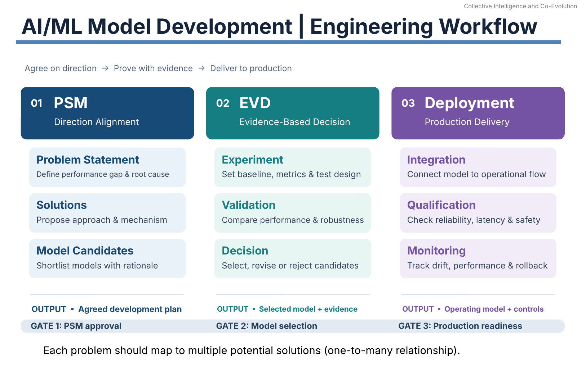

# AI/ML Model Development Engineering Workflow
Version 2 | Created: 2026-11-19 | Updated: 2026-11-19 17:59 CST

## 1. Purpose

**Problem Statement**: AI/ML model 개발 workflow 의 단계, 산출물, 관문이 글로 정리되어 있지 않다.

**Goal**:

- Workflow 의 세 단계와 단계별 작업, 산출물, 관문 (gate) 을 정리한다.
- 세 단계를 R&D 관리의 Plan, Develop, Review 에 대응시킨다.

**Non-Goal**: 특정 과제의 일정과 실측값은 다루지 않는다.

## 2. Summary

- AI/ML model 개발 workflow 는 PSM, EVD, Deployment 세 단계를 차례로 거쳐 방향을 합의하고, 근거로 model 을 고르고, 운영 환경에 배포한다.
- 단계마다 산출물이 하나씩 있고, 다음 단계로 넘어가려면 Gate 1, Gate 2, Gate 3 의 승인을 차례로 받는다.
- 문제 하나에는 해결책 후보를 여럿 둔다 (one-to-many relationship).
- R&D 관리에서 PSM 은 Plan 에, EVD 와 Deployment 는 Develop 에 들고, Review 는 배포 뒤의 결과 평가와 다음 계획 결정을 맡는다.

## 3. Workflow

Workflow 는 아래 Fig 1 이다.

Fig 1. AI/ML Model Development | Engineering Workflow

첫 단계 PSM (Problem Statement, Solutions, Model Candidates) 은 방향을 합의하고 (Direction Alignment), 둘째 단계 EVD (Evidence-Based Decision) 는 근거로 결정하며, 셋째 단계 Deployment 는 운영 환경에 넘긴다 (Production Delivery). 단계별 작업은 아래 Table 1 이다.

Table 1. Activities by stage

<table>
<tr><th align="center">Stage</th><th align="center">Activity</th><th align="center">Description</th></tr>
<tr><td align="center" rowspan="3">PSM</td><td align="center">Problem Statement</td><td align="center">성능 차이 (performance gap) 와 근본 원인 정의</td></tr>
<tr><td align="center">Solutions</td><td align="center">해결 접근법과 동작 원리 (mechanism) 제안</td></tr>
<tr><td align="center">Model Candidates</td><td align="center">근거를 붙인 model 후보 선정</td></tr>
<tr><td align="center" rowspan="3">EVD</td><td align="center">Experiment</td><td align="center">Baseline, metric, 시험 설계 결정</td></tr>
<tr><td align="center">Validation</td><td align="center">성능과 robustness 비교</td></tr>
<tr><td align="center">Decision</td><td align="center">후보의 선택, 수정, 기각</td></tr>
<tr><td align="center" rowspan="3">Deployment</td><td align="center">Integration</td><td align="center">Model 을 운영 흐름에 연결</td></tr>
<tr><td align="center">Qualification</td><td align="center">신뢰성, latency, 안전성 점검</td></tr>
<tr><td align="center">Monitoring</td><td align="center">Drift, 성능 추적과 rollback</td></tr>
</table>

PSM 의 Solutions 는 Problem Statement 하나에 해결책 후보를 여럿 둔다 (one-to-many relationship). 엔지니어가 칸을 채워 쓰는 PSM 표는 [Appendix B](#appendix-b-psm-table-example) 에 있다. 단계마다의 산출물과 관문은 아래 Table 2 이다.

Table 2. Outputs and gates by stage

| Stage      | Output                          | Gate                          |
| :--------: | :-----------------------------: | :---------------------------: |
| PSM        | 합의한 개발 계획                | Gate 1: PSM approval          |
| EVD        | 선정한 model 과 그 근거         | Gate 2: Model selection       |
| Deployment | 운영 중인 model 과 관리 수단    | Gate 3: Production readiness  |

## 4. R&D Management Cycle

R&D 관리의 세 단계와 단계별 주요 내용은 아래 Table 3 이다.

Table 3. R&D management stages

| R&D stage | Main content                                   |
| :-------: | :--------------------------------------------: |
| Plan      | 목표 설정, 문제 정의, 해결 방향 합의 (PSM)     |
| Develop   | 실험, 검증, 모델 선정 (EVD), Deployment        |
| Review    | 결과 평가, 피드백, 개선 방향 및 다음 계획 결정 |

Plan 은 PSM 하나에, Develop 은 EVD 와 Deployment 두 단계에 대응한다. 대응 관계와 단계별 관문은 아래 Table 4 이다.

Table 4. Mapping to workflow stages

<table>
<tr><th align="center">R&amp;D stage</th><th align="center">Workflow stage</th><th align="center">Gate</th></tr>
<tr><td align="center">Plan</td><td align="center">PSM</td><td align="center">Gate 1</td></tr>
<tr><td align="center" rowspan="2">Develop</td><td align="center">EVD</td><td align="center">Gate 2</td></tr>
<tr><td align="center">Deployment</td><td align="center">Gate 3</td></tr>
</table>

Review 는 Deployment 뒤에 결과를 평가하고 피드백을 모아 개선 방향과 다음 계획을 정하며, 그 결정이 다음 Plan 의 입력이 된다. Workflow 에는 Review 단계와 그 관문이 없으므로 Table 4 에 Review 행이 없다.

---

## Appendix A. Terminology

- **baseline**: 새 model 의 성능을 견줄 때 기준으로 쓰는 가장 단순한 model 이나 기존 방법의 성능이다.
- **drift**: 운영 중에 입력 데이터나 입력과 출력의 관계가 학습 때와 달라지는 현상이다.
- **gate**: 다음 단계로 넘어가기 전에 받아야 하는 승인이다.
- **latency**: 입력을 받은 뒤 model 이 출력을 내놓기까지 걸리는 시간이다.
- **robustness**: 입력에 잡음이나 분포 변화가 있어도 model 성능이 유지되는 정도이다.
- **rollback**: 배포한 model 에 문제가 생겼을 때 이전 판으로 되돌리는 것이다.

## Appendix B. PSM Table Example

PSM 단계에서 엔지니어가 채우는 표의 예시는 아래 Table 5 이다.

Table 5. PSM table example

<table>
<tr><th align="center">Item</th><th align="center">Field</th><th align="center">Example</th></tr>
<tr><td align="center" rowspan="3">Problem Statement</td><td align="center">Performance gap</td><td align="center">현재 성능 &lt;현재값&gt; 이 목표 &lt;목표값&gt; 에 못 미친다</td></tr>
<tr><td align="center">Root cause</td><td align="center">학습 데이터에 &lt;조건&gt; 의 표본이 적어 그 조건에서 오차가 크다</td></tr>
<tr><td align="center">Success criterion</td><td align="center">검증 데이터에서 &lt;metric&gt; 이 &lt;목표값&gt; 을 만족한다</td></tr>
<tr><td align="center" rowspan="2">Solution S1</td><td align="center">Approach</td><td align="center">&lt;조건&gt; 의 표본을 더 모아 다시 학습한다</td></tr>
<tr><td align="center">Mechanism</td><td align="center">부족한 조건의 표본이 늘면 그 조건의 오차가 줄어든다</td></tr>
<tr><td align="center" rowspan="2">Solution S2</td><td align="center">Approach</td><td align="center">&lt;입력 변수&gt; 를 입력에 더한다</td></tr>
<tr><td align="center">Mechanism</td><td align="center">&lt;입력 변수&gt; 가 root cause 의 변동을 설명한다</td></tr>
<tr><td align="center" rowspan="3">Model Candidate M1</td><td align="center">Model</td><td align="center">&lt;model 이름&gt;</td></tr>
<tr><td align="center">Solution</td><td align="center">S1</td></tr>
<tr><td align="center">Rationale</td><td align="center">&lt;조건&gt; 별 오차를 따로 볼 수 있다</td></tr>
<tr><td align="center" rowspan="3">Model Candidate M2</td><td align="center">Model</td><td align="center">&lt;model 이름&gt;</td></tr>
<tr><td align="center">Solution</td><td align="center">S2</td></tr>
<tr><td align="center">Rationale</td><td align="center">더한 입력 변수의 영향을 해석할 수 있다</td></tr>
<tr><td align="center" rowspan="3">Gate 1</td><td align="center">Approver</td><td align="center">&lt;이름&gt;</td></tr>
<tr><td align="center">Decision</td><td align="center">승인, 보류, 기각 가운데 하나</td></tr>
<tr><td align="center">Date</td><td align="center">&lt;YYYY-MM-DD&gt;</td></tr>
</table>

- Example 열의 문구는 예시이며, `<...>` 를 과제의 값으로 바꾸어 채운다.
- Solution 은 Problem Statement 하나에 둘 이상 둔다. 행이 모자라면 Solution S3 부터 같은 Field 로 행을 더한다.
- Model Candidate 의 Solution 칸에는 그 model 이 따르는 Solution 의 번호를 적는다.
- Gate 1 의 Decision 이 승인이면 이 표가 합의한 개발 계획이 되고, EVD 단계로 넘어간다.
