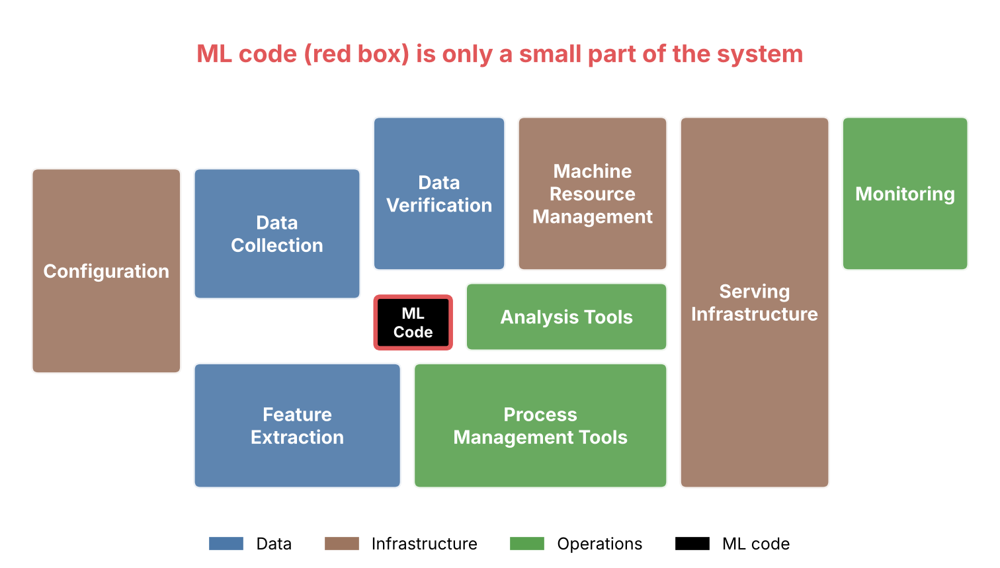

# Hidden Technical Debt in Machine Learning Systems
Version 2 | Created: 2026-11-01 | Updated: 2026-11-07 13:46 UTC

- [1. Problem and Motivation](#1-problem-and-motivation)
- [2. Architecture and Key Mechanisms](#2-architecture-and-key-mechanisms)
- [3. Experimental Setup](#3-experimental-setup)
- [4. Main Results and Ablation Studies](#4-main-results-and-ablation-studies)
- [5. Limitations and Critical Review](#5-limitations-and-critical-review)
- [6. Takeaways and Engineering Insights](#6-takeaways-and-engineering-insights)
- [Appendix A. Terminology](#appendix-a-terminology)

 

- **Authors**: D. Sculley, Gary Holt, Daniel Golovin, Eugene Davydov, Todd Phillips, Dietmar Ebner, Vinay Chaudhary, Michael Young, Jean-François Crespo, Dan Dennison (Google, Inc.)
- **Venue / Year**: NIPS (2015)
- **Link**: NeurIPS 2015 proceedings [[1](#ref-1)]
- **Code**: Not released
- **Read Date**: 2026-11-01

## 1. Problem and Motivation

- **What is the gap?**: ML system 은 만들고 배포하기는 빠르고 싸지만 유지하기는 어렵고 비싸다. Refactoring, unit test, dead code 삭제 같은 code 수준의 방법으로는 system 수준에 쌓이는 ML 고유의 부채를 줄이지 못한다.
- **Core Hypothesis**: ML system 은 일반 code 의 유지 문제에 더해, data 가 동작을 정하기 때문에 생기는 ML 고유의 부채를 지며, 이 부채는 system 수준에 쌓여 잘 드러나지 않는다.

## 2. Architecture and Key Mechanisms

- **Model Design**: 새 model 을 제안하지 않는 position paper 이며, ML 고유의 부채를 일곱 영역으로 나눈다 ([Table 1](#4-main-results-and-ablation-studies)).
- **Key Equations**: 논문에 수식이 없어 Appendix B 를 두지 않는다.
- **Pipeline / Flow**: 실제 ML system 에서 ML code 가 차지하는 비중은 Fig 1 이다.

Fig 1. Only a small fraction of a real-world ML system is ML code

가운데 빨간 테두리의 검은 상자가 ML code 이고, 나머지는 그 둘레의 data, infrastructure, 운영 구성 요소다. 상자의 배치와 이름은 논문의 Figure 1 과 같으며, 색은 세 분류를 구별하려고 리뷰어가 더했다.

## 3. Experimental Setup

- **Datasets**: 없음. 실험 대신 Google 의 운영 경험을 근거로 삼는다.
- **Baselines**: 없음.
- **Evaluation Metrics**: 없음. 논문은 technical debt 를 시간에 따라 추적할 엄밀한 지표가 없다고 밝힌다.

## 4. Main Results and Ablation Studies

- **Performance**: 정량 결과는 없다. 성숙한 system 은 ML code 가 많아야 5%, glue code 가 적어도 95% 일 수 있다고 본다.
- **Ablation Study**: 없음.
- **Qualitative / Quantitative Analysis**: 영역별 부채와 완화책은 Table 1 이다.

Table 1. ML-specific technical debt and mitigation

<table>
  <tr><th align="center">Area</th><th align="center">Debt</th><th align="center">Symptom</th><th align="center">Mitigation</th></tr>
  <tr><td align="center" rowspan="3">Boundary erosion</td><td align="center">Entanglement (CACE)</td><td align="center">입력 하나를 바꾸면 다른 feature 의 weight 가 모두 바뀜</td><td align="center">Model 분리, slice 별 metric 으로 변화 감지</td></tr>
  <tr><td align="center">Correction cascade</td><td align="center">기존 model 위에 보정 model 을 쌓아, 개별 개선이 system 을 나쁘게 만듦</td><td align="center">보정을 원 model 안에서 feature 로 학습</td></tr>
  <tr><td align="center">Undeclared consumer</td><td align="center">Model 출력을 알리지 않고 쓰는 system 과 숨은 결합</td><td align="center">Access control, SLA</td></tr>
  <tr><td align="center" rowspan="2">Data dependency</td><td align="center">Unstable data</td><td align="center">다른 system 이 만든 입력 signal 이 예고 없이 바뀜</td><td align="center">Signal 의 versioned copy</td></tr>
  <tr><td align="center">Underutilized data</td><td align="center">Legacy, bundled, ε, correlated feature 처럼 이득이 거의 없는 입력</td><td align="center">Leave-one-feature-out 평가로 정기 삭제</td></tr>
  <tr><td align="center">Feedback loop</td><td align="center">Direct, hidden</td><td align="center">Model 이 자기 학습 data 를 바꾸거나, 두 system 이 현실을 거쳐 서로를 바꿈</td><td align="center">일부 randomization, data 격리</td></tr>
  <tr><td align="center" rowspan="3">Anti-pattern</td><td align="center">Glue code, pipeline jungle</td><td align="center">범용 package 연결 code 와 얽힌 data 준비 단계</td><td align="center">공통 API 로 감싸기, data 수집과 feature 추출을 처음부터 설계</td></tr>
  <tr><td align="center">Dead experimental codepath</td><td align="center">실험 분기가 production code 에 남음 (Knight Capital, 45분에 4억 6,500만 달러 손실)</td><td align="center">쓰지 않는 분기를 정기 삭제</td></tr>
  <tr><td align="center">Abstraction debt, smells</td><td align="center">강한 abstraction 부재, plain-old-data type, 여러 언어, prototype 의 운영 전용</td><td align="center">Model, data, prediction 의 interface 정의</td></tr>
  <tr><td align="center">Configuration</td><td align="center">Configuration debt</td><td align="center">설정 줄 수가 code 를 넘고, 줄마다 오류 가능성</td><td align="center">설정의 code review, diff, 자동 검증</td></tr>
  <tr><td align="center" rowspan="2">External world</td><td align="center">Fixed threshold</td><td align="center">Model 이 바뀌어도 손으로 정한 threshold 가 남음</td><td align="center">Validation data 로 threshold 학습</td></tr>
  <tr><td align="center">Monitoring and testing</td><td align="center">Unit test 와 end-to-end test 만으로는 변하는 현실에서 동작을 보증하지 못함</td><td align="center">Prediction bias, action limit, up-stream producer 의 실시간 감시와 자동 대응</td></tr>
  <tr><td align="center">Other</td><td align="center">Data testing, reproducibility, process management, culture</td><td align="center">입력 data 검증 부재, 재현 불가, 수작업 운영, 정확도만 보상하는 문화</td><td align="center">Data test, 운영 자동화, 연구와 engineering 을 한 팀에 둠</td></tr>
</table>

## 5. Limitations and Critical Review

- **Computational Cost**: 실험이 없어 연산량이나 학습 시간을 보고하지 않았다.
- **Assumptions and Constraints**: 논문은 technical debt 가 비유일 뿐 엄밀한 지표가 아니라고 밝힌다. 리뷰어의 분석으로는, 근거가 Google 내부 경험이어서 다른 조직에서의 부채 크기는 확인되지 않았다.

## 6. Takeaways and Engineering Insights

- **What can I use?**: 논문의 부채 점검 질문 다섯 가지.
  - 완전히 새로운 algorithm 을 전체 규모에서 얼마나 쉽게 시험할 수 있는가
  - 모든 data 의존성의 transitive closure 를 아는가
  - 새 변경의 영향을 얼마나 정확히 잴 수 있는가
  - Model 이나 signal 하나를 개선하면 다른 것이 나빠지는가
  - 새 팀원이 얼마나 빨리 일할 수 있게 되는가
- **Implementation Notes**: 정확도를 조금 올리려고 system 복잡도를 크게 늘리는 선택은 피한다. Feature 삭제, 복잡도 감소, 재현성, monitoring 개선을 정확도 개선과 같게 보상해야 부채가 줄어든다.

## References

[1] Sculley, D., Holt, G., Golovin, D., Davydov, E., Phillips, T., Ebner, D., Chaudhary, V., Young, M., Crespo, J.-F., & Dennison, D. (2015). Hidden Technical Debt in Machine Learning Systems. *Advances in Neural Information Processing Systems 28 (NIPS 2015)*.

---

## Appendix A. Terminology

- **CACE**: Changing Anything Changes Everything. 입력이나 설정 하나를 바꾸면 model 전체의 동작이 바뀌는 성질.
- **Glue code**: 범용 ML package 에 data 를 넣고 꺼내려고 그 둘레에 쓰는 연결 code.
- **Pipeline jungle**: 수집, join, sampling 단계와 중간 파일이 계획 없이 덧붙어 얽힌 data 준비 pipeline.
- **Position paper**: 새 방법이나 실험 대신 문제 제기와 주장을 내놓는 논문.
- **SLA**: 서비스가 지킬 수준을 정한 약속 (service-level agreement).
- **Technical debt**: 빨리 만들려고 미룬 정리 작업이 뒤에 유지 비용으로 돌아오는 것.
- **Transitive closure**: 직접 의존하는 data 와, 그 data 가 다시 의존하는 data 를 모두 모은 집합.
