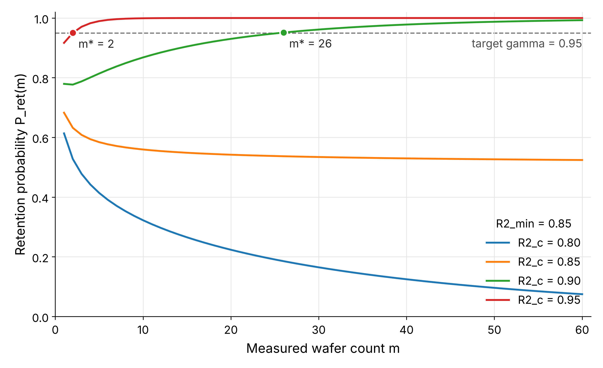

# R2 Retention Probability
Version 26 | Created: 2026-11-05 | Updated: 2026-11-08 07:04 UTC

- [1. Purpose](#1-purpose)
- [2. Summary](#2-summary)
- [3. Notation](#3-notation)
- [4. Definitions](#4-definitions)
- [5. Interpretation](#5-interpretation)
  - [5.1 Assumptions](#51-assumptions)
  - [5.2 Measured Count and Interval](#52-measured-count-and-interval)
- [6. Worked Example](#6-worked-example)
  - [6.1 Retention Probability by Measured Count](#61-retention-probability-by-measured-count)
  - [6.2 Measured Count and Interval](#62-measured-count-and-interval)
  - [6.3 Condition Comparison](#63-condition-comparison)
- [7. Application](#7-application)
  - [7.1 Calculation Script](#71-calculation-script)
  - [7.2 Breaking Conditions](#72-breaking-conditions)
- [Appendix A. Terminology](#appendix-a-terminology)
- [Appendix B. Derivation](#appendix-b-derivation)

## 1. Purpose

- **Problem Statement**: 반도체 증착 공정을 진행하면서 주기적으로 일부 wafer 에서 두께를 측정하면, 실측과 예측의 비교를 통해 예측값의 R² 를 동적으로 추출할 수 있고, 측정하지 않은 wafer 에 대한 예측값의 정확도를 알 수 있다. 그러나 예측값의 정확도를 검증하는 데 필요한 measurement interval 이나 측정 wafer 수를 계산하는 방법은 없다.
- **Goal**: model 의 R² 예측값 $R^2_c$ 로 유지 확률 $P_{\mathrm{ret}}(m)$ 을 구하고, 그 유지 확률로부터 wafer measurement count $m^{\ast}$ 와 measurement interval $T^{\ast}$ 를 구하는 수학 model 을 제시한다.
- **Non-Goal**: 두께 예측 model 을 만들거나 고르는 방법은 다루지 않는다.

## 2. Summary

유지 확률 $P_{\mathrm{ret}}(m)$ 은 실측 wafer $m$ 장의 예측 오차로 계산한 실측 R² 가 최저 R² $R^2_{\min}$ 이상일 확률이며, 자유도 $m$ 인 카이제곱 분포로 $m = 1$ 부터 계산된다.
$P_{\mathrm{ret}}(m)$ 이 목표 유지 확률 $\gamma$ 이상이 되는 가장 작은 $m$ 이 wafer measurement count $m^{\ast}$ 이고, measurement interval 은 $T^{\ast} = N/m^{\ast}$ 이다.
$m^{\ast}$ 는 $(1 - R^2_{\min})/(1 - R^2_c)$ 와 $\gamma$ 로 정해지며, 이 비가 클수록, $\gamma$ 가 낮을수록 줄어든다.

## 3. Notation

Table 1. Symbols

|           Symbol            |                          Meaning                           |  Shape  |                Assumption                 |
| :-------------------------: | :--------------------------------------------------------: | :-----: | :---------------------------------------: |
|             $N$             |            한 lot 또는 한 기간의 전체 wafer 수             | integer |                 $N \ge 1$                 |
|             $m$             |            실측 wafer 수. 예측 wafer 수는 $N-m$            | integer |              $1 \le m \le N$              |
|             $r$             |                      실측 wafer 비율                       | scalar  |              $0 \lt r \le 1$              |
|          $y_{m,i}$          |              $i$ 번째 실측 wafer 의 실측 두께              | scalar  |                     -                     |
|          $y_{c,i}$          |        $i$ 번째 실측 wafer 에 대한 model 예측 두께         | scalar  |                     -                     |
|            $e_i$            |  $i$ 번째 실측 wafer 의 예측 오차 $y_{m,i} - y_{c,i}$  | scalar  |                     -                     |
|           $s^2_m$           |           실측 wafer $m$ 장의 예측 오차 제곱 평균          | scalar  |                     -                     |
|        $\sigma^2_y$         |     전체 두께 분산. 과거 실측으로 정한 wafer 사이 두께 분산     | scalar  |           $\sigma^2_y \gt 0$            |
|        $\sigma^2_e$         |   예측 오차 분산의 참값. $\sigma_e$ 는 그 제곱근   | scalar  |           $\sigma^2_e \gt 0$            |
|           $R^2_m$           |   실측 R². 실측 wafer $m$ 장의 예측 오차로 계산한 R²   | scalar  |                     -                     |
|            $R^2$            |   참값 R². 측정하지 않은 wafer 를 포함한 전체 wafer 의 R²   | scalar  |                     -                     |
|           $R^2_c$           |   model 의 R² 예측값. model 이 과거 실측으로 계산해 둔 값    | scalar  |            $0 \lt R^2_c \lt 1$            |
|        $R^2_{\min}$         |                    유지해야 할 최저 R²                     | scalar  |          $R^2_{\min} \lt 1$          |
|          $\Delta$           |               허용 여유 $R^2_c - R^2_{\min}$               | scalar  |                     -                     |
|          $\alpha$           |        $R^2_m \lt R^2_{\min}$ 이 될 허용 확률        | scalar  |         $0 \lt \alpha \lt 1$          |
|          $\gamma$           |           목표 유지 확률. $\gamma = 1 - \alpha$            | scalar  |         $0 \lt \gamma \lt 1$          |
|         $P(\cdot)$          |                            확률                            | scalar  |                     -                     |
|    $P_{\mathrm{ret}}(m)$    |       유지 확률. $R^2_m \ge R^2_{\min}$ 이 될 확률       | scalar  |     $0 \le P_{\mathrm{ret}}(m) \le 1$     |
|         $\chi^2_m$          |              자유도 $m$ 인 카이제곱 분포               |    -    |                     -                     |
| $F_{\chi^2_m}(\cdot)$ |             $\chi^2_m$ 의 누적분포함수             | scalar  |                     -                     |
|         $m^{\ast}$          |        wafer measurement count. 최소 실측 wafer 수         | integer |                     -                     |
|         $r^{\ast}$          |                       최소 실측 비율                       | scalar  |                     -                     |
|         $T^{\ast}$          | Measurement interval. 실측 wafer 한 장당 공정을 거치는 wafer 수 | scalar  |             $T^{\ast} \ge 1$              |

R² 와 두께의 아래첨자는 그 값을 무엇으로 구했는지를 나타낸다. $m$ 은 measured 로 실측 두께로 구한 값을, $c$ 는 calculated by model 로 model 이 계산해 둔 값을 뜻한다. $\min$ 은 유지해야 할 최저값을, $\mathrm{ret}$ 은 retention 을, $y$ 와 $e$ 는 두께와 예측 오차를 뜻한다. 목표 유지 확률은 허용 확률 $\alpha$ 를 1 에서 뺀 값 $\gamma = 1 - \alpha$ 하나로 적는다.

- $\sum$: 영어로 "sum", 한국어로 "합" 이라 읽는다.
- $\chi^2_m$: 영어로 "chi-square with m degrees of freedom", 한국어로 "자유도 엠인 카이제곱" 이라 읽는다.
- $\sim$: 영어로 "is distributed as", 한국어로 "분포를 따른다" 라 읽는다.
- $\{ m \mid \cdot \}$: 영어로 "the set of m such that", 한국어로 "조건을 만족하는 m 의 집합" 이라 읽는다.
- $m^{\ast}$: 영어로 "m star", 한국어로 "엠 스타" 라 읽는다.

## 4. Definitions

> **Definition: Prediction error**<br>
> 예측 오차 $e_i$ 는 $i$ 번째 실측 wafer 의 실측 두께 $y_{m,i}$ 에서 model 예측 두께 $y_{c,i}$ 를 뺀 값이다.

> **Definition: Measured R2**<br>
> 실측 R² $R^2_m$ 은 1 에서, 실측 wafer $m$ 장의 예측 오차 제곱 평균 $s^2_m$ 을 과거 실측으로 정한 전체 두께 분산 $\sigma^2_y$ 로 나눈 값을 뺀 값이다.

> **Definition: True R2**<br>
> 참값 R² $R^2$ 은 1 에서, 측정하지 않은 wafer 를 포함한 전체 wafer 의 예측 오차 분산 $\sigma^2_e$ 를 전체 두께 분산 $\sigma^2_y$ 로 나눈 값을 뺀 값이다.

> **Definition: Measured ratio**<br>
> 실측 비율 $r$ 은 전체 wafer $N$ 장 가운데 실측한 wafer $m$ 장이 차지하는 비율이다.

> **Definition: Retention probability**<br>
> 유지 확률 $P_{\mathrm{ret}}(m)$ 은 실측 wafer $m$ 장으로 계산한 실측 R² $R^2_m$ 이 최저 R² $R^2_{\min}$ 이상일 확률이다.

> **Definition: Minimum measured ratio**<br>
> 최소 실측 비율 $r^{\ast}$ 는 유지 확률 $P_{\mathrm{ret}}(m)$ 이 목표 유지 확률 $\gamma$ 이상이 되는 실측 비율 $r$ 가운데 가장 작은 값이고, 그때의 실측 wafer 수가 wafer measurement count $m^{\ast}$ 이다.

> **Definition: Measurement interval**<br>
> Measurement interval $T^{\ast}$ 는 최소 실측 비율 $r^{\ast}$ 로 실측할 때 실측 wafer 한 장당 공정을 거치는 wafer 수의 평균이며, $r^{\ast}$ 의 역수이다.

여덟 정의 식은 아래 식 (1) 부터 식 (8) 이다. Problem Statement 의 측정 wafer 수는 wafer measurement count $m^{\ast}$ 이고, measurement interval 은 식 (8) 의 $T^{\ast}$ 이다.

```math
e_i = y_{m,i} - y_{c,i}
\hspace{19em} (1)
```

```math
s^2_m = \frac{1}{m} \sum_{i=1}^{m} e_i^2
\hspace{19em} (2)
```

```math
R^2_m = 1 - \frac{s^2_m}{\sigma^2_y}
\hspace{19em} (3)
```

```math
R^2 = 1 - \frac{\sigma^2_e}{\sigma^2_y}
\hspace{19em} (4)
```

```math
r = \frac{m}{N}
\hspace{19em} (5)
```

```math
P_{\mathrm{ret}}(m) = P\left( R^2_m \ge R^2_{\min} \right)
\hspace{19em} (6)
```

```math
r^{\ast} = \min \left\{ r = \frac{m}{N} \;\middle|\; P_{\mathrm{ret}}(m) \ge \gamma \right\}
\hspace{19em} (7)
```

```math
T^{\ast} = \frac{1}{r^{\ast}}
\hspace{19em} (8)
```

- 식 (3) 의 분모는 실측 wafer $m$ 장 안에서 계산하지 않고 과거 실측으로 정한 $\sigma^2_y$ 를 쓴다. 그래서 $m = 1$ 이어도 $R^2_m$ 이 정해진다.
- 실측 wafer 가 바뀌면 $s^2_m$ 이 바뀌므로, model 이 같아도 $R^2_m$ 은 참값 $R^2$ 주위에서 변동한다.

## 5. Interpretation

식 (6) 의 유지 확률은 식 (9) 로 계산하며, 이 문서는 식 (9) 를 R2 retention probability 식이라 부른다.

```math
P_{\mathrm{ret}}(m) = F_{\chi^2_m}\left( m\, \frac{1 - R^2_{\min}}{1 - R^2_c} \right)
\hspace{19em} (9)
```

식 (9) 의 분자 $1 - R^2_{\min}$ 은 허용하는 예측 오차의 몫이고, 분모 $1 - R^2_c$ 는 model 이 예상하는 예측 오차의 몫이다. 전체 두께 분산 $\sigma^2_y$ 는 유도 중에 약분되어 식 (9) 에 남지 않는다. 식 (9) 는 정규 근사를 쓰지 않으므로 $m = 1$ 부터 성립하며, 유도는 [Appendix B](#appendix-b-derivation) 에 있다.

### 5.1 Assumptions

식 (9) 는 아래 네 가정 (assumption) 에서 성립한다. Appendix B 는 이 가정을 번호로 부른다.

- **가정 1**: wafer 마다의 예측 오차 $e_i$ 는 서로 독립이고 평균 0, 분산 $\sigma^2_e$ 인 정규분포를 따른다.
- **가정 2**: 전체 두께 분산 $\sigma^2_y$ 는 과거 실측으로 알고 있고, 계산하는 기간 동안 변하지 않는다. 식 (3) 으로 $R^2_m$ 을 계산할 때 쓰인다.
- **가정 3**: 참값 $R^2$ 은 알 수 없으므로, 측정 wafer 수를 미리 계산할 때는 그 대신 model 의 R² 예측값 $R^2_c$ 를 넣는다. 곧 식 (4) 에서 예측 오차 분산을 $\sigma^2_e = (1 - R^2_c)\, \sigma^2_y$ 로 둔다.
- **가정 4**: 실측 wafer 는 전체 wafer 에서 치우치지 않게 고른다.

네 가정에는 실측 wafer 수에 대한 조건이 없다. 가정 3 은 계산에 넣는 값을 정할 뿐이므로, 실제 예측 오차가 $R^2_c$ 로 예상한 것보다 크면 실제 유지 확률은 식 (9) 의 값보다 낮다.

### 5.2 Measured Count and Interval

wafer measurement count 는 식 (9) 의 유지 확률이 목표 유지 확률 $\gamma$ 이상이 되는 가장 작은 $m$ 이며, 식 (10) 이다. 최소 실측 비율과 measurement interval 은 식 (10) 의 $m^{\ast}$ 를 식 (5) 와 식 (8) 에 넣은 식 (11) 과 식 (12) 이다.

```math
m^{\ast} = \min \left\{ m \in \{1, \dots, N\} \;\middle|\; F_{\chi^2_m}\left( m\, \frac{1 - R^2_{\min}}{1 - R^2_c} \right) \ge \gamma \right\}
\hspace{19em} (10)
```

```math
r^{\ast} = \frac{m^{\ast}}{N}
\hspace{19em} (11)
```

```math
T^{\ast} = \frac{N}{m^{\ast}}
\hspace{19em} (12)
```

- 식 (10) 에는 닫힌 꼴이 없어, $m = 1$ 부터 하나씩 늘리며 식 (9) 를 계산해 처음으로 $\gamma$ 이상이 되는 $m$ 을 고른다.
- 식 (9) 의 유지 확률은 $m$ 이 작을 때 늘 커지지는 않는다. 6.1 의 예에서 $m = 1$ 은 0.779, $m = 2$ 는 0.777 이다.
- $m^{\ast}$ 는 $N$ 에 따라 달라지지 않는다. $N$ 은 $m^{\ast} \le N$ 인지만 가리고, 그보다 크면 그 lot 에서는 목표 유지 확률을 채울 수 없다.

$m^{\ast}$ 는 model 의 실제 정확도가 R² 예측값 $R^2_c$ 와 같을 때, 실측 R² $R^2_m$ 이 우연히 $R^2_{\min}$ 아래로 내려갈 확률을 허용 확률 $\alpha$ 이하로 낮추는 가장 적은 실측 wafer 수이다. 실측 wafer 수에 따라 아래처럼 달라지며, 숫자는 6.1 의 예 ($R^2_c = 0.90$, $R^2_{\min} = 0.85$, $\gamma = 0.95$) 이다.

- $m \lt m^{\ast}$: 유지 확률이 $\gamma$ 보다 낮다. Model 이 $R^2_c$ 만큼 정확해도 $R^2_m$ 이 $R^2_{\min}$ 아래로 내려가, model 이 정확도를 잃었다고 잘못 판단할 확률이 $\alpha$ 보다 크다. $m = 10$ 이면 잘못 판단할 확률은 $1 - 0.868 = 0.132$ 이다.
- $m = m^{\ast}$: 잘못 판단할 확률이 처음으로 $\alpha$ 이하가 된다. $m = 26$ 이면 $1 - 0.951 = 0.049$ 이다.
- $m \gt m^{\ast}$: 유지 확률이 더 커져 잘못 판단할 확률이 더 줄지만, 실측 wafer 가 늘고 measurement interval $N/m$ 이 짧아진다. $m = 40$ 이면 잘못 판단할 확률은 $1 - 0.978 = 0.022$ 이다.

$R^2_c \le R^2_{\min}$ 이면 식 (9) 의 비가 1 이하가 되어, $m$ 이 클수록 유지 확률이 오히려 줄고 $\gamma = 0.95$ 같은 목표에 닿지 않는다.

## 6. Worked Example

### 6.1 Retention Probability by Measured Count

$R^2_c = 0.90$, $R^2_{\min} = 0.85$ 이면 식 (9) 의 비는 $0.15 / 0.10 = 1.5$ 이고, $m$ 마다 계산하면 아래 Table 2 이다.

Table 2. Retention probability by measured count

|  m  | Argument 1.5 m | P_ret(m) | Meets gamma = 0.95 |
| :-: | :------------: | :------: | :----------------: |
|  1  |      1.5       |  0.779   |         No         |
|  2  |      3.0       |  0.777   |         No         |
|  5  |      7.5       |  0.814   |         No         |
| 10  |      15.0      |  0.868   |         No         |
| 20  |      30.0      |  0.930   |         No         |
| 25  |      37.5      |  0.948   |         No         |
| 26  |      39.0      |  0.951   |        Yes         |
| 40  |      60.0      |  0.978   |        Yes         |
| 60  |      90.0      |  0.993   |        Yes         |

`Argument 1.5 m` 은 식 (9) 에서 $F_{\chi^2_m}$ 에 넣는 값이다. 실측 wafer 한 장만으로도 유지 확률은 0.779 이고, 0.95 이상이 되는 가장 작은 $m$ 은 26 이다.

$R^2_{\min} = 0.85$ 로 두고 $R^2_c$ 를 0.80, 0.85, 0.90, 0.95 로 바꾸어 식 (9) 를 $m = 1$ 부터 60 까지 그리면 아래 Fig 1 이다.



Fig 1. Retention probability by measured wafer count

- 가로축은 실측 wafer 수 $m$, 세로축은 식 (9) 의 유지 확률 $P_{\mathrm{ret}}(m)$ 을 0.4 부터 선형 눈금으로 그린 것이고, 점선은 목표 유지 확률 $\gamma = 0.95$ 이다.
- 식 (9) 에는 전체 wafer 수 $N$ 이 없어, 곡선은 $N$ 과 관계없이 같다. 다만 $m^{\ast}$ 는 $N \ge m^{\ast}$ 인 lot 에서만 실측할 수 있다.
- 곡선이 점선에 처음 닿는 점이 $m^{\ast}$ 이며, 그보다 적거나 많을 때의 뜻은 [5.2](#52-measured-count-and-interval) 에 있다. $R^2_c = 0.95$ 에서 2, $R^2_c = 0.90$ 에서 26 이다.
- $R^2_c \gt R^2_{\min}$ 인 두 곡선은 $m$ 이 늘수록 1 에 다가가고, $m = 1$ 에서도 0.917 과 0.779 이다.
- $R^2_c = R^2_{\min}$ 인 곡선은 $m = 1$ 의 0.683 에서 $m = 60$ 의 0.524 로 내려가 0.5 에 다가가고, $R^2_c \lt R^2_{\min}$ 인 곡선은 0.614 에서 내려가 $m = 6$ 에서 0.391 로 그림의 아래 끝을 벗어나고, $m = 60$ 에서 0.075 이다. 그림 밖의 값은 `fig1-retention-probability.csv` 에 있다. 두 곡선은 $\gamma$ 에 닿지 않는다.

### 6.2 Measured Count and Interval

같은 조건에 $\gamma = 0.95$, $N = 100$ 을 더해 식 (10) 부터 식 (12) 를 계산한다.

1. Table 2 에서 $P_{\mathrm{ret}}(25) = 0.948 \lt 0.95 \le P_{\mathrm{ret}}(26) = 0.951$ 이므로 $m^{\ast} = 26$
2. $r^{\ast} = 26/100 = 0.26$
3. $T^{\ast} = 100/26 = 3.85$ 이므로, wafer 평균 3.85 장마다 한 장을 실측한다.

### 6.3 Condition Comparison

조건별 $m^{\ast}$ 와 $r^{\ast}$ 는 아래 Table 3 과 Table 4 이다. Cell 은 `m* (r*)` 이고, `-` 는 $N = 100$ 장 안에서 목표 유지 확률에 닿지 않는 경우이다. 각 cell 의 measurement interval $T^{\ast}$ 는 괄호 안 $r^{\ast}$ 의 역수이다.

Table 3. Measured count by model R2 and margin, N = 100, gamma = 95 %

| R2_c | Margin = 0.03 | Margin = 0.05 | Margin = 0.10 |
| :--: | :-----------: | :-----------: | :-----------: |
| 0.80 |       -       |   96 (0.96)   |   26 (0.26)   |
| 0.85 |       -       |   55 (0.55)   |   15 (0.15)   |
| 0.90 |   68 (0.68)   |   26 (0.26)   |    8 (0.08)   |
| 0.95 |   19 (0.19)   |    8 (0.08)   |    2 (0.02)   |

허용 여유를 0.05 에서 0.10 으로 넓히면 $R^2_c = 0.80$ 에서 $m^{\ast}$ 가 96 에서 26 으로 줄어든다.

Table 4. Measured count by retention probability, N = 100, margin = 0.05

| R2_c |    90 %    |    95 %    |    99 %    |
| :--: | :--------: | :--------: | :--------: |
| 0.80 | 56 (0.56)  | 96 (0.96)  |     -      |
| 0.85 | 32 (0.32)  | 55 (0.55)  |     -      |
| 0.90 | 15 (0.15)  | 26 (0.26)  | 55 (0.55)  |
| 0.95 |  4 (0.04)  |  8 (0.08)  | 16 (0.16)  |

목표 유지 확률을 95 % 에서 99 % 로 올리면 $R^2_c = 0.90$ 에서 $m^{\ast}$ 가 26 에서 55 로 늘어난다.

## 7. Application

### 7.1 Calculation Script

식 (3), 식 (9) 부터 식 (11) 을 계산하는 Python script 는 [src/r2_sampling_ratio.py](src/r2_sampling_ratio.py) 이다.

- `estimate_r2(measured=..., predicted=..., thickness_variance=...)`: 식 (3) 의 $R^2_m$
- `retention_probability(r2_model=..., r2_min=..., measured=...)`: 식 (9) 의 $P_{\mathrm{ret}}(m)$
- `required_measured(r2_model=..., r2_min=..., confidence=..., total_wafers=...)`: 식 (10) 과 식 (11) 의 $m^{\ast}$, $r^{\ast}$
- `build_table(...)`: 여러 조건의 $m^{\ast}$, $r^{\ast}$ 를 한 표로 계산

식 (12) 의 measurement interval 은 결과 열 `ratio` 의 역수로 구한다. 허용 여유는 `--margin` 으로 $\Delta$ 를 주거나 `--r2-min` 으로 $R^2_{\min}$ 을 직접 주며, 둘을 함께 주면 오류로 끝난다. Table 3 은 아래 명령으로 계산한다.

```bash
python src/r2_sampling_ratio.py --r2-model 0.80 0.85 0.90 0.95 --margin 0.03 0.05 0.10 --total-wafers 100 --confidence 0.95
```

`--output-folder <FOLDER>` 를 주면 결과를 `<FOLDER>/r2_sampling_ratio.csv` 로 저장한다. 열은 `total_wafers`, `r2_model`, `r2_min`, `confidence`, `measured`, `retention`, `ratio` 이다. 목표 유지 확률에 닿지 않는 조건은 `measured` 가 비어 있다.

Fig 1 은 [src/r2_retention_chart.py](src/r2_retention_chart.py) 로 그린다. 같은 folder 의 `r2_sampling_ratio.py` 에서 식 (9) 와 식 (10) 을 불러 곡선과 $m^{\ast}$ 를 계산하고, 그림과 곡선의 값을 `--output-folder` 에 `fig1-retention-probability.png` 와 `fig1-retention-probability.csv` 로 저장한다.

```bash
python src/r2_retention_chart.py --r2-model 0.80 0.85 0.90 0.95 --r2-min 0.85 --confidence 0.95 --max-measured 60 --output-folder r2-retention-probability-ko_fig
```

### 7.2 Breaking Conditions

- 예측 오차의 평균이 0 이 아님 (bias): 가정 1 이 깨져 $s^2_m$ 이 커지므로, 실제 유지 확률은 식 (9) 의 값보다 낮다.
- 예측 오차가 wafer 사이에서 서로 이어짐: 가정 1 의 독립이 깨져, 같은 $m$ 이 담는 정보가 줄고 식 (9) 의 유지 확률이 실제보다 높다.
- 전체 두께 분산이 바뀜: 가정 2 가 깨져 식 (3) 의 $R^2_m$ 이 실제 정확도와 어긋난다. $\sigma^2_y$ 는 최근 실측으로 다시 정한다.
- 실제 정확도가 $R^2_c$ 보다 낮음: 가정 3 으로 넣은 값이 틀려, 식 (10) 의 $m^{\ast}$ 에서 실제 유지 확률이 $\gamma$ 보다 낮다. $R^2_c$ 는 최근 실측으로 다시 정한다.

---

## Appendix A. Terminology

- **bias**: 예측 두께의 평균이 실측 두께의 평균에서 벗어난 양. 이 문서에서는 예측 오차의 평균이 0 이 아닌 것이다.
- **R² (coefficient of determination)**: 1 에서 예측 오차 분산을 두께 분산으로 나눈 값을 뺀 정확도 지표.
- **누적분포함수 (cumulative distribution function, CDF)**: 확률변수가 주어진 값 이하일 확률을 그 값의 함수로 나타낸 것.
- **자유도 (degrees of freedom)**: 카이제곱 분포에서 더하는 표준정규 확률변수 제곱의 개수.
- **카이제곱 분포 (chi-square distribution)**: 서로 독립인 표준정규 확률변수 여럿의 제곱을 더한 값이 따르는 분포.

## Appendix B. Derivation

식 (6) 의 유지 확률을 식 (3) 과 [5.1](#51-assumptions) 의 가정으로 풀어 식 (9) 를 구한다.

```math
P_{\mathrm{ret}}(m) = P\left( s^2_m \le (1 - R^2_{\min})\, \sigma^2_y \right)
\hspace{19em} (13)
```

- 식 (13): 식 (6) 에 식 (3) 을 넣으면 $1 - s^2_m / \sigma^2_y \ge R^2_{\min}$ 이고, 가정 2 의 $\sigma^2_y \gt 0$ 을 양변에 곱해 $s^2_m$ 에 대해 정리한다.

```math
P_{\mathrm{ret}}(m) = P\left( \frac{m\, s^2_m}{\sigma^2_e} \le m\, \frac{(1 - R^2_{\min})\, \sigma^2_y}{\sigma^2_e} \right)
\hspace{19em} (14)
```

- 식 (14): 식 (13) 의 부등식 양변에 양수 $m / \sigma^2_e$ 를 곱한다. 부등호의 방향은 바뀌지 않는다.

```math
\frac{m\, s^2_m}{\sigma^2_e} = \sum_{i=1}^{m} \left( \frac{e_i}{\sigma_e} \right)^2 \sim \chi^2_m
\hspace{19em} (15)
```

- 식 (15): 식 (2) 에 따라 $m\, s^2_m$ 은 $e_i^2$ 의 합이다. 가정 1 에서 $e_i / \sigma_e$ 는 서로 독립인 표준정규 확률변수이므로, 그 제곱 $m$ 개의 합은 자유도 $m$ 인 카이제곱 분포를 따른다.

```math
P_{\mathrm{ret}}(m) = F_{\chi^2_m}\left( m\, \frac{(1 - R^2_{\min})\, \sigma^2_y}{\sigma^2_e} \right)
\hspace{19em} (16)
```

- 식 (16): 식 (14) 의 왼쪽은 식 (15) 에 따라 $\chi^2_m$ 을 따르므로, 그 값이 오른쪽 이하일 확률은 누적분포함수 $F_{\chi^2_m}$ 의 값이다.

```math
\sigma^2_e = (1 - R^2_c)\, \sigma^2_y
\hspace{19em} (17)
```

- 식 (17): 식 (4) 를 $\sigma^2_e$ 에 대해 풀면 $\sigma^2_e = (1 - R^2)\, \sigma^2_y$ 이고, 가정 3 에 따라 참값 $R^2$ 대신 $R^2_c$ 를 넣는다.

```math
P_{\mathrm{ret}}(m) = F_{\chi^2_m}\left( m\, \frac{1 - R^2_{\min}}{1 - R^2_c} \right)
\hspace{19em} (18)
```

- 식 (18): 식 (16) 에 식 (17) 을 넣으면 $\sigma^2_y$ 가 분자와 분모에서 약분된다.

따라서 식 (9) 가 성립한다.

```math
P_{\mathrm{ret}}(m) = F_{\chi^2_m}\left( m\, \frac{1 - R^2_{\min}}{1 - R^2_c} \right)
\hspace{19em} (9)
```
