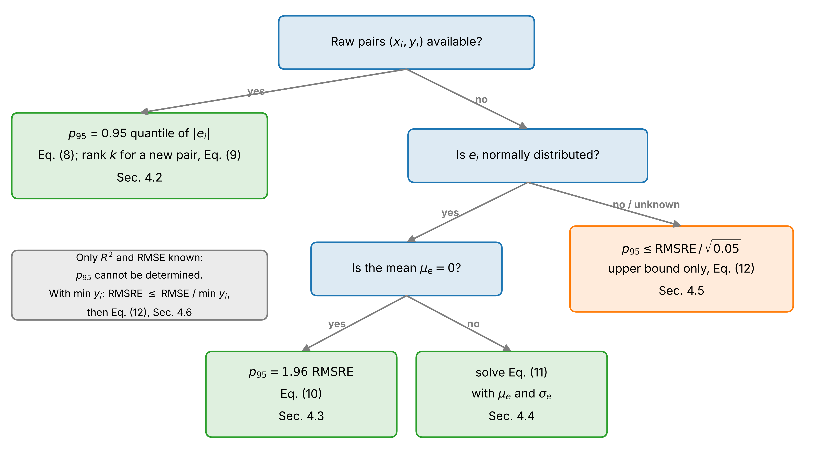
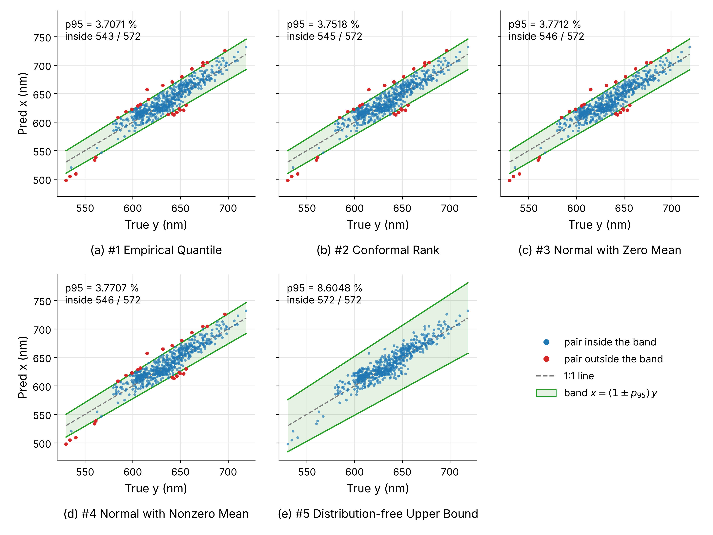
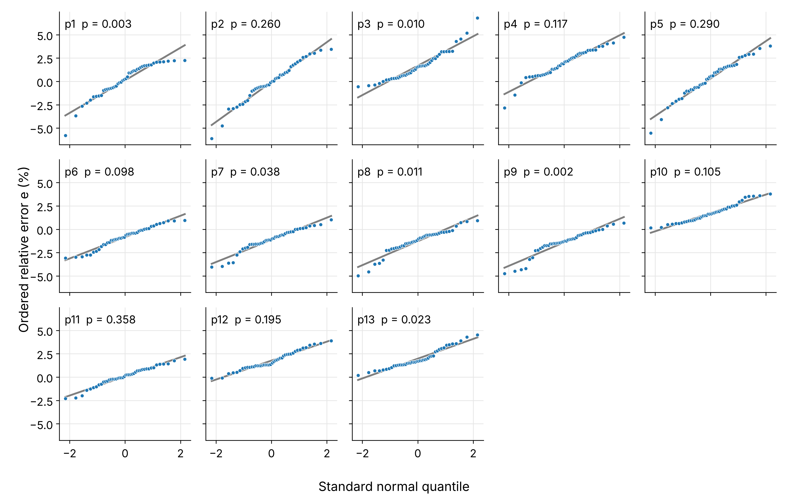

# Relative Error Band on the 1:1 Line
Version 51 | Created: 2026-11-16 | Updated: 2026-11-16 22:41 UTC

- [1. Purpose](#1-purpose)
- [2. Summary](#2-summary)
- [3. Notation](#3-notation)
- [4. Principle](#4-principle)
    - [4.1 Relative Error Band](#41-relative-error-band)
    - [4.2 With Raw Data](#42-with-raw-data)
    - [4.3 Without Raw Data: Normal with Zero Mean](#43-without-raw-data-normal-with-zero-mean)
    - [4.4 Without Raw Data: Normal with Nonzero Mean](#44-without-raw-data-normal-with-nonzero-mean)
    - [4.5 Without Raw Data: Distribution-free Upper Bound](#45-without-raw-data-distribution-free-upper-bound)
    - [4.6 Relation to R2 and RMSE](#46-relation-to-r2-and-rmse)
- [5. Worked Example](#5-worked-example)
    - [5.1 Data](#51-data)
    - [5.2 Relative Error](#52-relative-error)
    - [5.3 p95 by Method](#53-p95-by-method)
    - [5.4 R2 and RMSE](#54-r2-and-rmse)
    - [5.5 Calculation Script](#55-calculation-script)
- [6. Application](#6-application)
    - [6.1 Conditions](#61-conditions)
    - [6.2 Limitations](#62-limitations)
- [References](#references)
- [Appendix A. Terminology](#appendix-a-terminology)
- [Appendix B. Normality of Relative Error](#appendix-b-normality-of-relative-error)
- [Appendix C. Significance Level and p-value](#appendix-c-significance-level-and-p-value)

## 1. Purpose

**Problem Statement**: 반도체 wafer 에 증착한 박막의 두께를 예측할 때, Pred vs. True 의 1:1 라인에서 예측값이 측정값의 몇 % 안에 드는지를 나타내는 ±$`p_{95}`$ % 상대오차 경계를 구하는 방법이 정리되어 있지 않다.

**Goal**: Pred vs. True 의 1:1 라인에서 ±$`p_{95}`$ % 상대오차 경계 계산 방법을 정리한다.

1. 원본 데이터가 있을 때 $`p_{95}`$ 를 상대오차에서 직접 계산
2. 원본 데이터가 없을 때 요약값으로 $`p_{95}`$ 를 추정하거나 그 상한을 계산
3. R² 와 RMSE 만으로 $`p_{95}`$ 를 정할 수 있는지 판단

**Non-Goal**:

- 예측 model 을 만들거나 고치는 방법은 다루지 않는다.
- 공정 spec 이나 공정능력지수를 정하는 방법은 다루지 않는다.
- 측정값이 0 이하인 데이터는 다루지 않는다. 상대오차가 정의되지 않는다.

## 2. Summary

$`p_{95}`$ 는 상대오차 $`e = (x - y)/y`$ 의 절댓값이 짝의 95 % 에서 넘지 않는 값이며, Pred vs. True 그림의 경계는 1:1 라인 양쪽의 두 직선 $`x = (1 \pm p_{95})\, y`$ 이다.
원본 데이터가 있으면 $`|e|`$ 의 95 % 분위수로 분포 가정 없이 구하고, 없으면 정규분포 가정 아래 RMSRE 또는 평균과 표준편차로 추정하거나, 분포 가정 없이 $`\mathrm{RMSRE}/\sqrt{0.05}`$ 로 상한을 구한다.
이 상한은 정확한 $`p_{95}`$ 가 아니라 보수적인 값이며, R² 와 RMSE 만으로는 상대오차의 분포를 알 수 없어 일반적으로 $`p_{95}`$ 를 구할 수 없다.

## 3. Notation

이 문서의 기호는 아래 Table 1 이다.

Table 1. Symbols

| Symbol                 | Meaning                                              | Shape    | Assumption         |
| :--------------------: | :--------------------------------------------------: | :------: | :----------------: |
| $`T`$                  | 예측값과 측정값의 짝의 수                            | integer  | $`T \ge 2`$        |
| $`i`$                  | 짝의 번호                                            | integer  | $`1 \le i \le T`$  |
| $`x_i`$                | $`i`$ 번째 짝의 예측값 (Pred)                        | scalar   | -                  |
| $`y_i`$                | $`i`$ 번째 짝의 측정값 (True)                        | scalar   | $`y_i \gt 0`$      |
| $`e_i`$                | 상대오차 $`(x_i - y_i)/y_i`$                         | scalar   | -                  |
| $`p_{95}`$             | 짝의 95 % 에서 $`\lvert e_i \rvert`$ 가 넘지 않는 값 | scalar   | $`p_{95} \ge 0`$   |
| $`\mu_e`$              | 상대오차 $`T`$ 개의 평균                             | scalar   | -                  |
| $`\sigma_e`$           | 상대오차 $`T`$ 개의 표준편차 (분모 $`T`$)            | scalar   | -                  |
| $`\mathrm{RMSRE}`$     | root mean squared relative error                     | scalar   | -                  |
| $`k`$                  | 정렬한 $`\lvert e_i \rvert`$ 에서 고르는 순위        | integer  | $`1 \le k \le T`$  |
| $`z`$                  | 표준정규분포의 0.975 분위수 1.96                     | scalar   | -                  |
| $`\Phi`$               | 표준정규분포의 누적분포함수                          | function | -                  |
| $`\mathrm{RMSE}`$      | 오차 $`y_i - x_i`$ 의 root mean squared error        | scalar   | -                  |
| $`\bar{y}`$            | 측정값 $`T`$ 개의 평균                               | scalar   | -                  |
| $`\sigma_y`$           | 측정값 $`T`$ 개의 표준편차 (분모 $`T`$)              | scalar   | $`\sigma_y \gt 0`$ |
| $`R^2_{\mathrm{all}}`$ | 측정값 $`T`$ 개로 구한 R²                            | scalar   | -                  |

## 4. Principle

$`p_{95}`$ 를 구하는 방법은 원본 데이터가 있는지, 상대오차가 정규분포인지, 그 평균이 0 인지에 따라 아래 Fig 1 처럼 갈린다.



<a id="fig-1"></a>Fig 1. Decision tree for choosing the p95 method

- 위에서부터 파란 칸의 질문에 답하며 내려가면, 화살표가 끝나는 초록 칸과 주황 칸이 쓸 식과 꼭지이다. 초록 칸은 $`p_{95}`$ 를 구하고, 주황 칸은 그 상한만 구한다.
- 원본 데이터가 있으면 분포를 묻지 않고 식 (8) 을 쓴다. 원본 데이터가 없을 때만 분포와 평균을 묻는다.
- R² 와 RMSE 만 있는 경우는 나무에 들지 않고 왼쪽의 회색 칸에 따로 적었다. 이 경우 $`p_{95}`$ 는 구할 수 없고 상한만 구할 수 있다.
- Fig 1 은 같은 folder 의 [src/relative_error_band_decision_tree.py](src/relative_error_band_decision_tree.py) 로 그렸다. 문서 folder 에서 `python3 src/relative_error_band_decision_tree.py --output-folder relative-error-band-ko_fig` 로 실행하면 PNG 와 함께 발표 자료에 넣을 수 있는 SVG 를 저장한다.

### 4.1 Relative Error Band

상대오차는 예측값과 측정값의 차이를 측정값으로 나눈 값이다.

```math
e_i = \frac{x_i - y_i}{y_i}
\hspace{19em} (1)
```

$`\lvert e_i \rvert \le p_{95}`$ 는 아래 식 (2) 와 같으므로, 가로축이 True, 세로축이 Pred 인 그림에서 경계는 원점을 지나는 기울기 $`1 - p_{95}`$ 와 $`1 + p_{95}`$ 의 두 직선이고, 그 사이에 1:1 라인이 있다.

```math
(1 - p_{95})\, y_i \le x_i \le (1 + p_{95})\, y_i
\hspace{19em} (2)
```

$`p_{95}`$ 는 짝의 95 % 가 이 경계 안에 들도록 정한 값이다.

```math
P\left( \lvert e \rvert \le p_{95} \right) = 0.95
\hspace{19em} (3)
```

95 % 는 짝 20 개 가운데 19 개가 경계 안에 들고 1 개가 밖에 나가는 비율이다. 경계를 넓게 잡아 밖에 나가는 짝을 줄이는 것과 경계를 좁게 잡아 상대오차를 작게 보이는 것 사이에서 흔히 고르는 값이며, 상대오차가 평균 0 인 정규분포이면 경계는 RMSRE 의 1.96 배, 곧 약 2 배가 된다. 정규성 검정에 쓰는 유의수준 0.05 도 같은 1 − 0.95 이다 ([Appendix C](#appendix-c-significance-level-and-p-value)). 99 % 로 두면 평균 0 인 정규분포의 경계는 RMSRE 의 1.96 배에서 2.576 배로, 분포를 가정하지 않은 상한은 RMSRE 의 4.472 배에서 10 배로 넓어진다.

원본 데이터가 없을 때 쓰는 요약값은 상대오차의 평균, 표준편차, RMSRE 이며, 세 값 사이에는 식 (7) 이 성립한다.

```math
\mu_e = \frac{1}{T} \sum_{i=1}^{T} e_i
\hspace{19em} (4)
```

```math
\sigma_e = \sqrt{\frac{1}{T} \sum_{i=1}^{T} \left( e_i - \mu_e \right)^2}
\hspace{19em} (5)
```

```math
\mathrm{RMSRE} = \sqrt{\frac{1}{T} \sum_{i=1}^{T} e_i^2}
\hspace{19em} (6)
```

```math
\mathrm{RMSRE}^2 = \mu_e^2 + \sigma_e^2
\hspace{19em} (7)
```

### 4.2 With Raw Data

원본 데이터가 있으면 상대오차를 식 (1) 로 직접 구하고, $`\lvert e_i \rvert`$ 의 95 % 분위수를 $`p_{95}`$ 로 쓴다. 분포를 가정하지 않는다.

```math
p_{95} = Q_{0.95}\left( \lvert e_1 \rvert, \ldots, \lvert e_T \rvert \right)
\hspace{19em} (8)
```

$`Q_{0.95}`$ 는 표본의 95 % 분위수이며, 이 문서는 정렬한 값 사이를 선형 보간한다. 식 (8) 은 가진 짝의 95 % 를 담는 값이다. 앞으로 얻을 짝 하나가 경계 안에 들 확률을 0.95 이상으로 보장하려면, 정렬한 $`\lvert e \rvert`$ 에서 아래 순위 $`k`$ 의 값을 쓴다. 짝들의 순서가 교환 가능 (exchangeable) 할 때 이 보장이 성립한다 [[1](#ref-1)].

```math
k = \lceil 0.95\, (T + 1) \rceil
\hspace{19em} (9)
```

### 4.3 Without Raw Data: Normal with Zero Mean

상대오차가 평균 0 인 정규분포를 따르면 식 (7) 에서 $`\mathrm{RMSRE} = \sigma_e`$ 이고, $`\lvert e \rvert \le p_{95}`$ 의 확률이 0.95 가 되는 값은 표준정규분포의 0.975 분위수 $`z = 1.96`$ 배이다.

```math
p_{95} = z\, \mathrm{RMSRE}
\hspace{19em} (10)
```

### 4.4 Without Raw Data: Normal with Nonzero Mean

상대오차가 평균 $`\mu_e`$, 표준편차 $`\sigma_e`$ 인 정규분포를 따르면, 식 (3) 은 아래 식 (11) 이 되고 $`p_{95}`$ 는 이 식을 수치로 풀어 구한다.

```math
\Phi\left( \frac{p_{95} - \mu_e}{\sigma_e} \right) - \Phi\left( \frac{-p_{95} - \mu_e}{\sigma_e} \right) = 0.95
\hspace{19em} (11)
```

- $`\mu_e = 0`$ 이면 식 (11) 의 해는 식 (10) 과 같다.
- $`\lvert \mu_e \rvert`$ 가 $`\sigma_e`$ 보다 훨씬 크면 한쪽 꼬리만 남아 $`p_{95} \approx \lvert \mu_e \rvert + 1.645\, \sigma_e`$ 이다.
- 평균이 0 이 아니면 1:1 라인에 대칭인 경계는 오차가 치우친 쪽에서 먼저 넘친다. 식 (11) 은 양쪽을 합쳐 0.95 를 맞춘다.

### 4.5 Without Raw Data: Distribution-free Upper Bound

분포를 가정할 수 없으면 RMSRE 로 $`p_{95}`$ 의 상한만 구한다. Markov 부등식을 $`e^2`$ 에 쓰면 어떤 분포에서도 $`P(\lvert e \rvert \ge c) = P(e^2 \ge c^2) \le \mathrm{RMSRE}^2 / c^2`$ 이고, 이 상한을 0.05 로 두면 아래 식 (12) 이다.

```math
p_{95} \le \frac{\mathrm{RMSRE}}{\sqrt{0.05}} = 4.472\, \mathrm{RMSRE}
\hspace{19em} (12)
```

식 (12) 는 정확한 $`p_{95}`$ 가 아니라 보수적인 상한이다. 정규분포라면 식 (10) 의 1.96 배로 충분한 것을 4.472 배로 잡는다.

### 4.6 Relation to R2 and RMSE

RMSE 와 $`R^2_{\mathrm{all}}`$ 은 오차 $`y_i - x_i`$ 의 제곱 평균에서 나온다.

```math
\mathrm{RMSE} = \sqrt{\frac{1}{T} \sum_{i=1}^{T} \left( y_i - x_i \right)^2}
\hspace{19em} (13)
```

```math
R^2_{\mathrm{all}} = 1 - \frac{\mathrm{RMSE}^2}{\sigma_y^2}
\hspace{19em} (14)
```

- R² 와 RMSE 만으로는 일반적으로 $`p_{95}`$ 를 정할 수 없다. 두 값은 오차의 제곱 평균 하나만 주고, 상대오차의 평균과 분포 모양은 주지 않는다. 또 R² 에서 RMSE 를 얻으려면 식 (14) 대로 $`\sigma_y`$ 도 있어야 한다.
- RMSRE 는 오차를 짝마다 그 측정값으로 나눈 뒤 제곱 평균을 내고, RMSE 는 나누지 않고 제곱 평균을 낸다. 그래서 측정값이 모두 같을 때만 $`\mathrm{RMSRE} = \mathrm{RMSE}/\bar{y}`$ 이고, 그 밖에는 측정값의 최솟값과 최댓값 사이에서 아래 식 (15) 만 성립한다.

```math
\frac{\mathrm{RMSE}}{\max_i y_i} \le \mathrm{RMSRE} \le \frac{\mathrm{RMSE}}{\min_i y_i}
\hspace{19em} (15)
```

- 따라서 RMSE 와 측정값의 최솟값을 알면 식 (15) 의 오른쪽 값을 식 (12) 에 넣어 $`p_{95}`$ 의 분포 무관 상한을 구할 수 있지만, $`p_{95}`$ 자체는 구할 수 없다.

## 5. Worked Example

### 5.1 Data

반도체 wafer 44 장의 측정 위치 13 곳에서 측정한 박막 두께와 그 예측값 ([data/relative-error-band-u0-actuals-and-predictions.csv](data/relative-error-band-u0-actuals-and-predictions.csv)) 을 쓴다. 측정값은 `true_p1` 부터 `true_p13`, 예측값은 `pred_p1` 부터 `pred_p13` 열이며, 측정 위치를 가리지 않고 짝 $`T = 572`$ 개를 한데 모은다. 단위는 nm 이고, 측정값은 530.054 nm 부터 718.857 nm 이다.

### 5.2 Relative Error

식 (1), (4), (5), (6) 으로 구한 상대오차의 요약값은 아래 Table 2 이다.

Table 2. Summary of the relative error

| Quantity         | Value  |
| :--------------: | :----: |
| $`\mu_e`$ (%)    | 0.3727 |
| $`\sigma_e`$ (%) | 1.8877 |
| RMSRE (%)        | 1.9241 |
| Shapiro-Wilk W   | 0.9940 |
| Shapiro-Wilk p   | 0.0238 |

- $`0.3727^2 + 1.8877^2 = 1.9241^2`$ 으로 식 (7) 이 성립한다.
- 짝 572 개를 모은 상대오차의 Shapiro-Wilk 검정 [[2](#ref-2)] 은 p = 0.0238 로, 유의수준 0.05 에서 정규성을 기각한다. 측정 위치마다의 검정은 [Appendix B](#appendix-b-normality-of-relative-error), 유의수준과 p 의 뜻은 [Appendix C](#appendix-c-significance-level-and-p-value) 에 있다.

### 5.3 p95 by Method

꼭지 4.2 부터 4.5 의 방법으로 구한 $`p_{95}`$ 와, 그 경계 안에 실제로 든 짝의 비율은 아래 Table 3 이다.

Table 3. p95 by method and the share of pairs inside the band

| #   | Method                        | Equation | Section | p95 (%) | Pairs inside | Share inside (%) |
| :-: | :---------------------------: | :------: | :-----: | :-----: | :----------: | :--------------: |
| 1   | Empirical Quantile            | (8)      | 4.2     | 3.7071  | 543          | 94.93            |
| 2   | Conformal Rank                | (9)      | 4.2     | 3.7518  | 545          | 95.28            |
| 3   | Normal with Zero Mean         | (10)     | 4.3     | 3.7712  | 546          | 95.45            |
| 4   | Normal with Nonzero Mean      | (11)     | 4.4     | 3.7707  | 546          | 95.45            |
| 5   | Distribution-free Upper Bound | (12)     | 4.5     | 8.6048  | 572          | 100.00           |

- Pairs inside 는 짝 $`T = 572`$ 개 가운데 $`\lvert e_i \rvert \le p_{95}`$ 인 짝, 곧 식 (2) 의 경계 안에 든 짝의 수이다. Share inside 는 Pairs inside 를 $`T`$ 로 나누어 % 로 적은 값이다.
- #2 Conformal Rank 의 $`p_{95}`$ 는 정렬한 $`\lvert e_i \rvert`$ 에서 식 (9) 의 순위 $`k = 545`$ 인 값이다.
- 원본 데이터로 구한 경계는 1:1 라인 양쪽의 $`x = (1 \pm 0.037071)\, y`$ 이다.
- 정규분포를 가정한 두 값은 식 (8) 의 값과 0.07 %p 안에서 같다. 짝을 모은 상대오차는 정규성이 기각되었지만, 이 데이터에서는 정규분포 가정의 $`p_{95}`$ 가 크게 어긋나지 않는다.
- $`\mu_e = 0.3727`$ % 는 $`\sigma_e = 1.8877`$ % 보다 작아, 식 (11) 의 값이 식 (10) 의 값과 거의 같다.
- 분포 무관 상한 8.6048 % 는 식 (8) 의 값의 2.32 배로, 모든 짝을 담지만 경계를 넓게 잡는다.

각 방법의 경계를 짝 572 개와 함께 그리면 아래 Fig 2 이다.



<a id="fig-2"></a>Fig 2. Pred vs. True with the band of each method

- (a) 부터 (e) 는 Table 3 의 #1 부터 #5 의 방법이다. 가로축은 측정값 $`y_i`$, 세로축은 예측값 $`x_i`$ 이며, 점선은 1:1 라인, 초록 띠는 식 (2) 의 경계이다.
- 파란 점은 경계 안에 든 짝, 빨간 점은 경계 밖의 짝이며, 왼쪽 위의 inside 는 Table 3 의 Pairs inside 이다.
- (a) 부터 (d) 는 경계의 폭이 거의 같아, 경계 밖의 짝도 26 개에서 29 개로 거의 같다.
- (e) 는 경계가 (a) 의 2.32 배로 넓어 모든 짝이 경계 안에 든다.

### 5.4 R2 and RMSE

같은 데이터에서 $`R^2_{\mathrm{all}} = 0.8213`$, RMSE = 12.0490 nm, $`\bar{y}`$ = 634.5735 nm 이다.

- $`\mathrm{RMSE}/\bar{y}`$ = 1.8988 % 로 RMSRE 1.9241 % 와 가깝다. 측정값의 표준편차가 평균의 4.49 % 로 작아, 짝마다 나누는 값이 크게 다르지 않기 때문이다.
- 식 (15) 에서 $`\mathrm{RMSRE} \le 12.0490 / 530.054`$ = 2.2732 % 이고, 이를 식 (12) 에 넣은 분포 무관 상한은 10.1659 % 이다. RMSE 와 측정값의 최솟값만으로 얻는 값은 이 상한뿐이다.
- $`R^2_{\mathrm{all}} = 0.8213`$ 하나로는 $`\sigma_y`$ 없이 RMSE 도 구할 수 없다.

### 5.5 Calculation Script

Table 2 와 Table 3, Fig 2, 꼭지 5.4 의 값은 같은 folder 의 [src/relative_error_band.py](src/relative_error_band.py) 로 구했다. 이 script 는 CSV 의 짝을 한데 모아 상대오차의 요약값, Table 3 의 다섯 방법으로 구한 값과 그 경계 안에 든 짝의 비율, RMSE 와 $`R^2_{\mathrm{all}}`$ 을 출력한다. `--output-folder` 를 주면 Table 3 을 `relative-error-band-fig2-band-by-method.csv` 로, Fig 2 를 `relative-error-band-fig2-band-by-method.png` 로 저장한다. scipy 와 matplotlib 이 필요하며, 문서 folder 에서 아래처럼 실행한다.

```bash
python3 src/relative_error_band.py --csv data/relative-error-band-u0-actuals-and-predictions.csv --output-folder relative-error-band-ko_fig
```

## 6. Application

### 6.1 Conditions

- **측정값이 0 또는 0 근처인 경우**: 식 (1) 은 측정값으로 나누므로, 측정값이 0 에 가까우면 작은 오차도 큰 상대오차가 되고 0 이면 정의되지 않는다. 이 데이터의 측정값은 530.054 nm 이상이어서 문제가 없다. 측정값이 0 근처까지 내려가는 데이터에는 상대오차 대신 절대오차의 경계를 쓴다.
- **대표성**: 짝을 구한 wafer 가 앞으로 판정할 기간의 장비, recipe, 제품을 대표해야 한다.

### 6.2 Limitations

- **경험적 95 % 와 미래의 보장**: 식 (8) 은 가진 짝의 95 % 를 담는 값일 뿐, 앞으로 얻을 짝이 0.95 의 확률로 경계 안에 든다는 보장은 아니다. 이 데이터에서도 식 (8) 의 경계 안에 든 짝은 94.93 % 이다. 미래의 짝에 대한 보장은 식 (9) 의 순위를 쓰고 짝들의 순서가 교환 가능할 때만 성립한다.
- **교환 가능성이 깨지는 경우**: 같은 wafer 의 측정 위치 13 곳은 서로 독립이 아니고, [Appendix B](#appendix-b-normality-of-relative-error) 처럼 측정 위치마다 상대오차의 평균이 다르다. 장비나 recipe 가 바뀌어 오차가 달라지면 식 (9) 의 보장도 성립하지 않는다.
- **정규분포 가정**: 식 (10) 과 식 (11) 은 정규분포에서만 식 (3) 을 맞춘다. 정규성이 기각되면 원본 데이터가 있는 한 식 (8) 이나 식 (9) 를 쓴다.
- **요약값의 추정 오차**: 식 (10) 부터 식 (12) 는 RMSRE 를 참값으로 보지만, 표본으로 구한 RMSRE 에는 추정 오차가 있다.

## References

<a id="ref-1"></a>[1] Lei, J., G'Sell, M., Rinaldo, A., Tibshirani, R. J., and Wasserman, L. (2018). [Distribution-Free Predictive Inference for Regression](https://doi.org/10.1080/01621459.2017.1307116). *Journal of the American Statistical Association*.<br>
<a id="ref-2"></a>[2] NIST/SEMATECH. [7.2.1.3. Anderson-Darling and Shapiro-Wilk tests](https://www.itl.nist.gov/div898/handbook/prc/section2/prc213.htm). *NIST/SEMATECH e-Handbook of Statistical Methods*.<br>
<a id="ref-3"></a>[3] NIST/SEMATECH. [7.1.3.1. Critical values and p values](https://www.itl.nist.gov/div898/handbook/prc/section1/prc131.htm). *NIST/SEMATECH e-Handbook of Statistical Methods*.

---

## Appendix A. Terminology

- **Conformal Rank**: 정렬한 $`\lvert e_i \rvert`$ 에서 식 (9) 의 순위 $`k`$ 의 값을 $`p_{95}`$ 로 쓰는 방법. 짝들의 순서가 교환 가능하면 앞으로 얻을 짝 하나가 경계 안에 들 확률이 0.95 이상이다 [[1](#ref-1)]
- **exchangeable**: 교환 가능. 짝들의 순서를 바꾸어도 함께 갖는 분포가 같은 성질
- **p-value**: 귀무가설이 참일 때 관측한 것만큼 또는 그보다 극단적인 검정통계량이 나올 확률
- **Q-Q plot**: 정렬한 표본을 표준정규분포의 분위수에 대해 그린 그림. 점이 직선에 가까울수록 정규분포에 가깝다
- **RMSRE**: root mean squared relative error. 상대오차 제곱 평균의 제곱근
- **significance level**: 유의수준. 귀무가설이 참인데 기각할 확률로 미리 정하는 값

## Appendix B. Normality of Relative Error

wafer $`m`$ 의 측정 위치 $`j`$ 에서 측정값 $`y_{mj}`$ 와 예측값 $`x_{mj}`$ 의 상대오차를 아래로 정의하고, 측정 위치 13 곳마다 wafer 44 장의 상대오차가 정규분포를 따르는지 따로 검정했다.

```math
e_{mj} = \frac{x_{mj} - y_{mj}}{y_{mj}}
\hspace{19em} (16)
```

검정은 Shapiro-Wilk, D'Agostino-Pearson, Anderson-Darling 의 세 가지이며 [[2](#ref-2)], 유의수준은 0.05 이다. 결과는 아래 Table 4 이다.

Table 4. Normality tests of the relative error by measurement location

| Location | Mean (%) | Stdev (%) | Skewness | Shapiro-Wilk p | D'Agostino-Pearson p | Anderson-Darling p | Rejections |
| :------: | :------: | :-------: | :------: | :------------: | :------------------: | :----------------: | :--------: |
| p1       | 0.1169   | 1.7768    | -1.0159  | 0.0029         | 0.0050               | 0.0237             | 3          |
| p2       | -0.0648  | 2.1097    | -0.5415  | 0.2603         | 0.1849               | ≥ 0.15             | 0          |
| p3       | 1.6830   | 1.5895    | 1.0327   | 0.0096         | 0.0050               | 0.0396             | 3          |
| p4       | 1.9090   | 1.5091    | -0.6811  | 0.1167         | 0.0488               | ≥ 0.15             | 1          |
| p5       | 0.3056   | 1.9838    | -0.6235  | 0.2899         | 0.1123               | ≥ 0.15             | 0          |
| p6       | -0.8428  | 1.1303    | -0.3811  | 0.0982         | 0.3153               | ≥ 0.15             | 0          |
| p7       | -1.1359  | 1.1866    | -0.7421  | 0.0380         | 0.0761               | 0.0695             | 1          |
| p8       | -1.2839  | 1.2918    | -0.9165  | 0.0114         | 0.0120               | 0.0137             | 3          |
| p9       | -1.4071  | 1.2822    | -0.9892  | 0.0024         | 0.0100               | ≤ 0.01             | 3          |
| p10      | 1.7481   | 0.9739    | 0.4577   | 0.1052         | 0.2856               | ≥ 0.15             | 0          |
| p11      | 0.0765   | 1.0094    | -0.4753  | 0.3580         | 0.3588               | ≥ 0.15             | 0          |
| p12      | 1.7664   | 1.0009    | 0.2958   | 0.1948         | 0.4545               | 0.0867             | 0          |
| p13      | 1.9737   | 1.0578    | 0.6870   | 0.0233         | 0.1436               | ≤ 0.01             | 2          |

- Rejections 는 세 검정 가운데 p 가 0.05 보다 작은 검정의 수이다. Anderson-Darling 의 p 는 0.01 부터 0.15 사이에서만 구해져, 그 밖은 ≤ 0.01, ≥ 0.15 로 적었다.
- 세 검정이 모두 정규성을 기각한 측정 위치는 p1, p3, p8, p9 의 4 곳이고, 하나 이상이 기각한 곳은 p4, p7, p13 을 더한 7 곳이다. 세 검정이 모두 기각하지 않은 곳은 p2, p5, p6, p10, p11, p12 의 6 곳이다.
- 측정 위치 13 곳을 각각 유의수준 0.05 로 검정하면, 모두 정규분포여도 평균 $`13 \times 0.05 = 0.65`$ 곳이 기각된다. Shapiro-Wilk 의 p 가 $`0.05 / 13 = 0.0038`$ 보다 작은 곳은 p1 과 p9 이다.
- 상대오차의 평균은 측정 위치마다 -1.4071 % (p9) 부터 1.9737 % (p13) 까지 다르다.

측정 위치 13 곳의 Q-Q plot 은 아래 Fig 3 이다.



<a id="fig-3"></a>Fig 3. Normal Q-Q plots of the relative error by measurement location

- 칸마다 측정 위치 하나이며, 칸 안의 p 는 Shapiro-Wilk 의 p 이다. 가로축은 표준정규분포의 분위수, 세로축은 정렬한 상대오차 (%) 이고, 회색 직선은 정규분포일 때 점이 놓일 직선이다.
- p1, p8, p9 는 왼쪽 아래 점이 직선보다 아래에 있어 왼쪽 꼬리가 길고 (왜도 -1.0159, -0.9165, -0.9892), p3 는 오른쪽 위 점이 직선보다 위에 있어 오른쪽 꼬리가 길다 (왜도 1.0327).

Table 4 와 Fig 3 은 같은 folder 의 [src/relative_error_band_normality.py](src/relative_error_band_normality.py) 로 구했다. 이 script 는 측정 위치마다 식 (16) 의 상대오차를 구해 세 검정의 결과를 출력하고, 상대오차를 `relative-error-band-fig3-relative-error.csv` 로, Fig 3 을 `relative-error-band-fig3-relative-error-qq.png` 로 저장한다. scipy 와 matplotlib 이 필요하며, 문서 folder 에서 아래처럼 실행한다.

```bash
python3 src/relative_error_band_normality.py --csv data/relative-error-band-u0-actuals-and-predictions.csv --output-folder relative-error-band-ko_fig
```

## Appendix C. Significance Level and p-value

정규성 검정은 "상대오차가 정규분포를 따른다" 를 귀무가설 $`H_0`$ 로 두고, 데이터가 이 가설과 얼마나 맞지 않는지를 검정통계량 하나로 잰다. Shapiro-Wilk 의 통계량 $`W`$ 는 1 에 가까울수록 정규분포에 가깝고, 작을수록 정규분포에서 멀다 [[2](#ref-2)].

**p-value** 는 $`H_0`$ 가 참일 때, 관측한 통계량 $`w`$ 만큼 또는 그보다 극단적인 값이 나올 확률이다 [[3](#ref-3)]. Shapiro-Wilk 에서는 작은 $`W`$ 가 극단적이므로 아래 식 (17) 이다.

```math
p = P_{H_0}\left( W \le w \right)
\hspace{19em} (17)
```

**유의수준** $`\alpha`$ 는 검정 전에 정하는 값으로, $`H_0`$ 가 참인데도 기각할 확률의 허용 한도이다. 이 문서는 $`\alpha = 0.05`$ 를 쓴다.

**p < α 의 뜻**: $`p \lt \alpha`$ 이면 $`H_0`$ 를 기각한다. 정규분포가 참이라면 지금만큼 정규분포에서 벗어난 데이터가 나올 확률이 $`\alpha`$ 보다 작다는 뜻이며, 그래서 정규분포라는 가정을 받아들이지 않는다. $`p \ge \alpha`$ 이면 기각하지 않을 뿐, 정규분포임이 증명되지는 않는다.

**이론적 근거**: $`H_0`$ 아래에서 $`W`$ 의 누적분포함수를 $`F`$ 라 하면 식 (17) 의 $`p`$ 는 $`F(W)`$ 이고, $`W`$ 가 연속분포이면 확률적분변환에 따라 $`F(W)`$ 는 0 과 1 사이의 균등분포를 따른다. 따라서 아래 식 (18) 이 성립하여, "$`p \lt \alpha`$ 이면 기각" 이라는 규칙은 $`H_0`$ 가 참일 때 정확히 $`\alpha`$ 의 확률로 잘못 기각한다.

```math
P_{H_0}\left( p \lt \alpha \right) = P\left( F(W) \lt \alpha \right) = \alpha
\hspace{19em} (18)
```

해석할 때는 아래를 함께 본다.

- p 는 $`H_0`$ 가 참일 확률이 아니다. $`H_0`$ 를 참으로 놓고 계산한 데이터의 확률이다.
- 표본이 크면 작은 벗어남도 기각된다. 꼭지 5.2 에서 짝 572 개를 모은 상대오차는 p = 0.0238 로 기각되었지만, 정규분포로 구한 $`p_{95}`$ 는 원본 데이터의 값과 0.07 %p 안에서 같았다.
- 여러 번 검정하면 우연한 기각이 늘어난다. [Appendix B](#appendix-b-normality-of-relative-error) 처럼 측정 위치 13 곳을 각각 $`\alpha = 0.05`$ 로 검정하면, 모두 정규분포여도 평균 0.65 곳이 기각된다. 13 번의 검정 전체에서 잘못 기각할 확률을 0.05 이하로 두려면 $`\alpha / 13 = 0.0038`$ 을 쓴다 (Bonferroni).
