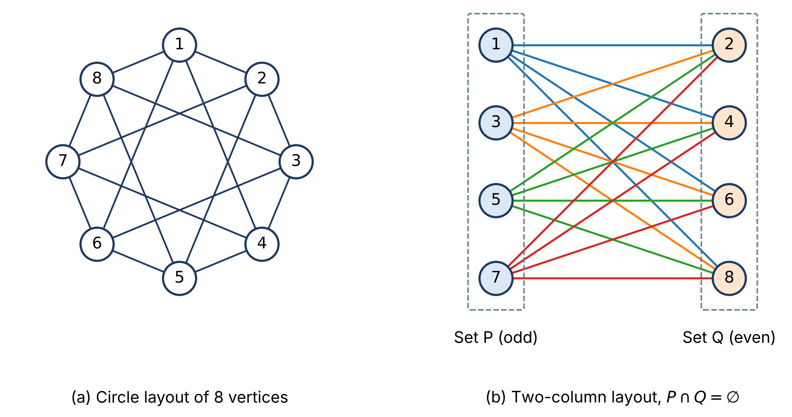

# Bipartite Graph Quick Start
Rev. 0 | Created: 2026-10-30 | Updated: 2026-10-30 05:19 CDT

- [1. Purpose](#1-purpose)
- [2. Taxonomy](#2-taxonomy)
- [3. Bipartite Graph](#3-bipartite-graph)
  - [3.1 Definition and Properties](#31-definition-and-properties)
  - [3.2 Complete Bipartite Graph](#32-complete-bipartite-graph)
- [4. Fully Connected Layer](#4-fully-connected-layer)
  - [4.1 Comparison](#41-comparison)
- [5. Applications and Courses](#5-applications-and-courses)
- [6. Models and Libraries](#6-models-and-libraries)
- [Appendix A. Terminology](#appendix-a-terminology)

## 1. Purpose

- **Problem Statement**: Bipartite graph 에 대한 quick start guide 가 없다.
- **Goal**: Bipartite graph 의 quick start guide 를 제공한다.
- **Non-Goal**: Bipartite graph 의 세부, 곧 matching algorithm 의 증명과 복잡도 분석은 다루지 않는다.

## 2. Taxonomy

Bipartite graph 와 그 아래 갈래는 아래 Fig 1 과 같다.

```text
Graph                           G = (V, E)                     vertices and edges
└── Bipartite graph             V = P ∪ Q, P ∩ Q = ∅           every edge joins a vertex of P to a vertex of Q
      aka bigraph, 2-colorable graph
    ├── General bipartite graph |E| ≤ m n                      only some P-Q pairs are joined
    │                                                          e.g. job seekers and jobs, users and items
    └── Complete bipartite graph K(m, n), |E| = m n            every vertex of P is joined to every vertex of Q
        └── Fully connected layer  y = W x + b                 directed, weighted K(n_in, n_out)
```

<a id="fig-1"></a>
Fig 1. Hierarchy of bipartite graphs

- 각 줄은 이름, 식, 한 줄 설명의 세 열이다. $m$ 과 $n$ 은 두 집합 $P$ 와 $Q$ 의 정점 수이다.
- 한 단계 내려갈 때마다 조건이 하나 더해진다. Bipartite graph 는 집합 안의 간선을 금지하고, complete bipartite graph 는 두 집합 사이의 모든 간선을 요구하며, fully connected layer 는 간선에 방향과 weight 를 더한다.
- 구직자는 일부 일자리에만 지원하고 사용자는 일부 상품만 사므로, 현실의 matching 과 추천 문제는 대부분 general bipartite graph 이다.

## 3. Bipartite Graph

### 3.1 Definition and Properties

- **Definition**: 정점 집합 $V$ 를 겹치지 않는 두 집합 $P$ 와 $Q$ ($P \cap Q = \emptyset$) 로 나누었을 때 모든 간선이 $P$ 의 정점 하나와 $Q$ 의 정점 하나를 잇는 graph 이다. $P$ 안의 두 정점, $Q$ 안의 두 정점을 직접 잇는 간선은 없다.
- **Independent set**: 집합 안의 어느 두 정점도 간선으로 이어지지 않은 정점 집합을 independent set 이라 한다. Bipartite graph 는 정점 전체를 independent set 두 개로 나눌 수 있는 graph 이다.
- **Property**: 같은 집합의 두 정점도 다른 집합의 정점을 거쳐 간접적으로는 이어질 수 있으며, 그 경로의 길이는 언제나 짝수이다. 금지되는 것은 같은 집합 안의 직접 간선뿐이다.
- **Odd cycle**: Graph 가 bipartite 인 것과 길이가 홀수인 cycle 이 없는 것은 같은 조건이다. 길이 4 의 cycle 은 bipartite 이고 길이 5 의 cycle 은 bipartite 가 아니다.
- **Test**: 아무 정점에서 시작해 너비 우선 탐색으로 이웃마다 반대 색을 칠해 나가면, 두 색만으로 모순 없이 칠해질 때 bipartite 이다. 같은 색의 두 정점이 간선으로 이어지면 그 간선을 포함한 홀수 cycle 이 있다.

### 3.2 Complete Bipartite Graph

- **Definition**: $P$ 의 모든 정점이 $Q$ 의 모든 정점과 이어진 bipartite graph 이며, $|P| = m$, $|Q| = n$ 이면 $K(m, n)$ 으로 적는다. 간선 수는 $m n$ 이다.
- **Property**: 같은 $m$, $n$ 의 bipartite graph 가운데 간선이 가장 많다. $K(3, 2)$ 의 간선은 6 개이다.
- **Use**: 두 집합의 모든 쌍을 후보로 두는 문제, 예를 들어 작업 $m$ 개를 기계 $n$ 대에 배정할 때 모든 배정에 비용을 매기는 assignment problem 의 출발점이다.

정점 8 개의 $K(4, 4)$ 를 두 가지로 배치하면 아래 Fig 2 와 같다.

<a id="fig-2"></a>


Fig 2. One complete bipartite graph K(4, 4) in two layouts

- (a): 정점 1 부터 8 을 원 위에 차례로 놓았다. 모든 간선이 같은 색이어서 어느 정점이 어느 집합인지 그림만으로는 보이지 않는다.
- (b): 같은 graph 에서 홀수 정점을 $P = \{1, 3, 5, 7\}$ 의 왼쪽 열에, 짝수 정점을 $Q = \{2, 4, 6, 8\}$ 의 오른쪽 열에 놓고, 간선을 $P$ 쪽 정점마다 다른 색으로 그렸다. 간선 16 개가 모두 두 열 사이에 있고 열 안의 간선은 없다.

두 panel 은 정점과 간선이 같고 배치만 다르다. Graph 가 bipartite 인지는 정점의 위치와 상관없이 간선의 연결로 정해지므로, 3.1 의 두 색 칠하기로 집합을 찾은 뒤 두 열로 배치하면 (b) 처럼 두 집합이 드러난다. 정점 수가 늘면 (a) 의 배치에서 눈으로 판별하기 어려워지므로 `networkx.is_bipartite` 로 판별한다.

Fig 2 는 같은 folder 의 [`src/bipartite_layouts.py`](src/bipartite_layouts.py) 가 그린다. 이 script 는 홀수 정점과 짝수 정점을 모두 잇는 graph 를 만들고, `networkx.is_bipartite` 와 `networkx.algorithms.bipartite.sets` 로 두 집합이 홀수와 짝수 정점인지 확인한 뒤 두 배치를 그린다. 이 folder 에서 `python3 src/bipartite_layouts.py --output-folder .` 를 실행하면 그림을 `bipartite-graph-quick-start-ko_fig/` 에 쓴다.

## 4. Fully Connected Layer

- **Definition**: 입력 neuron $n_{\mathrm{in}}$ 개와 출력 neuron $n_{\mathrm{out}}$ 개 사이의 연결은 $K(n_{\mathrm{in}}, n_{\mathrm{out}})$ 이다. 입력 neuron 끼리, 출력 neuron 끼리는 이어지지 않고, 모든 입력이 모든 출력에 이어진다.
- **Property**: 간선마다 weight 행렬 $\mathbf{W}$ 의 원소 하나가 붙고, 출력 neuron 마다 bias $b$ 가 하나씩 더해진다. 입력 3 개, 출력 2 개인 layer 는 $K(3, 2)$ 의 간선 6 개에 weight 6 개, 출력 2 개에 bias 2 개로 parameter 가 8 개이다.
- **Use**: 층이 여러 개인 MLP 도 이웃한 층끼리만 이어지므로, 홀수 번째 층과 짝수 번째 층을 두 집합으로 보면 bipartite graph 이다. 다만 첫 층과 셋째 층 사이에 간선이 없어 complete bipartite graph 는 아니다.

### 4.1 Comparison

Fully connected layer 는 complete bipartite graph 와 연결 구조가 같고, 아래 Table 1 의 세 가지가 더해진다.

Table 1. Complete bipartite graph and fully connected layer

| Aspect       | Complete bipartite graph $K(m, n)$ | Fully connected layer                                    |
| :----------: | :--------------------------------: | :------------------------------------------------------: |
| Two sets     | $P$, $Q$                           | 입력 neuron, 출력 neuron                                 |
| Edges        | 모든 $P$–$Q$ 쌍, $m n$ 개          | 모든 입력–출력 쌍, $n_{\mathrm{in}} n_{\mathrm{out}}$ 개 |
| Direction    | 대개 방향 없음                     | 입력에서 출력으로                                        |
| Edge value   | 연결 여부만                        | 실수 weight $w_{ij}$                                     |
| Vertex value | 없음                               | 출력 neuron 마다 bias $b_j$                              |

Weight 가 0 인 간선은 연결이 없는 것과 같으므로, pruning 이나 dropout 으로 weight 를 0 으로 만든 layer 는 complete 가 아닌 general bipartite graph 가 된다.

## 5. Applications and Courses

Bipartite graph 를 쓰는 대표 문제는 아래 Table 2 와 같다.

Table 2. Problems modeled as bipartite graphs

| Problem                 | P      | Q      | Method                                           |
| :---------------------: | :----: | :----: | :----------------------------------------------: |
| Maximum matching        | 구직자 | 일자리 | Hopcroft–Karp, 최대 유량 (Ford–Fulkerson)        |
| Assignment              | 작업   | 기계   | Hungarian algorithm, 최소 비용 완전 matching     |
| Collaborative filtering | 사용자 | 상품   | 사용자–상품 interaction 행렬의 행렬 분해         |
| Recommendation GNN      | 사용자 | 상품   | 이웃 정점의 embedding 을 모으는 GNN, 예: PinSage |

- Maximum matching 은 간선을 공유하지 않는 짝을 가장 많이 고르고, assignment 는 간선마다 비용이 있을 때 비용 합이 가장 작은 완전 matching 을 고른다.
- 사용자–상품 graph 의 biadjacency matrix 는 행이 사용자, 열이 상품인 interaction 행렬과 같다. 그래서 collaborative filtering 의 행렬 분해와 GNN 은 같은 자료를 행렬과 graph 로 달리 다룬다.

Bipartite graph 를 배우는 과목은 아래 Table 3 과 같다.

Table 3. Courses that teach bipartite graphs

| Course                            | What is taught                                 |
| :-------------------------------: | :--------------------------------------------: |
| 이산수학, 그래프 이론             | 정의, 홀수 cycle 조건, 두 색 칠하기 판별       |
| 자료구조와 algorithm              | 최대 유량, bipartite matching, Hopcroft–Karp   |
| 네트워크 과학, 소셜 네트워크 분석 | 두 종류의 정점이 있는 network 와 그 projection |
| 추천 시스템                       | 사용자–상품 graph, collaborative filtering     |
| Graph neural network              | 이종 graph, 사용자–상품 GNN                    |

## 6. Models and Libraries

꼭지 3 부터 꼭지 5 의 계산에 쓰는 Python 함수는 아래 Table 4 와 같다.

Table 4. Python functions for bipartite graphs

<table>
<tr><th align="center">Method</th><th align="center">Model</th><th align="center">Library</th><th align="center">Note</th></tr>
<tr><td align="center" rowspan="2">Construction</td><td align="center">Complete bipartite graph</td><td align="center"><code>networkx.complete_bipartite_graph</code></td><td align="center">K(m, n) 생성</td></tr>
<tr><td align="center">Biadjacency matrix</td><td align="center"><code>networkx.algorithms.bipartite.biadjacency_matrix</code></td><td align="center">P 를 행, Q 를 열로 하는 sparse 행렬로 변환</td></tr>
<tr><td align="center" rowspan="2">Test</td><td align="center">Two-coloring</td><td align="center"><code>networkx.is_bipartite</code></td><td align="center">홀수 cycle 이 없는지 판별</td></tr>
<tr><td align="center">Partition</td><td align="center"><code>networkx.algorithms.bipartite.sets</code></td><td align="center">연결된 graph 의 두 집합 P, Q 반환</td></tr>
<tr><td align="center" rowspan="2">Matching</td><td align="center">Hopcroft–Karp</td><td align="center"><code>networkx.algorithms.bipartite.hopcroft_karp_matching</code></td><td align="center">weight 없는 최대 matching</td></tr>
<tr><td align="center">Minimum cost matching</td><td align="center"><code>networkx.algorithms.bipartite.minimum_weight_full_matching</code></td><td align="center">weight 합이 최소인 완전 matching</td></tr>
<tr><td align="center">Assignment</td><td align="center">Hungarian algorithm</td><td align="center"><code>scipy.optimize.linear_sum_assignment</code></td><td align="center">비용 행렬에서 비용 합이 최소인 배정</td></tr>
<tr><td align="center">Projection</td><td align="center">One-mode projection</td><td align="center"><code>networkx.algorithms.bipartite.projected_graph</code></td><td align="center">Q 를 함께 공유하는 P 의 정점끼리 잇는 graph 생성</td></tr>
</table>

`minimum_weight_full_matching` 과 `linear_sum_assignment` 는 같은 assignment problem 을 푼다. 앞의 것은 graph 를, 뒤의 것은 비용 행렬을 입력으로 받는다.

---

## Appendix A. Terminology

- **assignment problem**: 두 집합의 쌍마다 비용이 있을 때 비용 합이 가장 작은 일대일 배정을 고르는 문제.
- **biadjacency matrix**: 행이 $P$ 의 정점, 열이 $Q$ 의 정점이고, 간선이 있으면 1 또는 그 weight 를 두는 행렬.
- **collaborative filtering**: 사용자와 상품의 interaction 기록만으로 사용자가 좋아할 상품을 추정하는 추천 방법.
- **cycle**: 시작 정점으로 돌아오는 경로. 길이는 지나는 간선의 수이다.
- **dropout**: 학습 중에 neuron 출력을 무작위로 0 으로 만드는 regularization 방법.
- **GNN**: Graph Neural Network. 정점마다 이웃 정점의 embedding 을 모아 새 embedding 을 계산하는 신경망.
- **Hopcroft–Karp**: Bipartite graph 의 weight 없는 최대 matching 을 구하는 algorithm.
- **Hungarian algorithm**: 정사각 비용 행렬에서 비용 합이 최소인 assignment 를 구하는 algorithm.
- **independent set**: 집합 안의 어느 두 정점도 간선으로 이어지지 않은 정점 집합.
- **matching**: 서로 정점을 공유하지 않는 간선의 집합.
- **MLP**: Multi-Layer Perceptron. Fully connected layer 를 여러 층 쌓은 신경망.
- **one-mode projection**: Bipartite graph 에서 $Q$ 의 정점을 함께 이웃으로 갖는 $P$ 의 두 정점을 바로 이어 만든 graph.
- **PinSage**: Pinterest 의 pin–board bipartite graph 에서 추천에 쓴 GNN.
- **pruning**: 학습한 신경망에서 작은 weight 를 0 으로 만들어 연결을 줄이는 방법.
- **최대 유량 (max flow)**: 간선마다 용량이 있는 network 에서 출발점에서 도착점으로 보낼 수 있는 흐름의 최댓값. Ford–Fulkerson 이 대표 algorithm 이다.
