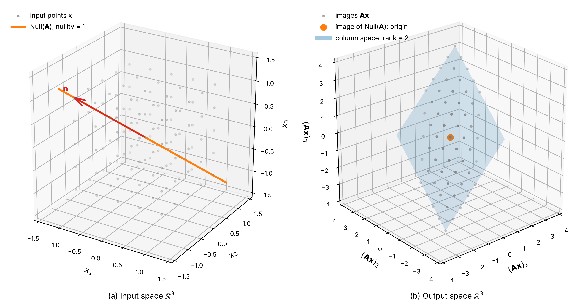

# Null Space Primer
Rev. 34 | Created: 2026-10-31 | Updated: 2026-11-02 21:46 UTC

- [1. Purpose](#1-purpose)
- [2. Summary](#2-summary)
- [3. Notation](#3-notation)
- [4. Interpretation](#4-interpretation)
  - [4.1 Set Definition](#41-set-definition)
  - [4.2 Linear Transformation](#42-linear-transformation)
  - [4.3 Uniqueness of Solutions](#43-uniqueness-of-solutions)
  - [4.4 Rank-Nullity Theorem](#44-rank-nullity-theorem)
- [5. Worked Example](#5-worked-example)
- [6. Application](#6-application)
  - [6.1 Collinear Features in Linear Regression](#61-collinear-features-in-linear-regression)
  - [6.2 Numerical Computation with SVD](#62-numerical-computation-with-svd)
- [Appendix A. Terminology](#appendix-a-terminology)
- [Appendix B. Derivation](#appendix-b-derivation)
- [Appendix C. Counting the Solutions of Equation (2)](#appendix-c-counting-the-solutions-of-equation-2)

## 1. Purpose

- **Problem Statement**: 선형방정식 $\mathbf{A}\mathbf{x} = \mathbf{b}$ 의 해가 하나인지 무수히 많은지는 $\mathbf{A}$ 의 원소만 보아서는 드러나지 않는다.
- **Goal**: 독자가 null space 와 nullity 를 구해 $\mathbf{A}\mathbf{x} = \mathbf{b}$ 의 해가 하나인지 무수히 많은지를 가리고, 선형 회귀의 weight 가 하나로 정해지지 않는 원인을 찾을 수 있게 한다.
- **Non-Goal**: 해가 없는 $\mathbf{A}\mathbf{x} = \mathbf{b}$ 의 최소제곱 해와 left null space 는 다루지 않는다.

## 2. Summary

Null space (kernel) 는 $m \times n$ 행렬 $\mathbf{A}$ 에 곱했을 때 zero vector 가 되는 모든 입력 vector 의 집합 $\mathrm{Null}(\mathbf{A})$ 이고, $\mathbb{R}^n$ 의 부분공간이다.
$\mathbf{A}\mathbf{x} = \mathbf{b}$ 의 해가 있을 때, null space 에 zero vector 만 있으면 해는 하나이고 zero vector 가 아닌 vector 가 있으면 해는 무수히 많다.
Null space 의 차원인 nullity 와 계수 (rank) 를 더하면 입력 공간의 차원 $n$ 이 된다.

## 3. Notation

이 문서가 쓰는 기호는 아래 Table 1 이다.

Table 1. Symbols

| Symbol                                    | Meaning                                                                                            | Shape                          | Assumption                                                 |
| :---------------------------------------: | :------------------------------------------------------------------------------------------------: | :----------------------------: | :--------------------------------------------------------: |
| $\mathbf{A}$                              | 선형 변환을 나타내는 행렬, 예를 들어 행이 sample 이고 열이 센서인 자료                             | $m \times n$                   | 실수 원소                                                  |
| $m$, $n$                                  | $\mathbf{A}$ 의 행의 수와 열의 수                                                                  | scalar                         | 양의 정수                                                  |
| $\mathbf{x}$                              | 입력 vector, 선형방정식의 해                                                                       | $n \times 1$                   | 실수 원소                                                  |
| $\lVert \mathbf{x} \rVert$                | $\mathbf{x}$ 의 norm (Euclidean norm), $\lVert \mathbf{x} \rVert = (x_1^2 + \cdots + x_n^2)^{1/2}$ | scalar                         | 0 이상                                                     |
| $\mathbf{b}$                              | 선형방정식의 우변                                                                                  | $m \times 1$                   | 실수 원소                                                  |
| $\mathbf{0}$                              | zero vector                                                                                        | $m \times 1$ 또는 $n \times 1$ | 모든 원소가 0                                              |
| $\mathrm{Null}(\mathbf{A})$               | $\mathbf{A}$ 의 null space                                                                         | $\mathbb{R}^n$ 의 부분공간     | zero vector 를 언제나 포함                                 |
| $x_j$, $b_j$                              | $\mathbf{x}$ 와 $\mathbf{b}$ 의 $j$ 번째 원소                                                      | scalar                         | 실수                                                       |
| $\mathbf{p}$, $\mathbf{q}$                | null space 에 속하는 임의의 vector 두 개                                                           | $n \times 1$                   | $\mathbf{A}\mathbf{p} = \mathbf{A}\mathbf{q} = \mathbf{0}$ |
| $c$                                       | 임의의 상수                                                                                        | scalar                         | 실수                                                       |
| $\mathbf{x}_0$                            | $\mathbf{A}\mathbf{x} = \mathbf{b}$ 의 특수해 하나                                                 | $n \times 1$                   | $\mathbf{A}\mathbf{x}_0 = \mathbf{b}$                      |
| $\mathbf{x}_{\mathrm{null}}$              | null space 에 속하는 vector                                                                        | $n \times 1$                   | $\mathbf{A}\mathbf{x}_{\mathrm{null}} = \mathbf{0}$        |
| $\mathbf{x}'$                             | $\mathbf{x}_0$ 와 다른 $\mathbf{A}\mathbf{x} = \mathbf{b}$ 의 해                                   | $n \times 1$                   | $\mathbf{A}\mathbf{x}' = \mathbf{b}$                       |
| $[\mathbf{A} \mid \mathbf{b}]$            | $\mathbf{A}$ 의 오른쪽에 $\mathbf{b}$ 를 열로 붙인 첨가 행렬                                       | $m \times (n + 1)$             | 실수 원소                                                  |
| $\mathrm{rank}(\mathbf{A})$               | $\mathbf{A}$ 의 계수                                                                               | scalar                         | $0 \le \mathrm{rank}(\mathbf{A}) \le \min(m, n)$           |
| $\mathrm{nullity}(\mathbf{A})$            | $\mathrm{Null}(\mathbf{A})$ 의 차원                                                                | scalar                         | $0 \le \mathrm{nullity}(\mathbf{A}) \le n$                 |
| $\mathbf{n}$                              | Worked Example 에서 null space 를 생성하는 vector                                                  | $3 \times 1$                   | zero vector 가 아님                                        |
| $\mathbf{B}$                              | Worked Example 에서 $\mathbf{A}$ 와 견주는 가역 행렬                                               | $3 \times 3$                   | rank 3                                                     |
| $\mathbf{R}$                              | $\mathbf{A}$ 의 기약 행사다리꼴                                                                    | $m \times n$                   | 기본 행 연산으로 얻음                                      |
| $n_{\mathrm{pivot}}$, $n_{\mathrm{free}}$ | $\mathbf{R}$ 의 pivot 열의 수와 자유 열의 수                                                       | scalar                         | $n_{\mathrm{pivot}} + n_{\mathrm{free}} = n$               |
| $\mathbf{w}$                              | 선형 회귀의 weight vector                                                                          | $n \times 1$                   | 실수 원소                                                  |
| $\hat{\mathbf{y}}$                        | 선형 회귀의 예측값 vector                                                                          | $m \times 1$                   | 실수 원소                                                  |
| $\sigma_i$                                | $\mathbf{A}$ 의 $i$ 번째 특이값                                                                    | scalar                         | $\sigma_1 \ge \sigma_2 \ge \cdots \ge 0$                   |
| $\mathbf{v}_i$                            | $\mathbf{A}$ 의 $i$ 번째 우특이벡터                                                                | $n \times 1$                   | 단위 vector                                                |

특수 기호는 아래처럼 읽는다.

- $\mathbb{R}^n$: 영어로 "R n" 또는 "real n-space", 한국어로 "n 차원 실수 공간" 이라 읽는다.
- $\in$: 영어로 "in" 또는 "is an element of", 한국어로 "에 속한다" 라 읽는다.
- $\{ \mathbf{x} \in \mathbb{R}^n \mid \mathbf{A}\mathbf{x} = \mathbf{0} \}$ 의 $\mid$: 영어로 "such that", 한국어로 "인" 이라 읽는다. 식 (1) 전체는 영어로 "the set of x in R n such that A x equals zero", 한국어로 "A x 가 zero vector 인 R n 의 x 의 집합" 이라 읽는다.
- $\mathbf{A}^\top$: 영어로 "A transpose", 한국어로 "A 의 전치" 또는 "A 트랜스포즈" 라 읽는다.
- $\mathbf{A}^{+}$: 영어로 "A plus" 또는 "the pseudo-inverse of A", 한국어로 "A 의 pseudo-inverse" 라 읽는다.
- $\hat{\mathbf{y}}$: 영어로 "y hat", 한국어로 "와이 햇" 이라 읽는다. 기호 위의 hat 은 그 값이 model 의 추정값임을 나타낸다.
- $\underbrace{\mathbf{b}}_{\mathbf{A}\mathbf{x} = \mathbf{b}}$: 영어로 "b, because A x equals b", 한국어로 "A x 가 b 이므로 b" 라 읽는다. 식 (3) 에서 아래 괄호 밑의 식은 위의 값이 나오는 근거이다.
- $[\mathbf{A} \mid \mathbf{b}]$: 영어로 "the augmented matrix A b", 한국어로 "A 와 b 의 첨가 행렬" 이라 읽는다. 여기의 $\mid$ 는 식 (1) 의 조건 기호와 달리 열의 경계를 나타낸다.
- $\lVert \mathbf{x} \rVert$: 영어로 "the norm of x" 또는 "norm x", 한국어로 "x 의 노름" 이라 읽는다.

## 4. Interpretation

Null space 는 선형방정식 $\mathbf{A}\mathbf{x} = \mathbf{b}$ 에서 $\mathbf{b}$ 가 zero vector 일 때 식을 만족하는 모든 해 $\mathbf{x}$ 의 집합이다. 다시 말해 동차 선형방정식 (homogeneous linear equation) $\mathbf{A}\mathbf{x} = \mathbf{0}$ 의 해들이 이루는 공간이다.

```math
\mathrm{Null}(\mathbf{A}) = \{ \mathbf{x} \in \mathbb{R}^n \mid \mathbf{A}\mathbf{x} = \mathbf{0} \} \hspace{19em} (1)
```

### 4.1 Set Definition

$m$ 은 $\mathbf{A}$ 의 행의 수이고 $n$ 은 열의 수이다. $\mathbf{A}\mathbf{x}$ 를 계산하려면 $\mathbf{x}$ 의 원소가 $\mathbf{A}$ 의 열과 같은 $n$ 개여야 하고, 계산한 $\mathbf{A}\mathbf{x}$ 의 원소는 $\mathbf{A}$ 의 행과 같은 $m$ 개이다. 식 (1) 의 $\mathbf{x}$ 는 이 $n$ 차원 입력 공간 (domain) $\mathbb{R}^n$ 의 vector 이므로, null space 는 출력 공간 $\mathbb{R}^m$ 이 아니라 $\mathbb{R}^n$ 안에 있다.

식 (1) 에서 바로 찾을 수 있는 해는 zero vector 이며, 식 (5) 의 $\mathbf{A}$ 에서는 $\mathbf{x} = [0, 0, 0]^\top$ 이다. 어떤 $\mathbf{A}$ 든 $\mathbf{A}\mathbf{0} = \mathbf{0}$ 이므로 모든 null space 는 zero vector 를 반드시 포함하고, 이 해를 자명해 (trivial solution) 라 한다. Vector space 는 zero vector 를 포함해야 하므로, zero vector 를 반드시 포함한다는 성질이 null space 를 vector space 로 정의할 수 있는 첫 조건이다. 🌳

또한 $\mathbf{A}\mathbf{p} = \mathbf{0}$ 과 $\mathbf{A}\mathbf{q} = \mathbf{0}$ 이면 $\mathbf{A}(c\mathbf{p} + \mathbf{q}) = c\mathbf{A}\mathbf{p} + \mathbf{A}\mathbf{q} = \mathbf{0}$ 이므로, 해끼리 더하거나 상수배한 vector 도 null space 에 든다. 두 성질을 함께 갖추므로 null space 는 $\mathbb{R}^n$ 의 부분공간 (subspace) 이다. $\mathbf{A}\mathbf{x} = \mathbf{0}$ 은 $\mathbf{x}$ 가 $\mathbf{A}$ 의 모든 행과 직교한다는 뜻이며, 행들이 생성하는 row space 와 null space 의 관계는 [Row Space Primer](../Row-Space/row-space-primer-ko.md) 에 있다.

### 4.2 Linear Transformation

$\mathbf{A}$ 를 $\mathbb{R}^n$ 의 vector 를 $\mathbb{R}^m$ 의 vector 로 옮기는 선형 변환 (linear transformation) 으로 보면, null space 는 이 변환이 원점으로 보내는 입력 vector 전체이다. 변환 뒤 공간의 차원이 줄어들면, 줄어든 차원만큼의 입력 방향이 모두 원점으로 가고 그 방향들이 null space 를 이룬다. 3 차원 공간이 평면으로 옮겨지면 원점으로 가는 방향은 직선 하나이고, 그 직선이 null space 이다.

### 4.3 Uniqueness of Solutions

$\mathbf{A}\mathbf{x} = \mathbf{b}$ 에 해 $\mathbf{x}_0$ 가 하나 있으면, 해 전체는 $\mathbf{x}_0$ 에 null space 의 vector 를 더한 것이다.

```math
\mathbf{A}(\mathbf{x}_0 + \mathbf{x}_{\mathrm{null}}) = \mathbf{A}\mathbf{x}_0 + \mathbf{A}\mathbf{x}_{\mathrm{null}} = \mathbf{b} + \mathbf{0} = \mathbf{b} \hspace{19em} (2)
```

$\mathbf{A}\mathbf{x} = \mathbf{b}$ 의 해의 개수는 null space 에 따라 아래처럼 갈린다. 주어진 $\mathbf{A}$ 와 $\mathbf{b}$ 로 해가 없는지, 하나인지, 무수히 많은지를 가리는 절차는 [Appendix C](#appendix-c-counting-the-solutions-of-equation-2) 에 있다.

- $\mathrm{Null}(\mathbf{A}) = \{ \mathbf{0} \}$: 해는 $\mathbf{x}_0$ 하나이다.
- $\mathrm{Null}(\mathbf{A})$ 에 zero vector 가 아닌 vector 가 있음: $\mathbf{x}_0$ 에 null space vector 의 상수배를 더한 vector 가 모두 해이므로 해가 무수히 많다.

두 번째 경우는 $\mathbf{x}_0$ 에 null space vector 의 상수배를 더한 vector 를 $\mathbf{A}\mathbf{x} = \mathbf{b}$ 의 왼쪽 변에 넣어 $\mathbf{b}$ 가 나오는지로 확인한다.

```math
\mathbf{A}(\mathbf{x}_0 + c\,\mathbf{x}_{\mathrm{null}}) = \mathbf{A}\mathbf{x}_0 + c\,\mathbf{A}\mathbf{x}_{\mathrm{null}} = \underbrace{\mathbf{b}}_{\mathbf{A}\mathbf{x}_0 = \mathbf{b}} + c\,\underbrace{\mathbf{0}}_{\mathbf{A}\mathbf{x}_{\mathrm{null}} = \mathbf{0}} = \mathbf{b} \hspace{19em} (3)
```

식 (3) 의 결과가 $c$ 와 상관없이 $\mathbf{b}$ 이므로, 모든 실수 $c$ 에 대해 식 (3) 의 왼쪽 변에 넣은 vector 가 $\mathbf{A}\mathbf{x} = \mathbf{b}$ 의 해이다. Null space vector 가 zero vector 가 아니면 $c$ 가 다를 때마다 서로 다른 해가 나오므로, 해가 무수히 많다. [Table 2](#5-worked-example) 의 $c = 0, 1, 2$ 가 이 경우이며, 세 해가 모두 $\mathbf{A}\mathbf{x} = [2, 3, 5]^\top$ 을 만족한다.

식 (2) 는 $\mathbf{x}_0$ 가 있을 때만 쓸 수 있다. $\mathbf{b}$ 가 $\mathbf{A}$ 의 열의 일차결합으로 나타나지 않으면 (column space 밖에 있으면) $\mathbf{A}\mathbf{x} = \mathbf{b}$ 의 해는 null space 와 상관없이 0 개이다. Null space 로 해가 하나인지 무수히 많은지를 가리는 것은 해가 하나라도 있을 때만 맞다.

### 4.4 Rank-Nullity Theorem

Null space 의 차원을 nullity 라 하며, 계수 (rank) 와 nullity 를 더하면 열의 수 $n$ 이 된다.

```math
\mathrm{rank}(\mathbf{A}) + \mathrm{nullity}(\mathbf{A}) = n \hspace{19em} (4)
```

식 (4) 의 $\mathrm{rank}(\mathbf{A})$ 는 변환 뒤에 남는 차원이고, $\mathrm{nullity}(\mathbf{A})$ 는 원점으로 가는 차원이다. 행의 수 $m$ 은 식 (4) 에 들지 않으므로, $m \lt n$ 이면 $\mathrm{rank}(\mathbf{A}) \le m \lt n$ 이어서 nullity 가 1 이상이고 해가 있으면 언제나 무수히 많다. 유도는 [Appendix B](#appendix-b-derivation) 에 있다.

식 (5) 의 $\mathbf{A}$ 로 식 (4) 를 그리면 아래 Fig 1 이다.



Fig 1. Rank and nullity of the matrix in equation (5)

- (a): 입력 공간 $\mathbb{R}^3$ 의 격자점 125 개 (회색) 와 $\mathbf{n}$ 방향의 null space 직선 (주황). Null space 가 직선 하나이므로 nullity 는 1 이다.
- (b): 같은 격자점을 $\mathbf{A}$ 로 옮긴 점. 모든 점이 첫 두 열이 생성하는 column space 평면 (파랑) 위에 있어 rank 는 2 이고, (a) 의 주황 직선 위의 점은 모두 원점으로 간다. 두 차원을 더하면 $2 + 1 = 3 = n$ 이다.

Fig 1 은 같은 folder 의 [`src/null_space_rank_nullity.py`](src/null_space_rank_nullity.py) 로 그렸다. 이 script 는 $\mathbf{A}\mathbf{n} = \mathbf{0}$ 과 rank, nullity 를 확인하고, 옮긴 점이 모두 column space 평면 위에 있는지 검사한 뒤 그림을 저장한다. 이 folder 에서 `python3 src/null_space_rank_nullity.py --output-folder .` 를 실행하면 `null-space-primer-ko_fig/fig1.png` 가 생긴다.

## 5. Worked Example

세 번째 열이 첫 번째 열과 두 번째 열의 합인 $3 \times 3$ 행렬을 둔다.

```math
\mathbf{A} = \begin{bmatrix} 1 & 0 & 1 \\ 0 & 1 & 1 \\ 1 & 1 & 2 \end{bmatrix}, \quad \mathbf{b} = \begin{bmatrix} 2 \\ 3 \\ 5 \end{bmatrix} \hspace{19em} (5)
```

$\mathbf{A}\mathbf{x} = \mathbf{0}$ 의 첫 행과 둘째 행에서 $x_1 = -x_3$, $x_2 = -x_3$ 이고, 셋째 행은 첫 행과 둘째 행의 합이어서 조건을 더하지 않는다. $x_3 = 1$ 로 두면 null space 를 생성하는 vector 는 아래이다.

```math
\mathbf{n} = \begin{bmatrix} -1 \\ -1 \\ 1 \end{bmatrix}, \quad \mathbf{A}\mathbf{n} = \begin{bmatrix} -1 + 0 + 1 \\ 0 - 1 + 1 \\ -1 - 1 + 2 \end{bmatrix} = \begin{bmatrix} 0 \\ 0 \\ 0 \end{bmatrix} \hspace{19em} (6)
```

$\mathrm{Null}(\mathbf{A})$ 는 $\mathbf{n}$ 의 상수배 전체인 직선이므로 nullity 는 1 이다. 일차독립인 열은 첫 번째와 두 번째 열 둘이므로 rank 는 2 이고, $2 + 1 = 3 = n$ 으로 식 (4) 가 성립한다. $\mathbf{A}$ 는 $\mathbb{R}^3$ 을 두 열이 생성하는 평면으로 옮기고, $\mathbf{n}$ 방향의 직선을 원점으로 보낸다.

특수해 $\mathbf{x}_0 = [2, 3, 0]^\top$ 은 $\mathbf{A}\mathbf{x}_0 = [2, 3, 5]^\top = \mathbf{b}$ 를 만족한다. 식 (3) 대로 $\mathbf{x}_0 + c\,\mathbf{n}$ 을 넣으면 $c$ 와 상관없이 $\mathbf{b}$ 가 나오며, 그 값은 아래 Table 2 이다.

Table 2. Solutions along the null space

| $c$   | $\mathbf{x}_0 + c\,\mathbf{n}$ | $\mathbf{A}(\mathbf{x}_0 + c\,\mathbf{n})$ |
| :---: | :----------------------------: | :----------------------------------------: |
| $0$   | $[2, 3, 0]$                    | $[2, 3, 5]$                                |
| $1$   | $[1, 2, 1]$                    | $[2, 3, 5]$                                |
| $2$   | $[0, 1, 2]$                    | $[2, 3, 5]$                                |

오른쪽 아래 원소만 2 에서 3 으로 바꾼 행렬을 $\mathbf{B}$ 로 두고, 세 행렬의 해를 견주면 아래 Table 3 이다. 첨가 행렬의 rank 를 적은 열은 [Appendix C](#appendix-c-counting-the-solutions-of-equation-2) 의 절차에서 쓴다.

Table 3. Number of solutions by null space

| Matrix       | Right-hand side | Rank of A | Rank of [A \| b] | Nullity | Solutions                        |
| :----------: | :-------------: | :-------: | :--------------: | :-----: | :------------------------------: |
| $\mathbf{A}$ | $[2, 3, 5]$     | $2$       | $2$              | $1$     | 무수히 많음, $[2 - c, 3 - c, c]$ |
| $\mathbf{B}$ | $[2, 3, 5]$     | $3$       | $3$              | $0$     | 하나, $[2, 3, 0]$                |
| $\mathbf{A}$ | $[1, 0, 0]$     | $2$       | $3$              | $1$     | 없음                             |

$\mathbf{B} = [[1, 0, 1], [0, 1, 1], [1, 1, 3]]$ 는 rank 3 이어서 null space 에 zero vector 만 있고 해가 $[2, 3, 0]$ 하나이다. $\mathbf{A}$ 의 셋째 행은 첫 두 행의 합이므로 해가 있으려면 우변도 $b_3 = b_1 + b_2$ 여야 한다. 우변 $[1, 0, 0]$ 은 $0 \ne 1 + 0$ 이어서 해가 없고, 이때는 nullity 가 1 이어도 해가 무수히 많아지지 않는다.

## 6. Application

Null space 에 zero vector 가 아닌 vector 가 있으면, 같은 출력을 주는 입력이 하나로 정해지지 않는다.

### 6.1 Collinear Features in Linear Regression

선형 회귀의 예측값은 $\hat{\mathbf{y}} = \mathbf{A}\mathbf{w}$ 이며, $\mathbf{A}$ 의 열이 센서이고 $\mathbf{w}$ 가 weight 이다. 한 센서가 다른 센서들의 일차결합이면 (collinearity) null space 에 zero vector 가 아닌 vector 가 있고, 식 (3) 대로 그 vector 의 상수배를 $\mathbf{w}$ 에 더해도 $\hat{\mathbf{y}}$ 가 바뀌지 않는다.

식 (5) 의 $\mathbf{A}$ 에서 세 번째 센서는 첫 두 센서의 합이다. $\mathbf{w} = [2, 3, 0]^\top$ 과 $[0, 1, 2]^\top$ 은 예측값이 모두 $[2, 3, 5]^\top$ 이지만, 앞의 것은 세 번째 센서의 weight 가 0 이고 뒤의 것은 2 이다. 이때 weight 의 크기로 센서의 중요도를 해석할 수 없다. 정규방정식의 $\mathbf{A}^\top\mathbf{A}$ 도 같은 null space 를 가져 역행렬이 없으므로, 열을 빼거나 regularization 을 써서 nullity 를 0 으로 만든다.

### 6.2 Numerical Computation with SVD

Null space 는 특이값 분해 (SVD) 에서 특이값 0 에 대응하는 우특이벡터 $\mathbf{v}_i$ 들이 생성한다. 식 (5) 의 $\mathbf{A}$ 의 특이값은 $\sigma_1 = 3$, $\sigma_2 = 1$, $\sigma_3 = 0$ 이고, $\sigma_3$ 의 우특이벡터는 $\pm[0.5774, 0.5774, -0.5774]^\top$ 으로 식 (6) 의 $\mathbf{n}$ 을 길이 1 로 줄인 것이다.

Pseudo-inverse 로 구한 해 $\mathbf{A}^{+}\mathbf{b} = [1/3, 4/3, 5/3]^\top$ 은 $\mathbf{x}_0 + c\,\mathbf{n}$ 에서 $c = 5/3$ 인 해이며, $\mathbf{n}$ 과의 내적이 0 이어서 $\lVert \mathbf{x} \rVert$ 가 가장 작은 해이다. 이 해를 구하는 식과 숫자 예시는 [Minimum Norm Solution Primer](../Minimum-Norm-Solution/minimum-norm-solution-primer-ko.md) 에 있다. Pseudo-inverse 의 정의와 계산은 [Pseudo-Inverse Primer](../Pseudo-Inverse/pseudo-inverse-primer-ko.md) 에 있다.

부동소수점 계산에서는 특이값이 정확히 0 이 되지 않으므로, 문턱값보다 작은 특이값을 0 으로 보고 rank 와 nullity 를 정한다. 문턱값을 크게 잡으면 거의 collinear 한 센서까지 null space 에 들어가고, 작게 잡으면 측정 noise 때문에 nullity 가 0 으로 나온다.

---

## Appendix A. Terminology

- **collinearity**: 한 feature 가 다른 feature 들의 일차결합으로 나타나는 것. Null space 에 zero vector 가 아닌 vector 가 생긴다.
- **column space**: 행렬의 열들의 일차결합으로 나타나는 vector 전체. $\mathbf{A}\mathbf{x} = \mathbf{b}$ 는 $\mathbf{b}$ 가 여기에 속할 때만 해가 있다.
- **norm (Euclidean norm)**: vector 원소의 제곱을 모두 더한 값의 제곱근. Vector 의 길이이며, $\lVert \mathbf{x} \rVert = (x_1^2 + \cdots + x_n^2)^{1/2}$ 로 적는다. L1, L∞ 같은 다른 vector norm 과 matrix norm 은 [Types of Norms](../Norm-Types/norm-types-ko.md) 에 있다.
- **nullity**: Null space 의 차원.
- **pivot 열**: 기약 행사다리꼴에서 각 행의 첫 0 이 아닌 원소 (pivot) 가 있는 열.
- **pseudo-inverse**: 정사각이 아니거나 역행렬이 없는 행렬에도 정의되며, 해 가운데 길이가 가장 짧은 해를 주는 역행렬의 일반화.
- **regularization**: 손실 함수에 weight 의 크기에 대한 벌점을 더해 weight 를 하나로 정하는 방법.
- **vector space**: zero vector 를 포함하고, 원소끼리의 덧셈과 상수배에 대해 닫혀 있는 vector 집합.
- **계수 (rank)**: 행렬에서 서로 일차독립인 열의 최대 개수.
- **기약 행사다리꼴 (reduced row echelon form)**: 기본 행 연산으로 얻는 행렬로, 각 행의 pivot 이 1 이고 pivot 이 있는 열의 다른 원소가 모두 0 인 꼴.
- **동차 선형방정식 (homogeneous linear equation)**: 우변이 zero vector 인 선형방정식 $\mathbf{A}\mathbf{x} = \mathbf{0}$.
- **부분공간 (subspace)**: Vector space 의 부분집합이면서 그 자체로 vector space 인 집합. $\mathbb{R}^n$ 의 부분공간은 $\mathbb{R}^n$ 안에 있는 vector space 이다.
- **선형 변환 (linear transformation)**: 덧셈과 상수배를 보존하는 vector 사이의 함수. 행렬 곱 $\mathbf{x} \mapsto \mathbf{A}\mathbf{x}$ 로 나타난다.
- **우특이벡터 (right singular vector)**: 특이값 분해 $\mathbf{A} = \mathbf{U}\boldsymbol{\Sigma}\mathbf{V}^\top$ 에서 $\mathbf{V}$ 의 열. 입력 공간 $\mathbb{R}^n$ 의 단위 vector 이다.
- **자명해 (trivial solution)**: 동차 선형방정식 $\mathbf{A}\mathbf{x} = \mathbf{0}$ 의 해 가운데 zero vector $\mathbf{x} = \mathbf{0}$.
- **자유 열**: 기약 행사다리꼴에서 pivot 이 없는 열. 그 열의 변수 (자유 변수) 는 아무 값이나 가질 수 있다.
- **정규방정식 (normal equation)**: 최소제곱 weight 를 구하는 식 $\mathbf{A}^\top\mathbf{A}\mathbf{w} = \mathbf{A}^\top\mathbf{y}$. $\mathbf{y}$ 는 관측값 vector 이다.
- **첨가 행렬 (augmented matrix)**: 계수 행렬 $\mathbf{A}$ 의 오른쪽에 우변 $\mathbf{b}$ 를 열 하나로 붙인 행렬 $[\mathbf{A} \mid \mathbf{b}]$.
- **특수해 (particular solution)**: $\mathbf{A}\mathbf{x} = \mathbf{b}$ 를 만족하는 해 하나.
- **특이값 분해 (Singular Value Decomposition, SVD)**: 실수 행렬을 직교 행렬, 0 이상의 대각 원소를 가진 대각 행렬, 직교 행렬의 곱으로 나타내는 분해. 대각 원소가 특이값이다.

## Appendix B. Derivation

식 (4) 는 $\mathbf{A}$ 를 기약 행사다리꼴 (reduced row echelon form) 로 바꾸어 열을 pivot 열과 자유 열로 나누면 나온다.

```math
\begin{aligned}
\mathrm{nullity}(\mathbf{A})
&= \dim \mathrm{Null}(\mathbf{R}) \\
&= n_{\mathrm{free}} \\
&= n - n_{\mathrm{pivot}} \\
&= n - \mathrm{rank}(\mathbf{A})
\end{aligned}
\hspace{19em} (7)
```

- 첫째 등호: 기본 행 연산은 가역 행렬을 왼쪽에 곱하는 것이므로 $\mathbf{A}\mathbf{x} = \mathbf{0}$ 과 $\mathbf{R}\mathbf{x} = \mathbf{0}$ 의 해가 같다.
- 둘째 등호: 자유 변수 하나를 1, 나머지를 0 으로 둔 해가 자유 열마다 하나씩 있다. 해마다 값이 1 인 자유 변수가 달라 이 해들은 일차독립이고 $\mathrm{Null}(\mathbf{R})$ 를 생성하므로, 기저의 원소 수인 차원이 자유 열의 수와 같다.
- 셋째 등호: 모든 열은 pivot 열이거나 자유 열이다.
- 넷째 등호: 기본 행 연산은 열 사이의 일차독립 관계를 바꾸지 않으므로 pivot 열의 수가 $\mathbf{A}$ 의 rank 이다.

$\mathbf{R}$ 은 $\mathbf{A}$ 의 기약 행사다리꼴이다. 식 (5) 의 $\mathbf{A}$ 에서는 $\mathbf{R} = [[1, 0, 1], [0, 1, 1], [0, 0, 0]]$ 이고, pivot 열이 두 개, 자유 열이 세 번째 열 하나이며, 둘째 등호에서 쓴 해가 식 (6) 의 $\mathbf{n}$ 이다.

따라서 식 (4) 가 성립한다.

```math
\mathrm{rank}(\mathbf{A}) + \mathrm{nullity}(\mathbf{A}) = n \hspace{19em} (4)
```

## Appendix C. Counting the Solutions of Equation (2)

$\mathbf{A}\mathbf{x} = \mathbf{b}$ 의 해가 하나인지 무수히 많은지는 $\mathbf{A}$ 의 rank 와 열의 수 $n$ 을 견주어 가린다. 해가 있는지는 첨가 행렬 (augmented matrix) $[\mathbf{A} \mid \mathbf{b}]$ 의 rank 로 먼저 확인한다.

첨가 행렬은 $\mathbf{A}$ 의 오른쪽에 우변 $\mathbf{b}$ 를 열 하나로 붙인 $m \times (n + 1)$ 행렬이다. 각 행에는 방정식 하나의 계수와 우변이 함께 들어 있어, 연립방정식 전체를 행렬 하나로 적은 것이다. 식 (5) 의 $\mathbf{A}$ 는 아래 식 (8) 이고, 여기에 두 우변을 붙인 첨가 행렬은 식 (9) 이다. 세로선의 왼쪽이 $\mathbf{A}$, 오른쪽이 $\mathbf{b}$ 이다.

```math
\mathbf{A} = \begin{bmatrix} 1 & 0 & 1 \\ 0 & 1 & 1 \\ 1 & 1 & 2 \end{bmatrix}
\hspace{19em} (8)
```

```math
\mathbf{b} = \begin{bmatrix} 2 \\ 3 \\ 5 \end{bmatrix} : \quad
[\mathbf{A} \mid \mathbf{b}] = \left[\begin{array}{ccc|c} 1 & 0 & 1 & 2 \\ 0 & 1 & 1 & 3 \\ 1 & 1 & 2 & 5 \end{array}\right]
\qquad
\mathbf{b} = \begin{bmatrix} 1 \\ 0 \\ 0 \end{bmatrix} : \quad
[\mathbf{A} \mid \mathbf{b}] = \left[\begin{array}{ccc|c} 1 & 0 & 1 & 1 \\ 0 & 1 & 1 & 0 \\ 1 & 1 & 2 & 0 \end{array}\right]
\hspace{19em} (9)
```

왼쪽 첨가 행렬의 첫 행 $[1, 0, 1 \mid 2]$ 는 $\mathbf{A}$ 의 첫 행 $[1, 0, 1]$ 에 $\mathbf{x}$ 를 곱한 값이 $\mathbf{b}$ 의 첫 원소 2 와 같다는 방정식을 뜻한다. $\mathbf{b}$ 가 $\mathbf{A}$ 의 열의 일차결합이면 붙인 열이 새 방향을 더하지 않아 rank 가 그대로이고, 아니면 rank 가 1 늘어난다. 왼쪽은 셋째 행이 첫 두 행의 합 ($5 = 2 + 3$) 이어서 rank 가 $\mathbf{A}$ 와 같은 2 이고, 오른쪽은 셋째 행의 우변이 $0 \ne 1 + 0$ 이어서 rank 가 3 으로 늘어난다.

1. $\mathrm{rank}([\mathbf{A} \mid \mathbf{b}]) \gt \mathrm{rank}(\mathbf{A})$ 이면 해가 없다. 위의 오른쪽 첨가 행렬이 이 경우이다.
2. $\mathrm{rank}([\mathbf{A} \mid \mathbf{b}]) = \mathrm{rank}(\mathbf{A}) = n$ 이면 해가 하나이다. 식 (4) 에서 nullity 가 0 이어서 null space 에 zero vector 만 있다.
3. $\mathrm{rank}([\mathbf{A} \mid \mathbf{b}]) = \mathrm{rank}(\mathbf{A}) \lt n$ 이면 해가 무수히 많다. 식 (4) 에서 nullity 가 1 이상이어서 null space 에 zero vector 가 아닌 vector 가 있다.

2 번에서 해가 하나뿐인 것은 아래처럼 보인다. $\mathbf{x}_0$ 와 다른 해 $\mathbf{x}'$ 가 있다고 두고 두 해의 차이에 $\mathbf{A}$ 를 곱한다.

```math
\mathbf{A}(\mathbf{x}' - \mathbf{x}_0) = \mathbf{A}\mathbf{x}' - \mathbf{A}\mathbf{x}_0 = \mathbf{b} - \mathbf{b} = \mathbf{0} \hspace{19em} (10)
```

식 (10) 에 따라 두 해의 차이는 null space 에 든다. Null space 에 zero vector 만 있으면 그 차이가 zero vector 여서 $\mathbf{x}' = \mathbf{x}_0$ 이므로, 다른 해는 없다. 3 번에서 해가 무수히 많은 것은 4.3 의 식 (3) 과 같다.

[Table 3](#5-worked-example) 의 세 경우에 이 절차를 적용하면, 셋째 행은 $[\mathbf{A} \mid \mathbf{b}]$ 의 rank 가 3 으로 $\mathbf{A}$ 의 rank 2 보다 커서 1 번에 해당한다. 첫째 행은 두 rank 가 같고 $n$ 보다 작아 3 번, 둘째 행은 두 rank 가 $n$ 과 같아 2 번에 해당한다.
