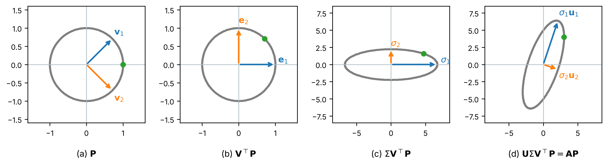
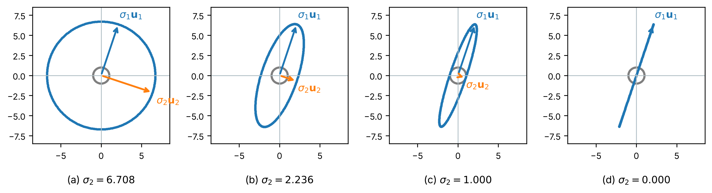

# Singular Value Decomposition Primer
Rev. 2 | Created: 2026-10-26 | Updated: 2026-10-26 02:14 CDT

- [1. Purpose](#1-purpose)
- [2. Summary](#2-summary)
- [3. Notation](#3-notation)
- [4. Interpretation](#4-interpretation)
  - [4.1 Singular Values](#41-singular-values)
  - [4.2 Singular Vectors](#42-singular-vectors)
  - [4.3 Geometric Form](#43-geometric-form)
  - [4.4 Sum of Rank-One Matrices](#44-sum-of-rank-one-matrices)
- [5. Worked Example](#5-worked-example)
- [6. Application](#6-application)
  - [6.1 PCA](#61-pca)
  - [6.2 Low-Rank Approximation](#62-low-rank-approximation)
  - [6.3 Pseudo-Inverse](#63-pseudo-inverse)
  - [6.4 Breaking Conditions](#64-breaking-conditions)
- [Appendix A. Terminology](#appendix-a-terminology)
- [Appendix B. Derivation](#appendix-b-derivation)
- [Appendix C. Circle to Ellipse](#appendix-c-circle-to-ellipse)

## 1. Purpose

- **Problem Statement**: 고윳값 분해는 정사각 행렬에만 쓸 수 있어, 행이 sample 이고 열이 센서인 직사각 자료 행렬의 구조를 같은 방법으로 볼 수 없다.
- **Goal**: 독자가 특이값과 특이벡터가 행렬의 어떤 성질을 나타내는지 가리고, PCA, 저차원 근사, pseudo-inverse 에서 그 값을 어떻게 쓰는지 알 수 있게 한다.
- **Non-Goal**: SVD 를 계산하는 algorithm과 복소 행렬의 SVD 는 다루지 않는다.

## 2. Summary

특이값 분해 (Singular Value Decomposition, SVD) 는 크기와 계수에 상관없이 모든 실수 행렬 $\mathbf{A}$ 를 직교 행렬 $\mathbf{U}$, 대각 행렬 $\boldsymbol{\Sigma}$, 직교 행렬 $\mathbf{V}^\top$ 의 곱으로 나타낸다.
특이값 $\sigma_i$ 는 단위 원이 $\mathbf{A}$ 로 옮겨진 타원의 반축 길이이고, 우특이벡터 $\mathbf{v}_i$ 는 $\mathbf{A}$ 가 $\mathbf{u}_i$ 방향으로 보내는 입력 방향, 좌특이벡터 $\mathbf{u}_i$ 는 그 반축의 방향이다.
큰 특이값 $k$ 개만 남기면 Frobenius norm 기준으로 가장 가까운 계수 $k$ 행렬이 되며, 이 성질이 PCA 와 저차원 근사와 pseudo-inverse 의 바탕이다.

## 3. Notation

이 문서가 쓰는 기호는 아래 Table 1 과 같다.

Table 1. Symbols

| Symbol                     | Meaning                                                        | Shape                      | Assumption                               |
| :------------------------: | :------------------------------------------------------------: | :------------------------: | :--------------------------------------: |
| $\mathbf{A}$               | 분해할 행렬, 예를 들어 행이 wafer sample 이고 열이 센서인 자료 | $m \times n$               | 실수 원소                                |
| $\mathbf{U}$               | 좌특이벡터를 열로 모은 직교 행렬                               | $m \times m$               | $\mathbf{U}^\top\mathbf{U} = \mathbf{I}$ |
| $\boldsymbol{\Sigma}$      | 특이값을 대각에 두고 나머지가 0 인 행렬                        | $m \times n$               | 대각 원소는 0 이상, 큰 순서              |
| $\mathbf{V}$               | 우특이벡터를 열로 모은 직교 행렬                               | $n \times n$               | $\mathbf{V}^\top\mathbf{V} = \mathbf{I}$ |
| $\sigma_i$                 | $i$ 번째 특이값                                                | scalar                     | $\sigma_1 \ge \sigma_2 \ge \cdots \ge 0$ |
| $\mathbf{u}_i$             | $i$ 번째 좌특이벡터, $\mathbf{U}$ 의 $i$ 번째 열               | $m \times 1$               | 단위 vector                              |
| $\mathbf{v}_i$             | $i$ 번째 우특이벡터, $\mathbf{V}$ 의 $i$ 번째 열               | $n \times 1$               | 단위 vector                              |
| $r$                        | $\mathbf{A}$ 의 계수, 0 이 아닌 특이값의 개수                  | scalar                     | $r \le \min(m, n)$                       |
| $\mathbf{A}_k$             | 큰 특이값 $k$ 개만 남긴 근사 행렬                              | $m \times n$               | $k \le r$                                |
| $\mathbf{I}$               | 단위 행렬                                                      | 정사각                     | 대각 원소 1, 나머지 0                    |
| $m$, $n$                   | $\mathbf{A}$ 의 행의 수와 열의 수                              | scalar                     | 양의 정수                                |
| $\lambda_i$                | $\mathbf{A}^\top\mathbf{A}$ 의 $i$ 번째 고윳값                 | scalar                     | $\lambda_i = \sigma_i^2$                 |
| $\mathbf{X}$               | centering 한 자료 행렬                                         | $N \times p$               | $N$ 은 sample 수, $p$ 는 센서 수         |
| $\mathbf{T}$               | 주성분 score 행렬                                              | $N \times p$               | $\mathbf{T} = \mathbf{X}\mathbf{V}$      |
| $\mathbf{x}$, $\mathbf{b}$ | 선형방정식 $\mathbf{A}\mathbf{x} = \mathbf{b}$ 의 해와 우변    | $n \times 1$, $m \times 1$ | 실수 원소                                |

특수 기호는 아래와 같이 읽는다.

- $\mathbf{V}^\top$: 영어로 "V transpose", 한국어로 "V 의 전치" 또는 "V 트랜스포즈" 라 읽는다.
- $\mathbf{u}_i \mathbf{v}_i^\top$: 영어로 "u i v i transpose" 또는 "the outer product of u i and v i", 한국어로 "u i 와 v i 의 외적" 이라 읽는다.
- $\sum$: 영어로 "sum" 또는 "sigma", 한국어로 "합" 또는 "시그마" 라 읽는다. 특이값 $\sigma_i$ 와 같은 그리스 문자이지만 뜻이 다르다.
- $\lVert \mathbf{A} \rVert_F$: 영어로 "the Frobenius norm of A", 한국어로 "A 의 Frobenius norm" 이라 읽는다. 모든 원소의 제곱합의 제곱근이다.
- $\mathbf{A}^{+}$: 영어로 "A plus" 또는 "the pseudo-inverse of A", 한국어로 "A 의 pseudo-inverse" 라 읽는다. $\boldsymbol{\Sigma}^{+}$ 도 같은 방식으로 "Sigma plus" 라 읽는다.
- $\mathbb{R}^n$: 영어로 "R n" 또는 "real n-space", 한국어로 "n 차원 실수 공간" 이라 읽는다.

## 4. Interpretation

모든 실수 행렬 $\mathbf{A}$ 는 세 행렬의 곱으로 분해된다.

```math
\mathbf{A} = \mathbf{U} \boldsymbol{\Sigma} \mathbf{V}^\top \hspace{19em} (1)
```

$\mathbf{A}$ 가 정사각이 아니어도, 역행렬이 없어도 식 (1) 은 성립한다. 존재의 유도는 [Appendix B](#appendix-b-derivation) 에 있다.

### 4.1 Singular Values

특이값은 $\mathbf{A}^\top\mathbf{A}$ 의 고윳값 $\lambda_i$ 의 제곱근이다.

```math
\sigma_i = \sqrt{\lambda_i(\mathbf{A}^\top\mathbf{A})} \hspace{19em} (2)
```

$\mathbf{A}^\top\mathbf{A}$ 는 대칭이고 고윳값이 모두 0 이상이므로 특이값은 언제나 0 이상의 실수이며, 큰 순서로 $\sigma_1 \ge \sigma_2 \ge \cdots \ge 0$ 으로 적는다. 0 이 아닌 특이값의 개수가 $\mathbf{A}$ 의 계수 $r$ 이다. 모든 원소의 제곱합은 특이값의 제곱합과 같다.

```math
\lVert \mathbf{A} \rVert_F^2 = \sum_{i,j} a_{ij}^2 = \sum_{i=1}^{r} \sigma_i^2 \hspace{19em} (3)
```

### 4.2 Singular Vectors

우특이벡터 $\mathbf{v}_i$ 를 $\mathbf{A}$ 로 옮기면 좌특이벡터 $\mathbf{u}_i$ 방향으로 $\sigma_i$ 배 늘어난 vector 가 된다.

```math
\mathbf{A}\mathbf{v}_i = \sigma_i \mathbf{u}_i, \quad \mathbf{A}^\top\mathbf{u}_i = \sigma_i \mathbf{v}_i \hspace{19em} (4)
```

$\mathbf{v}_i$ 는 입력 공간 $\mathbb{R}^n$ 에, $\mathbf{u}_i$ 는 출력 공간 $\mathbb{R}^m$ 에 있다. 고유벡터는 $\mathbf{A}\mathbf{x} = \lambda\mathbf{x}$ 처럼 방향이 그대로인 vector 이지만, 특이벡터는 방향이 $\mathbf{v}_i$ 에서 $\mathbf{u}_i$ 로 바뀐다. 모든 $i$ 에서 $\mathbf{u}_i = \mathbf{v}_i$ 가 되는 것은 $\mathbf{A}$ 가 대칭이고 고윳값이 0 이상일 때뿐이다. $\mathbf{v}_1, \dots, \mathbf{v}_n$ 은 $\mathbf{A}^\top\mathbf{A}$ 의 고유벡터이고 $\mathbf{u}_1, \dots, \mathbf{u}_m$ 은 $\mathbf{A}\mathbf{A}^\top$ 의 고유벡터이다.

### 4.3 Geometric Form

식 (1) 을 vector $\mathbf{x}$ 에 오른쪽부터 적용하면 $\mathbf{A}\mathbf{x}$ 는 세 단계로 나뉜다.

1. $\mathbf{V}^\top$ 이 입력 공간을 회전 또는 반사하여 $\mathbf{v}_i$ 를 $i$ 번째 좌표축에 맞춘다.
2. $\boldsymbol{\Sigma}$ 가 $i$ 번째 좌표축을 $\sigma_i$ 배 늘이거나 줄이고, 차원을 $n$ 에서 $m$ 으로 바꾼다.
3. $\mathbf{U}$ 가 출력 공간을 회전 또는 반사하여 $i$ 번째 좌표축을 $\mathbf{u}_i$ 에 맞춘다.

$2 \times 2$ 행렬에서는 이 세 단계가 단위 원을 타원으로 바꾼다. 타원의 반장축 길이가 $\sigma_1$, 반단축 길이가 $\sigma_2$ 이고, 두 반축의 방향이 $\mathbf{u}_1$ 과 $\mathbf{u}_2$ 이다. $\mathbf{v}_1$ 과 $\mathbf{v}_2$ 는 단위 원 위에서 그 두 반축의 끝점으로 옮겨지는 점의 방향이다. 꼭지 5 의 행렬로 세 단계를 실제로 계산한 과정은 [Appendix C](#appendix-c-circle-to-ellipse) 에 있다.

### 4.4 Sum of Rank-One Matrices

식 (1) 의 곱을 열마다 풀면 $\mathbf{A}$ 는 계수 1 인 행렬 $r$ 개의 합이 된다.

```math
\mathbf{A} = \sum_{i=1}^{r} \sigma_i\, \mathbf{u}_i \mathbf{v}_i^\top \hspace{19em} (5)
```

각 항 $\sigma_i\, \mathbf{u}_i \mathbf{v}_i^\top$ 의 Frobenius norm 은 $\sigma_i$ 이므로, 특이값이 큰 항일수록 $\mathbf{A}$ 의 제곱합에 더하는 몫이 크다.

## 5. Worked Example

아래 $2 \times 2$ 행렬로 식 (1) 부터 식 (5) 까지를 계산한다.

```math
\mathbf{A} = \begin{bmatrix} 3 & 0 \\ 4 & 5 \end{bmatrix}, \quad \mathbf{A}^\top\mathbf{A} = \begin{bmatrix} 25 & 20 \\ 20 & 25 \end{bmatrix} \hspace{19em} (6)
```

$\mathbf{A}^\top\mathbf{A}$ 의 고윳값은 45 와 5 이므로 식 (2) 에서 $\sigma_1 = \sqrt{45} = 3\sqrt{5} \approx 6.708$, $\sigma_2 = \sqrt{5} \approx 2.236$ 이다. 고유벡터와 식 (4) 로 구한 특이벡터는 아래와 같다.

```math
\mathbf{v}_1 = \tfrac{1}{\sqrt{2}} \begin{bmatrix} 1 \\ 1 \end{bmatrix}, \quad \mathbf{v}_2 = \tfrac{1}{\sqrt{2}} \begin{bmatrix} 1 \\ -1 \end{bmatrix}, \quad \mathbf{u}_1 = \tfrac{1}{\sqrt{10}} \begin{bmatrix} 1 \\ 3 \end{bmatrix}, \quad \mathbf{u}_2 = \tfrac{1}{\sqrt{10}} \begin{bmatrix} 3 \\ -1 \end{bmatrix} \hspace{19em} (7)
```

계산한 값을 정리하면 아래 Table 2 와 같다.

Table 2. Checks on the decomposition of A

| Check           | Left side                                       | Right side                                                                                                 |
| :-------------: | :---------------------------------------------: | :--------------------------------------------------------------------------------------------------------: |
| 식 (4), $i = 1$ | $\mathbf{A}\mathbf{v}_1 = [2.121, 6.364]^\top$  | $\sigma_1\mathbf{u}_1 = [2.121, 6.364]^\top$                                                               |
| 식 (4), $i = 2$ | $\mathbf{A}\mathbf{v}_2 = [2.121, -0.707]^\top$ | $\sigma_2\mathbf{u}_2 = [2.121, -0.707]^\top$                                                              |
| 식 (3)          | $3^2 + 0^2 + 4^2 + 5^2 = 50$                    | $45 + 5 = 50$                                                                                              |
| 식 (5)          | $\mathbf{A}$                                    | $\sigma_1\mathbf{u}_1\mathbf{v}_1^\top + \sigma_2\mathbf{u}_2\mathbf{v}_2^\top$, 원소 차이 $10^{-15}$ 이하 |
| 행렬식          | $\det(\mathbf{A}) = 15$                         | $\sigma_1 \sigma_2 = 3\sqrt{5} \times \sqrt{5} = 15$                                                       |

단위 원 위의 점 10 만 개를 $\mathbf{A}$ 로 옮기면 원점에서 가장 먼 점의 거리는 6.708, 가장 가까운 점의 거리는 2.236 이고, 가장 먼 점의 방향은 $[0.316, 0.949]^\top = \mathbf{u}_1$ 이다. 4.3 의 타원 해석대로 반축의 길이는 특이값, 방향은 좌특이벡터이다.

$\mathbf{A}$ 의 고유벡터는 특이벡터와 다르다. 고윳값 5 의 고유벡터는 $[0, 1]^\top$ 이고 고윳값 3 의 고유벡터는 $[1, -2]^\top / \sqrt{5}$ 인 반면, $\mathbf{v}_1 = [0.707, 0.707]^\top$ 은 $\mathbf{A}$ 로 옮기면 $[2.121, 6.364]^\top$ 이 되어 방향이 바뀐다.

큰 특이값 하나만 남긴 근사 행렬과 그 오차는 아래와 같다.

```math
\mathbf{A}_1 = \sigma_1 \mathbf{u}_1 \mathbf{v}_1^\top = \begin{bmatrix} 1.5 & 1.5 \\ 4.5 & 4.5 \end{bmatrix}, \quad \lVert \mathbf{A} - \mathbf{A}_1 \rVert_F = \sqrt{1.5^2 + 1.5^2 + 0.5^2 + 0.5^2} = \sqrt{5} = \sigma_2 \hspace{19em} (8)
```

$\mathbf{A}_1$ 은 행렬식이 0 이어서 역행렬이 없지만, 6.3 의 식 (12) 로 pseudo-inverse 를 구하면 $\mathbf{A}_1^{+} = \tfrac{1}{\sigma_1}\mathbf{v}_1\mathbf{u}_1^\top = \tfrac{1}{30} \begin{bmatrix} 1 & 3 \\ 1 & 3 \end{bmatrix}$ 이다.

NumPy 의 `numpy.linalg.svd` 는 네 특이벡터를 모두 식 (7) 과 부호가 반대로 돌려준다. 6.4 의 부호 문제이며, 식 (5) 의 각 항에서 $\mathbf{u}_i$ 와 $\mathbf{v}_i$ 의 부호가 함께 바뀌므로 $\mathbf{A}$ 는 같다.

## 6. Application

자료 행렬의 SVD 는 자료가 퍼진 방향, 그 방향의 크기, 그리고 작은 방향을 버렸을 때의 오차를 한 번에 준다.

### 6.1 PCA

행이 sample 이고 열이 센서인 자료 행렬 $\mathbf{X}$ ($N \times p$) 를 열마다 centering 한 뒤 SVD 하면, 주성분 분석의 결과가 아래와 같이 나온다.

```math
\mathbf{X} = \mathbf{U}\boldsymbol{\Sigma}\mathbf{V}^\top, \quad \frac{\mathbf{X}^\top\mathbf{X}}{N-1} = \mathbf{V} \frac{\boldsymbol{\Sigma}^\top\boldsymbol{\Sigma}}{N-1} \mathbf{V}^\top, \quad \mathbf{T} = \mathbf{X}\mathbf{V} = \mathbf{U}\boldsymbol{\Sigma} \hspace{19em} (9)
```

- **주성분 축**: $\mathbf{V}$ 의 열 $\mathbf{v}_i$ 가 공분산 행렬 $\mathbf{X}^\top\mathbf{X}/(N-1)$ 의 고유벡터이므로 주성분 축이다.
- **설명 분산**: $\mathbf{v}_i$ 방향의 분산은 $\sigma_i^2 / (N-1)$ 이다. $\sigma_1$ 이 크면 자료가 $\mathbf{v}_1$ 방향으로 가장 크게 퍼져 있다는 뜻이고, $i$ 번째 주성분이 설명하는 분산의 비율은 $\sigma_i^2 / \sum_j \sigma_j^2$ 이다.
- **Score**: 각 sample 을 주성분 축에 정사영한 좌표 $\mathbf{T}$ 는 $\mathbf{U}\boldsymbol{\Sigma}$ 로 바로 얻는다.
- **SVD 를 쓰는 이유**: 공분산 행렬을 만들어 고윳값 분해하면 $\mathbf{X}^\top\mathbf{X}$ 의 condition number 가 $\mathbf{X}$ 의 condition number 의 제곱이 되어, 작은 특이값의 상대 오차가 커진다. scikit-learn 의 `sklearn.decomposition.PCA` 는 공분산 행렬을 만들지 않고 $\mathbf{X}$ 를 바로 SVD 한다.

### 6.2 Low-Rank Approximation

식 (5) 에서 큰 특이값 $k$ 개의 항만 남긴 $\mathbf{A}_k$ 는 계수가 $k$ 이하인 모든 행렬 가운데 Frobenius norm 으로 $\mathbf{A}$ 에 가장 가깝다 (Eckart–Young 정리).

```math
\mathbf{A}_k = \sum_{i=1}^{k} \sigma_i\, \mathbf{u}_i \mathbf{v}_i^\top, \quad \lVert \mathbf{A} - \mathbf{A}_k \rVert_F = \sqrt{\sum_{i=k+1}^{r} \sigma_i^2} \hspace{19em} (10)
```

- **압축**: $m \times n$ 개의 원소 대신 $k(m + n + 1)$ 개의 숫자로 $\mathbf{A}_k$ 를 저장한다.
- **잡음 제거**: 측정 잡음이 모든 방향에 고르게 작은 크기로 퍼지고 신호가 소수의 방향에 몰려 있으면, 작은 특이값의 항은 주로 잡음이어서 버려도 신호가 거의 남는다. 신호의 일부가 작은 특이값의 방향에 있으면 그 부분도 함께 버려진다.
- **$k$ 의 선택**: 식 (10) 의 오차 또는 6.1 의 누적 설명 분산 비율을 보고 정한다.

### 6.3 Pseudo-Inverse

정사각이 아니거나 계수가 모자라 역행렬이 없는 행렬에도 SVD 로 pseudo-inverse 를 만든다.

```math
\mathbf{A}^{+} = \mathbf{V}\boldsymbol{\Sigma}^{+}\mathbf{U}^\top, \quad (\boldsymbol{\Sigma}^{+})_{ii} = \begin{cases} 1/\sigma_i & \sigma_i \gt 0 \\ 0 & \sigma_i = 0 \end{cases} \hspace{19em} (11)
```

```math
\mathbf{A}^{+} = \sum_{i=1}^{r} \frac{1}{\sigma_i}\, \mathbf{v}_i \mathbf{u}_i^\top \hspace{19em} (12)
```

$\boldsymbol{\Sigma}^{+}$ 는 $\boldsymbol{\Sigma}$ 를 전치한 $n \times m$ 행렬에서 0 이 아닌 특이값만 역수로 바꾼 것이다. 선형방정식 $\mathbf{A}\mathbf{x} = \mathbf{b}$ 에서 $\mathbf{x} = \mathbf{A}^{+}\mathbf{b}$ 는 $\lVert \mathbf{A}\mathbf{x} - \mathbf{b} \rVert$ 를 가장 작게 하는 해 가운데 길이가 가장 짧은 해이다. $\mathbf{A}$ 가 정사각이고 역행렬이 있으면 $\mathbf{A}^{+} = \mathbf{A}^{-1}$ 이다.

### 6.4 Breaking Conditions

- **부호**: $(\mathbf{u}_i, \mathbf{v}_i)$ 를 $(-\mathbf{u}_i, -\mathbf{v}_i)$ 로 바꾸어도 식 (1) 이 성립한다. Library 나 자료가 바뀌면 주성분과 score 의 부호가 뒤집힐 수 있으므로, 부호에 뜻을 두는 해석은 기준 방향을 정해 맞춘 뒤에 한다.
- **같은 특이값**: 두 특이값이 같으면 그 두 특이벡터가 이루는 평면 안의 어떤 직교 쌍도 특이벡터가 되어, 개별 특이벡터가 하나로 정해지지 않는다.
- **Centering 하지 않은 자료**: 열 평균을 빼지 않으면 $\sigma_1$ 과 $\mathbf{v}_1$ 이 퍼짐이 아니라 평균 vector 의 크기와 방향을 주로 나타내어, 6.1 의 분산 해석이 성립하지 않는다.
- **단위가 다른 센서**: 열마다 단위와 크기가 다르면 값이 큰 센서가 $\sigma_1$ 을 차지한다. 센서를 같은 무게로 보려면 열마다 표준편차로 나누어 standardization 한 뒤 SVD 한다.
- **작은 특이값의 역수**: 식 (12) 에서 0 에 가까운 $\sigma_i$ 의 역수는 매우 커서 $\mathbf{b}$ 의 잡음을 크게 키운다. 정해 둔 문턱보다 작은 특이값은 0 으로 보고 역수를 취하지 않으며, NumPy 의 `numpy.linalg.pinv` 는 이 문턱을 `rcond` 인자로 받는다.

---

## Appendix A. Terminology

- **centering**: 각 열에서 그 열의 평균을 빼서 평균을 0 으로 만드는 전처리.
- **condition number**: 가장 큰 특이값을 가장 작은 특이값으로 나눈 값. 클수록 입력의 작은 오차가 해에서 크게 커진다.
- **Eckart–Young 정리**: 큰 특이값 $k$ 개만 남긴 행렬이 계수 $k$ 이하의 행렬 가운데 Frobenius norm 으로 원래 행렬에 가장 가깝다는 정리.
- **Frobenius norm**: 행렬의 모든 원소의 제곱합의 제곱근.
- **PCA**: Principal Component Analysis. 자료의 분산이 가장 큰 방향을 차례로 축으로 고르는 차원 축소 방법.
- **pseudo-inverse**: 정사각이 아니거나 특이한 행렬에도 정의되며, 최소제곱 해 가운데 길이가 가장 짧은 해를 주는 역행렬의 일반화. Moore–Penrose inverse 라고도 한다.
- **score**: Sample 을 한 축에 정사영한 부호 있는 길이.
- **standardization**: 각 열에서 평균을 빼고 표준편차로 나누어 열마다 평균 0, 표준편차 1 로 맞추는 전처리.
- **계수 (rank)**: 행렬에서 서로 일차독립인 열의 최대 개수.
- **고유벡터**: $\mathbf{A}\mathbf{x} = \lambda\mathbf{x}$ 를 만족하는 영이 아닌 vector. $\lambda$ 는 그 고윳값이다.
- **반사 (reflection)**: 한 직선을 거울로 삼아 평면의 점을 맞은편으로 옮기는 변환. 길이를 바꾸지 않으며, 행렬식이 -1 인 직교 행렬이다.
- **반장축**: 타원의 중심에서 가장 먼 점까지의 선분. 가장 가까운 점까지의 선분은 반단축이다.
- **외적 (outer product)**: 열 vector $\mathbf{u}$ 와 행 vector $\mathbf{v}^\top$ 를 곱한 행렬 $\mathbf{u}\mathbf{v}^\top$. 계수가 1 이다.
- **직교 행렬**: 열이 서로 직교하는 단위 vector 인 정사각 행렬. 전치가 역행렬이다.

## Appendix B. Derivation

식 (1) 은 $\mathbf{A}^\top\mathbf{A}$ 의 고윳값 분해에서 출발하면 나온다. 단계마다 쓴 성질은 아래 Table 3 과 같다.

Table 3. Derivation of equation (1)

| Step  | Expression                                                                                                                                                                     | Property                                                                                                                   |
| :---: | :----------------------------------------------------------------------------------------------------------------------------------------------------------------------------: | :------------------------------------------------------------------------------------------------------------------------: |
| 1     | $\mathbf{A}^\top\mathbf{A} = \mathbf{V}\boldsymbol{\Lambda}\mathbf{V}^\top, \quad \lambda_1 \ge \cdots \ge \lambda_n \ge 0$                                                    | 대칭 행렬의 고윳값 분해, $\mathbf{x}^\top\mathbf{A}^\top\mathbf{A}\mathbf{x} = \lVert \mathbf{A}\mathbf{x} \rVert^2 \ge 0$ |
| 2     | $\sigma_i = \sqrt{\lambda_i}, \quad \mathbf{u}_i = \mathbf{A}\mathbf{v}_i / \sigma_i \quad (\sigma_i \gt 0)$                                                                   | 식 (2) 와 식 (4) 의 정의                                                                                                   |
| 3     | $\mathbf{u}_i^\top\mathbf{u}_j = \mathbf{v}_i^\top\mathbf{A}^\top\mathbf{A}\mathbf{v}_j / (\sigma_i\sigma_j) = \lambda_j\, \mathbf{v}_i^\top\mathbf{v}_j / (\sigma_i\sigma_j)$ | 단계 1, $\mathbf{A}^\top\mathbf{A}\mathbf{v}_j = \lambda_j\mathbf{v}_j$                                                    |
| 4     | $\mathbf{u}_i^\top\mathbf{u}_j = 1 \ (i = j), \quad 0 \ (i \ne j)$                                                                                                             | $\mathbf{V}$ 는 직교, $\lambda_i = \sigma_i^2$                                                                             |
| 5     | $\mathbf{A}\mathbf{V} = \mathbf{U}\boldsymbol{\Sigma}$                                                                                                                         | 단계 2 를 열마다 모음, $\sigma_i = 0$ 인 $\mathbf{u}_i$ 는 직교 보완으로 채움                                              |
| 6     | $\mathbf{A} = \mathbf{U}\boldsymbol{\Sigma}\mathbf{V}^\top$                                                                                                                    | 단계 5 의 오른쪽에 $\mathbf{V}^\top$ 을 곱함, $\mathbf{V}\mathbf{V}^\top = \mathbf{I}$                                     |

식 (9) 의 가운데 식은 식 (1) 을 $\mathbf{X}^\top\mathbf{X}$ 에 넣고 $\mathbf{U}^\top\mathbf{U} = \mathbf{I}$ 를 쓰면 $\mathbf{X}^\top\mathbf{X} = \mathbf{V}\boldsymbol{\Sigma}^\top\mathbf{U}^\top\mathbf{U}\boldsymbol{\Sigma}\mathbf{V}^\top = \mathbf{V}\boldsymbol{\Sigma}^\top\boldsymbol{\Sigma}\mathbf{V}^\top$ 로 나온다.

## Appendix C. Circle to Ellipse

단위 원 위의 점 $N = 360$ 개를 열로 모은 $2 \times N$ 행렬 $\mathbf{P}$ 에 꼭지 5 의 $\mathbf{A}$ 를 곱하면, 모든 점이 식 (1) 의 세 행렬을 오른쪽부터 차례로 거쳐 타원 위로 옮겨진다.

```math
\mathbf{P} = \begin{bmatrix} \cos\theta_1 & \cos\theta_2 & \cdots & \cos\theta_N \\ \sin\theta_1 & \sin\theta_2 & \cdots & \sin\theta_N \end{bmatrix}, \quad \theta_k = \frac{360^\circ (k - 1)}{N}, \quad \mathbf{A}\mathbf{P} = \mathbf{U} \left( \boldsymbol{\Sigma} \left( \mathbf{V}^\top \mathbf{P} \right) \right) \hspace{19em} (13)
```

세 단계를 차례로 계산한 결과는 아래 Fig 1 과 같다.

<a id="fig-1"></a>


Fig 1. Unit circle points through the three factors of A

- (a): 계산 전의 $\mathbf{P}$. 화살표는 우특이벡터 $\mathbf{v}_1$, $\mathbf{v}_2$ 이고, 녹색 점은 $\theta = 0^\circ$ 의 점 $[1, 0]^\top$ 이다.
- (b): $\mathbf{V}^\top\mathbf{P}$. 길이가 바뀌지 않아 점들은 여전히 단위 원 위에 있고, $\mathbf{v}_1$ 과 $\mathbf{v}_2$ 는 좌표축 방향의 $\mathbf{e}_1$, $\mathbf{e}_2$ 로 옮겨졌다. $\mathbf{v}_1$ 을 $\mathbf{e}_1$ 로 옮기는 회전이라면 $-45^\circ$ 회전이어서 녹색 점은 $[0.707, -0.707]^\top$ 으로 가야 하지만, 실제로는 $[0.707, 0.707]^\top$ 으로 옮겨졌다. 따라서 $\mathbf{V}^\top$ 은 회전이 아니라 반사이다.
- (c): $\boldsymbol{\Sigma}\mathbf{V}^\top\mathbf{P}$. 첫 좌표가 $\sigma_1 = 6.708$ 배, 둘째 좌표가 $\sigma_2 = 2.236$ 배 되어, 원이 두 좌표축을 반축으로 하는 타원이 되었다.
- (d): $\mathbf{U}\boldsymbol{\Sigma}\mathbf{V}^\top\mathbf{P} = \mathbf{A}\mathbf{P}$. $\mathbf{U}$ 가 좌표축을 $\mathbf{u}_1$, $\mathbf{u}_2$ 로 옮겨 타원의 반축이 $\sigma_1\mathbf{u}_1$ 과 $\sigma_2\mathbf{u}_2$ 가 되었다. 녹색 점은 $\mathbf{A}$ 의 첫째 열 $[3, 4]^\top$ 에 놓인다.

360 개 점의 상 가운데 원점에서 가장 먼 점의 거리는 6.708, 가장 가까운 점의 거리는 2.236 이고, 가장 먼 점의 방향은 $\pm[0.316, 0.949]^\top = \pm\mathbf{u}_1$ 이다. 반축 끝으로 옮겨지는 단위 원 위의 점은 (a) 의 $\mathbf{v}_1$, $\mathbf{v}_2$ 이므로, 우특이벡터는 $\mathbf{A}$ 가 가장 길게 늘이는 입력 방향과 그에 직교하는 입력 방향이다. 좌특이벡터는 그 두 입력이 옮겨진 타원의 반축 방향이고, 특이값은 그 반축의 길이이다.

$\mathbf{U}$, $\mathbf{V}$, $\sigma_1$ 을 그대로 두고 $\sigma_2$ 만 바꾸어 같은 계산을 하면 아래 Fig 2 와 같다.

<a id="fig-2"></a>


Fig 2. Image of the unit circle as the second singular value shrinks

- (a): $\sigma_2 = \sigma_1 = 6.708$. 두 축을 같은 배율로 늘여 상은 반지름 6.708 의 원이다. 모든 방향이 똑같이 늘어나므로 특이벡터가 하나로 정해지지 않는다.
- (b): $\sigma_2 = 2.236$. 꼭지 5 의 $\mathbf{A}$ 이며, Fig 1 (d) 와 같은 타원이다.
- (c): $\sigma_2 = 1$. 반단축이 1 로 줄어 타원이 $\mathbf{u}_1$ 방향으로 납작해졌다.
- (d): $\sigma_2 = 0$. 반단축이 사라져 모든 점이 $\mathbf{u}_1$ 방향의 길이 $2\sigma_1$ 선분 위로 옮겨진다. 이때의 행렬은 식 (8) 의 계수 1 근사 $\mathbf{A}_1$ 이다.

$\sigma_2$ 가 작아질수록 $\mathbf{u}_2$ 방향의 정보가 줄고, 0 이 되면 $\mathbf{v}_2$ 방향의 입력은 모두 원점으로 옮겨져 되찾을 수 없다. 6.2 의 저차원 근사는 Fig 2 의 (b) 를 (d) 로 바꾸는 계산이고, 6.3 에서 작은 특이값의 역수가 잡음을 키우는 것은 (c) 처럼 납작한 타원을 원으로 되돌리려면 $\mathbf{u}_2$ 방향을 $1/\sigma_2$ 배 늘여야 하기 때문이다.

Fig 1 과 Fig 2 는 같은 folder 의 [`src/svd_circle_to_ellipse.py`](src/svd_circle_to_ellipse.py) 가 그린다. 이 script 는 식 (13) 의 $\mathbf{P}$ 를 만들어 세 행렬을 차례로 곱하고, $\mathbf{U}\boldsymbol{\Sigma}\mathbf{V}^\top\mathbf{P}$ 가 $\mathbf{A}\mathbf{P}$ 와 같은지 확인한 뒤, 위의 가장 먼 점과 가장 가까운 점의 거리를 출력한다. 이 folder 에서 `python3 src/svd_circle_to_ellipse.py --output-folder .` 를 실행하면 두 그림을 `singular-value-decomposition-primer-ko_fig/` 에 쓴다.
