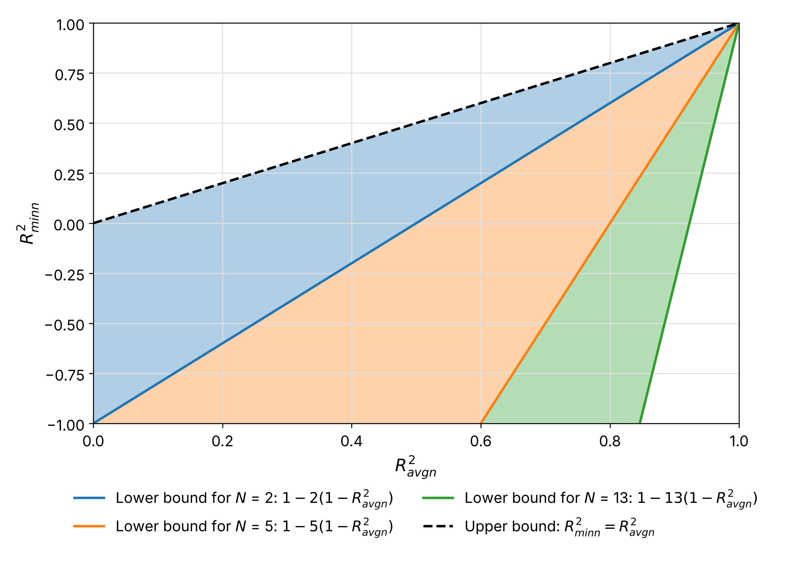

# R2 by Aggregation Level
Version 120 | Created: 2026-11-09 | Updated: 2026-11-14 01:22 UTC

- [1. Purpose](#1-purpose)
- [2. Summary](#2-summary)
- [3. Notations and Assumptions](#3-notations-and-assumptions)
- [4. Definitions](#4-definitions)
- [5. Practical Interpretation](#5-practical-interpretation)
  - [5.1 Core Identities](#51-core-identities)
  - [5.2 Target Constraints](#52-target-constraints)
  - [5.3 Range of the Minimum Location R2](#53-range-of-the-minimum-location-r2)
  - [5.4 Meaning of the Quantities](#54-meaning-of-the-quantities)
- [6. Worked Example](#6-worked-example)
- [7. Application](#7-application)
  - [7.1 Breaking Conditions](#71-breaking-conditions)
  - [7.2 Wafer Average Prediction Structure](#72-wafer-average-prediction-structure)
  - [7.3 Setting Targets](#73-setting-targets)
  - [7.4 Target Reliability](#74-target-reliability)
- [8. Related Work](#8-related-work)
  - [8.1 Multi-output R2](#81-multi-output-r2)
  - [8.2 Analysis of Variance](#82-analysis-of-variance)
  - [8.3 Multi-objective Optimization](#83-multi-objective-optimization)
  - [8.4 Group Distributionally Robust Optimization](#84-group-distributionally-robust-optimization)
- [Appendix A. Terminology](#appendix-a-terminology)
- [Appendix B. Mathematical Derivations](#appendix-b-mathematical-derivations)
  - [B.1 Sums of Squares](#b1-sums-of-squares)
  - [B.2 Core Identities](#b2-core-identities)
  - [B.3 Differences](#b3-differences)
  - [B.4 Inequalities](#b4-inequalities)
  - [B.5 Target Conditions](#b5-target-conditions)
- [Appendix C. Wafer Average Prediction as the Mean of Location Predictions](#appendix-c-wafer-average-prediction-as-the-mean-of-location-predictions)
- [Appendix D. Target Setting with Measured Data](#appendix-d-target-setting-with-measured-data)
  - [D.1 Target Conditions](#d1-target-conditions)
  - [D.2 Error to Reduce](#d2-error-to-reduce)
  - [D.3 Four R2 without the Offset Component](#d3-four-r2-without-the-offset-component)
  - [D.4 Target Reliability for the Measured Data](#d4-target-reliability-for-the-measured-data)

## 1. Purpose

- **Problem Statement**: 반도체 wafer 의 동일한 측정·예측 데이터에서도 전체 측정값, wafer 평균값, 측정 위치 (measurement location) 별 측정값으로 계산한 R² 는 서로 다르다. 따라서 한 R² 의 목표를 정해도 다른 R² 의 목표가 자동으로 충족되는 것은 아니며, 각 목표를 달성하기 위해 줄여야 할 예측오차도 다르다.
- **Goal**: 네 R² 의 수학적 관계를 이용하여 다음을 정량적으로 분석한다.
  1. 각 R² 목표가 허용하는 예측오차의 크기
  2. 여러 R² 목표를 동시에 충족하기 위한 조건
  3. 현재 모델에서 목표 달성에 필요한 오차 감소량
  4. 목표 달성을 위해 우선적으로 개선할 오차 성분
  5. 목표 달성 판정의 신뢰성

  이를 위한 항등식과 부등식을 유도하고, 실제 wafer 데이터로 적용 방법을 보인다.
- **Non-Goal**: 본 문서는 centered R² 를 사용하며, 동일한 측정 위치를 갖는 wafer 데이터를 대상으로 한다. 제시한 관계식은 목표 충족 조건과 오차 개선 요구량을 분석하지만, 특정 모델이 목표를 실제로 달성할 수 있음을 보장하지는 않는다. 모델 개발 방법과 공정 규격 설정은 다루지 않는다.

## 2. Summary

네 R² 의 목표값은 SST 가중 fraction of variance unexplained (FVU) $`q`$, 측정 위치 패턴 비율 $`\lambda`$, 오차 비 $`\kappa`$, 가중 평균과 산술 평균의 차이 $`\delta`$, 오차 집중도 $`\gamma_n`$ 에 대한 조건으로 바뀌며, 측정값만으로 정해지는 양으로 그 목표 조합을 함께 이룰 수 있는지와 먼저 줄일 오차를 예측을 고치기 전에 정하고, 목표마다 줄여야 할 SSE 의 비율로 필요한 오차 감소량을 정한다.
그 바탕은 네 R² 의 FVU 가 $`q`$ 에 계수를 곱하거나 더한 꼴로 모두 적힌다는 항등식과, 세 R² 의 순서를 정하는 필요충분조건과 R2_minn 의 범위를 주는 부등식이다.

예측은 wafer 마다 측정 위치의 측정값 $`y_{ij}`$ 와 wafer 평균 $`\bar{y}_{i\cdot}`$ 이며, 그 예측값이 $`\hat{y}_{ij}`$ 와 $`\hat{y}_{iw}`$ 이다.

## 3. Notations and Assumptions

Table 1. Symbols

| Symbol                                                                                    | Meaning                                                                                                                                                   | Scope                        | Shape   | Assumption                                                           |
| :---------------------------------------------------------------------------------------: | :-------------------------------------------------------------------------------------------------------------------------------------------------------: | :--------------------------: | :-----: | :------------------------------------------------------------------: |
| $`M`$                                                                                     | wafer 수                                                                                                                                                  | -                            | integer | $`M \ge 2`$                                                          |
| $`N`$                                                                                     | wafer 한 장에서 측정하는 위치의 수                                                                                                                        | -                            | integer | $`N \ge 2`$                                                          |
| $`T`$                                                                                     | 전체 (all) 측정값의 개수 $`MN`$                                                                                                                           | -                            | integer | -                                                                    |
| $`i`$                                                                                     | wafer 번호                                                                                                                                                | -                            | integer | $`1 \le i \le M`$                                                    |
| $`j`$, $`k`$                                                                              | 측정 위치의 번호                                                                                                                                          | -                            | integer | $`1 \le j, k \le N`$                                                 |
| $`y_{ij}`$                                                                                | wafer $`i`$ 의 측정 위치 $`j`$ 에서 측정값                                                                                                                | per wafer,<br>per location   | scalar  | -                                                                    |
| $`\hat{y}_{ij}`$                                                                          | wafer $`i`$ 의 측정 위치 $`j`$ 에 대한 예측값                                                                                                             | per wafer,<br>per location   | scalar  | -                                                                    |
| $`e_{ij}`$                                                                                | 예측 오차 $`y_{ij} - \hat{y}_{ij}`$                                                                                                                       | per wafer,<br>per location   | scalar  | -                                                                    |
| $`\bar{y}`$                                                                               | 측정값 $`T`$ 개의 평균                                                                                                                                    | all wafers,<br>all locations | scalar  | -                                                                    |
| $`\bar{y}_{i\cdot}`$                                                                      | wafer $`i`$ 의 wafer 평균 (average of wafer, avgw)                                                                                                        | per wafer,<br>all locations  | scalar  | -                                                                    |
| $`\hat{y}_{iw}`$                                                                          | wafer $`i`$ 의 wafer 평균에 대한 예측값                                                                                                                   | per wafer,<br>all locations  | scalar  | -                                                                    |
| $`e_{iw}`$                                                                                | wafer 평균에서 그 예측값을 뺀 오차 $`\bar{y}_{i\cdot} - \hat{y}_{iw}`$                                                                                    | per wafer,<br>all locations  | scalar  | -                                                                    |
| $`\bar{y}_{\cdot j}`$                                                                     | 측정 위치 $`j`$ 에서 wafer $`M`$ 장의 측정값 평균                                                                                                         | per location,<br>all wafers  | scalar  | -                                                                    |
| $`\mathrm{SST}`$, $`\mathrm{SSE}`$                                                        | 평균에서 벗어난 제곱합 (total sum of squares) 과 오차 제곱합 (sum of squared errors)                                                                      | 아래첨자에 따름              | scalar  | -                                                                    |
| $`R^2_j`$                                                                                 | 측정 위치 $`j`$ 에서 wafer $`M`$ 장으로 구한 R². $`N`$ 곳에서 산술 평균하면 avgn (average over $`N`$ locations)                                           | per location,<br>all wafers  | scalar  | -                                                                    |
| $`A`$                                                                                     | 측정 위치마다의 wafer 사이 변동 $`\mathrm{SST}_j`$ 의 합                                                                                                  | all wafers,<br>all locations | scalar  | $`A \gt 0`$                                                          |
| $`B`$                                                                                     | 측정 위치 평균이 서로 달라 생기는 제곱합                                                                                                                  | all wafers,<br>all locations | scalar  | $`B \ge 0`$                                                          |
| $`E`$                                                                                     | 측정 위치마다의 오차 제곱합 $`\mathrm{SSE}_j`$ 의 합                                                                                                      | all wafers,<br>all locations | scalar  | $`E \ge 0`$                                                          |
| $`\omega_j`$                                                                              | 측정 위치 $`j`$ 의 SST 가중치. $`\mathrm{SST}_j`$ 를 $`A`$ 로 나눈 값                                                                                     | per location,<br>all wafers  | scalar  | $`\sum_j \omega_j = 1`$                                              |
| $`R^2_{\mathrm{wavgn}}`$                                                                  | 측정 위치마다 구한 $`R^2_j`$ 를 $`\mathrm{SST}_j`$ 에 비례하는 가중치로 평균한 값 (SST-weighted R2 average over $`N`$ locations, wavgn)                   | all wafers,<br>all locations | scalar  | -                                                                    |
| $`q`$                                                                                     | SST 가중 FVU (weighted FVU). FVU (fraction of variance unexplained) 는 측정값의 평균을 기준으로 정규화한 제곱예측오차 비율이다. $`E`$ 를 $`A`$ 로 나눈 값 | all wafers,<br>all locations | scalar  | $`q \ge 0`$                                                          |
| $`\lambda`$                                                                               | 측정 위치 평균의 차이가 $`\mathrm{SST}_{\mathrm{all}}`$ 에서 차지하는 비율 (location pattern fraction)                                                    | all wafers,<br>all locations | scalar  | $`0 \le \lambda \lt 1`$                                              |
| $`\kappa`$                                                                                | 오차 비 (error ratio). wafer 평균 예측의 FVU 를 SST 가중 FVU $`q`$ 로 나눈 값                                                                             | all wafers,<br>all locations | scalar  | $`\kappa \ge 0`$, $`E \gt 0`$ 일 때만 정의                           |
| $`\delta`$                                                                                | $`R^2_{\mathrm{wavgn}}`$ 에서 $`R^2_{\mathrm{avgn}}`$ 을 뺀 값                                                                                            | all wafers,<br>all locations | scalar  | -                                                                    |
| $`\gamma_n`$                                                                              | 오차 집중도 (error concentration). $`1 - R^2_{\mathrm{minn}}`$ 을 $`1 - R^2_{\mathrm{avgn}}`$ 으로 나눈 값                                                | all wafers,<br>all locations | scalar  | $`1 \le \gamma_n \le N`$, $`R^2_{\mathrm{avgn}} \lt 1`$ 일 때만 정의 |
| $`T_{\mathrm{all}}, T_{\mathrm{avgw}}, T_{\mathrm{avgn}}, T_{\mathrm{minn}}`$             | 예측 정확도의 목표값 (target). R2_all, R2_avgw, R2_avgn, R2_minn 이 넘어야 할 값                                                                          | -                            | scalar  | 1 이하                                                               |
| $`\eta_{\mathrm{all}}, \eta_{\mathrm{avgw}}, \eta_{\mathrm{avgn}}, \eta_{\mathrm{minn}}`$ | 현재의 R² 에서 목표값에 닿으려면 그 집계 수준의 SSE 를 줄여야 하는 비율                                                                                   | -                            | scalar  | 1 이하                                                               |
| $`n_b`$, $`b`$                                                                            | wafer bootstrap 의 표본 수와 표본 번호                                                                                                                    | -                            | integer | $`1 \le b \le n_b`$                                                  |
| $`R^{2(b)}_{\mathrm{all}}`$                                                               | $`b`$ 번째 wafer bootstrap 표본으로 다시 구한 R2_all. 다른 R² 도 같은 꼴                                                                                  | per sample                   | scalar  | -                                                                    |
| $`\hat{p}_{\mathrm{all}}`$, $`\hat{p}_{\mathrm{joint}}`$                                  | R2_all 의 목표, 네 목표를 함께 충족할 확률의 추정값                                                                                                       | -                            | scalar  | $`0 \le \hat{p} \le 1`$                                              |
| $`\hat{L}_{\mathrm{all},\alpha}`$, $`\alpha`$                                             | R2_all 의 bootstrap 값의 $`\alpha`$ 분위수의 추정값과 그 확률 수준                                                                                        | -                            | scalar  | $`0 \lt \alpha \lt 1`$                                               |
| $`\theta`$                                                                                | 예측의 parameter                                                                                                                                          | -                            | vector  | -                                                                    |

🥑 아래첨자의 점 ($`\cdot`$) 은 점 표기 (dot notation) 로, 점으로 바꾼 첨자에 대해 모두 더했다는 뜻이다. 예를 들어 $`y_{i\cdot} = \sum_{j} y_{ij}`$ 는 wafer $`i`$ 의 측정값 $`N`$ 개를 모두 더한 값이다. 점 표기에 bar 를 얹으면 합 대신 평균이 되어, $`\bar{y}_{i\cdot}`$ 는 $`j`$ 에 대한 평균이고 $`\bar{y}_{\cdot j}`$ 는 $`i`$ 에 대한 평균이다.

SST, SSE, R² 의 아래첨자 $`\mathrm{all}`$ 은 측정값 $`T`$ 개, $`\mathrm{avgw}`$ 는 wafer 평균값, $`j`$ 는 측정 위치 $`j`$, $`\mathrm{avgn}`$ 은 측정 위치 R² 평균, $`\mathrm{wavgn}`$ 은 측정 위치 $`N`$ 곳의 R² 를 SST 로 가중 평균한 것 (weighted average over $`N`$ locations), $`\mathrm{minn}`$ 은 측정 위치 $`N`$ 곳의 R² 가운데 최솟값 (minimum over $`N`$ locations) 을 뜻한다. $`\hat{y}_{iw}`$ 와 $`e_{iw}`$ 의 둘째 아래첨자 $`w`$ 는 측정 위치 번호가 아니라 wafer 한 장에 하나인 값임을 뜻한다. SST, SSE, R², $`q`$, $`\lambda`$, $`\kappa`$, $`\delta`$ 는 주어진 측정값과 예측값으로 정의하는 양이며 모수를 추정한 값이 아니므로 hat 을 붙이지 않는다. Hat 을 붙인 $`\hat{y}_{ij}`$ 와 $`\hat{y}_{iw}`$ 는 예측값이다. 기호를 읽는 법은 [Appendix A](#appendix-a-terminology) 에 있다.

이 문서의 식은 아래 다섯 가정에서 성립한다.

- 모든 wafer 가 같은 측정 위치 $`N`$ 곳을 갖는다.
- 모든 측정 위치에서 $`\mathrm{SST}_j \gt 0`$ 이다. 그래서 $`R^2_j`$ 가 정의되고 $`A \gt 0`$, $`\lambda \lt 1`$ 이다.
- $`\mathrm{SST}_{\mathrm{avgw}} \gt 0`$ 이다. 그래서 $`R^2_{\mathrm{avgw}}`$ 가 정의된다.
- $`\gamma_n`$ 은 $`R^2_{\mathrm{avgn}} \lt 1`$ 일 때만 정의한다.
- $`\kappa`$ 는 $`E \gt 0`$ 일 때만 정의한다. $`E = 0`$ 이면 $`\kappa`$ 대신 $`1 - R^2_{\mathrm{avgw}} = \mathrm{SSE}_{\mathrm{avgw}} / \mathrm{SST}_{\mathrm{avgw}}`$ 를 그대로 쓴다.
- Wafer 평균 예측값 $`\hat{y}_{iw}`$ 는 측정 위치 예측값의 평균이어도 되고 따로 구한 값이어도 된다. 평균인 경우에만 성립하는 결과는 [Appendix C](#appendix-c-wafer-average-prediction-as-the-mean-of-location-predictions) 에 있다.

## 4. Definitions

> **Definition: R2 over all measured values**<br>
> 전체 측정값으로 구한 $`R^2_{\mathrm{all}}`$ 은 측정값 $`T = MN`$ 개에서, 1 에서 예측 오차 제곱합 $`\mathrm{SSE}_{\mathrm{all}}`$ 을 측정값과 전체 평균의 차이의 제곱합 $`\mathrm{SST}_{\mathrm{all}}`$ 로 나눈 값을 뺀 값이다.
> ```math
> e_{ij} := y_{ij} - \hat{y}_{ij}
> \hspace{19em} (1)
> ```
> ```math
> \bar{y} := \frac{1}{MN} \sum_{i=1}^{M} \sum_{j=1}^{N} y_{ij}
> \hspace{19em} (2)
> ```
> ```math
> \mathrm{SST}_{\mathrm{all}} := \sum_{i=1}^{M} \sum_{j=1}^{N} \left( y_{ij} - \bar{y} \right)^2
> \hspace{19em} (3)
> ```
> ```math
> \mathrm{SSE}_{\mathrm{all}} := \sum_{i=1}^{M} \sum_{j=1}^{N} e_{ij}^2
> \hspace{19em} (4)
> ```
> ```math
> R^2_{\mathrm{all}} := 1 - \frac{\mathrm{SSE}_{\mathrm{all}}}{\mathrm{SST}_{\mathrm{all}}}
> \hspace{19em} (5)
> ```

> **Definition: R2 over wafer averages**<br>
> Wafer 평균값으로 구한 $`R^2_{\mathrm{avgw}}`$ 는 wafer 평균 $`M`$ 개에서, 1 에서 wafer 평균 예측 오차의 제곱합 $`\mathrm{SSE}_{\mathrm{avgw}}`$ 를 wafer 평균과 전체 평균의 차이의 제곱합 $`\mathrm{SST}_{\mathrm{avgw}}`$ 로 나눈 값을 뺀 값이다.
> ```math
> \bar{y}_{i\cdot} := \frac{1}{N} \sum_{j=1}^{N} y_{ij}
> \hspace{19em} (6)
> ```
> ```math
> e_{iw} := \bar{y}_{i\cdot} - \hat{y}_{iw}
> \hspace{19em} (7)
> ```
> ```math
> \mathrm{SST}_{\mathrm{avgw}} := \sum_{i=1}^{M} \left( \bar{y}_{i\cdot} - \bar{y} \right)^2
> \hspace{19em} (8)
> ```
> ```math
> \mathrm{SSE}_{\mathrm{avgw}} := \sum_{i=1}^{M} e_{iw}^2
> \hspace{19em} (9)
> ```
> ```math
> R^2_{\mathrm{avgw}} := 1 - \frac{\mathrm{SSE}_{\mathrm{avgw}}}{\mathrm{SST}_{\mathrm{avgw}}}
> \hspace{19em} (10)
> ```

> **Definition: R2 average over N locations**<br>
> 측정 위치 R² 평균 $`R^2_{\mathrm{avgn}}`$ 은 측정 위치마다 wafer $`M`$ 장의 측정값과 예측값으로 구한 R² $`R^2_j`$ 를, 측정 위치 $`N`$ 곳에서 산술 평균한 값이다.
> ```math
> \bar{y}_{\cdot j} := \frac{1}{M} \sum_{i=1}^{M} y_{ij}
> \hspace{19em} (11)
> ```
> ```math
> \mathrm{SST}_j := \sum_{i=1}^{M} \left( y_{ij} - \bar{y}_{\cdot j} \right)^2
> \hspace{19em} (12)
> ```
> ```math
> \mathrm{SSE}_j := \sum_{i=1}^{M} e_{ij}^2
> \hspace{19em} (13)
> ```
> ```math
> R^2_j := 1 - \frac{\mathrm{SSE}_j}{\mathrm{SST}_j}
> \hspace{19em} (14)
> ```
> ```math
> R^2_{\mathrm{avgn}} := \frac{1}{N} \sum_{j=1}^{N} R^2_j
> \hspace{19em} (15)
> ```

> **Definition: Min R2 across N points**<br>
> 측정 위치 R² 의 최솟값 $`R^2_{\mathrm{minn}}`$ 은 측정 위치마다 wafer $`M`$ 장의 측정값과 예측값으로 구한 R² $`R^2_j`$ 가운데, 측정 위치 $`N`$ 곳에서 가장 작은 값이다.
> ```math
> R^2_{\mathrm{minn}} := \min_{j} R^2_j
> \hspace{19em} (16)
> ```

> **Definition: Quantities linking the three R2**<br>
> 세 R² 를 잇는 데 쓰는 Table 1 의 양은 측정 위치마다의 제곱합 $`\mathrm{SST}_j`$, $`\mathrm{SSE}_j`$ 와 측정 위치 평균 $`\bar{y}_{\cdot j}`$, 그리고 wafer 평균의 제곱합 $`\mathrm{SST}_{\mathrm{avgw}}`$, $`\mathrm{SSE}_{\mathrm{avgw}}`$ 로 정한다.
> ```math
> A := \sum_{j=1}^{N} \mathrm{SST}_j
> \hspace{19em} (17)
> ```
> ```math
> B := M \sum_{j=1}^{N} \left( \bar{y}_{\cdot j} - \bar{y} \right)^2
> \hspace{19em} (18)
> ```
> ```math
> E := \sum_{j=1}^{N} \mathrm{SSE}_j
> \hspace{19em} (19)
> ```
> ```math
> \omega_j := \frac{\mathrm{SST}_j}{A}
> \hspace{19em} (20)
> ```
> ```math
> R^2_{\mathrm{wavgn}} := 1 - \frac{E}{A}
> \hspace{19em} (21)
> ```
> ```math
> q := \frac{E}{A}
> \hspace{19em} (22)
> ```
> ```math
> \lambda := \frac{B}{A + B}
> \hspace{19em} (23)
> ```
> ```math
> \kappa := \frac{\mathrm{SSE}_{\mathrm{avgw}}}{\mathrm{SST}_{\mathrm{avgw}}} \cdot \frac{A}{E}
> \hspace{19em} (24)
> ```
> ```math
> \delta := R^2_{\mathrm{wavgn}} - R^2_{\mathrm{avgn}}
> \hspace{19em} (25)
> ```

> **Theorem: Minimum location R2 identity and bounds**<br>
> 모든 측정 위치에서 $`\mathrm{SST}_j \gt 0`$ 이라 하면, $`R^2_{\mathrm{minn}}`$ 은 $`1 - N(1 - R^2_{\mathrm{avgn}})`$ 이상 $`R^2_{\mathrm{avgn}}`$ 이하이다. 여기에 $`R^2_{\mathrm{avgn}} \lt 1`$ 이라 하고, 최악 측정 위치의 FVU $`1 - R^2_{\mathrm{minn}}`$ 을 측정 위치 FVU 의 평균 $`1 - R^2_{\mathrm{avgn}}`$ 으로 나눈 값을 오차 집중도 $`\gamma_n`$ 이라 하면, $`\gamma_n`$ 은 1 이상 $`N`$ 이하이며, 모든 측정 위치의 $`R^2_j`$ 가 같을 때 $`\gamma_n = 1`$ 이다.
> ```math
> 1 - N \left( 1 - R^2_{\mathrm{avgn}} \right) \le R^2_{\mathrm{minn}} \le R^2_{\mathrm{avgn}}
> \hspace{19em} (26)\ \text{🌳}
> ```
> ```math
> \gamma_n := \frac{1 - R^2_{\mathrm{minn}}}{1 - R^2_{\mathrm{avgn}}}
> \hspace{19em} (27)
> ```
> ```math
> 1 \le \gamma_n \le N
> \hspace{19em} (28)
> ```

증명은 [B.4](#b4-inequalities) 에 있다.

식 (27) 의 양변에 $`1 - R^2_{\mathrm{avgn}}`$ 을 곱하면, 최악 측정 위치의 FVU (worst-location FVU) 가 아래 식 (29) 와 같이 오차 집중도와 측정 위치 FVU 의 평균 (mean location FVU) 의 곱으로 정확히 나뉜다.

```math
\underbrace{1 - R^2_{\mathrm{minn}}}_{\text{FVU of the worst location}} = \underbrace{\gamma_n}_{\text{error concentration}} \, \underbrace{(1 - R^2_{\mathrm{avgn}})}_{\text{mean FVU over locations}}
\hspace{19em} (29)
```

예측의 오차가 바뀌기 전과 뒤를 A 와 B 라 하면, 식 (29) 를 두 경우에서 나누어 최악 측정 위치의 FVU 가 몇 배가 되었는지를 아래 식 (30) 과 같이 측정 위치 FVU 의 평균의 배수와 오차 집중도의 배수의 곱으로 나눈다. 아래첨자 A, B 는 오차가 바뀌기 전과 뒤의 값이다.

```math
\frac{1 - R^2_{\mathrm{minn},B}}{1 - R^2_{\mathrm{minn},A}} = \underbrace{\frac{1 - R^2_{\mathrm{avgn},B}}{1 - R^2_{\mathrm{avgn},A}}}_{\text{ratio of mean location FVU}} \, \underbrace{\frac{\gamma_{n,B}}{\gamma_{n,A}}}_{\text{ratio of error concentration}}
\hspace{19em} (30)
```

- 그래서 오차가 바뀔 때 $`R^2_{\mathrm{minn}}`$ 이 바뀐 까닭이 측정 위치 전체의 오차가 바뀐 것인지, 오차가 한 측정 위치에 몰리는 정도가 바뀐 것인지를 가를 수 있다. 측정 데이터로 가른 예는 [D.3](#d3-four-r2-without-the-offset-component) 에 있다.
- $`\gamma_n = 1`$ 은 모든 측정 위치의 $`R^2_j`$ 가 같을 때, 그리고 그때만이다. $`\gamma_n = N`$ 은 측정 위치 한 곳을 뺀 나머지의 $`R^2_j`$ 가 모두 1 일 때이다.
- $`\gamma_n`$ 은 최악 측정 위치의 FVU 를 설명하는 진단 지표이며, 따로 줄일 목표가 아니다. 식 (29) 에서 $`\gamma_n`$ 이 줄어도 측정 위치 FVU 의 평균이 늘면 $`R^2_{\mathrm{minn}}`$ 은 낮아질 수 있고, $`\gamma_n`$ 이 늘어도 측정 위치 FVU 의 평균이 충분히 줄면 $`R^2_{\mathrm{minn}}`$ 은 그대로이거나 높아진다.

## 5. Practical Interpretation

### 5.1 Core Identities

다섯 R² 의 FVU 는 SST 가중 FVU $`q`$ 에 계수를 곱하거나 더한 꼴로 모두 적히며, 이것이 이 문서의 주요 결과이다. 정리하면 아래 Table 2 이다.

Table 2. FVU of the five R2 in terms of the weighted FVU

| R2       | FVU                       | Defined when         |
| :------: | :-----------------------: | :------------------: |
| R2_all   | $`(1 - \lambda)\, q`$     | -                    |
| R2_avgw  | $`\kappa\, q`$            | $`q \gt 0`$          |
| R2_wavgn | $`q`$                     | -                    |
| R2_avgn  | $`q + \delta`$            | -                    |
| R2_minn  | $`\gamma_n (q + \delta)`$ | $`q + \delta \gt 0`$ |

- $`q`$ 는 SST 가중 FVU, $`q + \delta`$ 는 측정 위치 FVU 의 평균, $`\gamma_n (q + \delta)`$ 는 최악 측정 위치의 FVU 이다. 셋은 $`\delta`$ 와 $`\gamma_n`$ 이 0 과 1 이 아니면 서로 다르다.
- 각 행의 유도는 [Appendix B](#appendix-b-mathematical-derivations) 에 있다.

꼭지 4 에서 정의한 세 R² 의 FVU 는 아래 식 (33), 식 (34), 식 (35) 와 같이 $`q`$, $`\lambda`$, $`\kappa`$, $`\delta`$ 로 모두 적히고, R2_minn 의 FVU 는 그 바로 아래 식 (36) 과 같이 $`\gamma_n`$ 을 더해 적힌다. 그 바탕은 식 (31) 과 식 (32) 의 제곱합 분해이며, 증명은 [Appendix B](#appendix-b-mathematical-derivations) 에 있다.

```math
\mathrm{SST}_{\mathrm{all}} = A + B
\hspace{19em} (31)
```

```math
\mathrm{SSE}_{\mathrm{all}} = E
\hspace{19em} (32)
```

```math
1 - R^2_{\mathrm{all}} = (1 - \lambda)\, q
\hspace{19em} (33)
```

```math
1 - R^2_{\mathrm{avgw}} = \kappa\, q
\hspace{19em} (34)
```

```math
1 - R^2_{\mathrm{avgn}} = q + \delta
\hspace{19em} (35)
```

```math
1 - R^2_{\mathrm{minn}} = \gamma_n (q + \delta)
\hspace{19em} (36)
```

```math
R^2_{\mathrm{wavgn}} = \sum_{j=1}^{N} \omega_j R^2_j
\hspace{19em} (37)
```

```math
\delta = \frac{1}{A} \sum_{j=1}^{N} \left( \mathrm{SST}_j - \frac{A}{N} \right) \left( R^2_j - R^2_{\mathrm{avgn}} \right)
\hspace{19em} (38)
```

- 식 (31), 식 (32): 식 (31) 은 측정 위치를 집단으로 보는 일원 분산분석 (one-way analysis of variance, ANOVA) 의 제곱합 분해를 wafer 와 측정 위치의 구조에 적용한 것이다. $`A`$ 는 측정 위치 안에서 wafer 사이의 변동인 집단 내 제곱합 (within-group sum of squares), $`B`$ 는 측정 위치 평균 사이의 변동인 집단 간 제곱합 (between-group sum of squares) 이다. 그래서 $`\mathrm{SST}_{\mathrm{all}}`$ 은 $`A`$ 에 $`B`$ 가 더해진 값이고, $`\mathrm{SSE}_{\mathrm{all}}`$ 은 측정 위치 SSE 의 합 $`E`$ 와 같다.
- 식 (36): 식 (29) 의 $`1 - R^2_{\mathrm{avgn}}`$ 에 식 (35) 를 넣은 것이다. 유도는 [B.2](#b2-core-identities) 에 있다.
- 식 (33), 식 (34), 식 (35): 세 R² 는 모두 1 에서 $`q`$ 에 계수를 곱한 값을 뺀 꼴이며, 계수는 $`R^2_{\mathrm{all}}`$ 이 $`1 - \lambda`$, $`R^2_{\mathrm{avgw}}`$ 가 $`\kappa`$ 이다. $`R^2_{\mathrm{avgn}}`$ 은 계수 1 에 $`\delta`$ 를 더 뺀다. $`q = 1 - R^2_{\mathrm{wavgn}}`$ 이므로 세 식은 $`R^2_{\mathrm{wavgn}}`$ 을 거쳐 이어진다.
- 식 (34) 는 $`E \gt 0`$ 일 때 쓴다. $`E = 0`$ 이면 측정 위치 R² 는 모두 1 이지만, 따로 구한 wafer 평균 예측의 $`\mathrm{SSE}_{\mathrm{avgw}}`$ 는 0 이 아닐 수 있어 $`R^2_{\mathrm{avgw}}`$ 는 1 보다 작을 수 있다.
- 식 (37): $`R^2_{\mathrm{wavgn}}`$ 은 $`R^2_j`$ 를 SST 가중치 $`\omega_j`$ 로 평균한 값이다.
- 식 (38): $`\delta`$ 는 측정 위치마다의 $`\mathrm{SST}_j`$ 와 $`R^2_j`$ 가 함께 움직이는 정도이다. $`\mathrm{SST}_j`$ 가 큰 측정 위치에서 $`R^2_j`$ 도 큰 경향이 있으면 $`\delta \gt 0`$ 이다. $`\mathrm{SST}_j`$ 가 모두 같으면 $`\delta = 0`$ 이지만, 이것은 충분조건일 뿐이다. 예를 들어 $`R^2_j`$ 가 모두 같으면 $`\mathrm{SST}_j`$ 가 달라도 $`\delta = 0`$ 이다.

### 5.2 Target Constraints

네 R² 의 목표값은 그 집계 수준의 SSE 를 SST 로 나눈 값, 곧 FVU 의 위쪽 한계와 동치이며, Table 2 로 이 한계를 $`q, \lambda, \kappa, \delta, \gamma_n`$ 의 조건으로 바꾼다.

> **Theorem: Joint R2 target constraints**<br>
> R2_all, R2_avgw, R2_avgn, R2_minn 의 목표값을 $`T_{\mathrm{all}}, T_{\mathrm{avgw}}, T_{\mathrm{avgn}}, T_{\mathrm{minn}}`$ 이라 하자. 네 목표를 함께 충족하는 것은 아래 네 조건을 함께 충족하는 것과 동치이다. 각 조건은 그 집계 수준에서 SSE 를 SST 로 나눈 값의 위쪽 한계이다.
> ```math
> R^2_{\mathrm{all}} \ge T_{\mathrm{all}} \;\Leftrightarrow\; \frac{\mathrm{SSE}_{\mathrm{all}}}{\mathrm{SST}_{\mathrm{all}}} \le 1 - T_{\mathrm{all}} \;\Leftrightarrow\; (1 - \lambda)\, q \le 1 - T_{\mathrm{all}}
> \hspace{19em} (39)
> ```
> ```math
> R^2_{\mathrm{avgw}} \ge T_{\mathrm{avgw}} \;\Leftrightarrow\; \frac{\mathrm{SSE}_{\mathrm{avgw}}}{\mathrm{SST}_{\mathrm{avgw}}} \le 1 - T_{\mathrm{avgw}} \;\Leftrightarrow\; \kappa\, q \le 1 - T_{\mathrm{avgw}}
> \hspace{19em} (40)
> ```
> ```math
> R^2_{\mathrm{avgn}} \ge T_{\mathrm{avgn}} \;\Leftrightarrow\; \sum_{j=1}^{N} \frac{\mathrm{SSE}_j}{\mathrm{SST}_j} \le N (1 - T_{\mathrm{avgn}}) \;\Leftrightarrow\; q + \delta \le 1 - T_{\mathrm{avgn}}
> \hspace{19em} (41)
> ```
> ```math
> R^2_{\mathrm{minn}} \ge T_{\mathrm{minn}} \;\Leftrightarrow\; \max_{j} \frac{\mathrm{SSE}_j}{\mathrm{SST}_j} \le 1 - T_{\mathrm{minn}} \;\Leftrightarrow\; \gamma_n (q + \delta) \le 1 - T_{\mathrm{minn}}
> \hspace{19em} (42)
> ```

증명은 [B.5](#b5-target-conditions) 에 있다.

- 식 (39): $`\lambda`$ 는 측정값만으로 정해지므로, R2_all 의 목표는 SST 가중 FVU $`q`$ 의 위쪽 한계 $`(1 - T_{\mathrm{all}}) / (1 - \lambda)`$ 하나로 바뀐다.
- 식 (40): R2_avgw 의 목표는 wafer 평균 예측의 FVU 에만 걸리며, 측정 위치 예측의 오차와 따로 정해진다.
- 식 (41): R2_avgn 의 목표는 측정 위치 FVU 의 합에 대한 오차 예산 (error budget) $`N (1 - T_{\mathrm{avgn}})`$ 이다. 이 예산은 측정 위치 사이에서 나누어 쓰이므로, 한 측정 위치의 FVU 가 커도 다른 측정 위치의 FVU 가 작으면 충족된다.
- 식 (42): R2_minn 의 목표는 측정 위치 FVU 의 최댓값에 걸려, 식 (41) 의 예산을 한 측정 위치가 많이 쓰는 것을 막는다. $`\gamma_n \ge 1`$ 이므로 측정 위치 FVU 의 평균이 $`1 - T_{\mathrm{minn}}`$ 이하여야 하고, 측정 위치 FVU 의 평균이 $`1 - T_{\mathrm{avgn}}`$ 일 때 $`\gamma_n`$ 은 $`(1 - T_{\mathrm{minn}}) / (1 - T_{\mathrm{avgn}})`$ 이하여야 한다.
- $`\lambda`$ 는 측정값만으로 정해지고, $`\kappa, \delta, \gamma_n`$ 은 예측에 따라 바뀐다. 그래서 네 조건은 주어진 예측이 목표를 충족하는지를 정확히 판정하지만, 목표를 충족하는 예측이 있는지까지 보장하지는 않는다.

### 5.3 Range of the Minimum Location R2

측정 위치 R² 의 최솟값과 최댓값은 아래 식 (43), 식 (44) 로 범위가 정해진다.

```math
R^2_{\mathrm{wavgn}} \ge R^2_{\mathrm{minn}}
\hspace{19em} (43)
```

```math
R^2_{\mathrm{wavgn}} \le \max_{j} R^2_j
\hspace{19em} (44)
```

- 식 (43), 식 (44): $`R^2_{\mathrm{wavgn}}`$ 과 $`R^2_{\mathrm{avgn}}`$ 은 모두 $`R^2_j`$ 의 평균이므로 $`R^2_j`$ 의 최솟값과 최댓값 사이에 있다. 그래서 $`R^2_{\mathrm{minn}}`$ 의 위쪽 범위는 두 평균 가운데 작은 값이다.
- $`R^2_{\mathrm{minn}}`$ 을 세 R² 와 $`R^2_{\mathrm{wavgn}}`$ 으로 정하는 항등식은 없다. 이 값들은 모두 측정 위치 SSE 와 SST 의 합이나 평균으로 정해져, 측정 위치 하나의 값을 가려내지 못한다. $`R^2_{\mathrm{minn}}`$ 은 식 (27) 의 오차 집중도 $`\gamma_n`$ 으로 $`R^2_{\mathrm{avgn}}`$ 과 이어지며, 그 범위는 식 (26) 과 식 (28) 이다.

식 (26) 이 허용하는 $`R^2_{\mathrm{minn}}`$ 의 범위를 측정 위치의 수 $`N`$ 마다 그리면 아래 Fig 1 이다.



Fig 1. Range of the minimum location R2 for each number of locations

- 가로축은 R2_avgn, 세로축은 R2_minn 이며, 세로축은 -0.1 부터 1 까지만 그렸다. 검은 점선은 위쪽 범위 $`R^2_{\mathrm{minn}} = R^2_{\mathrm{avgn}}`$ 이고, 파란, 주황, 초록 실선은 $`N`$ = 2, 5, 13 의 아래쪽 범위 $`1 - N(1 - R^2_{\mathrm{avgn}})`$ 이다.
- $`N`$ 이 정해지면 $`R^2_{\mathrm{minn}}`$ 은 검은 점선과 그 $`N`$ 의 실선 사이에 있다. 색 띠는 $`N`$ 이 2 에서 5, 5 에서 13 으로 커질 때 그 범위가 아래로 넓어지는 부분이다.
- 아래쪽 범위는 $`R^2_{\mathrm{avgn}} = 1 - 1/N`$ 에서 0 이 되며, 그 값은 $`N`$ = 2 에서 0.5, $`N`$ = 5 에서 0.8, $`N`$ = 13 에서 0.9231 이다. R2_avgn 이 그보다 작으면 식 (26) 만으로는 $`R^2_{\mathrm{minn}} \ge 0`$ 이 보장되지 않는다.

Fig 1 은 같은 folder 의 [src/r2_minn_bounds_figure.py](src/r2_minn_bounds_figure.py) 로 그렸다. 이 script 는 $`N`$ = 2, 5, 13 마다 식 (26) 의 두 범위를 계산해 그림을 저장하며, 문서 folder 에서 `python3 src/r2_minn_bounds_figure.py` 로 실행한다.

### 5.4 Meaning of the Quantities

- **$`q`$**: 측정 위치 $`N`$ 곳의 wafer 사이 변동 $`A`$ 에 대한 측정 위치 오차 $`E`$ 의 비율이다. 세 R² 가 공통으로 쓰는 기준이다.
- **$`\lambda`$**: 측정값만으로 정해지며 예측값과 무관하다. [B.3](#b3-differences) 의 식 (59) 의 차이 $`\lambda q`$ 는 예측이 측정 위치 패턴을 맞혔다는 뜻이 아니다. $`\mathrm{SST}_{\mathrm{all}}`$ 에는 측정 위치 평균의 차이 $`B`$ 가 더해지지만 $`\mathrm{SSE}_{\mathrm{all}}`$ 은 $`E`$ 그대로여서, 두 R² 의 기준 변동이 달라서 생기는 차이다.
- **$`\kappa`$**: wafer 평균 예측의 FVU 와 SST 가중 FVU 의 비이다. $`1 - \kappa`$ 는 측정 위치 예측과 견주어 wafer 평균 예측의 정규화된 제곱오차가 얼마나 작은지를 나타내며, 양수이면 $`R^2_{\mathrm{avgw}}`$ 가 $`R^2_{\mathrm{wavgn}}`$ 보다 크다. Wafer 평균 예측을 따로 구하면 $`\kappa \gt 1`$ 일 수 있고, 그때 $`1 - \kappa`$ 는 음수이다.
- **$`\delta`$**: 가중 평균과 산술 평균의 차이이며, 식 (38) 대로 $`\mathrm{SST}_j`$ 와 $`R^2_j`$ 가 함께 움직이는 정도로 정해진다.
- **R² 의 뜻**: 이 문서의 R² 는 $`1 - \mathrm{SSE}/\mathrm{SST}`$ 이며, 그 집계 수준의 평균을 예측값으로 쓸 때와 견주어 제곱오차가 얼마나 줄었는지를 나타낸다. 측정값과 예측값의 상관계수를 제곱한 값과는 다르며, 예측이 평균보다 나쁘면 음수이다.

## 6. Worked Example

Wafer $`M = 3`$ 장, 측정 위치 $`N = 2`$ 곳의 측정값과 예측값은 아래 Table 3 이다.

Table 3. Measured and predicted values

| Wafer i | y_i1 | y_i2 | Predicted y_i1 | Predicted y_i2 | e_i1 | e_i2 | Wafer average | Predicted wafer average | Wafer average error |
| :-----: | :--: | :--: | :------------: | :------------: | :--: | :--: | :-----------: | :---------------------: | :-----------------: |
| 1       | 10   | 12   | 11             | 12             | -1   | 0    | 11            | 11.5                    | -0.5                |
| 2       | 13   | 15   | 13             | 14             | 0    | 1    | 14            | 13.0                    | 1.0                 |
| 3       | 16   | 20   | 15             | 19             | 1    | 1    | 18            | 17.5                    | 0.5                 |

Wafer 평균 예측값은 측정 위치 예측값과 따로 구한 값이어서, wafer 2 의 13.0 은 측정 위치 예측값 평균 13.5 와 다르다. 전체 평균은 86/6 = 14.3333, 측정 위치 평균은 13 과 15.6667 이다. 꼭지 4 의 정의 식으로 구한 값은 아래 Table 4 이다.

Table 4. Sums of squares and R2 values

| Quantity                                 | SST     | SSE | Calculation                     | Symbol   | Value  |
| :--------------------------------------: | :-----: | :-: | :-----------------------------: | :------: | :----: |
| R2 over all measured values              | 61.3333 | 4   | 1 - 4 / 61.3333                 | R2_all   | 0.9348 |
| R2 over wafer averages                   | 24.6667 | 1.5 | 1 - 1.5 / 24.6667               | R2_avgw  | 0.9392 |
| Location 1                               | 18      | 2   | 1 - 2 / 18                      | R2_1     | 0.8889 |
| Location 2                               | 32.6667 | 2   | 1 - 2 / 32.6667                 | R2_2     | 0.9388 |
| R2 average over N locations              | -       | -   | (0.8889 + 0.9388) / 2           | R2_avgn  | 0.9138 |
| SST-weighted R2 average over N locations | 50.6667 | 4   | 1 - 4 / 50.6667                 | R2_wavgn | 0.9211 |
| Location error share                     | -       | -   | 4 / 50.6667                     | q        | 0.0789 |
| Location pattern                         | -       | -   | 10.6667 / (50.6667 + 10.6667)   | lambda   | 0.1739 |
| Error ratio                              | -       | -   | (1.5 / 24.6667) × (50.6667 / 4) | kappa    | 0.7703 |
| Weighted minus plain average             | -       | -   | 0.9211 - 0.9138                 | delta    | 0.0072 |

Table 4 의 값을 넣어 식 (33), 식 (34), 식 (35) 와 세 R² 의 순서를 확인하면 아래 네 항목이다.

- 식 (33): (1 - 0.1739) × 0.0789 = 0.0652 이어서 R2_all = 1 - 0.0652 = 0.9348 이다.
- 식 (34): 0.7703 × 0.0789 = 0.0608 이어서 R2_avgw = 1 - 0.0608 = 0.9392 이다.
- 식 (35): 1 - 0.0789 - 0.0072 = 0.9138 이 R2_avgn 이다.
- 순서: $`\kappa`$ = 0.7703 이 $`1 - \lambda`$ = 0.8261 보다 작아 R2_avgw 가 R2_all 보다 크고, $`\delta`$ = 0.0072 가 $`-\lambda q`$ = -0.0137 보다 커서 R2_all 이 R2_avgn 보다 크다. 그래서 R2_avgw = 0.9392, R2_all = 0.9348, R2_avgn = 0.9138 의 차례이다.

목표를 $`T_{\mathrm{all}} = 0.95,\ T_{\mathrm{avgw}} = 0.95,\ T_{\mathrm{avgn}} = 0.90,\ T_{\mathrm{minn}} = 0.90`$ 으로 잡고 Table 4 의 값으로 식 (39) 부터 식 (42) 의 조건과 식 (46) 의 SSE 감소율을 구하면 아래 네 항목이다. R2_minn 은 측정 위치 1 의 0.8889 이고, $`\gamma_n`$ = (1 - 0.8889) / (1 - 0.9138) = 1.2895 이다.

- 식 (39): SSE_all / SST_all = 4 / 61.3333 = 0.0652 이고 $`(1 - \lambda)\, q`$ = 0.8261 × 0.0789 = 0.0652 이다. 0.05 를 넘으므로 R2_all 의 목표를 충족하지 않으며, $`\eta_{\mathrm{all}}`$ = (0.95 - 0.9348) / (1 - 0.9348) = 0.2333 이다.
- 식 (40): SSE_avgw / SST_avgw = 1.5 / 24.6667 = 0.0608 이고 $`\kappa q`$ = 0.7703 × 0.0789 = 0.0608 이다. 0.05 를 넘으므로 R2_avgw 의 목표를 충족하지 않으며, $`\eta_{\mathrm{avgw}}`$ = 0.1778 이다.
- 식 (41): 측정 위치 FVU 의 합은 2 / 18 + 2 / 32.6667 = 0.1723 이고, 오차 예산 2 × (1 - 0.90) = 0.20 이하이므로 R2_avgn 의 목표를 충족한다. $`q + \delta`$ = 0.0789 + 0.0072 = 0.0862 은 그 합의 절반이다.
- 식 (42): 측정 위치 FVU 의 최댓값은 2 / 18 = 0.1111 이고 $`\gamma_n (q + \delta)`$ = 1.2895 × 0.0862 = 0.1111 이다. 0.10 을 넘으므로 R2_minn 의 목표를 충족하지 않으며, $`\eta_{\mathrm{minn}}`$ = 0.1000 이다.

## 7. Application

### 7.1 Breaking Conditions

- Wafer 마다 측정 위치의 수나 위치가 다르면 식 (31) 과 식 (33) 은 지금의 정의 그대로는 일반적으로 쓸 수 없다. 측정 위치마다 관측된 wafer 수를 반영해 SST 의 분해를 새로 정의하는 일은 이 문서의 범위 밖이다. 식 (31) 의 교차항이 0 이 되는 단계에 모든 wafer 의 측정 위치가 같다는 가정이 쓰인다.
- R² 를 측정값과 예측값의 상관계수 제곱으로 구하면 SSE 와 SST 의 비가 아니므로 식 (33) 부터 식 (42) 와 식 (59) 부터 식 (63) 이 모두 성립하지 않는다.
- 어떤 측정 위치에서 측정값이 wafer 사이에서 같아 $`\mathrm{SST}_j = 0`$ 이면 $`R^2_j`$ 와 $`R^2_{\mathrm{avgn}}`$ 이 정의되지 않는다.

### 7.2 Wafer Average Prediction Structure

wafer 평균 예측값을 측정 위치 예측값의 평균으로 구하느냐 따로 구하느냐에 따라, R2_avgw 의 목표가 R2_all 의 목표에 묶이는지가 갈린다. wafer 평균 예측값이 측정 위치 예측값의 평균 $`\hat{y}_{iw} = \frac{1}{N} \sum_j \hat{y}_{ij}`$ 이면 wafer 마다 평균의 제곱이 제곱의 평균을 넘지 않아 $`\mathrm{SSE}_{\mathrm{avgw}} \le \mathrm{SSE}_{\mathrm{all}} / N`$ 이고, 아래 식 (45) 가 성립한다. 유도는 [Appendix C](#appendix-c-wafer-average-prediction-as-the-mean-of-location-predictions) 에 있다.

```math
1 - R^2_{\mathrm{avgw}} \le \frac{\mathrm{SST}_{\mathrm{all}}}{N\, \mathrm{SST}_{\mathrm{avgw}}} \left( 1 - R^2_{\mathrm{all}} \right)
\hspace{19em} (45)
```

- 식 (45): 오른쪽 변의 $`\mathrm{SST}_{\mathrm{all}} / (N\, \mathrm{SST}_{\mathrm{avgw}})`$ 는 측정값만으로 정해진다. R2_all 의 목표를 이루면 R2_avgw 는 $`1 - \mathrm{SST}_{\mathrm{all}} (1 - T_{\mathrm{all}}) / (N\, \mathrm{SST}_{\mathrm{avgw}})`$ 이상이 보장되며, 이 값이 $`T_{\mathrm{avgw}}`$ 이상이면 R2_avgw 의 목표는 R2_all 의 목표를 따라 이루어진다.
- wafer 평균을 따로 예측하면 식 (45) 는 일반적으로 성립하지 않는다. 그때 R2_avgw 의 목표는 식 (40) 대로 wafer 평균 예측의 오차에만 걸리므로, 측정 위치 예측과 따로 목표와 개선량을 정한다.

### 7.3 Setting Targets

예측 정확도의 목표값은 현재 예측의 R² 에서 시작해, 목표마다 줄여야 할 SSE 의 비율을 구하고, 한 R² 의 목표를 다른 R² 로 환산하고, 네 조건을 함께 이룰 수 있는지를 확인하는 차례로 정한다.

평가에 쓰는 측정값이 정해져 SST 가 바뀌지 않으면, 현재의 R2_all 에서 목표 $`T_{\mathrm{all}}`$ 에 닿으려면 $`\mathrm{SSE}_{\mathrm{all}}`$ 을 아래 식 (46) 의 비율 $`\eta_{\mathrm{all}}`$ 만큼 줄여야 한다. R2_avgw, R2_avgn, R2_minn 의 $`\eta_{\mathrm{avgw}}, \eta_{\mathrm{avgn}}, \eta_{\mathrm{minn}}`$ 도 같은 꼴로 그 집계 수준의 SSE 를 줄일 비율이다.

```math
\eta_{\mathrm{all}} := \frac{T_{\mathrm{all}} - R^2_{\mathrm{all}}}{1 - R^2_{\mathrm{all}}}
\hspace{19em} (46)
```

- 식 (46): R² 는 1 에서 SSE 를 SST 로 나눈 값을 뺀 것이고 SST 가 그대로이므로, $`\eta_{\mathrm{all}}`$ 은 목표의 SSE 가 현재의 SSE 보다 줄어야 하는 비율이다. 현재 R² 가 1 에 가까울수록 같은 R² 의 차이에 큰 $`\eta`$ 가 들어, R² 숫자의 차이만으로는 개선의 어려움을 견줄 수 없다.

$`\kappa`$ 와 $`\delta`$ 가 현재 예측의 값으로 유지된다고 하면, R2_all 의 값에 대응하는 R2_avgw 와 R2_avgn 은 아래 식 (47), 식 (48) 이다. 유도는 [B.5](#b5-target-conditions) 에 있다.

```math
1 - R^2_{\mathrm{avgw}} = \frac{\kappa}{1 - \lambda} \left( 1 - R^2_{\mathrm{all}} \right)
\hspace{19em} (47)
```

```math
1 - R^2_{\mathrm{avgn}} = \frac{1 - R^2_{\mathrm{all}}}{1 - \lambda} + \delta
\hspace{19em} (48)
```

- 식 (47), 식 (48): R2_all 을 $`T_{\mathrm{all}}`$ 로 두면 다른 두 R² 의 대응값이 나오고, R2_all 이 $`T_{\mathrm{all}}`$ 이상이면 그 대응값이 다른 두 R² 의 아래쪽 한계이다. 새 예측에서는 $`\kappa`$ 와 $`\delta`$ 가 바뀌므로, 이 환산은 목표를 정하기 위한 시나리오 분석으로만 쓴다.

네 조건을 함께 이룰 수 있는지는 $`q`$ 와 측정 위치 FVU 의 평균의 관계로 정해진다. $`q`$ 가 정해져도 측정 위치 FVU 의 평균은 오차가 어느 측정 위치에 있느냐에 따라 아래 식 (49) 의 범위에서 바뀐다. 유도는 [B.5](#b5-target-conditions) 에 있다.

```math
\frac{q}{N \max_{j} \omega_j} \le q + \delta \le \frac{q}{N \min_{j} \omega_j}
\hspace{19em} (49)
```

- 식 (49): R2_all 의 목표로 $`q`$ 를 줄여도, 식 (49) 의 위쪽 끝이 $`1 - T_{\mathrm{avgn}}`$ 보다 크면 오차가 $`\omega_j`$ 가 작은 측정 위치에 몰릴 때 R2_avgn 의 목표를 이루지 못한다. $`q \le N \min_j \omega_j \, (1 - T_{\mathrm{avgn}})`$ 이면 오차가 어느 측정 위치에 있어도 이룬다.
- 식 (39), 식 (49), 식 (45) 에 쓰인 $`\lambda, \omega_j, \mathrm{SST}_{\mathrm{all}}, \mathrm{SST}_{\mathrm{avgw}}`$ 는 측정값만으로 정해지므로, 목표 조합이 요구하는 오차의 크기는 예측을 고치기 전에 구할 수 있다.

각 목표가 줄여야 할 오차는 아래 Table 5 이다.

Table 5. Prediction error that each target constrains

| Target | Condition        | Error to reduce                      |
| :----: | :--------------: | :----------------------------------: |
| T_all  | 식 (39)          | 측정 위치 오차 제곱합 E 전체         |
| T_avgn | 식 (41), 식 (49) | E, 특히 ω_j 가 작은 측정 위치의 오차 |
| T_avgw | 식 (40), 식 (45) | wafer 평균 예측 오차                 |
| T_minn | 식 (42)          | 최악 측정 위치의 오차                |

목표 조합은 아래 차례로 정하고 이룬다. 측정 데이터의 예는 [Appendix D](#appendix-d-target-setting-with-measured-data) 에 있다.

- 측정값으로 $`\lambda, \omega_j, \mathrm{SST}_{\mathrm{all}}, \mathrm{SST}_{\mathrm{avgw}}`$ 를 구한다.
- 현재 예측의 네 R² 에서 식 (46) 으로 목표마다 줄여야 할 SSE 의 비율을 구한다.
- 식 (47), 식 (48) 로 $`T_{\mathrm{all}}`$ 을 다른 R² 로 환산해, 어느 목표가 가장 엄격한지를 본다.
- 식 (39) 와 식 (49) 로 $`q`$ 의 목표를 $`(1 - T_{\mathrm{all}}) / (1 - \lambda)`$ 와 $`N \min_j \omega_j \, (1 - T_{\mathrm{avgn}})`$ 가운데 작은 값으로 잡는다. $`q`$ 가 이 값 이하이면 R2_all 과 R2_avgn 의 목표를 오차의 분포와 무관하게 이룬다.
- 식 (40) 과 식 (45) 로 wafer 평균 예측의 FVU 의 목표를 잡는다.
- 현재 예측의 $`E`$ 를 성분으로 나누어, $`q`$ 의 목표에 닿으려면 어느 성분을 줄여야 하는지를 정한다.
- 식 (42) 로 R2_minn 의 목표가 허용하는 $`\gamma_n`$ 의 위쪽 한계를 구하고 현재의 $`\gamma_n`$ 과 견준다. 이때 $`\gamma_n`$ 은 최악 측정 위치의 오차를 설명하는 진단 지표로 쓴다.

### 7.4 Target Reliability

이 문서의 R² 는 주어진 wafer $`M`$ 장으로 구한 값이어서, 같은 예측도 다른 wafer 로 구하면 값이 달라진다. 그래서 목표를 정할 때는 R² 의 표본 분포를 wafer bootstrap 으로 구해, 목표를 충족할 확률과 R² 의 아래쪽 분위수를 함께 본다.

> **Definition: Wafer bootstrap**<br>
> Wafer bootstrap 은 wafer $`M`$ 장에서 복원 추출로 $`M`$ 장을 뽑는 일을 $`n_b`$ 번 되풀이하여, $`b`$ 번째 표본으로 네 R² 를 정의 식대로 다시 구하는 방법이다. 한 wafer 의 측정값 $`N`$ 개는 서로 상관이 있으므로 함께 뽑는다. $`b`$ 번째 표본의 R2_all 을 $`R^{2(b)}_{\mathrm{all}}`$ 이라 하면, 목표를 충족할 확률의 추정값 $`\hat{p}_{\mathrm{all}}`$ 은 $`R^{2(b)}_{\mathrm{all}}`$ 이 $`T_{\mathrm{all}}`$ 이상인 표본의 비율이고, 아래쪽 분위수의 추정값 $`\hat{L}_{\mathrm{all},\alpha}`$ 는 $`R^{2(b)}_{\mathrm{all}}`$ 의 $`\alpha`$ 분위수이다. $`\mathbf{1}[\cdot]`$ 은 괄호 안의 조건이 참이면 1, 거짓이면 0 이다. 네 목표를 함께 충족할 확률의 추정값 $`\hat{p}_{\mathrm{joint}}`$ 은 네 조건이 한 표본에서 함께 참인 비율이다.
> ```math
> \hat{p}_{\mathrm{all}} := \frac{1}{n_b} \sum_{b=1}^{n_b} \mathbf{1} \left[ R^{2(b)}_{\mathrm{all}} \ge T_{\mathrm{all}} \right]
> \hspace{19em} (50)
> ```
> ```math
> \hat{L}_{\mathrm{all},\alpha} := \mathrm{quantile}_{\alpha} \left\{ R^{2(b)}_{\mathrm{all}} \right\}_{b=1}^{n_b}
> \hspace{19em} (51)
> ```
> ```math
> \hat{p}_{\mathrm{joint}} := \frac{1}{n_b} \sum_{b=1}^{n_b} \mathbf{1} \left[ R^{2(b)}_{\mathrm{all}} \ge T_{\mathrm{all}},\ R^{2(b)}_{\mathrm{avgw}} \ge T_{\mathrm{avgw}},\ R^{2(b)}_{\mathrm{avgn}} \ge T_{\mathrm{avgn}},\ R^{2(b)}_{\mathrm{minn}} \ge T_{\mathrm{minn}} \right]
> \hspace{19em} (52)
> ```

- R2_avgw, R2_avgn, R2_minn 의 $`\hat{p}`$ 와 $`\hat{L}_{\alpha}`$ 도 식 (50), 식 (51) 과 같은 꼴이다.
- 네 R² 를 같은 표본에서 함께 구하므로, 식 (52) 는 네 목표 사이의 상관을 반영한다. 그래서 $`\hat{p}_{\mathrm{joint}}`$ 는 네 $`\hat{p}`$ 의 곱과 다르다.

목표는 아래 세 가지를 나누어 정한다.

- 목표값: $`T_{\mathrm{all}}`$ 처럼 R² 가 넘어야 할 값.
- 검증 기준: 목표를 정할 때 쓰지 않은 독립한 wafer 로 구한 R² 가 목표값을 넘는지.
- 안정성 기준: $`\hat{L}_{\mathrm{all},0.05} \ge T_{\mathrm{all}}`$ 처럼, wafer 를 다시 뽑아도 표본의 0.95 이상에서 R² 가 목표값을 넘는지.

R² 의 점 추정값과 $`\hat{L}_{0.05}`$ 의 차이는 안정성 기준을 충족하려면 점 추정값이 목표값보다 얼마나 커야 하는지를 보여 준다. 목표를 정하는 데 쓴 wafer 와 최종 성능을 검증하는 wafer 는 나눈다.

## 8. Related Work

이 문서의 지표와 식은 이미 쓰이는 평가 방식과 분해에 대응한다. 대응하는 것은 측정 위치별 R² 의 집계, 제곱합 분해, 목표를 함께 이루는 문제, 최악 측정 위치의 오차를 줄이는 문제의 네 가지이다.

### 8.1 Multi-output R2

측정 위치 하나를 output 하나로, wafer 한 장을 sample 하나로 두면, scikit-learn 의 `r2_score` 가 `multioutput` 인자로 제공하는 세 집계는 이 문서의 지표와 아래 Table 6 처럼 대응한다.

Table 6. scikit-learn multioutput options and the R2 of this document

| scikit-learn multioutput | R2 in this document |
| :----------------------: | :-----------------: |
| raw_values               | R2_j                |
| uniform_average          | R2_avgn             |
| variance_weighted        | R2_wavgn            |

- `variance_weighted` 는 output 마다의 R² 를 측정값의 분산에 비례하는 가중치로 평균한다. 측정 위치 $`j`$ 의 분산은 $`\mathrm{SST}_j / M`$ 이므로 그 가중치는 식 (20) 의 $`\omega_j`$ 와 같다.
- 그래서 측정 위치 R² 의 산술 평균과 SST 가중 평균의 차이 $`\delta`$ 는 이미 널리 쓰이는 평가 방식 사이의 차이이다.

### 8.2 Analysis of Variance

식 (31) 은 측정 위치를 집단으로 보는 일원 분산분석의 제곱합 분해이며, 새로운 통계 이론이 아니라 그 분해를 wafer 와 측정 위치의 구조에 적용한 결과이다. 반도체 공정의 통계 방법을 다루는 NIST/SEMATECH e-Handbook of Statistical Methods 가 이 분해를 다룬다.

### 8.3 Multi-objective Optimization

세 R² 의 목표를 함께 이루는 예측을 찾는 일은 다목적 최적화 (multi-objective optimization) 문제이다. 대표적인 ε-constraint method 는 목적 하나를 최적화하면서 나머지 목적에 아래쪽 한계를 두며, 예측의 parameter 를 $`\theta`$ 라 하면 아래 식 (53) 으로 적는다.

```math
\max_{\theta}\ R^2_{\mathrm{all}}(\theta) \quad \mathrm{subject\ to} \quad R^2_{\mathrm{avgw}}(\theta) \ge T_{\mathrm{avgw}},\ R^2_{\mathrm{avgn}}(\theta) \ge T_{\mathrm{avgn}}
\hspace{19em} (53)
```

- 식 (53) 의 제약은 5.2 의 식 (40) 과 식 (41) 이며, 예측 후보들이 이루는 Pareto frontier 에서 한 R² 를 높일 때 다른 R² 가 얼마나 낮아지는지를 본다.
- 이 문제를 푸는 방법은 모델 개발에 속하므로 Non-Goal 이다.

### 8.4 Group Distributionally Robust Optimization

측정 위치 하나를 group 하나로 보면, 최악 측정 위치의 FVU 를 줄이는 문제는 아래 식 (54) 이며 Group Distributionally Robust Optimization (Group DRO) 과 같은 꼴이다.

```math
\min_{\theta}\ \max_{j} \frac{\mathrm{SSE}_j(\theta)}{\mathrm{SST}_j}
\hspace{19em} (54)
```

- 식 (16) 과 식 (14) 로 $`1 - R^2_{\mathrm{minn}} = \max_j \mathrm{SSE}_j / \mathrm{SST}_j`$ 이므로, 식 (54) 는 R2_minn 을 최대화하는 것과 동치이다.
- Group DRO 의 대표 연구는 Sagawa, Koh, Hashimoto, Liang 의 ICLR 2020 논문이며, 원래의 Group DRO 는 R² 가 아닌 손실을 쓴다.

---

## Appendix A. Terminology

- **between-group sum of squares**: 식 (18) 의 $`B`$. 측정 위치를 집단으로 볼 때 측정 위치 평균 사이의 변동.
- **centered R2**: 분모의 SST 를 그 집계 수준의 측정값 평균에서 벗어난 제곱합으로 구한 R². 이 문서의 R² 는 모두 $`1 - \mathrm{SSE}/\mathrm{SST}`$ 꼴의 centered R² 이다.
- **dot notation**: 아래첨자 하나를 점 ($`\cdot`$) 으로 바꾸어 그 첨자에 대해 모두 더했음을 나타내는 표기. 예: $`y_{i\cdot} = \sum_{j} y_{ij}`$.
- **error budget**: 식 (41) 의 $`N (1 - T_{\mathrm{avgn}})`$. R2_avgn 의 목표가 허용하는 측정 위치 FVU 의 합.
- **error concentration**: 식 (27) 의 $`\gamma_n`$. 최악 측정 위치의 FVU 를 측정 위치 FVU 의 평균으로 나눈 값.
- **error ratio**: 식 (24) 의 $`\kappa`$. wafer 평균 예측의 FVU 를 SST 가중 FVU 로 나눈 값.
- **fraction of variance unexplained (FVU)**: R² 를 1 에서 뺀 값. SSE 를 SST 로 나눈 값과 같다.
- **location pattern fraction**: 식 (23) 의 $`\lambda`$. 측정 위치 평균이 서로 달라 생기는 제곱합이 $`\mathrm{SST}_{\mathrm{all}}`$ 에서 차지하는 비율.
- **mean location FVU**: 측정 위치 FVU $`1 - R^2_j`$ 의 산술 평균. $`1 - R^2_{\mathrm{avgn}}`$ 이며 $`q + \delta`$ 와 같다.
- **measurement location**: wafer 위에서 측정값을 얻는 지점. 모든 wafer 에서 같은 번호 $`j`$ 는 같은 지점이다.
- **min R2 across N points**: 식 (16) 의 $`R^2_{\mathrm{minn}}`$. 측정 위치 $`N`$ 곳의 $`R^2_j`$ 가운데 가장 작은 값.
- **one-way analysis of variance (ANOVA)**: 전체 제곱합을 집단 내 제곱합과 집단 간 제곱합으로 나누는 분해. 식 (31) 은 측정 위치를 집단으로 본 이 분해이다.
- **R2 (coefficient of determination)**: $`1 - \mathrm{SSE}/\mathrm{SST}`$. 평균을 예측값으로 쓸 때와 견주어 제곱오차가 줄어든 정도.
- **SST-weighted R2 average over N locations**: 식 (21) 의 $`R^2_{\mathrm{wavgn}}`$. 측정 위치 R² $`R^2_j`$ 를 $`\mathrm{SST}_j`$ 에 비례하는 가중치로 평균한 값이며, 측정 위치 $`N`$ 곳의 SSE 합과 SST 합으로 구한 R² 와 같다.
- **sum of squared errors (SSE)**: 예측 오차를 제곱해 더한 값.
- **total sum of squares (SST)**: 측정값과 그 평균의 차이를 제곱해 더한 값.
- **wafer average**: wafer 한 장의 측정값 $`N`$ 개를 산술 평균한 값.
- **wafer bootstrap**: wafer 를 복원 추출로 다시 뽑아 R² 의 표본 분포를 구하는 방법. 한 wafer 의 측정값은 함께 뽑는다.
- **weighted FVU**: 식 (22) 의 $`q`$. 측정 위치 FVU 를 SST 가중치 $`\omega_j`$ 로 평균한 값이며 $`1 - R^2_{\mathrm{wavgn}}`$ 과 같다.
- **within-group sum of squares**: 식 (17) 의 $`A`$. 측정 위치를 집단으로 볼 때 측정 위치 안에서 wafer 사이의 변동.
- **worst-location FVU**: $`1 - R^2_{\mathrm{minn}}`$. 측정 위치 FVU 의 최댓값이며 $`\gamma_n (q + \delta)`$ 와 같다.

특수 기호를 읽는 법은 아래 목록이다.

- $`\hat{y}_{ij}`$: 영어로 "y hat i j", 한국어로 "와이 햇 아이 제이" 라 읽는다.
- $`\bar{y}`$: 영어로 "y bar", 한국어로 "와이 바" 라 읽는다.
- $`\bar{y}_{i\cdot}`$: 영어로 "y bar i dot", 한국어로 "와이 바 아이 닷" 이라 읽는다.
- $`\bar{y}_{\cdot j}`$: 영어로 "y bar dot j", 한국어로 "와이 바 닷 제이" 라 읽는다.
- $`\hat{y}_{iw}`$: 영어로 "y hat i w", 한국어로 "와이 햇 아이 더블유" 라 읽는다.
- $`\lambda`$, $`\kappa`$, $`\delta`$, $`\omega_j`$, $`\gamma_n`$: 영어로 "lambda", "kappa", "delta", "omega j", "gamma n", 한국어로 "람다", "카파", "델타", "오메가 제이", "감마 엔" 이라 읽는다.
- $`\sum`$: 영어로 "sum", 한국어로 "합" 이라 읽는다.
- $`\min_j`$, $`\max_j`$: 영어로 "minimum over j", "maximum over j", 한국어로 "제이에 대한 최솟값", "제이에 대한 최댓값" 이라 읽는다.

## Appendix B. Mathematical Derivations

### B.1 Sums of Squares

식 (31) 은 일원 분산분석의 제곱합 분해와 같은 방법으로, 측정값과 전체 평균의 차이를 측정 위치 평균에서 나누어 증명한다.

```math
y_{ij} - \bar{y} = \left( y_{ij} - \bar{y}_{\cdot j} \right) + \left( \bar{y}_{\cdot j} - \bar{y} \right)
\hspace{19em} (55)
```

- 식 (55): $`\bar{y}_{\cdot j}`$ 를 빼고 더했다.

식 (55) 를 식 (3) 에 넣고 제곱을 전개한다. 첫 항의 합은 식 (12) 와 식 (17) 로 $`A`$, 셋째 항의 합은 식 (18) 의 $`B`$ 이다. 교차항은 $`\sum_i (y_{ij} - \bar{y}_{\cdot j}) = 0`$ 이므로 0 이다. 따라서 식 (31) 이 성립한다. 식 (32) 도 식 (4) 의 합의 순서를 바꾸면 식 (13) 과 식 (19) 로 성립한다.

```math
\mathrm{SST}_{\mathrm{all}} = A + B
\hspace{19em} (31)
```

```math
\mathrm{SSE}_{\mathrm{all}} = E
\hspace{19em} (32)
```

### B.2 Core Identities

```math
1 - R^2_{\mathrm{all}} = \frac{A}{A + B} \cdot \frac{E}{A}
\hspace{19em} (56)
```

- 식 (56): 식 (5) 에 식 (31) 과 식 (32) 를 넣고, 분자와 분모에 $`A`$ 를 곱했다.

식 (56) 의 첫 분수는 식 (23) 으로 $`1 - \lambda`$, 둘째 분수는 식 (22) 의 $`q`$ 이다. 식 (10) 의 $`\mathrm{SSE}_{\mathrm{avgw}} / \mathrm{SST}_{\mathrm{avgw}}`$ 는 식 (24) 와 식 (22) 로 $`\kappa q`$ 와 같고, 식 (25) 와 식 (21), 식 (22) 에서 $`R^2_{\mathrm{avgn}} = R^2_{\mathrm{wavgn}} - \delta = 1 - q - \delta`$ 이다. 따라서 식 (33), 식 (34), 식 (35) 가 성립한다.

```math
1 - R^2_{\mathrm{all}} = (1 - \lambda)\, q
\hspace{19em} (33)
```

```math
1 - R^2_{\mathrm{avgw}} = \kappa\, q
\hspace{19em} (34)
```

```math
1 - R^2_{\mathrm{avgn}} = q + \delta
\hspace{19em} (35)
```

식 (29) 의 $`1 - R^2_{\mathrm{avgn}}`$ 에 식 (35) 를 넣으면 식 (36) 이 성립한다.

```math
1 - R^2_{\mathrm{minn}} = \gamma_n (q + \delta)
\hspace{19em} (36)
```

```math
R^2_{\mathrm{wavgn}} = \sum_{j=1}^{N} \frac{\mathrm{SST}_j}{A} \left( 1 - \frac{\mathrm{SSE}_j}{\mathrm{SST}_j} \right)
\hspace{19em} (57)
```

- 식 (57): 식 (21) 의 1 을 $`\sum_j \mathrm{SST}_j / A`$ 로, $`E/A`$ 를 $`\sum_j \mathrm{SSE}_j / A`$ 로 적고 항마다 묶었다.

식 (57) 의 첫 분수는 식 (20) 의 $`\omega_j`$, 괄호는 식 (14) 의 $`R^2_j`$ 이므로 식 (37) 이 성립한다.

```math
R^2_{\mathrm{wavgn}} = \sum_{j=1}^{N} \omega_j R^2_j
\hspace{19em} (37)
```

```math
\delta = \sum_{j=1}^{N} \left( \omega_j - \frac{1}{N} \right) R^2_j
\hspace{19em} (58)
```

- 식 (58): 식 (25) 에 식 (37) 과 식 (15) 를 넣었다.

식 (58) 의 괄호는 $`(\mathrm{SST}_j - A/N)/A`$ 이고 $`j`$ 에 대해 더하면 0 이므로, $`R^2_j`$ 에서 $`R^2_{\mathrm{avgn}}`$ 을 빼도 합이 바뀌지 않는다. 따라서 식 (38) 이 성립한다.

```math
\delta = \frac{1}{A} \sum_{j=1}^{N} \left( \mathrm{SST}_j - \frac{A}{N} \right) \left( R^2_j - R^2_{\mathrm{avgn}} \right)
\hspace{19em} (38)
```

### B.3 Differences

식 (59) 부터 식 (63) 은 식 (21), 식 (22) 의 $`R^2_{\mathrm{wavgn}} = 1 - q`$ 와 식 (33), 식 (34), 식 (35) 에서 두 식을 빼어 얻는다. 따라서 식 (59) 부터 식 (63) 이 성립한다. 이 차이는 한 R² 의 목표값이 다른 R² 의 목표값과 얼마나 떨어져도 되는지를 정하며, Table 7 의 조건은 $`q \gt 0`$ 에서 각 차이의 부호를 본 것이다.

```math
R^2_{\mathrm{all}} - R^2_{\mathrm{wavgn}} = \lambda\, q
\hspace{19em} (59)
```

```math
R^2_{\mathrm{avgw}} - R^2_{\mathrm{wavgn}} = (1 - \kappa)\, q
\hspace{19em} (60)
```

```math
R^2_{\mathrm{all}} - R^2_{\mathrm{avgw}} = (\kappa - 1 + \lambda)\, q
\hspace{19em} (61)
```

```math
R^2_{\mathrm{all}} - R^2_{\mathrm{avgn}} = \lambda\, q + \delta
\hspace{19em} (62)
```

```math
R^2_{\mathrm{avgw}} - R^2_{\mathrm{avgn}} = (1 - \kappa)\, q + \delta
\hspace{19em} (63)
```

$`\lambda \ge 0`$ 이고 $`q \ge 0`$ 이므로, $`q \gt 0`$ 일 때 식 (59) 부터 식 (63) 의 각 차이의 부호에서 아래 Table 7 의 필요충분조건이 나온다.

Table 7. Necessary and sufficient conditions among the R2

| Inequality                                       | Condition                     | From    |
| :----------------------------------------------: | :---------------------------: | :-----: |
| $`R^2_{\mathrm{all}} \ge R^2_{\mathrm{wavgn}}`$  | 언제나                        | 식 (59) |
| $`R^2_{\mathrm{avgw}} \ge R^2_{\mathrm{wavgn}}`$ | $`\kappa \le 1`$              | 식 (60) |
| $`R^2_{\mathrm{all}} \ge R^2_{\mathrm{avgw}}`$   | $`\kappa \ge 1 - \lambda`$    | 식 (61) |
| $`R^2_{\mathrm{all}} \ge R^2_{\mathrm{avgn}}`$   | $`\delta \ge -\lambda q`$     | 식 (62) |
| $`R^2_{\mathrm{avgw}} \ge R^2_{\mathrm{avgn}}`$  | $`\delta \ge (\kappa - 1) q`$ | 식 (63) |

- R2_all, R2_avgw, R2_avgn 사이의 세 쌍은 아래 세 행이며, 세 쌍 모두 조건이 필요충분조건이다. $`\delta \lt 0`$ 이어도 $`\lambda q`$ 나 $`(1 - \kappa) q`$ 가 충분히 크면 $`R^2_{\mathrm{all}}`$ 이나 $`R^2_{\mathrm{avgw}}`$ 가 $`R^2_{\mathrm{avgn}}`$ 이상이다.
- 식 (61) 은 $`\kappa`$ 로 나누지 않으므로 $`\kappa = 0`$ 일 때도 성립한다.
- $`q = 0`$ 이면 식 (59), 식 (60), 식 (61) 의 차이가 모두 0 이다.

### B.4 Inequalities

```math
R^2_{\mathrm{wavgn}} - \min_{k} R^2_k = \sum_{j=1}^{N} \omega_j \left( R^2_j - \min_{k} R^2_k \right)
\hspace{19em} (64)
```

- 식 (64): 식 (37) 에서 가중치의 합이 1 인 것을 써서 $`\min_k R^2_k`$ 를 뺐다.

식 (64) 의 가중치와 괄호는 모두 0 이상이므로 식 (43) 이 성립한다. 최솟값 대신 최댓값으로 같은 식을 세우면 식 (44) 가 성립한다.

```math
R^2_{\mathrm{wavgn}} \ge R^2_{\mathrm{minn}}
\hspace{19em} (43)
```

```math
R^2_{\mathrm{wavgn}} \le \max_{j} R^2_j
\hspace{19em} (44)
```

식 (26) 부터 식 (28) 은 측정 위치마다의 FVU $`1 - R^2_j = \mathrm{SSE}_j / \mathrm{SST}_j \ge 0`$ 의 평균과 최댓값을 견주어 증명한다.

```math
1 - R^2_{\mathrm{avgn}} = \frac{1}{N} \sum_{j=1}^{N} \left( 1 - R^2_j \right)
\hspace{19em} (65)
```

- 식 (65): 식 (15) 를 1 에서 빼고, $`1/N`$ 을 측정 위치에 대해 더하면 1 인 것을 썼다.

식 (16) 대로 $`R^2_{\mathrm{minn}}`$ 은 $`R^2_j`$ 의 최솟값이므로, $`1 - R^2_{\mathrm{minn}}`$ 은 $`1 - R^2_j`$ 의 최댓값이다. 0 이상인 값들의 최댓값은 그 평균 이상이고 그 합 이하이므로, $`1 - R^2_{\mathrm{minn}}`$ 은 식 (65) 의 $`1 - R^2_{\mathrm{avgn}}`$ 이상이고 $`N (1 - R^2_{\mathrm{avgn}})`$ 이하이다. 최댓값이 평균과 같은 것은 모든 값이 같을 때뿐이다. 1 에서 빼면 $`R^2_{\mathrm{minn}}`$ 의 범위인 식 (26) 이, 식 (27) 로 나누면 $`\gamma_n`$ 의 범위인 식 (28) 이 나온다. 따라서 식 (26) 부터 식 (28) 이 성립한다.

```math
1 - N \left( 1 - R^2_{\mathrm{avgn}} \right) \le R^2_{\mathrm{minn}} \le R^2_{\mathrm{avgn}}
\hspace{19em} (26)\ \text{🌳}
```

```math
\gamma_n := \frac{1 - R^2_{\mathrm{minn}}}{1 - R^2_{\mathrm{avgn}}}
\hspace{19em} (27)
```

```math
1 \le \gamma_n \le N
\hspace{19em} (28)
```

### B.5 Target Conditions

식 (39) 부터 식 (42) 의 왼쪽 동치는 R² 의 정의에서, 오른쪽 동치는 FVU 의 항등식에서 나온다. 식 (39) 는 식 (5) 와 식 (33), 식 (40) 은 식 (10) 과 식 (34) 이다. 식 (41) 은 식 (15) 와 식 (14) 로 $`1 - R^2_{\mathrm{avgn}} = \frac{1}{N} \sum_j \mathrm{SSE}_j / \mathrm{SST}_j`$ 이고 식 (35) 로 이것이 $`q + \delta`$ 이다. 식 (42) 는 식 (16) 과 식 (14) 로 $`1 - R^2_{\mathrm{minn}} = \max_j \mathrm{SSE}_j / \mathrm{SST}_j`$ 이고 식 (29) 로 이것이 $`\gamma_n (q + \delta)`$ 이다. 각 동치는 등식의 양변을 1 에서 뺀 것이므로 부등호의 방향이 바뀌지 않는다. 따라서 식 (39) 부터 식 (42) 가 성립한다.

```math
R^2_{\mathrm{all}} \ge T_{\mathrm{all}} \;\Leftrightarrow\; \frac{\mathrm{SSE}_{\mathrm{all}}}{\mathrm{SST}_{\mathrm{all}}} \le 1 - T_{\mathrm{all}} \;\Leftrightarrow\; (1 - \lambda)\, q \le 1 - T_{\mathrm{all}}
\hspace{19em} (39)
```

```math
R^2_{\mathrm{avgw}} \ge T_{\mathrm{avgw}} \;\Leftrightarrow\; \frac{\mathrm{SSE}_{\mathrm{avgw}}}{\mathrm{SST}_{\mathrm{avgw}}} \le 1 - T_{\mathrm{avgw}} \;\Leftrightarrow\; \kappa\, q \le 1 - T_{\mathrm{avgw}}
\hspace{19em} (40)
```

```math
R^2_{\mathrm{avgn}} \ge T_{\mathrm{avgn}} \;\Leftrightarrow\; \sum_{j=1}^{N} \frac{\mathrm{SSE}_j}{\mathrm{SST}_j} \le N (1 - T_{\mathrm{avgn}}) \;\Leftrightarrow\; q + \delta \le 1 - T_{\mathrm{avgn}}
\hspace{19em} (41)
```

```math
R^2_{\mathrm{minn}} \ge T_{\mathrm{minn}} \;\Leftrightarrow\; \max_{j} \frac{\mathrm{SSE}_j}{\mathrm{SST}_j} \le 1 - T_{\mathrm{minn}} \;\Leftrightarrow\; \gamma_n (q + \delta) \le 1 - T_{\mathrm{minn}}
\hspace{19em} (42)
```

식 (33) 에서 $`q = (1 - R^2_{\mathrm{all}}) / (1 - \lambda)`$ 이고, 이것을 식 (34) 와 식 (35) 에 넣으면 식 (47) 과 식 (48) 이 성립한다.

```math
1 - R^2_{\mathrm{avgw}} = \frac{\kappa}{1 - \lambda} \left( 1 - R^2_{\mathrm{all}} \right)
\hspace{19em} (47)
```

```math
1 - R^2_{\mathrm{avgn}} = \frac{1 - R^2_{\mathrm{all}}}{1 - \lambda} + \delta
\hspace{19em} (48)
```

식 (49) 는 측정 위치 FVU 의 평균을 SST 가중치로 다시 적어 증명한다.

```math
q + \delta = \frac{1}{N} \sum_{j=1}^{N} \frac{1}{\omega_j} \cdot \frac{\mathrm{SSE}_j}{A}
\hspace{19em} (66)
```

- 식 (66): 식 (35) 로 $`q + \delta = 1 - R^2_{\mathrm{avgn}}`$ 이고, 식 (15), 식 (14), 식 (20) 으로 이것을 측정 위치 FVU $`\mathrm{SSE}_j / \mathrm{SST}_j = (\mathrm{SSE}_j / A) / \omega_j`$ 의 평균으로 적었다.

식 (66) 의 $`\mathrm{SSE}_j / A`$ 는 0 이상이고, $`j`$ 에 대해 더하면 식 (19) 와 식 (22) 로 $`q`$ 이다. $`1/\omega_j`$ 를 가장 작은 값 $`1 / \max_j \omega_j`$ 와 가장 큰 값 $`1 / \min_j \omega_j`$ 로 바꾸면 식 (49) 가 성립한다.

```math
\frac{q}{N \max_{j} \omega_j} \le q + \delta \le \frac{q}{N \min_{j} \omega_j}
\hspace{19em} (49)
```

## Appendix C. Wafer Average Prediction as the Mean of Location Predictions

Wafer 평균 예측값이 측정 위치 예측값의 평균 $`\hat{y}_{iw} = \frac{1}{N} \sum_j \hat{y}_{ij}`$ 이면 $`e_{iw} = \frac{1}{N} \sum_j e_{ij}`$ 이어서, $`\mathrm{SSE}_{\mathrm{avgw}}`$ 에 위쪽 범위가 생긴다.

```math
\mathrm{SSE}_{\mathrm{avgw}} \le \frac{E}{N}
\hspace{19em} (67)
```

- 식 (67): 평균의 제곱은 제곱의 평균을 넘지 않으므로 $`e_{iw}^2 \le \frac{1}{N} \sum_j e_{ij}^2`$ 이고, 이것을 wafer 에 대해 더했다.

이 범위는 wafer 평균을 따로 예측한 일반적인 경우에는 성립하지 않는다. 식 (67) 의 양변을 $`\mathrm{SST}_{\mathrm{avgw}}`$ 로 나누고, 식 (32) 와 식 (5) 로 $`E = \mathrm{SSE}_{\mathrm{all}} = \mathrm{SST}_{\mathrm{all}} (1 - R^2_{\mathrm{all}})`$ 인 것을 쓰면 식 (45) 가 성립한다.

```math
1 - R^2_{\mathrm{avgw}} \le \frac{\mathrm{SST}_{\mathrm{all}}}{N\, \mathrm{SST}_{\mathrm{avgw}}} \left( 1 - R^2_{\mathrm{all}} \right)
\hspace{19em} (45)
```

## Appendix D. Target Setting with Measured Data

반도체 wafer 44 장의 측정 위치 13 곳에서 측정한 값과 예측값 ([data/u0_actuals_and_predictions.csv](data/u0_actuals_and_predictions.csv)) 으로 목표 조합을 정하고 그 달성 여부를 확인한다. 이 데이터의 현재 값은 아래 Table 8 이다.

Table 8. Quantities of the measured data

| Quantity | Value       | Quantity | Value  |
| :------: | :---------: | :------: | :----: |
| M        | 44          | q        | 0.2051 |
| N        | 13          | lambda   | 0.1288 |
| T        | 572         | kappa    | 0.2748 |
| SST_all  | 464746.9398 | delta    | 0.0114 |
| SST_avgw | 23830.3120  | R2_all   | 0.8213 |
| SSE_avgw | 1343.1469   | R2_avgw  | 0.9436 |
| A        | 404892.0942 | R2_avgn  | 0.7835 |
| B        | 59854.8456  | R2_wavgn | 0.7949 |
| R2_minn  | 0.6370      | gamma_n  | 1.6768 |
| E        | 83042.5789  |          |        |

- 측정값 $`y_{ij}`$ 는 `true_p1` 부터 `true_p13`, 측정 위치 예측값 $`\hat{y}_{ij}`$ 는 `pred_p1` 부터 `pred_p13`, wafer 평균 예측값 $`\hat{y}_{iw}`$ 는 `pred_avg` 열이다.
- Wafer 평균은 식 (6) 대로 `true_p1` 부터 `true_p13` 의 평균으로 다시 구했다. 첫 wafer `20260123_0001` 의 `true_avg` 열은 628 이지만 측정값 13 개의 평균은 614.4957 이어서, 이 열은 쓰지 않았다.

측정 위치 13 곳의 R2_j 를 그리면 아래 Fig 2 이다.


Fig 2. Location R2 of the measured data

- 점의 넓이는 가중치 $`\omega_j`$ 에 비례한다. 실선은 R2_avgn = 0.7835, 점선은 R2_wavgn = 0.7949 이다.

Fig 2 와 Table 8 의 값은 같은 folder 의 [src/r2_three_views.py](src/r2_three_views.py) 로 구했다. 이 script 는 CSV 에서 세 R² 와 $`\lambda`$, $`\kappa`$ 를 계산하고, 식 (33) 과 식 (34) 가 성립하는지 확인한 뒤 측정 위치별 R2_j 의 그림을 저장하며, 문서 folder 에서 `python3 src/r2_three_views.py` 로 실행한다.

### D.1 Target Conditions

목표값은 계산으로 정한 값이 아니라 예로 잡은 값이다. Original 예측, 곧 CSV 의 `pred_p1` 부터 `pred_p13` 과 `pred_avg` 로 구한 현재의 네 R² 는 R2_all = 0.8213, R2_avgw = 0.9436, R2_avgn = 0.7835, R2_minn = 0.6370 이고, 목표값은 각 R² 마다 현재 값보다 큰 0.05 단위의 값으로 잡았다. 목표마다 줄여야 할 SSE 의 비율 $`\eta`$ 를 먼저 정하면, SST 가 그대로이므로 식 (46) 에서 목표값은 $`T = 1 - (1 - \eta)(1 - R^2)`$ 이다. 여기서 $`R^2`$ 는 Original 의 값이며, 이 예의 목표값에 대응하는 $`\eta`$ 는 Table 10 이다.

이 데이터에서 목표를 $`T_{\mathrm{all}} = 0.90,\ T_{\mathrm{avgw}} = 0.95,\ T_{\mathrm{avgn}} = 0.85,\ T_{\mathrm{minn}} = 0.80`$ 으로 잡으면, 5.2 와 7.3 의 조건과 현재 값은 아래 Table 9 이다.

Table 9. Conditions for the targets and the current values

| Condition                    | Required | Current | Required / current |
| :--------------------------: | :------: | :-----: | :----------------: |
| q, 식 (39)                   | 0.1148   | 0.2051  | 0.5596             |
| q, N min ω_j (1 - T_avgn)    | 0.1085   | 0.2051  | 0.5289             |
| q + delta, 식 (41)           | 0.1500   | 0.2165  | 0.6929             |
| SSE_avgw / SST_avgw, 식 (40) | 0.0500   | 0.0564  | 0.8871             |
| gamma_n (q + delta), 식 (42) | 0.2000   | 0.3630  | 0.5510             |

- $`\lambda`$ = 0.1288, 가장 큰 $`\omega_j`$ = 0.1252 (측정 위치 1), 가장 작은 $`\omega_j`$ = 0.0556 (측정 위치 6) 은 측정값만으로 구했다.
- $`q`$ 를 R2_all 의 목표인 0.1148 까지 줄여도, 식 (49) 로 측정 위치 FVU 의 평균은 0.0705 부터 0.1587 사이에 있어 위쪽 끝이 0.15 를 넘는다. 그래서 오차가 어느 측정 위치에 있어도 R2_all 과 R2_avgn 의 목표를 함께 이루려면 $`q`$ 를 0.1085 이하, 곧 현재의 0.5289 배 이하로 줄여야 한다.
- R2_avgw 의 목표는 CSV 의 wafer 평균 예측값 `pred_avg` 의 FVU 를 0.0564 에서 0.0500 으로, 0.8871 배로 줄여야 이룬다. 측정 위치 예측값의 평균을 wafer 평균 예측값으로 쓰면 그 FVU 는 0.0540 이어서, 이것만으로는 목표에 닿지 않는다. 식 (45) 의 계수 $`\mathrm{SST}_{\mathrm{all}} / (N\, \mathrm{SST}_{\mathrm{avgw}})`$ 는 1.5002 여서, R2_all = 0.90 을 이뤄도 식 (45) 가 보장하는 R2_avgw 는 0.8500 이다. 그래서 이 데이터에서 R2_avgw 의 목표는 R2_all 의 목표를 따라 이루어진다고 볼 수 없다.
- R2_minn 의 목표는 최악 측정 위치의 FVU 를 0.3630 에서 0.2000 으로, 0.5510 배로 줄여야 이룬다. 측정 위치 FVU 의 평균이 R2_avgn 의 목표인 0.15 이면 식 (42) 로 $`\gamma_n`$ 은 0.20 / 0.15 = 1.3333 이하여야 하며, 현재의 1.6768 보다 작아야 한다.
- 식 (26) 의 아래쪽 범위만으로 R2_minn 의 목표를 보장하려면 R2_avgn 이 1 - 0.20 / 13 = 0.9846 이상이어야 한다. 그래서 이 데이터에서는 식 (26) 대신 식 (42) 로 $`\gamma_n`$ 을 함께 본다.

목표마다 식 (46) 으로 줄여야 할 SSE 의 비율을 구하면 아래 Table 10 이다.

Table 10. Required SSE reduction for each target

| R2      | Current | Target | eta    |
| :-----: | :-----: | :----: | :----: |
| R2_all  | 0.8213  | 0.90   | 0.4404 |
| R2_avgw | 0.9436  | 0.95   | 0.1129 |
| R2_avgn | 0.7835  | 0.85   | 0.3071 |
| R2_minn | 0.6370  | 0.80   | 0.4490 |

- R2_minn 은 R2_all 보다 R² 를 두 배 넘게 올려야 하지만 (0.1630 대 0.0787), 줄여야 할 SSE 의 비율은 0.4490 과 0.4404 로 거의 같다.
- 식 (47), 식 (48) 로 $`\kappa`$ 와 $`\delta`$ 를 지금 값으로 두고 R2_all = 0.90 을 환산하면 R2_avgw = 0.9685, R2_avgn = 0.8738 이다. 둘 다 목표를 넘으므로, 오차가 지금처럼 퍼진 채 $`q`$ 만 줄면 R2_all 의 목표가 셋 가운데 가장 엄격하다. 같은 가정에서 $`\gamma_n`$ 도 지금 값이면 식 (29) 로 R2_minn 은 0.7885 여서 목표 0.80 에 닿지 않는다.
- 식 (41) 의 오차 예산은 $`13 \times (1 - 0.85) = 1.95`$ 이고, 현재 측정 위치 FVU 의 합은 2.8142 이다.

### D.2 Error to Reduce

측정 위치 오차 $`e_{ij}`$ 를 전체 평균, wafer 마다의 평균, 측정 위치마다의 평균, 나머지로 나누면 $`E`$ 는 아래 Table 11 의 네 성분의 합이다.

Table 11. Components of the location error sum E

| Component           | Sum of squares | Share of E |
| :-----------------: | :------------: | :--------: |
| Overall mean error  | 3223.04        | 0.0388     |
| Wafer mean error    | 13508.09       | 0.1627     |
| Location mean error | 36022.60       | 0.4338     |
| Residual            | 30288.85       | 0.3647     |
| Total E             | 83042.58       | 1.0000     |

- 전체 평균과 측정 위치마다의 평균을 더한 성분은 측정 위치마다의 mean error (offset) 의 제곱합 $`M \sum_j \bar{e}_{\cdot j}^2`$ 이며, $`E`$ 의 0.4726 을 차지한다. 이 성분이 0 이면 $`q`$ 는 0.1082 가 되어 0.1085 이하이므로, R2_all 과 R2_avgn 의 목표를 오차의 분포와 무관하게 이룬다.
- 그래서 이 데이터에서 R2_all 과 R2_avgn 의 목표를 위해 가장 먼저 줄일 오차는 측정 위치마다 wafer 사이에서 일정한 오차, 곧 mean error (offset) 이다. R2_avgw 의 목표는 이와 따로 wafer 평균 예측의 오차를 줄여야 이룬다.

측정 위치마다 $`\mathrm{SSE}_j`$ 를 mean error (offset) 의 비율과 그 나머지로 나누면 아래 Table 12 이다.

Table 12. Offset share of SSE and R2 without the offset by location

| Location j | R2_j   | Mean error (offset) | Offset share of SSE_j | R2_j without offset |
| :--------: | :----: | :-----------------: | :-------------------: | :-----------------: |
| 1          | 0.8990 | -1.0253             | 0.0090                | 0.8999              |
| 2          | 0.8396 | 0.1226              | 0.0001                | 0.8396              |
| 3          | 0.6370 | -10.8077            | 0.5428                | 0.8341              |
| 4          | 0.7534 | -12.2493            | 0.6318                | 0.9092              |
| 5          | 0.8553 | -2.2286             | 0.0338                | 0.8602              |
| 6          | 0.8461 | 5.3257              | 0.3599                | 0.9015              |
| 7          | 0.7980 | 7.3241              | 0.4851                | 0.8960              |
| 8          | 0.7534 | 8.2137              | 0.5025                | 0.8773              |
| 9          | 0.7390 | 8.9966              | 0.5510                | 0.8828              |
| 10         | 0.7457 | -10.8761            | 0.7743                | 0.9426              |
| 11         | 0.9340 | -0.4417             | 0.0051                | 0.9343              |
| 12         | 0.7194 | -10.9931            | 0.7609                | 0.9329              |
| 13         | 0.6660 | -12.2198            | 0.7805                | 0.9267              |

- Offset share of SSE_j 는 $`M \bar{e}_{\cdot j}^2 / \mathrm{SSE}_j`$ 이며, $`\bar{e}_{\cdot j}`$ 는 측정 위치 $`j`$ 에서 예측 오차 $`M`$ 개의 평균인 mean error (offset) 이다. $`\mathrm{SSE}_j`$ 는 이 비율과, mean error (offset) 를 뺀 나머지의 제곱합으로 나뉜다.
- R2_j without offset 은 측정 위치 $`j`$ 의 예측값에 mean error (offset) $`\bar{e}_{\cdot j}`$ 를 더한 뒤 식 (14) 대로 다시 구한 R² 이며, $`1 - (\mathrm{SSE}_j - M \bar{e}_{\cdot j}^2) / \mathrm{SST}_j`$ 와 같다. 이 값은 $`\mathrm{SSE}_j`$ 가운데 mean error (offset) 를 뺀 나머지, 곧 wafer 마다 달라지는 예측 오차만으로 구한 R² 이다. 그래서 R2_j 와의 차이는 그 측정 위치의 오차에서 mean error (offset) 성분이 없어지면 오르는 R² 이고, 1 과의 차이는 그 성분이 없어져도 남는 FVU 이다. 이 값은 시험 데이터의 측정값으로 구한 mean error (offset) 를 같은 데이터에 쓴 분석값이어서, 예측으로 이룰 수 있는 값이 아니다.
- 최솟값인 측정 위치 3 은 $`\mathrm{SSE}_3`$ = 9467.61 가운데 5139.45 (0.5428) 가 mean error (offset) -10.8077 에서 온다. 이것을 빼면 $`R^2_3`$ 이 0.6370 에서 0.8341 로 오르고 $`R^2_{\mathrm{minn}}`$ 도 0.8341 이 된다. 이 성분을 빼도 최솟값은 측정 위치 3 이다.

### D.3 Four R2 without the Offset Component

D.2 의 성분 가운데 측정 위치마다의 mean error (offset) 성분이 0 일 때의 네 R² 를 구해 목표와 견주면 아래 Table 13 이다. 이 값은 시험 데이터의 측정값으로 구한 mean error (offset) 를 같은 데이터의 예측값에 더해 구한 분석값이어서, 예측으로 이룰 수 있는 값이 아니다. 예측이 offset 성분을 없앨 때 네 R² 가 오를 수 있는 위쪽 한계, 곧 그 성분을 줄이는 개선이 목표에 닿을 수 있는지를 보인다.

Table 13. Four R2 with and without the offset component against the targets

| Prediction               | R2_all | R2_avgw | R2_avgn | R2_minn | gamma_n |
| :----------------------: | :----: | :-----: | :-----: | :-----: | :-----: |
| Original                 | 0.8213 | 0.9436  | 0.7835  | 0.6370  | 1.6768  |
| Without offset component | 0.9058 | 0.9436  | 0.8952  | 0.8341  | 1.5827  |
| Target                   | 0.90   | 0.95    | 0.85    | 0.80    | -       |

- Original 은 CSV 의 `pred_p1` 부터 `pred_p13` 열을 측정 위치 예측값 $`\hat{y}_{ij}`$ 로 그대로 쓴 예측이다. Target 은 D.1 에서 잡은 목표값이다. Offset 성분은 측정 위치 예측의 오차여서 `pred_avg` 와 무관하므로, R2_avgw 는 두 행이 같다.
- Offset 성분이 0 이면 R2_all, R2_avgn, R2_minn 의 점 추정값은 목표를 넘지만, R2_avgw 는 목표에 닿지 않는다. 그래서 R2_avgw 의 목표는 wafer 평균 예측의 오차를 따로 줄여야 이룬다.
- 식 (30) 으로 나누면 offset 성분이 0 일 때 최악 측정 위치의 FVU 는 0.4572 배가 되고, 이것은 측정 위치 FVU 의 평균의 배수 0.4843 과 $`\gamma_n`$ 의 배수 0.9439 의 곱이다. 그래서 R2_minn 이 오르는 것은 주로 측정 위치 FVU 의 평균이 줄어든 결과이다.
- Offset 성분이 0 일 때의 $`\gamma_n`$ = 1.5827 은 D.1 의 한계 1.3333 보다 크지만, 측정 위치 FVU 의 평균이 0.1048 로 0.15 보다 충분히 작아 1.5827 × 0.1048 = 0.1659 가 0.20 이하이다. 식 (42) 는 $`\gamma_n`$ 과 측정 위치 FVU 의 평균의 곱에 걸리므로, $`\gamma_n`$ 하나만으로 목표의 달성을 판단하지 않는다.
- 측정 위치마다 측정값을 예측값의 일차식으로 다시 맞춰도 (linear recalibration) 측정 위치 3 의 R² 는 0.8341 을 넘지 못한다. 이 값은 측정 위치 3 의 측정값과 예측값의 상관계수의 제곱이어서, $`T_{\mathrm{minn}}`$ 을 0.8341 보다 높게 잡으면 측정 위치 3 의 오차 가운데 mean error (offset) 가 아닌 나머지를 줄여야 이룬다.

### D.4 Target Reliability for the Measured Data

원래 예측으로 wafer 44 장의 wafer bootstrap 을 $`n_b`$ = 2000 번 되풀이해 구한 네 R² 의 아래쪽 분위수와 목표 충족 확률은 아래 Table 14 이다.

Table 14. Wafer bootstrap of the four R2 for the original prediction

| R2      | Point estimate | L_0.05 | Point - L_0.05 | Target | p_hat  |
| :-----: | :------------: | :----: | :------------: | :----: | :----: |
| R2_all  | 0.8213         | 0.7628 | 0.0585         | 0.90   | 0.0000 |
| R2_avgw | 0.9436         | 0.9053 | 0.0383         | 0.95   | 0.3085 |
| R2_avgn | 0.7835         | 0.6802 | 0.1033         | 0.85   | 0.0145 |
| R2_minn | 0.6370         | 0.3634 | 0.2736         | 0.80   | 0.0000 |

- L_0.05 는 식 (51) 의 $`\hat{L}_{0.05}`$, p_hat 은 식 (50) 의 $`\hat{p}`$ 이다. 네 목표를 함께 충족할 확률 $`\hat{p}_{\mathrm{joint}}`$ 은 0.0000 이다.
- 점 추정값과 $`\hat{L}_{0.05}`$ 의 차이는 R2_avgw 가 0.0383 으로 가장 작고 R2_minn 이 0.2736 으로 가장 크다. R2_minn 은 측정 위치 하나의 값이어서 wafer 를 다시 뽑을 때 가장 크게 흔들린다.
- 그래서 안정성 기준을 쓰려면, 목표값에 이 차이를 더한 값을 점 추정값의 목표로 잡는다. 예를 들어 R2_all 의 목표가 0.90 이면 점 추정값이 0.90 + 0.0585 = 0.9585 근처여야 표본의 0.95 이상에서 0.90 을 넘는다. 이 차이는 원래 예측의 오차 분포에서 구한 것이어서, 예측이 바뀌면 다시 구한다.

Table 14 의 값은 같은 folder 의 [src/r2_bootstrap.py](src/r2_bootstrap.py) 로 구했다. 이 script 는 wafer 를 복원 추출로 2000 번 다시 뽑아 네 R² 를 구하고, 목표마다 $`\hat{p}`$ 와 $`\hat{L}_{0.05}`$ 를 출력하며, 문서 folder 에서 `python3 src/r2_bootstrap.py` 로 실행한다.
