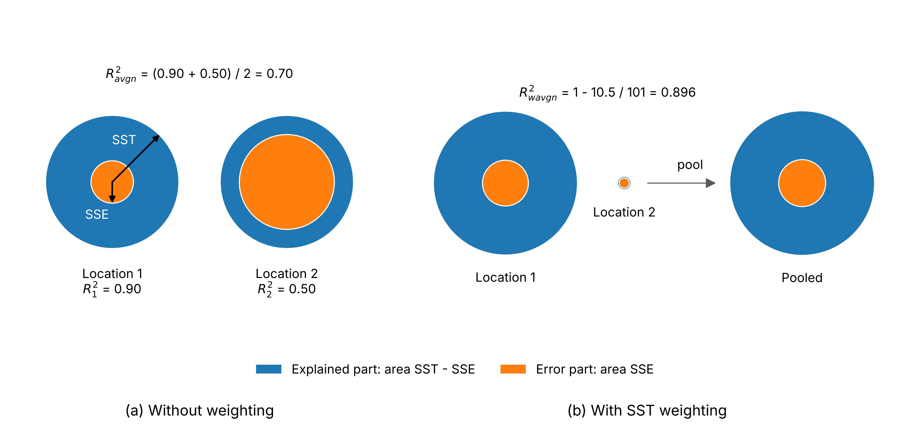
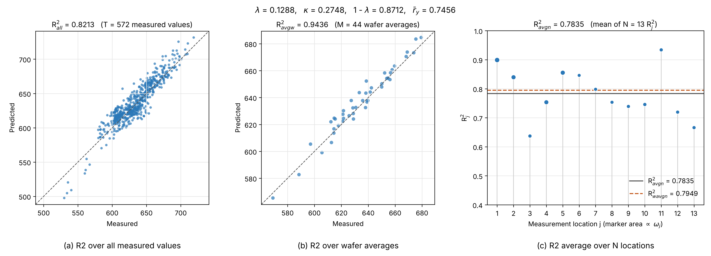

# R2 by Aggregation Level
Version 95 | Created: 2026-11-09 | Updated: 2026-11-12 23:21 UTC

- [1. Purpose](#1-purpose)
- [2. Summary](#2-summary)
- [3. Notations and Assumptions](#3-notations-and-assumptions)
- [4. Definitions](#4-definitions)
- [5. Practical Interpretation](#5-practical-interpretation)
  - [5.1 Core Identities](#51-core-identities)
  - [5.2 Differences and Inequalities](#52-differences-and-inequalities)
  - [5.3 Meaning of the Quantities](#53-meaning-of-the-quantities)
- [6. Worked Example](#6-worked-example)
- [7. Application](#7-application)
  - [7.1 Choosing an Aggregation Level](#71-choosing-an-aggregation-level)
  - [7.2 Breaking Conditions](#72-breaking-conditions)
- [Appendix A. Terminology](#appendix-a-terminology)
- [Appendix B. Mathematical Derivations](#appendix-b-mathematical-derivations)
  - [B.1 Sums of Squares](#b1-sums-of-squares)
  - [B.2 Core Identities](#b2-core-identities)
  - [B.3 Differences and Inequalities](#b3-differences-and-inequalities)
- [Appendix C. Variance Decomposition and Correlation](#appendix-c-variance-decomposition-and-correlation)
  - [C.1 Two-way Decomposition](#c1-two-way-decomposition)
  - [C.2 Aggregate Cross-location Correlation](#c2-aggregate-cross-location-correlation)
  - [C.3 Wafer Average Prediction as the Mean of Location Predictions](#c3-wafer-average-prediction-as-the-mean-of-location-predictions)
- [Appendix D. Q&A](#appendix-d-qa)
  - [D.1 Why do the plain and SST-weighted averages differ?](#d1-why-do-the-plain-and-sst-weighted-averages-differ)
  - [D.2 Why is the SST-weighted average meaningful?](#d2-why-is-the-sst-weighted-average-meaningful)
  - [D.3 Why not weight by SSE?](#d3-why-not-weight-by-sse)
- [Appendix E. Example with Measured Data](#appendix-e-example-with-measured-data)
  - [E.1 Identity Check against the Data](#e1-identity-check-against-the-data)
  - [E.2 Overall Error versus Error Concentration](#e2-overall-error-versus-error-concentration)
  - [E.3 What Limits the Minimum Location R2](#e3-what-limits-the-minimum-location-r2)

## 1. Purpose

- **Problem Statement**: 반도체 wafer $`M`$ 장에서 wafer 마다 측정 위치 (measurement location) $`N`$ 곳을 측정한 같은 데이터로 R² 를 전체 측정값, wafer 평균값, 측정 위치별 측정값에서 구하면 세 값이 서로 다르다. Wafer 평균의 예측값은 측정 위치 예측값의 평균일 수도, 따로 구한 값일 수도 있다.
- **Goal**: 전체 측정값으로 구한 $`R^2_{\mathrm{all}}`$, wafer 평균값으로 구한 $`R^2_{\mathrm{avgw}}`$, 측정 위치 R² 평균 $`R^2_{\mathrm{avgn}}`$, 측정 위치 R² 의 최솟값 $`R^2_{\mathrm{minn}}`$ 사이의 항등식과 부등식을 구하고 증명한다.
- **Non-Goal**: 예측 model 을 만들거나 고르는 방법, R² 의 표본 분포는 다루지 않는다.

## 2. Summary

전체 측정값, wafer 평균값, 측정 위치별 측정값으로 구한 세 R² 는 측정 위치 fraction of variance unexplained (FVU) $`q`$, 측정 위치 패턴 비율 $`\lambda`$, 오차 비 $`\kappa`$, 가중 평균과 산술 평균의 차이 $`\delta`$ 의 네 양으로 모두 적힌다.
세 R² 의 순서는 이 네 양의 계수 차이로 정해지며, 이 문서는 세 쌍 모두의 필요충분조건을 구한다.

예측은 wafer 마다 측정 위치의 측정값 $`y_{ij}`$ 와 wafer 평균 $`\bar{y}_{i\cdot}`$ 이며, 그 예측값이 $`\hat{y}_{ij}`$ 와 $`\hat{y}_{iw}`$ 이다. 이 R² 들은 예측의 성능을 wafer 평균을 관리하는 공정과 측정 위치마다 관리하는 공정 가운데 어디에 맞춰 보고할지 고르는 데, 그리고 $`R^2_{\mathrm{minn}}`$ 이 낮은 까닭을 측정 위치 전체의 오차와 오차 집중도로 가르는 데 쓴다.

## 3. Notations and Assumptions

Table 1. Symbols

| Symbol                             | Meaning                                                                                                                                            | Scope                        | Shape   | Assumption                                                           |
| :--------------------------------: | :------------------------------------------------------------------------------------------------------------------------------------------------: | :--------------------------: | :-----: | :------------------------------------------------------------------: |
| $`M`$                              | wafer 수                                                                                                                                           | -                            | integer | $`M \ge 2`$                                                          |
| $`N`$                              | wafer 한 장에서 측정하는 위치의 수                                                                                                                 | -                            | integer | $`N \ge 2`$                                                          |
| $`T`$                              | 전체 (all) 측정값의 개수 $`MN`$                                                                                                                    | -                            | integer | -                                                                    |
| $`i`$                              | wafer 번호                                                                                                                                         | -                            | integer | $`1 \le i \le M`$                                                    |
| $`j`$, $`k`$                       | 측정 위치의 번호                                                                                                                                   | -                            | integer | $`1 \le j, k \le N`$                                                 |
| $`y_{ij}`$                         | wafer $`i`$ 의 측정 위치 $`j`$ 에서 측정값                                                                                                         | per wafer,<br>per location   | scalar  | -                                                                    |
| $`\hat{y}_{ij}`$                   | wafer $`i`$ 의 측정 위치 $`j`$ 에 대한 예측값                                                                                                      | per wafer,<br>per location   | scalar  | -                                                                    |
| $`e_{ij}`$                         | 예측 오차 $`y_{ij} - \hat{y}_{ij}`$                                                                                                                | per wafer,<br>per location   | scalar  | -                                                                    |
| $`\bar{y}`$                        | 측정값 $`T`$ 개의 평균                                                                                                                             | all wafers,<br>all locations | scalar  | -                                                                    |
| $`\bar{y}_{i\cdot}`$               | wafer $`i`$ 의 wafer 평균 (average of wafer, avgw)                                                                                                 | per wafer,<br>all locations  | scalar  | -                                                                    |
| $`\hat{y}_{iw}`$                   | wafer $`i`$ 의 wafer 평균에 대한 예측값                                                                                                            | per wafer,<br>all locations  | scalar  | -                                                                    |
| $`e_{iw}`$                         | wafer 평균에서 그 예측값을 뺀 오차 $`\bar{y}_{i\cdot} - \hat{y}_{iw}`$                                                                             | per wafer,<br>all locations  | scalar  | -                                                                    |
| $`\bar{y}_{\cdot j}`$              | 측정 위치 $`j`$ 에서 wafer $`M`$ 장의 측정값 평균                                                                                                  | per location,<br>all wafers  | scalar  | -                                                                    |
| $`\mathrm{SST}`$, $`\mathrm{SSE}`$ | 평균에서 벗어난 제곱합 (total sum of squares) 과 오차 제곱합 (sum of squared errors)                                                               | 아래첨자에 따름              | scalar  | -                                                                    |
| $`R^2_j`$                          | 측정 위치 $`j`$ 에서 wafer $`M`$ 장으로 구한 R². $`N`$ 곳에서 산술 평균하면 avgn (average over $`N`$ locations)                                    | per location,<br>all wafers  | scalar  | -                                                                    |
| $`A`$                              | 측정 위치마다의 wafer 사이 변동 $`\mathrm{SST}_j`$ 의 합                                                                                           | all wafers,<br>all locations | scalar  | $`A \gt 0`$                                                          |
| $`B`$                              | 측정 위치 평균이 서로 달라 생기는 제곱합                                                                                                           | all wafers,<br>all locations | scalar  | $`B \ge 0`$                                                          |
| $`E`$                              | 측정 위치마다의 오차 제곱합 $`\mathrm{SSE}_j`$ 의 합                                                                                               | all wafers,<br>all locations | scalar  | $`E \ge 0`$                                                          |
| $`\omega_j`$                       | 측정 위치 $`j`$ 의 SST 가중치. $`\mathrm{SST}_j`$ 를 $`A`$ 로 나눈 값                                                                              | per location,<br>all wafers  | scalar  | $`\sum_j \omega_j = 1`$                                              |
| $`R^2_{\mathrm{wavgn}}`$           | 측정 위치마다 구한 $`R^2_j`$ 를 $`\mathrm{SST}_j`$ 에 비례하는 가중치로 평균한 값 (SST-weighted R2 average over $`N`$ locations, wavgn)            | all wafers,<br>all locations | scalar  | -                                                                    |
| $`q`$                              | 측정 위치 예측의 FVU (fraction of variance unexplained). FVU 는 측정값의 평균을 기준으로 정규화한 제곱예측오차 비율이다. $`E`$ 를 $`A`$ 로 나눈 값 | all wafers,<br>all locations | scalar  | $`q \ge 0`$                                                          |
| $`\lambda`$                        | 측정 위치 평균의 차이가 $`\mathrm{SST}_{\mathrm{all}}`$ 에서 차지하는 비율 (location pattern fraction)                                             | all wafers,<br>all locations | scalar  | $`0 \le \lambda \lt 1`$                                              |
| $`\kappa`$                         | 오차 비 (error ratio). wafer 평균 예측의 FVU 를 측정 위치 예측의 FVU $`q`$ 로 나눈 값                                                              | all wafers,<br>all locations | scalar  | $`\kappa \ge 0`$, $`E \gt 0`$ 일 때만 정의                           |
| $`\delta`$                         | $`R^2_{\mathrm{wavgn}}`$ 에서 $`R^2_{\mathrm{avgn}}`$ 을 뺀 값                                                                                     | all wafers,<br>all locations | scalar  | -                                                                    |
| $`\gamma_n`$                       | 오차 집중도 (error concentration). $`1 - R^2_{\mathrm{minn}}`$ 을 $`1 - R^2_{\mathrm{avgn}}`$ 으로 나눈 값                                         | all wafers,<br>all locations | scalar  | $`1 \le \gamma_n \le N`$, $`R^2_{\mathrm{avgn}} \lt 1`$ 일 때만 정의 |

🥑 아래첨자의 점 ($`\cdot`$) 은 점 표기 (dot notation) 로, 점으로 바꾼 첨자에 대해 모두 더했다는 뜻이다. 예를 들어 $`y_{i\cdot} = \sum_{j} y_{ij}`$ 는 wafer $`i`$ 의 측정값 $`N`$ 개를 모두 더한 값이다. 점 표기에 bar 를 얹으면 합 대신 평균이 되어, $`\bar{y}_{i\cdot}`$ 는 $`j`$ 에 대한 평균이고 $`\bar{y}_{\cdot j}`$ 는 $`i`$ 에 대한 평균이다.

SST, SSE, R² 의 아래첨자 $`\mathrm{all}`$ 은 측정값 $`T`$ 개, $`\mathrm{avgw}`$ 는 wafer 평균값, $`j`$ 는 측정 위치 $`j`$, $`\mathrm{avgn}`$ 은 측정 위치 R² 평균, $`\mathrm{wavgn}`$ 은 측정 위치 $`N`$ 곳의 R² 를 SST 로 가중 평균한 것 (weighted average over $`N`$ locations), $`\mathrm{minn}`$ 은 측정 위치 $`N`$ 곳의 R² 가운데 최솟값 (minimum over $`N`$ locations) 을 뜻한다. $`\hat{y}_{iw}`$ 와 $`e_{iw}`$ 의 둘째 아래첨자 $`w`$ 는 측정 위치 번호가 아니라 wafer 한 장에 하나인 값임을 뜻한다. SST, SSE, R², $`q`$, $`\lambda`$, $`\kappa`$, $`\delta`$ 는 주어진 측정값과 예측값으로 정의하는 양이며 모수를 추정한 값이 아니므로 hat 을 붙이지 않는다. Hat 을 붙인 $`\hat{y}_{ij}`$ 와 $`\hat{y}_{iw}`$ 는 예측값이다. 기호를 읽는 법은 [Appendix A](#appendix-a-terminology) 에 있다.

이 문서의 식은 아래 다섯 가정에서 성립한다.

- 모든 wafer 가 같은 측정 위치 $`N`$ 곳을 갖는다.
- 모든 측정 위치에서 $`\mathrm{SST}_j \gt 0`$ 이다. 그래서 $`R^2_j`$ 가 정의되고 $`A \gt 0`$, $`\lambda \lt 1`$ 이다.
- $`\mathrm{SST}_{\mathrm{avgw}} \gt 0`$ 이다. 그래서 $`R^2_{\mathrm{avgw}}`$ 가 정의된다.
- $`\gamma_n`$ 은 $`R^2_{\mathrm{avgn}} \lt 1`$ 일 때만 정의한다.
- $`\kappa`$ 는 $`E \gt 0`$ 일 때만 정의한다. $`E = 0`$ 이면 $`\kappa`$ 대신 $`1 - R^2_{\mathrm{avgw}} = \mathrm{SSE}_{\mathrm{avgw}} / \mathrm{SST}_{\mathrm{avgw}}`$ 를 그대로 쓴다.
- Wafer 평균 예측값 $`\hat{y}_{iw}`$ 는 측정 위치 예측값의 평균이어도 되고 따로 구한 값이어도 된다. 평균인 경우에만 성립하는 결과는 [C.3](#c3-wafer-average-prediction-as-the-mean-of-location-predictions) 에 있다.

## 4. Definitions

> **Definition: R2 over all measured values**<br>
> 전체 측정값으로 구한 $`R^2_{\mathrm{all}}`$ 은 측정값 $`T = MN`$ 개에서, 1 에서 예측 오차 제곱합 $`\mathrm{SSE}_{\mathrm{all}}`$ 을 측정값과 전체 평균의 차이의 제곱합 $`\mathrm{SST}_{\mathrm{all}}`$ 로 나눈 값을 뺀 값이다.
> ```math
> e_{ij} := y_{ij} - \hat{y}_{ij}
> \hspace{19em} (1)
> ```
> ```math
> \bar{y} := \frac{1}{MN} \sum_{i=1}^{M} \sum_{j=1}^{N} y_{ij}
> \hspace{19em} (2)
> ```
> ```math
> \mathrm{SST}_{\mathrm{all}} := \sum_{i=1}^{M} \sum_{j=1}^{N} \left( y_{ij} - \bar{y} \right)^2
> \hspace{19em} (3)
> ```
> ```math
> \mathrm{SSE}_{\mathrm{all}} := \sum_{i=1}^{M} \sum_{j=1}^{N} e_{ij}^2
> \hspace{19em} (4)
> ```
> ```math
> R^2_{\mathrm{all}} := 1 - \frac{\mathrm{SSE}_{\mathrm{all}}}{\mathrm{SST}_{\mathrm{all}}}
> \hspace{19em} (5)
> ```

> **Definition: R2 over wafer averages**<br>
> Wafer 평균값으로 구한 $`R^2_{\mathrm{avgw}}`$ 는 wafer 평균 $`M`$ 개에서, 1 에서 wafer 평균 예측 오차의 제곱합 $`\mathrm{SSE}_{\mathrm{avgw}}`$ 를 wafer 평균과 전체 평균의 차이의 제곱합 $`\mathrm{SST}_{\mathrm{avgw}}`$ 로 나눈 값을 뺀 값이다.
> ```math
> \bar{y}_{i\cdot} := \frac{1}{N} \sum_{j=1}^{N} y_{ij}
> \hspace{19em} (6)
> ```
> ```math
> e_{iw} := \bar{y}_{i\cdot} - \hat{y}_{iw}
> \hspace{19em} (7)
> ```
> ```math
> \mathrm{SST}_{\mathrm{avgw}} := \sum_{i=1}^{M} \left( \bar{y}_{i\cdot} - \bar{y} \right)^2
> \hspace{19em} (8)
> ```
> ```math
> \mathrm{SSE}_{\mathrm{avgw}} := \sum_{i=1}^{M} e_{iw}^2
> \hspace{19em} (9)
> ```
> ```math
> R^2_{\mathrm{avgw}} := 1 - \frac{\mathrm{SSE}_{\mathrm{avgw}}}{\mathrm{SST}_{\mathrm{avgw}}}
> \hspace{19em} (10)
> ```

> **Definition: R2 average over N locations**<br>
> 측정 위치 R² 평균 $`R^2_{\mathrm{avgn}}`$ 은 측정 위치마다 wafer $`M`$ 장의 측정값과 예측값으로 구한 R² $`R^2_j`$ 를, 측정 위치 $`N`$ 곳에서 산술 평균한 값이다.
> ```math
> \bar{y}_{\cdot j} := \frac{1}{M} \sum_{i=1}^{M} y_{ij}
> \hspace{19em} (11)
> ```
> ```math
> \mathrm{SST}_j := \sum_{i=1}^{M} \left( y_{ij} - \bar{y}_{\cdot j} \right)^2
> \hspace{19em} (12)
> ```
> ```math
> \mathrm{SSE}_j := \sum_{i=1}^{M} e_{ij}^2
> \hspace{19em} (13)
> ```
> ```math
> R^2_j := 1 - \frac{\mathrm{SSE}_j}{\mathrm{SST}_j}
> \hspace{19em} (14)
> ```
> ```math
> R^2_{\mathrm{avgn}} := \frac{1}{N} \sum_{j=1}^{N} R^2_j
> \hspace{19em} (15)
> ```

> **Definition: Min R2 across N points**<br>
> 측정 위치 R² 의 최솟값 $`R^2_{\mathrm{minn}}`$ 은 측정 위치마다 wafer $`M`$ 장의 측정값과 예측값으로 구한 R² $`R^2_j`$ 가운데, 측정 위치 $`N`$ 곳에서 가장 작은 값이다.
> ```math
> R^2_{\mathrm{minn}} := \min_{j} R^2_j
> \hspace{19em} (16)
> ```

> **Definition: Quantities linking the three R2**<br>
> 세 R² 를 잇는 데 쓰는 Table 1 의 양은 측정 위치마다의 제곱합 $`\mathrm{SST}_j`$, $`\mathrm{SSE}_j`$ 와 측정 위치 평균 $`\bar{y}_{\cdot j}`$, 그리고 wafer 평균의 제곱합 $`\mathrm{SST}_{\mathrm{avgw}}`$, $`\mathrm{SSE}_{\mathrm{avgw}}`$ 로 정한다.
> ```math
> A := \sum_{j=1}^{N} \mathrm{SST}_j
> \hspace{19em} (17)
> ```
> ```math
> B := M \sum_{j=1}^{N} \left( \bar{y}_{\cdot j} - \bar{y} \right)^2
> \hspace{19em} (18)
> ```
> ```math
> E := \sum_{j=1}^{N} \mathrm{SSE}_j
> \hspace{19em} (19)
> ```
> ```math
> \omega_j := \frac{\mathrm{SST}_j}{A}
> \hspace{19em} (20)
> ```
> ```math
> R^2_{\mathrm{wavgn}} := 1 - \frac{E}{A}
> \hspace{19em} (21)
> ```
> ```math
> q := \frac{E}{A}
> \hspace{19em} (22)
> ```
> ```math
> \lambda := \frac{B}{A + B}
> \hspace{19em} (23)
> ```
> ```math
> \kappa := \frac{\mathrm{SSE}_{\mathrm{avgw}}}{\mathrm{SST}_{\mathrm{avgw}}} \cdot \frac{A}{E}
> \hspace{19em} (24)
> ```
> ```math
> \delta := R^2_{\mathrm{wavgn}} - R^2_{\mathrm{avgn}}
> \hspace{19em} (25)
> ```

> **Theorem: Minimum location R2 identity and bounds**<br>
> 모든 측정 위치에서 $`\mathrm{SST}_j \gt 0`$ 이고 $`R^2_{\mathrm{avgn}} \lt 1`$ 이라 하고, 측정 위치 R² 의 최솟값의 FVU $`1 - R^2_{\mathrm{minn}}`$ 을 측정 위치 R² 평균의 FVU $`1 - R^2_{\mathrm{avgn}}`$ 으로 나눈 값을 오차 집중도 $`\gamma_n`$ 이라 하자. 그러면 $`\gamma_n`$ 은 1 이상 $`N`$ 이하이다. 그래서 $`R^2_{\mathrm{minn}}`$ 은 $`1 - N(1 - R^2_{\mathrm{avgn}})`$ 이상 $`R^2_{\mathrm{avgn}}`$ 이하이며, 모든 측정 위치의 $`R^2_j`$ 가 같을 때 $`\gamma_n = 1`$ 이다.
> ```math
> \gamma_n := \frac{1 - R^2_{\mathrm{minn}}}{1 - R^2_{\mathrm{avgn}}}
> \hspace{19em} (26)
> ```
> ```math
> 1 \le \gamma_n \le N
> \hspace{19em} (27)
> ```
> ```math
> 1 - N \left( 1 - R^2_{\mathrm{avgn}} \right) \le R^2_{\mathrm{minn}} \le R^2_{\mathrm{avgn}}
> \hspace{19em} (28)
> ```

증명은 [B.3](#b3-differences-and-inequalities) 에 있다.

식 (26) 의 양변에 $`1 - R^2_{\mathrm{avgn}}`$ 을 곱하면, 최악 측정 위치의 FVU 가 아래 식 (29) 와 같이 오차 집중도와 측정 위치 FVU 의 평균의 곱으로 정확히 나뉜다.

```math
\underbrace{1 - R^2_{\mathrm{minn}}}_{\text{FVU of the worst location}} = \underbrace{\gamma_n}_{\text{error concentration}} \, \underbrace{(1 - R^2_{\mathrm{avgn}})}_{\text{mean FVU over locations}}
\hspace{19em} (29)
```

- 그래서 예측 model 을 견줄 때 $`R^2_{\mathrm{minn}}`$ 이 낮아진 까닭이 측정 위치 전체의 오차가 커진 것인지, 오차가 한 측정 위치에 몰린 것인지를 가를 수 있다. 측정 데이터로 가른 예는 [E.2](#e2-overall-error-versus-error-concentration) 에 있다.
- $`\gamma_n = 1`$ 은 모든 측정 위치의 $`R^2_j`$ 가 같을 때, 그리고 그때만이다. $`\gamma_n = N`$ 은 측정 위치 한 곳을 뺀 나머지의 $`R^2_j`$ 가 모두 1 일 때이다.

## 5. Practical Interpretation

### 5.1 Core Identities

꼭지 4 에서 정의한 세 R² 는 아래 식 (32), 식 (33), 식 (34) 와 같이 $`q`$, $`\lambda`$, $`\kappa`$, $`\delta`$ 로 모두 적힌다. 그 바탕은 식 (30) 과 식 (31) 의 제곱합 분해이며, 증명은 [Appendix B](#appendix-b-mathematical-derivations) 에 있다.

```math
\mathrm{SST}_{\mathrm{all}} = A + B
\hspace{19em} (30)
```

```math
\mathrm{SSE}_{\mathrm{all}} = E
\hspace{19em} (31)
```

```math
R^2_{\mathrm{all}} = 1 - (1 - \lambda)\, q
\hspace{19em} (32)
```

```math
R^2_{\mathrm{avgw}} = 1 - \kappa\, q
\hspace{19em} (33)
```

```math
R^2_{\mathrm{avgn}} = 1 - q - \delta
\hspace{19em} (34)
```

```math
R^2_{\mathrm{wavgn}} = \sum_{j=1}^{N} \omega_j R^2_j
\hspace{19em} (35)
```

```math
\delta = \frac{1}{A} \sum_{j=1}^{N} \left( \mathrm{SST}_j - \frac{A}{N} \right) \left( R^2_j - R^2_{\mathrm{avgn}} \right)
\hspace{19em} (36)
```

- 식 (30), 식 (31): $`\mathrm{SST}_{\mathrm{all}}`$ 은 측정 위치마다의 wafer 사이 변동 $`A`$ 에 측정 위치 평균의 차이 $`B`$ 가 더해진 값이고, $`\mathrm{SSE}_{\mathrm{all}}`$ 은 측정 위치 SSE 의 합 $`E`$ 와 같다.
- 식 (32), 식 (33), 식 (34): 세 R² 는 모두 1 에서 $`q`$ 에 계수를 곱한 값을 뺀 꼴이며, 계수는 $`R^2_{\mathrm{all}}`$ 이 $`1 - \lambda`$, $`R^2_{\mathrm{avgw}}`$ 가 $`\kappa`$ 이다. $`R^2_{\mathrm{avgn}}`$ 은 계수 1 에 $`\delta`$ 를 더 뺀다. $`q = 1 - R^2_{\mathrm{wavgn}}`$ 이므로 세 식은 $`R^2_{\mathrm{wavgn}}`$ 을 거쳐 이어진다.
- 식 (33) 은 $`E \gt 0`$ 일 때 쓴다. $`E = 0`$ 이면 측정 위치 R² 는 모두 1 이지만, 따로 구한 wafer 평균 예측의 $`\mathrm{SSE}_{\mathrm{avgw}}`$ 는 0 이 아닐 수 있어 $`R^2_{\mathrm{avgw}}`$ 는 1 보다 작을 수 있다.
- 식 (35): $`R^2_{\mathrm{wavgn}}`$ 은 $`R^2_j`$ 를 SST 가중치 $`\omega_j`$ 로 평균한 값이다. 직관적 의미는 [Appendix D](#appendix-d-qa) 에 있다.
- 식 (36): $`\delta`$ 는 측정 위치마다의 $`\mathrm{SST}_j`$ 와 $`R^2_j`$ 가 함께 움직이는 정도이다. $`\mathrm{SST}_j`$ 가 큰 측정 위치에서 $`R^2_j`$ 도 큰 경향이 있으면 $`\delta \gt 0`$ 이다. $`\mathrm{SST}_j`$ 가 모두 같으면 $`\delta = 0`$ 이지만, 이것은 충분조건일 뿐이다. 예를 들어 $`R^2_j`$ 가 모두 같으면 $`\mathrm{SST}_j`$ 가 달라도 $`\delta = 0`$ 이다.

### 5.2 Differences and Inequalities

세 R² 와 $`R^2_{\mathrm{wavgn}}`$ 사이의 차이는 식 (32), 식 (33), 식 (34) 에서 아래 식 (37) 부터 식 (41) 로 바로 나온다.

```math
R^2_{\mathrm{all}} - R^2_{\mathrm{wavgn}} = \lambda\, q
\hspace{19em} (37)
```

```math
R^2_{\mathrm{avgw}} - R^2_{\mathrm{wavgn}} = (1 - \kappa)\, q
\hspace{19em} (38)
```

```math
R^2_{\mathrm{all}} - R^2_{\mathrm{avgw}} = (\kappa - 1 + \lambda)\, q
\hspace{19em} (39)
```

```math
R^2_{\mathrm{all}} - R^2_{\mathrm{avgn}} = \lambda\, q + \delta
\hspace{19em} (40)
```

```math
R^2_{\mathrm{avgw}} - R^2_{\mathrm{avgn}} = (1 - \kappa)\, q + \delta
\hspace{19em} (41)
```

$`\lambda \ge 0`$ 이고 $`q \ge 0`$ 이므로, $`q \gt 0`$ 일 때 각 차이의 부호에서 아래 Table 2 의 필요충분조건이 나온다.

Table 2. Necessary and sufficient conditions among the R2

| Inequality                                       | Condition                     | From    |
| :----------------------------------------------: | :---------------------------: | :-----: |
| $`R^2_{\mathrm{all}} \ge R^2_{\mathrm{wavgn}}`$  | 언제나                        | 식 (37) |
| $`R^2_{\mathrm{avgw}} \ge R^2_{\mathrm{wavgn}}`$ | $`\kappa \le 1`$              | 식 (38) |
| $`R^2_{\mathrm{all}} \ge R^2_{\mathrm{avgw}}`$   | $`\kappa \ge 1 - \lambda`$    | 식 (39) |
| $`R^2_{\mathrm{all}} \ge R^2_{\mathrm{avgn}}`$   | $`\delta \ge -\lambda q`$     | 식 (40) |
| $`R^2_{\mathrm{avgw}} \ge R^2_{\mathrm{avgn}}`$  | $`\delta \ge (\kappa - 1) q`$ | 식 (41) |

- Goal 의 세 쌍은 아래 세 행이며, 세 쌍 모두 조건이 필요충분조건이다. $`\delta \lt 0`$ 이어도 $`\lambda q`$ 나 $`(1 - \kappa) q`$ 가 충분히 크면 $`R^2_{\mathrm{all}}`$ 이나 $`R^2_{\mathrm{avgw}}`$ 가 $`R^2_{\mathrm{avgn}}`$ 이상이다.
- 식 (39) 는 $`\kappa`$ 로 나누지 않으므로 $`\kappa = 0`$ 일 때도 성립한다.
- $`q = 0`$ 이면 식 (37), 식 (38), 식 (39) 의 차이가 모두 0 이다.

측정 위치 R² 의 최솟값과 최댓값은 아래 식 (42), 식 (43) 으로 범위가 정해진다.

```math
R^2_{\mathrm{wavgn}} \ge R^2_{\mathrm{minn}}
\hspace{19em} (42)
```

```math
R^2_{\mathrm{wavgn}} \le \max_{j} R^2_j
\hspace{19em} (43)
```

- 식 (42), 식 (43): $`R^2_{\mathrm{wavgn}}`$ 과 $`R^2_{\mathrm{avgn}}`$ 은 모두 $`R^2_j`$ 의 평균이므로 $`R^2_j`$ 의 최솟값과 최댓값 사이에 있다. 그래서 $`R^2_{\mathrm{minn}}`$ 의 위쪽 범위는 두 평균 가운데 작은 값이다.
- $`R^2_{\mathrm{minn}}`$ 을 세 R² 와 $`R^2_{\mathrm{wavgn}}`$ 으로 정하는 항등식은 없다. 이 값들은 모두 측정 위치 SSE 와 SST 의 합이나 평균으로 정해져, 측정 위치 하나의 값을 가려내지 못한다. $`R^2_{\mathrm{minn}}`$ 은 식 (26) 의 오차 집중도 $`\gamma_n`$ 으로 $`R^2_{\mathrm{avgn}}`$ 과 이어지며, 그 범위는 식 (27) 과 식 (28) 이다.

### 5.3 Meaning of the Quantities

- **$`q`$**: 측정 위치 $`N`$ 곳의 wafer 사이 변동 $`A`$ 에 대한 측정 위치 오차 $`E`$ 의 비율이다. 세 R² 가 공통으로 쓰는 기준이다.
- **$`\lambda`$**: 측정값만으로 정해지며 예측값과 무관하다. 식 (37) 의 차이 $`\lambda q`$ 는 예측이 측정 위치 패턴을 맞혔다는 뜻이 아니다. $`\mathrm{SST}_{\mathrm{all}}`$ 에는 측정 위치 평균의 차이 $`B`$ 가 더해지지만 $`\mathrm{SSE}_{\mathrm{all}}`$ 은 $`E`$ 그대로여서, 두 R² 의 기준 변동이 달라서 생기는 차이다.
- **$`\kappa`$**: 두 집계 수준의 FVU 의 비이다. $`1 - \kappa`$ 는 측정 위치 예측과 견주어 wafer 평균 예측의 정규화된 제곱오차가 얼마나 작은지를 나타내며, 양수이면 $`R^2_{\mathrm{avgw}}`$ 가 $`R^2_{\mathrm{wavgn}}`$ 보다 크다. Wafer 평균 예측을 따로 구하면 $`\kappa \gt 1`$ 일 수 있고, 그때 $`1 - \kappa`$ 는 음수이다.
- **$`\delta`$**: 가중 평균과 산술 평균의 차이이며, 식 (36) 대로 $`\mathrm{SST}_j`$ 와 $`R^2_j`$ 가 함께 움직이는 정도로 정해진다.
- **R² 의 뜻**: 이 문서의 R² 는 $`1 - \mathrm{SSE}/\mathrm{SST}`$ 이며, 그 집계 수준의 평균을 예측값으로 쓸 때와 견주어 제곱오차가 얼마나 줄었는지를 나타낸다. 측정값과 예측값의 상관계수를 제곱한 값과는 다르며, 예측이 평균보다 나쁘면 음수이다.

$`\lambda`$ 와 $`\kappa`$ 를 wafer 평균과 그 차이로 나누어 적는 방법과, $`\kappa`$ 를 측정값의 상관으로 적는 방법은 [Appendix C](#appendix-c-variance-decomposition-and-correlation) 에 있다.

## 6. Worked Example

Wafer $`M = 3`$ 장, 측정 위치 $`N = 2`$ 곳의 측정값과 예측값은 아래 Table 3 이다.

Table 3. Measured and predicted values

| Wafer i | y_i1 | y_i2 | Predicted y_i1 | Predicted y_i2 | e_i1 | e_i2 | Wafer average | Predicted wafer average | Wafer average error |
| :-----: | :--: | :--: | :------------: | :------------: | :--: | :--: | :-----------: | :---------------------: | :-----------------: |
| 1       | 10   | 12   | 11             | 12             | -1   | 0    | 11            | 11.5                    | -0.5                |
| 2       | 13   | 15   | 13             | 14             | 0    | 1    | 14            | 13.0                    | 1.0                 |
| 3       | 16   | 20   | 15             | 19             | 1    | 1    | 18            | 17.5                    | 0.5                 |

Wafer 평균 예측값은 측정 위치 예측값과 따로 구한 값이어서, wafer 2 의 13.0 은 측정 위치 예측값 평균 13.5 와 다르다. 전체 평균은 86/6 = 14.3333, 측정 위치 평균은 13 과 15.6667 이다. 꼭지 4 의 정의 식으로 구한 값은 아래 Table 4 이다.

Table 4. Sums of squares and R2 values

| Quantity                                 | SST     | SSE | Calculation                     | Symbol   | Value  |
| :--------------------------------------: | :-----: | :-: | :-----------------------------: | :------: | :----: |
| R2 over all measured values              | 61.3333 | 4   | 1 - 4 / 61.3333                 | R2_all   | 0.9348 |
| R2 over wafer averages                   | 24.6667 | 1.5 | 1 - 1.5 / 24.6667               | R2_avgw  | 0.9392 |
| Location 1                               | 18      | 2   | 1 - 2 / 18                      | R2_1     | 0.8889 |
| Location 2                               | 32.6667 | 2   | 1 - 2 / 32.6667                 | R2_2     | 0.9388 |
| R2 average over N locations              | -       | -   | (0.8889 + 0.9388) / 2           | R2_avgn  | 0.9138 |
| SST-weighted R2 average over N locations | 50.6667 | 4   | 1 - 4 / 50.6667                 | R2_wavgn | 0.9211 |
| Location error share                     | -       | -   | 4 / 50.6667                     | q        | 0.0789 |
| Location pattern                         | -       | -   | 10.6667 / (50.6667 + 10.6667)   | lambda   | 0.1739 |
| Error ratio                              | -       | -   | (1.5 / 24.6667) × (50.6667 / 4) | kappa    | 0.7703 |
| Weighted minus plain average             | -       | -   | 0.9211 - 0.9138                 | delta    | 0.0072 |

Table 4 의 값을 넣어 식 (32), 식 (33), 식 (34) 와 세 R² 의 순서를 확인하면 아래 네 항목이다.

- 식 (32): (1 - 0.1739) × 0.0789 = 0.0652 이어서 R2_all = 1 - 0.0652 = 0.9348 이다.
- 식 (33): 0.7703 × 0.0789 = 0.0608 이어서 R2_avgw = 1 - 0.0608 = 0.9392 이다.
- 식 (34): 1 - 0.0789 - 0.0072 = 0.9138 이 R2_avgn 이다.
- 순서: $`\kappa`$ = 0.7703 이 $`1 - \lambda`$ = 0.8261 보다 작아 R2_avgw 가 R2_all 보다 크고, $`\delta`$ = 0.0072 가 $`-\lambda q`$ = -0.0137 보다 커서 R2_all 이 R2_avgn 보다 크다. 그래서 R2_avgw = 0.9392, R2_all = 0.9348, R2_avgn = 0.9138 의 차례이다.

## 7. Application

### 7.1 Choosing an Aggregation Level

같은 측정 데이터와 예측으로도 어느 집계 수준의 R² 를 보고하는지에 따라 model 의 성능이 다르게 보이므로, 보고하는 R² 의 집계 수준을 함께 밝힌다.

- $`R^2_{\mathrm{all}}`$: 기준 변동에 측정 위치 평균의 차이 $`B`$ 가 들어 있어, 같은 $`E`$ 에서도 $`R^2_{\mathrm{wavgn}}`$ 보다 $`\lambda q`$ 만큼 크다. 예를 들어 예측값을 측정 위치 평균 $`\bar{y}_{\cdot j}`$ 로 두면 측정 위치마다 $`\mathrm{SSE}_j = \mathrm{SST}_j`$ 이어서 $`R^2_{\mathrm{wavgn}} = 0`$ 이지만 $`R^2_{\mathrm{all}} = \lambda`$ 이다.
- $`R^2_{\mathrm{avgw}}`$: wafer 평균 예측의 제곱오차를 wafer 평균 사이 변동과 견준다. Wafer 평균을 관리하는 공정에서 쓴다.
- $`R^2_{\mathrm{avgn}}`$ 과 $`R^2_{\mathrm{wavgn}}`$: 측정 위치마다의 wafer 사이 변동을 기준으로 한다. 측정 위치마다 관리하는 공정에서 쓰며, 측정 위치마다 변동의 크기가 다르면 $`R^2_{\mathrm{wavgn}}`$ 이 변동이 거의 없는 측정 위치에 덜 흔들린다.

### 7.2 Breaking Conditions

- Wafer 마다 측정 위치의 수나 위치가 다르면 식 (30) 과 식 (32) 가 성립하지 않는다. 식 (30) 의 교차항이 0 이 되는 단계와 [C.2](#c2-aggregate-cross-location-correlation) 의 식에 모든 wafer 의 측정 위치가 같다는 가정이 쓰인다.
- R² 를 측정값과 예측값의 상관계수 제곱으로 구하면 SSE 와 SST 의 비가 아니므로 식 (32) 부터 식 (41) 이 모두 성립하지 않는다.
- 어떤 측정 위치에서 측정값이 wafer 사이에서 같아 $`\mathrm{SST}_j = 0`$ 이면 $`R^2_j`$ 와 $`R^2_{\mathrm{avgn}}`$ 이 정의되지 않는다.

---

## Appendix A. Terminology

- **dot notation**: 아래첨자 하나를 점 ($`\cdot`$) 으로 바꾸어 그 첨자에 대해 모두 더했음을 나타내는 표기. 예: $`y_{i\cdot} = \sum_{j} y_{ij}`$.
- **error concentration**: 식 (26) 의 $`\gamma_n`$. 측정 위치 R² 의 최솟값의 FVU 를 측정 위치 R² 평균의 FVU 로 나눈 값.
- **error ratio**: 식 (24) 의 $`\kappa`$. wafer 평균 예측의 FVU 를 측정 위치 예측의 FVU 로 나눈 값.
- **fraction of variance unexplained (FVU)**: R² 를 1 에서 뺀 값. SSE 를 SST 로 나눈 값과 같다.
- **location pattern fraction**: 식 (23) 의 $`\lambda`$. 측정 위치 평균이 서로 달라 생기는 제곱합이 $`\mathrm{SST}_{\mathrm{all}}`$ 에서 차지하는 비율.
- **measurement location**: wafer 위에서 측정값을 얻는 지점. 모든 wafer 에서 같은 번호 $`j`$ 는 같은 지점이다.
- **min R2 across N points**: 식 (16) 의 $`R^2_{\mathrm{minn}}`$. 측정 위치 $`N`$ 곳의 $`R^2_j`$ 가운데 가장 작은 값.
- **R2 (coefficient of determination)**: $`1 - \mathrm{SSE}/\mathrm{SST}`$. 평균을 예측값으로 쓸 때와 견주어 제곱오차가 줄어든 정도.
- **SST-weighted R2 average over N locations**: 식 (21) 의 $`R^2_{\mathrm{wavgn}}`$. 측정 위치 R² $`R^2_j`$ 를 $`\mathrm{SST}_j`$ 에 비례하는 가중치로 평균한 값이며, 측정 위치 $`N`$ 곳의 SSE 합과 SST 합으로 구한 R² 와 같다.
- **sum of squared errors (SSE)**: 예측 오차를 제곱해 더한 값.
- **total sum of squares (SST)**: 측정값과 그 평균의 차이를 제곱해 더한 값.
- **wafer average**: wafer 한 장의 측정값 $`N`$ 개를 산술 평균한 값.

특수 기호를 읽는 법은 아래 목록이다.

- $`\hat{y}_{ij}`$: 영어로 "y hat i j", 한국어로 "와이 햇 아이 제이" 라 읽는다.
- $`\bar{y}`$: 영어로 "y bar", 한국어로 "와이 바" 라 읽는다.
- $`\bar{y}_{i\cdot}`$: 영어로 "y bar i dot", 한국어로 "와이 바 아이 닷" 이라 읽는다.
- $`\bar{y}_{\cdot j}`$: 영어로 "y bar dot j", 한국어로 "와이 바 닷 제이" 라 읽는다.
- $`\hat{y}_{iw}`$: 영어로 "y hat i w", 한국어로 "와이 햇 아이 더블유" 라 읽는다.
- $`\lambda`$, $`\kappa`$, $`\delta`$, $`\omega_j`$, $`\gamma_n`$: 영어로 "lambda", "kappa", "delta", "omega j", "gamma n", 한국어로 "람다", "카파", "델타", "오메가 제이", "감마 엔" 이라 읽는다.
- $`\bar{r}_y`$: 영어로 "r bar y", 한국어로 "알 바 와이" 라 읽는다.
- $`\sum`$: 영어로 "sum", 한국어로 "합" 이라 읽는다.
- $`\min_j`$, $`\max_j`$: 영어로 "minimum over j", "maximum over j", 한국어로 "제이에 대한 최솟값", "제이에 대한 최댓값" 이라 읽는다.
- $`\sum_{j \ne k}`$: 영어로 "sum over j not equal to k", 한국어로 "제이와 케이가 다른 모든 순서쌍에 대한 합" 이라 읽는다.

## Appendix B. Mathematical Derivations

### B.1 Sums of Squares

식 (30) 은 측정값과 전체 평균의 차이를 측정 위치 평균에서 나누어 증명한다.

```math
y_{ij} - \bar{y} = \left( y_{ij} - \bar{y}_{\cdot j} \right) + \left( \bar{y}_{\cdot j} - \bar{y} \right)
\hspace{19em} (44)
```

- 식 (44): $`\bar{y}_{\cdot j}`$ 를 빼고 더했다.

식 (44) 를 식 (3) 에 넣고 제곱을 전개한다. 첫 항의 합은 식 (12) 와 식 (17) 로 $`A`$, 셋째 항의 합은 식 (18) 의 $`B`$ 이다. 교차항은 $`\sum_i (y_{ij} - \bar{y}_{\cdot j}) = 0`$ 이므로 0 이다. 따라서 식 (30) 이 성립한다. 식 (31) 도 식 (4) 의 합의 순서를 바꾸면 식 (13) 과 식 (19) 로 성립한다.

```math
\mathrm{SST}_{\mathrm{all}} = A + B
\hspace{19em} (30)
```

```math
\mathrm{SSE}_{\mathrm{all}} = E
\hspace{19em} (31)
```

### B.2 Core Identities

```math
1 - R^2_{\mathrm{all}} = \frac{A}{A + B} \cdot \frac{E}{A}
\hspace{19em} (45)
```

- 식 (45): 식 (5) 에 식 (30) 과 식 (31) 을 넣고, 분자와 분모에 $`A`$ 를 곱했다.

식 (45) 의 첫 분수는 식 (23) 으로 $`1 - \lambda`$, 둘째 분수는 식 (22) 의 $`q`$ 이다. 식 (10) 의 $`\mathrm{SSE}_{\mathrm{avgw}} / \mathrm{SST}_{\mathrm{avgw}}`$ 는 식 (24) 와 식 (22) 로 $`\kappa q`$ 와 같고, 식 (25) 와 식 (21), 식 (22) 에서 $`R^2_{\mathrm{avgn}} = R^2_{\mathrm{wavgn}} - \delta = 1 - q - \delta`$ 이다. 따라서 식 (32), 식 (33), 식 (34) 가 성립한다.

```math
R^2_{\mathrm{all}} = 1 - (1 - \lambda)\, q
\hspace{19em} (32)
```

```math
R^2_{\mathrm{avgw}} = 1 - \kappa\, q
\hspace{19em} (33)
```

```math
R^2_{\mathrm{avgn}} = 1 - q - \delta
\hspace{19em} (34)
```

```math
R^2_{\mathrm{wavgn}} = \sum_{j=1}^{N} \frac{\mathrm{SST}_j}{A} \left( 1 - \frac{\mathrm{SSE}_j}{\mathrm{SST}_j} \right)
\hspace{19em} (46)
```

- 식 (46): 식 (21) 의 1 을 $`\sum_j \mathrm{SST}_j / A`$ 로, $`E/A`$ 를 $`\sum_j \mathrm{SSE}_j / A`$ 로 적고 항마다 묶었다.

식 (46) 의 첫 분수는 식 (20) 의 $`\omega_j`$, 괄호는 식 (14) 의 $`R^2_j`$ 이므로 식 (35) 가 성립한다.

```math
R^2_{\mathrm{wavgn}} = \sum_{j=1}^{N} \omega_j R^2_j
\hspace{19em} (35)
```

```math
\delta = \sum_{j=1}^{N} \left( \omega_j - \frac{1}{N} \right) R^2_j
\hspace{19em} (47)
```

- 식 (47): 식 (25) 에 식 (35) 와 식 (15) 를 넣었다.

식 (47) 의 괄호는 $`(\mathrm{SST}_j - A/N)/A`$ 이고 $`j`$ 에 대해 더하면 0 이므로, $`R^2_j`$ 에서 $`R^2_{\mathrm{avgn}}`$ 을 빼도 합이 바뀌지 않는다. 따라서 식 (36) 이 성립한다.

```math
\delta = \frac{1}{A} \sum_{j=1}^{N} \left( \mathrm{SST}_j - \frac{A}{N} \right) \left( R^2_j - R^2_{\mathrm{avgn}} \right)
\hspace{19em} (36)
```

### B.3 Differences and Inequalities

식 (37) 부터 식 (41) 은 식 (21), 식 (22) 의 $`R^2_{\mathrm{wavgn}} = 1 - q`$ 와 식 (32), 식 (33), 식 (34) 에서 두 식을 빼어 얻는다. 따라서 식 (37) 부터 식 (41) 이 성립한다. Table 2 의 조건은 $`q \gt 0`$ 에서 각 차이의 부호를 본 것이다.

```math
R^2_{\mathrm{all}} - R^2_{\mathrm{wavgn}} = \lambda\, q
\hspace{19em} (37)
```

```math
R^2_{\mathrm{avgw}} - R^2_{\mathrm{wavgn}} = (1 - \kappa)\, q
\hspace{19em} (38)
```

```math
R^2_{\mathrm{all}} - R^2_{\mathrm{avgw}} = (\kappa - 1 + \lambda)\, q
\hspace{19em} (39)
```

```math
R^2_{\mathrm{all}} - R^2_{\mathrm{avgn}} = \lambda\, q + \delta
\hspace{19em} (40)
```

```math
R^2_{\mathrm{avgw}} - R^2_{\mathrm{avgn}} = (1 - \kappa)\, q + \delta
\hspace{19em} (41)
```

```math
R^2_{\mathrm{wavgn}} - \min_{k} R^2_k = \sum_{j=1}^{N} \omega_j \left( R^2_j - \min_{k} R^2_k \right)
\hspace{19em} (48)
```

- 식 (48): 식 (35) 에서 가중치의 합이 1 인 것을 써서 $`\min_k R^2_k`$ 를 뺐다.

식 (48) 의 가중치와 괄호는 모두 0 이상이므로 식 (42) 가 성립한다. 최솟값 대신 최댓값으로 같은 식을 세우면 식 (43) 이 성립한다.

```math
R^2_{\mathrm{wavgn}} \ge R^2_{\mathrm{minn}}
\hspace{19em} (42)
```

```math
R^2_{\mathrm{wavgn}} \le \max_{j} R^2_j
\hspace{19em} (43)
```

식 (26) 부터 식 (28) 은 측정 위치마다의 FVU $`1 - R^2_j = \mathrm{SSE}_j / \mathrm{SST}_j \ge 0`$ 의 평균과 최댓값을 견주어 증명한다.

```math
1 - R^2_{\mathrm{avgn}} = \frac{1}{N} \sum_{j=1}^{N} \left( 1 - R^2_j \right)
\hspace{19em} (49)
```

- 식 (49): 식 (15) 를 1 에서 빼고, $`1/N`$ 을 측정 위치에 대해 더하면 1 인 것을 썼다.

식 (16) 대로 $`R^2_{\mathrm{minn}}`$ 은 $`R^2_j`$ 의 최솟값이므로, $`1 - R^2_{\mathrm{minn}}`$ 은 $`1 - R^2_j`$ 의 최댓값이다. 0 이상인 값들의 최댓값은 그 평균 이상이고 그 합 이하이므로, $`1 - R^2_{\mathrm{minn}}`$ 은 식 (49) 의 $`1 - R^2_{\mathrm{avgn}}`$ 이상이고 $`N (1 - R^2_{\mathrm{avgn}})`$ 이하이다. 최댓값이 평균과 같은 것은 모든 값이 같을 때뿐이다. 식 (26) 으로 나누면 $`\gamma_n`$ 의 범위가, 1 에서 빼면 $`R^2_{\mathrm{minn}}`$ 의 범위가 나온다. 따라서 식 (26) 부터 식 (28) 이 성립한다.

```math
\gamma_n := \frac{1 - R^2_{\mathrm{minn}}}{1 - R^2_{\mathrm{avgn}}}
\hspace{19em} (26)
```

```math
1 \le \gamma_n \le N
\hspace{19em} (27)
```

```math
1 - N \left( 1 - R^2_{\mathrm{avgn}} \right) \le R^2_{\mathrm{minn}} \le R^2_{\mathrm{avgn}}
\hspace{19em} (28)
```

## Appendix C. Variance Decomposition and Correlation

### C.1 Two-way Decomposition

$`\mathrm{SST}_{\mathrm{all}}`$ 은 wafer 평균 사이의 변동 $`W`$, 측정 위치 평균 사이의 변동 $`L`$, 그 나머지 $`I`$ 의 셋으로 나뉜다.

```math
y_{ij} - \bar{y} = \left( \bar{y}_{i\cdot} - \bar{y} \right) + \left( \bar{y}_{\cdot j} - \bar{y} \right) + \left( y_{ij} - \bar{y}_{i\cdot} - \bar{y}_{\cdot j} + \bar{y} \right)
\hspace{19em} (50)
```

```math
\mathrm{SST}_{\mathrm{all}} = W + L + I
\hspace{19em} (51)
```

- 식 (50): 세 항을 더하면 $`\bar{y}_{i\cdot}`$ 과 $`\bar{y}_{\cdot j}`$ 가 지워진다.
- 식 (51): $`W = N\, \mathrm{SST}_{\mathrm{avgw}}`$, $`L = B`$, $`I`$ 는 식 (50) 의 셋째 항의 제곱합이다. 세 항은 모든 $`i`$, $`j`$ 에서 더할 때 서로의 교차항이 0 이다. 첫 항은 $`j`$ 에, 둘째 항은 $`i`$ 에 따라 바뀌지 않고, 셋째 항은 $`i`$ 와 $`j`$ 어느 쪽으로 더해도 0 이기 때문이다.

$`I`$ 는 측정값을 wafer 효과와 측정 위치 효과의 합으로 맞추고 남은 제곱합이며, wafer 와 측정 위치마다 측정이 한 번이므로 상호작용과 측정 잡음을 가르지 못한다. 식 (30) 과 식 (51) 을 견주면 $`A = W + I`$ 이고, 식 (23) 은 $`\lambda = L / (W + L + I)`$ 가 되어 $`\lambda`$ 가 측정 위치 평균 사이 변동의 비율임이 드러난다.

측정 위치 오차 $`E`$ 도 같은 방법으로 wafer 마다의 오차 평균과 그 차이로 나뉜다.

```math
E = N \sum_{i=1}^{M} \left( \frac{1}{N} \sum_{k=1}^{N} e_{ik} \right)^2 + \sum_{i=1}^{M} \sum_{j=1}^{N} \left( e_{ij} - \frac{1}{N} \sum_{k=1}^{N} e_{ik} \right)^2
\hspace{19em} (52)
```

- 식 (52): 식 (19) 와 식 (13) 의 $`e_{ij}`$ 에 wafer 마다의 오차 평균을 빼고 더해 전개했다. 그 차이를 측정 위치에 대해 더하면 0 이므로 교차항은 0 이다.

$`A = W + I`$ 와 식 (52) 를 식 (24) 의 $`A/E`$ 에 넣으면 $`\kappa`$ 가 wafer 평균의 비율과 wafer 평균과의 차이의 비율로 적힌다.

### C.2 Aggregate Cross-location Correlation

> **Definition: Aggregate cross-location correlation**<br>
> $`\bar{r}_y`$ 는 측정 위치 평균에서 벗어난 양 $`x_{ij} = y_{ij} - \bar{y}_{\cdot j}`$ 의 곱을 서로 다른 측정 위치의 모든 순서쌍과 wafer $`M`$ 장에서 더한 값을, $`N - 1`$ 과 $`A`$ 의 곱으로 나눈 값이다.
> ```math
> \bar{r}_y := \frac{\sum_{j \ne k} \sum_{i=1}^{M} x_{ij}\, x_{ik}}{(N-1)\, A}
> \hspace{19em} (53)
> ```

- $`\bar{r}_y`$ 는 측정 위치 쌍마다의 Pearson 상관계수의 산술 평균이 아니다. $`\mathrm{SST}_j`$ 가 모두 같을 때만 그 평균과 같다.
- $`\bar{r}_y = 1`$ 은 모든 측정 위치의 $`x_{ij}`$ 가 wafer 마다 같은 경우이다. 상관이 완전한 것에 더해 변동의 크기까지 같아야 한다.

```math
N^2\, \mathrm{SST}_{\mathrm{avgw}} = \sum_{i=1}^{M} \left( \sum_{j=1}^{N} x_{ij} \right)^2
\hspace{19em} (54)
```

- 식 (54): 식 (6), 식 (2), 식 (11) 로 $`\bar{y}_{i\cdot} - \bar{y} = \frac{1}{N} \sum_j x_{ij}`$ 이고, 이것을 식 (8) 에 넣었다.

식 (54) 의 우변을 $`\sum_{i,j} x_{ij}^2 + \sum_{j \ne k} \sum_i x_{ij} x_{ik}`$ 로 전개하면 첫 합은 $`A`$, 둘째 합은 식 (53) 으로 $`(N-1)\, \bar{r}_y A`$ 이다.

```math
\mathrm{SST}_{\mathrm{avgw}} = \frac{A}{N^2} \left[ 1 + (N-1)\, \bar{r}_y \right]
\hspace{19em} (55)
```

```math
\kappa = \frac{N^2\, \mathrm{SSE}_{\mathrm{avgw}}}{\left[ 1 + (N-1)\, \bar{r}_y \right] E}
\hspace{19em} (56)
```

- 식 (56): 식 (24) 의 $`\mathrm{SST}_{\mathrm{avgw}}`$ 에 식 (55) 를 넣었다. $`\bar{r}_y = 1`$ 이면 $`\kappa = N\, \mathrm{SSE}_{\mathrm{avgw}} / E`$ 이다.

식 (54) 의 우변은 0 이상이고, 괄호 안의 합의 제곱은 $`N \sum_j x_{ij}^2`$ 를 넘지 않는다. 그래서 식 (55) 의 괄호는 0 이상 $`N`$ 이하이며, $`\bar{r}_y`$ 의 범위는 $`-1/(N-1) \le \bar{r}_y \le 1`$ 이다. $`\mathrm{SST}_{\mathrm{avgw}} \gt 0`$ 이면 왼쪽 부등호가 엄격해진다.

### C.3 Wafer Average Prediction as the Mean of Location Predictions

Wafer 평균 예측값이 측정 위치 예측값의 평균 $`\hat{y}_{iw} = \frac{1}{N} \sum_j \hat{y}_{ij}`$ 이면 $`e_{iw} = \frac{1}{N} \sum_j e_{ij}`$ 이어서, $`\kappa`$ 에 위쪽 범위가 생긴다.

```math
\mathrm{SSE}_{\mathrm{avgw}} \le \frac{E}{N}
\hspace{19em} (57)
```

```math
\kappa \le \frac{N}{1 + (N-1)\, \bar{r}_y}
\hspace{19em} (58)
```

- 식 (57): 평균의 제곱은 제곱의 평균을 넘지 않으므로 $`e_{iw}^2 \le \frac{1}{N} \sum_j e_{ij}^2`$ 이고, 이것을 wafer 에 대해 더했다.
- 식 (58): 식 (56) 에 식 (57) 을 넣었다.

이 범위는 wafer 평균을 따로 예측한 일반적인 경우에는 성립하지 않는다.

## Appendix D. Q&A

### D.1 Why do the plain and SST-weighted averages differ?

두 평균은 wafer 사이 변동이 작은 측정 위치를 얼마나 크게 세는지가 달라서 다르다.

SST 가중 평균 $`R^2_{\mathrm{wavgn}}`$ 과 가중하지 않은 산술 평균 $`R^2_{\mathrm{avgn}}`$ 을 측정 위치 두 곳의 예로 견주면 아래 Fig 1 이다.



Fig 1. Plain and SST-weighted averages of location R2

- 원 하나가 측정 위치 하나이다. 바깥 원의 넓이는 $`\mathrm{SST}_j`$, 안쪽 주황 원의 넓이는 $`\mathrm{SSE}_j`$ 이고, 파란 고리가 바깥 원에서 차지하는 비율이 $`R^2_j`$ 이다. 측정 위치 1 은 $`\mathrm{SST}_1 = 100`$, $`\mathrm{SSE}_1 = 10`$ 이고 측정 위치 2 는 $`\mathrm{SST}_2 = 1`$, $`\mathrm{SSE}_2 = 0.5`$ 이며, Table 3 과 다른 예시이다. 이 그림은 $`0 \le R^2_j \le 1`$ 인 경우만 그릴 수 있으며, $`\mathrm{SSE}_j \gt \mathrm{SST}_j`$ 여서 R² 가 음수인 측정 위치는 그리지 못한다.
- (a): 두 측정 위치를 같은 크기로 그렸다. 측정 위치 1 의 두 화살표는 중심에서 바깥 원과 안쪽 원의 가장자리까지 그은 반지름이며, 두 원의 넓이가 각각 $`\mathrm{SST}_1`$ 과 $`\mathrm{SSE}_1`$ 이다. $`R^2_{\mathrm{avgn}}`$ 은 이처럼 측정 위치마다 가중치 $`1/N`$ 을 주어 (0.90 + 0.50) / 2 = 0.70 이다.
- (b): 두 측정 위치를 $`\mathrm{SST}_j`$ 그대로의 크기로 그린 뒤 한 원으로 합쳤다. $`R^2_{\mathrm{wavgn}}`$ 은 합친 원에서 파란 고리의 비율이며 1 - 10.5 / 101 = 0.896 이다.

두 값의 차이는 측정 위치 2 를 얼마나 크게 세는지에서 생긴다. 측정 위치 2 는 wafer 사이에서 측정값이 거의 변하지 않아 ($`\mathrm{SST}_2 = 1`$) 기준 변동이 작다. (a) 는 이 측정 위치를 측정 위치 1 과 같은 크기의 원으로 부풀려서, 크기가 0.5 인 오차가 원의 절반을 차지하게 만든다. (b) 에서는 측정 위치 2 가 제 크기인 작은 점으로 남고, 합친 원의 파란 비율은 측정 위치 1 의 비율과 거의 같다.

Fig 1 은 같은 folder 의 [src/r2_wavgn_figure.py](src/r2_wavgn_figure.py) 로 그렸다. 이 script 는 위 예시의 $`\mathrm{SST}_j`$ 와 $`\mathrm{SSE}_j`$ 로 $`R^2_j`$, $`R^2_{\mathrm{avgn}}`$, $`R^2_{\mathrm{wavgn}}`$ 을 계산해 그림을 저장하며, 문서 folder 에서 `python3 src/r2_wavgn_figure.py` 로 실행한다.

### D.2 Why is the SST-weighted average meaningful?

SST 가중 평균은 wafer 사이 변동이 큰 측정 위치에 무게를 두고, 측정 위치 $`N`$ 곳의 wafer 사이 변동 전체를 기준으로 한 R² 하나로 읽힌다. 근거는 아래 두 항목이다.

- **wafer 사이 변동이 큰 측정 위치에 무게를 둔다.** 측정 위치마다 담긴 변동을 한 그릇에 부어 합치면, 그릇의 비율은 많이 부은 측정 위치가 더 많이 정한다. 그 무게가 식 (35) 의 가중치 $`\omega_j`$ 이며, Fig 1 의 예에서는 0.99 대 0.01 이다.
- **하나의 비율로 읽힌다.** 식 (21) 의 $`R^2_{\mathrm{wavgn}} = 1 - E/A`$ 는 측정 위치 $`N`$ 곳의 wafer 사이 변동 전체를 기준으로 한 R² 이다. 그래서 식 (32) 와 식 (33) 처럼 $`R^2_{\mathrm{all}}`$, $`R^2_{\mathrm{avgw}}`$ 와 $`\lambda`$, $`\kappa`$ 로 이어진다. $`R^2_{\mathrm{avgn}}`$ 은 식 (36) 의 $`\delta`$ 가 0 일 때 이 값과 같아지며, $`\mathrm{SST}_j`$ 가 모두 같은 것은 그 충분조건이다.

Fig 1 의 예에서 $`\mathrm{SSE}_2`$ 를 0.5 에서 2 로 늘리면 $`R^2_2`$ 는 0.50 에서 -1.00 으로, $`R^2_{\mathrm{avgn}}`$ 은 0.70 에서 -0.05 로 떨어지지만, $`R^2_{\mathrm{wavgn}}`$ 은 0.896 에서 0.881 로 거의 그대로이다.

### D.3 Why not weight by SSE?

SSE 로 가중하면 가중 평균이 비율 하나로 줄어들지 않고, 가중치가 예측 model 에 따라 바뀐다. 근거는 아래 두 항목이다.

- **비율 하나로 줄어들지 않는다.** $`R^2_j`$ 의 분모가 $`\mathrm{SST}_j`$ 이므로, $`\mathrm{SST}_j`$ 에 비례하는 가중치를 곱하면 분모가 약분되어 가중 평균이 $`1 - E/A`$ 하나로 줄어든다. $`\mathrm{SSE}_j`$ 에 비례하는 가중치를 곱하면 분모가 남아 그런 비율이 나오지 않고, 예측 오차가 큰 측정 위치일수록 무게가 커진다. Fig 1 의 예에서 SSE 가중 평균은 (10 × 0.90 + 0.5 × 0.50) / 10.5 = 0.881 이다.
- **가중치가 예측 model 에 따라 바뀐다.** $`\mathrm{SST}_j`$ 는 측정값만으로 정해지지만 $`\mathrm{SSE}_j`$ 는 예측값에 따라 바뀐다. Fig 1 의 예에서 $`\mathrm{SSE}_2`$ 를 0.5 에서 2 로 바꾸면 SSE 가중치는 0.952 대 0.048 에서 0.833 대 0.167 로 바뀌고, SSE 가중 평균은 0.881 에서 0.583 으로 떨어진다. 두 예측 model 을 견줄 때 가중치까지 함께 바뀌면, R² 의 차이가 예측이 나아진 비율인지 가중치가 바뀐 비율인지 가릴 수 없다.

## Appendix E. Example with Measured Data

반도체 wafer 44 장의 측정 위치 13 곳에서 측정한 값과 예측값 ([data/u0_actuals_and_predictions.csv](data/u0_actuals_and_predictions.csv)) 으로 구한 양은 아래 Table 5 이다.

Table 5. Quantities of the measured data

| Quantity | Value       | Quantity | Value      |
| :------: | :---------: | :------: | :--------: |
| M        | 44          | E        | 83042.5789 |
| N        | 13          | q        | 0.2051     |
| T        | 572         | lambda   | 0.1288     |
| SST_all  | 464746.9398 | kappa    | 0.2748     |
| SST_avgw | 23830.3120  | delta    | 0.0114     |
| SSE_avgw | 1343.1469   | R2_all   | 0.8213     |
| A        | 404892.0942 | R2_avgw  | 0.9436     |
| B        | 59854.8456  | R2_avgn  | 0.7835     |
| W        | 309794.0556 | R2_wavgn | 0.7949     |
| I        | 95098.0386  | r_y      | 0.7456     |
| R2_minn  | 0.6370      | gamma_n  | 1.6768     |

- 측정값 $`y_{ij}`$ 는 `true_p1` 부터 `true_p13`, 측정 위치 예측값 $`\hat{y}_{ij}`$ 는 `pred_p1` 부터 `pred_p13`, wafer 평균 예측값 $`\hat{y}_{iw}`$ 는 `pred_avg` 열이다.
- Wafer 평균은 식 (6) 대로 `true_p1` 부터 `true_p13` 의 평균으로 다시 구했다. 첫 wafer `20260123_0001` 의 `true_avg` 열은 628 이지만 측정값 13 개의 평균은 614.4957 이어서, 이 열은 쓰지 않았다.

세 R² 를 그리면 아래 Fig 2 이다.



Fig 2. Three R2 of the measured data

- (a): 측정값 572 개와 그 예측값의 산점도이며, 점선은 측정값과 예측값이 같은 선이다. R2_all = 0.8213 이다.
- (b): wafer 평균 44 개와 wafer 평균 예측값의 산점도이다. 점이 (a) 보다 점선에 가까이 모여 R2_avgw = 0.9436 이다.
- (c): 측정 위치 13 곳의 R2_j 이며, 점의 넓이는 가중치 $`\omega_j`$ 에 비례한다. 실선은 R2_avgn = 0.7835, 점선은 R2_wavgn = 0.7949 이다.

Table 5 와 Fig 2 를 문서의 식에 맞춰 읽은 결과는 아래 다섯 항목이다.

- 세 R² 는 식 (32), 식 (33), 식 (34) 로 모두 맞는다. 1 - (1 - 0.1288) × 0.2051 = 0.8213, 1 - 0.2748 × 0.2051 = 0.9436, 1 - 0.2051 - 0.0114 = 0.7835 이다.
- 식 (39): $`\kappa`$ = 0.2748 이 $`1 - \lambda`$ = 0.8712 보다 작아 R2_avgw 가 R2_all 보다 0.5964 × 0.2051 = 0.1223 만큼 크다. Wafer 평균 예측의 FVU 0.0564 가 측정 위치 예측의 0.2051 의 0.2748 배에 그친다.
- 식 (40), 식 (41): R2_all 과 R2_avgw 는 R2_avgn 보다 각각 0.0264 + 0.0114 = 0.0378, 0.1487 + 0.0114 = 0.1601 만큼 크다. $`\delta`$ = 0.0114 가 양수이므로 두 조건 모두 성립한다.
- 식 (36): $`\delta`$ 가 양수인 것은 SST 가 큰 측정 위치 1, 2, 5 (가중치 0.1252, 0.1082, 0.1105) 의 R2_j 가 0.8990, 0.8396, 0.8553 으로 R2_avgn 보다 크고, R2_j 가 가장 작은 측정 위치 3 (0.6370) 은 가중치가 0.0644 로 작기 때문이다.
- 식 (42), 식 (26), 식 (28): 측정 위치 R² 의 최솟값은 측정 위치 3 의 0.6370 이다. 오차 집중도는 $`\gamma_n`$ = (1 - 0.6370) / (1 - 0.7835) = 1.6768 로, 최악 측정 위치의 FVU 가 측정 위치 FVU 의 평균의 1.6768 배이다. 위쪽 범위는 R2_avgn 과 R2_wavgn 가운데 작은 0.7835 이고, 아래쪽 범위는 식 (28) 로 1 - 13 × (1 - 0.7835) = -1.8142 이다.
    - 실제 최솟값과 아래쪽 범위가 멀리 떨어진 것은, 식 (28) 이 $`\gamma_n = N`$, 곧 측정 위치 한 곳을 뺀 나머지의 R2_j 가 모두 1 인 경우를 가정하기 때문이다. 실제 $`\gamma_n`$ 은 1.6768 로 $`N`$ = 13 보다 훨씬 작다.

Fig 2 와 Table 5 의 값은 같은 folder 의 [src/r2_three_views.py](src/r2_three_views.py) 로 구했다. 이 script 는 CSV 에서 세 R² 와 $`\lambda`$, $`\kappa`$ 를 계산하고, 식 (32) 와 식 (33) 이 성립하는지 확인한 뒤 그림을 저장하며, 문서 folder 에서 `python3 src/r2_three_views.py` 로 실행한다.

### E.1 Identity Check against the Data

데이터에서 정의 식대로 직접 구한 세 R² 는 식 (32), 식 (33), 식 (34) 로 구한 값과 같다. 두 값을 소수점 아래 10 자리까지 견주면 아래 Table 6 이다.

Table 6. Three R2 from the data and from the identities

| R2      | From data    | From identity | Equation | Difference |
| :-----: | :----------: | :-----------: | :------: | :--------: |
| R2_all  | 0.8213165665 | 0.8213165665  | 식 (32)  | 1.1e-16    |
| R2_avgw | 0.9436370404 | 0.9436370404  | 식 (33)  | 0          |
| R2_avgn | 0.7835243800 | 0.7835243800  | 식 (34)  | 0          |

- From data 는 식 (5), 식 (10), 식 (15) 대로 CSV 의 측정값과 예측값에서 구한 값이고, From identity 는 $`q`$, $`\lambda`$, $`\kappa`$, $`\delta`$ 를 먼저 구해 식에 넣은 값이다.
- R2_all 의 차이 1.1e-16 은 부동소수점 계산의 반올림 오차이다. 세 식은 정의에서 유도한 항등식이어서 어떤 데이터에서도 두 값이 같다.

### E.2 Overall Error versus Error Concentration

원래 예측, 곧 CSV 의 측정 위치 예측값을 보정 없이 그대로 쓴 예측의 $`R^2_{\mathrm{minn}}`$ = 0.6370 이 작은 것은 오차가 한 측정 위치에 몰려서가 아니라 측정 위치 전체의 오차가 커서이다. 오차 집중도 $`\gamma_n`$ = 1.6768 은 가장 큰 값 $`N`$ = 13 보다 1 에 훨씬 가깝고, 측정 위치 전체의 오차를 키운 것은 측정 위치마다의 mean error (offset) 이다 (Table 9).

예측 model 두 개의 $`R^2_{\mathrm{minn}}`$ 을 견줄 때는 식 (29) 로, 그 차이를 측정 위치 FVU 의 평균 $`1 - R^2_{\mathrm{avgn}}`$ 의 변화와 오차 집중도 $`\gamma_n`$ 의 변화로 나눈다. Table 5 의 데이터에서 원래 예측과 두 보정 예측으로 구한 값은 아래 Table 7 이다.

Table 7. Minimum location R2 split into overall error and error concentration

| Prediction           | R2_avgn | 1 - R2_avgn | gamma_n | 1 - R2_minn | R2_minn | Location of min |
| :------------------: | :-----: | :---------: | :-----: | :---------: | :-----: | :-------------: |
| Original             | 0.7835  | 0.2165      | 1.6768  | 0.3630      | 0.6370  | 3               |
| Offset correction    | 0.8952  | 0.1048      | 1.5827  | 0.1659      | 0.8341  | 3               |
| Linear recalibration | 0.9201  | 0.0799      | 2.0745  | 0.1659      | 0.8341  | 3               |

- Original 은 원래 예측이며, CSV 의 `pred_p1` 부터 `pred_p13` 열을 측정 위치 예측값 $`\hat{y}_{ij}`$ 로 그대로 쓴다. 이 행의 값은 식 (14), 식 (15), 식 (16) 대로 $`R^2_j`$, $`R^2_{\mathrm{avgn}}`$, $`R^2_{\mathrm{minn}}`$ 을 구하고, 식 (26) 대로 $`\gamma_n`$ 을 구한 것이다.
- Offset correction 은 측정 위치마다 예측 오차 $`M`$ 개의 평균인 mean error (offset) 를 예측값에 더한 예측이고, linear recalibration 은 측정 위치마다 측정값을 예측값의 일차식으로 다시 맞춘 예측이다.
- 행마다 $`1 - R^2_{\mathrm{minn}}`$ 은 $`1 - R^2_{\mathrm{avgn}}`$ 과 $`\gamma_n`$ 의 곱이다. 원래 예측에서는 0.2165 × 1.6768 = 0.3630 이다.
- 세 예측 모두 최솟값은 측정 위치 3 이다. 두 보정 예측의 $`R^2_{\mathrm{minn}}`$ 은 0.83406 과 0.83415 로 소수점 아래 넷째 자리까지 같다.

두 예측 사이에서 각 값이 몇 배가 되었는지를 구하면 아래 Table 8 이다.

Table 8. Ratio of each factor between two predictions

| Comparison                                | Ratio of 1 - R2_minn | Ratio of 1 - R2_avgn | Ratio of gamma_n |
| :---------------------------------------: | :------------------: | :------------------: | :--------------: |
| Original to offset correction             | 0.4572               | 0.4843               | 0.9439           |
| Offset correction to linear recalibration | 0.9995               | 0.7625               | 1.3107           |

- 두 보정은 $`R^2_{\mathrm{minn}}`$ 이 낮은 원인을 가려내려고 쓴다. Offset correction 으로 오차가 측정 위치 전체에 퍼져 있는지 (Table 8 의 $`1 - R^2_{\mathrm{avgn}}`$) 아니면 한 측정 위치에 몰려 있는지 (Table 8 의 $`\gamma_n`$) 를 본다.
- 각 행에서 Ratio of 1 - R2_minn 은 나머지 두 열의 곱이다. 원래 예측에서 offset correction 으로 갈 때 0.4843 × 0.9439 = 0.4572 이다.
- 원래 예측에서 offset correction 으로 가면 $`R^2_{\mathrm{minn}}`$ 이 0.6370 에서 0.8341 로 오른다. 그동안 $`1 - R^2_{\mathrm{avgn}}`$ 은 0.4843 배로 줄고 $`\gamma_n`$ 은 0.9439 배로 조금만 준다. 그래서 $`R^2_{\mathrm{minn}}`$ 이 오른 것은 거의 모두 측정 위치 전체의 오차가 줄어든 결과이다. Table 9 대로 13 곳 가운데 9 곳에서 mean error (offset) 가 $`\mathrm{SSE}_j`$ 의 0.3 이상을 차지하므로, 이를 빼면 측정 위치 대부분의 FVU 가 함께 준다.
- Offset correction 에서 linear recalibration 으로 가면 $`1 - R^2_{\mathrm{avgn}}`$ 은 0.7625 배로 더 줄지만 $`\gamma_n`$ 이 1.3107 배로 늘어, $`R^2_{\mathrm{minn}}`$ 은 거의 그대로이다. Linear recalibration 은 측정 위치 3 의 FVU 를 0.999 배로 거의 줄이지 못하고 다른 측정 위치의 FVU 를 0.514 배에서 0.985 배로 줄여, 남은 오차가 측정 위치 3 에 몰렸다.
- 그래서 $`R^2_{\mathrm{avgn}}`$ 으로는 linear recalibration 이 offset correction 보다 낫지만, $`R^2_{\mathrm{minn}}`$ 으로는 두 예측이 같다. $`R^2_{\mathrm{minn}}`$ 을 더 높이려면 측정 위치 3 의 오차를 줄여 $`\gamma_n`$ 을 낮춰야 한다.

### E.3 What Limits the Minimum Location R2

$`R^2_{\mathrm{minn}}`$ 은 R² 가 가장 작은 측정 위치의 $`\mathrm{SSE}_j / \mathrm{SST}_j`$ 로 정해진다. 측정 위치마다 $`\mathrm{SSE}_j`$ 를 mean error (offset) 의 비율과 그 나머지로 나누면 아래 Table 9 이다.

Table 9. Offset share of SSE and R2 after offset correction by location

| Location j | R2_j   | Mean error (offset) | Offset share of SSE_j | R2_j after offset correction |
| :--------: | :----: | :-----------------: | :-------------------: | :--------------------------: |
| 1          | 0.8990 | -1.0253             | 0.0090                | 0.8999                       |
| 2          | 0.8396 | 0.1226              | 0.0001                | 0.8396                       |
| 3          | 0.6370 | -10.8077            | 0.5428                | 0.8341                       |
| 4          | 0.7534 | -12.2493            | 0.6318                | 0.9092                       |
| 5          | 0.8553 | -2.2286             | 0.0338                | 0.8602                       |
| 6          | 0.8461 | 5.3257              | 0.3599                | 0.9015                       |
| 7          | 0.7980 | 7.3241              | 0.4851                | 0.8960                       |
| 8          | 0.7534 | 8.2137              | 0.5025                | 0.8773                       |
| 9          | 0.7390 | 8.9966              | 0.5510                | 0.8828                       |
| 10         | 0.7457 | -10.8761            | 0.7743                | 0.9426                       |
| 11         | 0.9340 | -0.4417             | 0.0051                | 0.9343                       |
| 12         | 0.7194 | -10.9931            | 0.7609                | 0.9329                       |
| 13         | 0.6660 | -12.2198            | 0.7805                | 0.9267                       |

- Offset share of SSE_j 는 $`M \bar{e}_{\cdot j}^2 / \mathrm{SSE}_j`$ 이며, $`\bar{e}_{\cdot j}`$ 는 측정 위치 $`j`$ 에서 예측 오차 $`M`$ 개의 평균인 mean error (offset) 이다. $`\mathrm{SSE}_j`$ 는 이 비율과, mean error (offset) 를 뺀 나머지의 제곱합으로 나뉜다.
- R2_j after offset correction 은 측정 위치 $`j`$ 의 예측값에 mean error (offset) $`\bar{e}_{\cdot j}`$ 를 더한 뒤 식 (14) 대로 다시 구한 R² 이며, $`1 - (\mathrm{SSE}_j - M \bar{e}_{\cdot j}^2) / \mathrm{SST}_j`$ 와 같다. 이 값은 $`\mathrm{SSE}_j`$ 가운데 mean error (offset) 를 뺀 나머지, 곧 wafer 마다 달라지는 예측 오차만으로 구한 R² 이다. 그래서 R2_j 와의 차이는 mean error (offset) 를 빼는 보정으로 그 측정 위치에서 얻는 R² 이고, 1 과의 차이는 그 보정으로는 줄지 않는 FVU 이다.
- 최솟값인 측정 위치 3 은 $`\mathrm{SSE}_3`$ = 9467.61 가운데 5139.45 (0.5428) 가 mean error (offset) -10.8077 에서 온다. 이것을 빼면 $`R^2_3`$ 이 0.6370 에서 0.8341 로 오르고 $`R^2_{\mathrm{minn}}`$ 도 0.8341 이 된다. 보정 뒤에도 최솟값은 측정 위치 3 이다.
- Linear recalibration 은 측정 위치마다의 보정으로 측정 위치 3 에서 $`R^2_{\mathrm{minn}}`$ 을 어디까지 올릴 수 있는지를 보려고 쓴다. 측정 위치마다 측정값을 예측값의 일차식으로 다시 맞추는 이 보정도 측정 위치 3 에서 0.8341 을 넘지 못한다. 이 값은 측정 위치 3 에서 측정값과 예측값의 상관계수의 제곱이다.
- 식 (28) 의 아래쪽 범위는 R2_avgn 을 높이면 오르지만, $`1 - R^2_{\mathrm{avgn}}`$ 에 $`N`$ = 13 을 곱하므로 R2_avgn 을 높여도 $`R^2_{\mathrm{minn}}`$ 을 보장하는 폭이 작다. 식 (26) 대로 $`R^2_{\mathrm{minn}}`$ 을 높이려면 $`1 - R^2_{\mathrm{avgn}}`$ 과 함께 오차 집중도 $`\gamma_n`$ 을 줄여, 오차가 한 측정 위치에 몰리지 않게 해야 한다.
