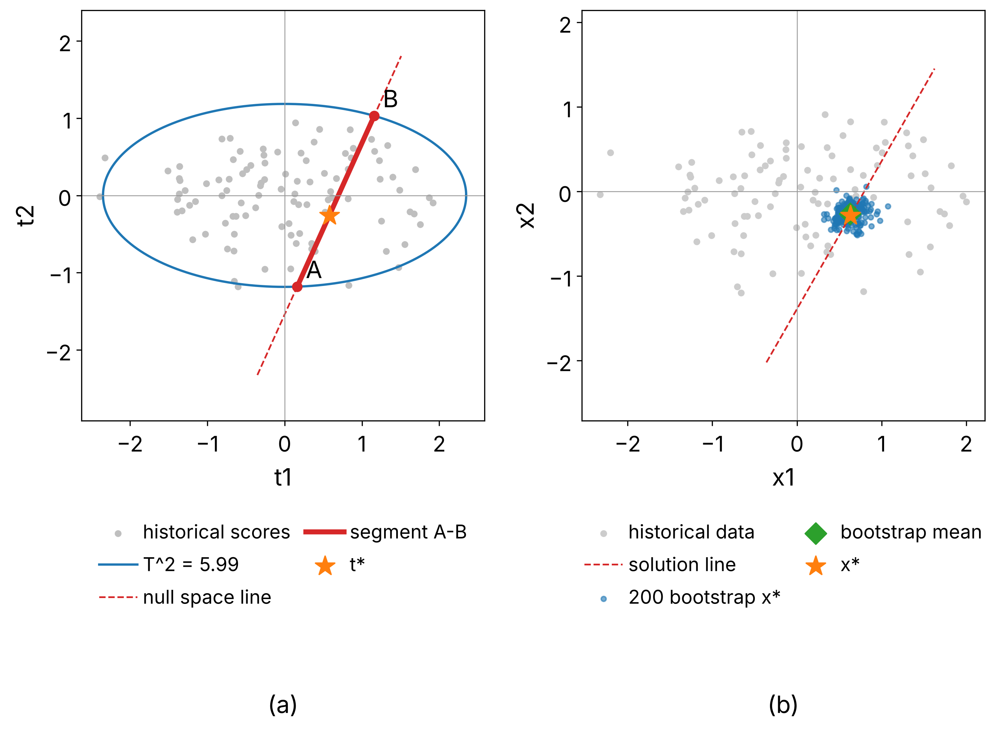
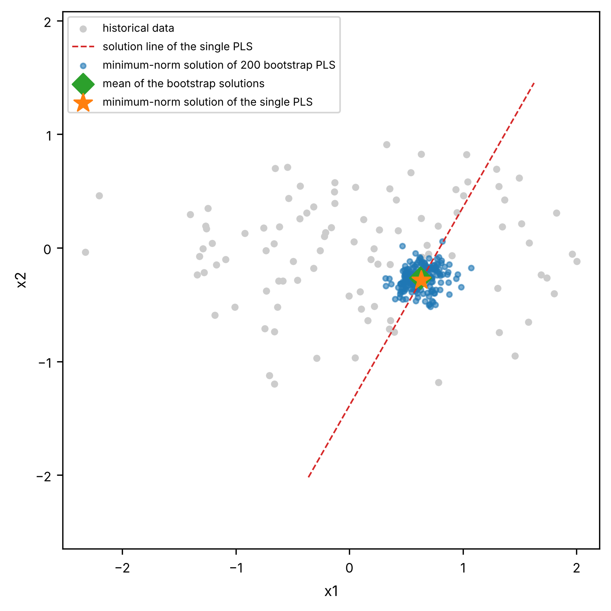
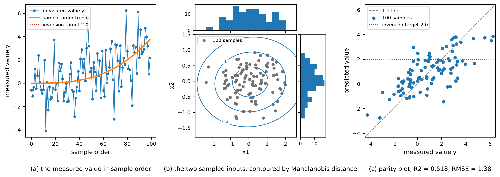
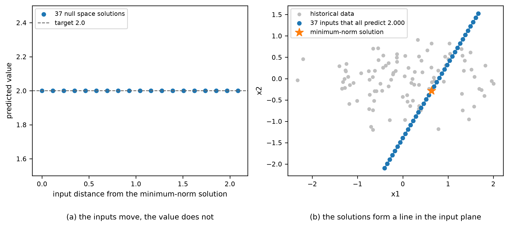
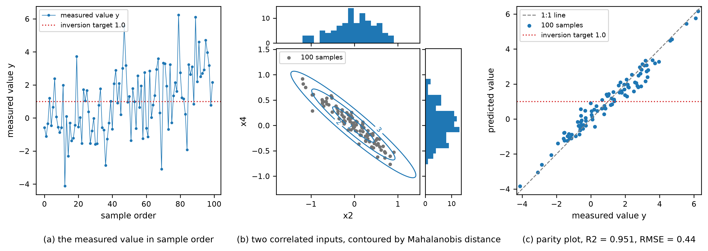
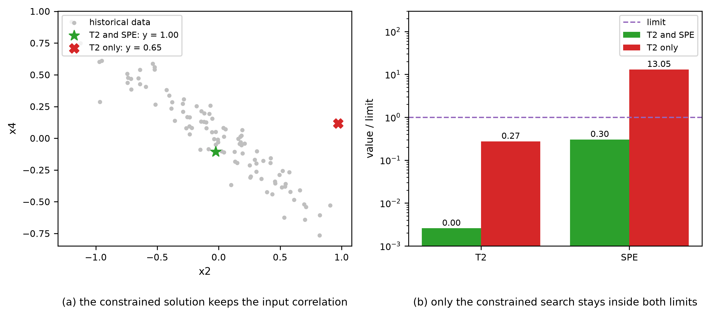
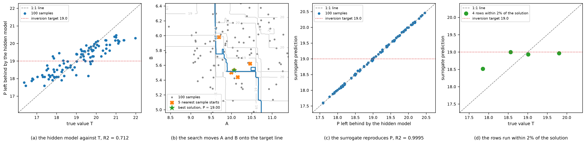

# Inverse Problem and Model Inversion
Rev. 12 | Created: 2026-10-25 | Updated: 2026-10-28 10:07 UTC

- [1. Definition](#1-definition)
  - [1.1 Forward problem and inverse problem](#11-forward-problem-and-inverse-problem)
  - [1.2 Ill-posedness](#12-ill-posedness)
  - [1.3 Inverse model](#13-inverse-model)
  - [1.4 Model inversion](#14-model-inversion)
- [2. Taxonomy](#2-taxonomy)
  - [2.1 Formulation (How to pose)](#21-formulation-how-to-pose)
  - [2.2 Search space (Where to search)](#22-search-space-where-to-search)
  - [2.3 Solution method (How to solve)](#23-solution-method-how-to-solve)
  - [2.4 Ambiguity handling (What fixes the answer)](#24-ambiguity-handling-what-fixes-the-answer)
  - [2.5 Answer form (What to return)](#25-answer-form-what-to-return)
- [3. Inverse Model](#3-inverse-model)
  - [3.1 Learned Inverse Map](#31-learned-inverse-map)
  - [3.2 Invertible Models](#32-invertible-models)
- [4. Model Inversion](#4-model-inversion)
  - [4.1 Model-Specific Inversion Methods](#41-model-specific-inversion-methods)
  - [4.2 Linear Projection Models](#42-linear-projection-models)
  - [4.3 Kernel and Gaussian Process Models](#43-kernel-and-gaussian-process-models)
  - [4.4 Tree Ensembles](#44-tree-ensembles)
  - [4.5 Neural Networks](#45-neural-networks)
  - [4.6 Generative Models](#46-generative-models)
  - [4.7 Model-Agnostic Numerical Optimization](#47-model-agnostic-numerical-optimization)
  - [4.8 Inversion without Model Access](#48-inversion-without-model-access)
- [5. Solution Validity](#5-solution-validity)
- [References](#references)
- [Appendix A. Terminology](#appendix-a-terminology)
- [Appendix B. Tools and Libraries](#appendix-b-tools-and-libraries)
- [Appendix C. Bagging Ensemble](#appendix-c-bagging-ensemble)
- [Appendix D. Python Example: PLS Model Inversion](#appendix-d-python-example-pls-model-inversion)
- [Appendix E. Python Example: Constrained Numerical Inversion](#appendix-e-python-example-constrained-numerical-inversion)
- [Appendix F. Python Example: Inversion without Model Access](#appendix-f-python-example-inversion-without-model-access)
- [Appendix G. Derivation of Eq. (3), (4) and (5)](#appendix-g-derivation-of-eq-3-4-and-5)

A trained model usually runs from input to output. An inverse problem fixes the desired output first and recovers the input that produces it, and model inversion is the way of running an already trained model backwards for that purpose. This document defines the two terms, classifies the solutions along five axes, summarises the classical results of latent variable model inversion and the inversion methods for each model family, and covers the case where the model cannot be called and the validation of the solution.

## 1. Definition

### 1.1 Forward problem and inverse problem

A forward problem computes an output $\mathbf{y} \in \mathbb{R}^M$ made of $M$ output variables from an input $\mathbf{x} \in \mathbb{R}^K$ made of $K$ input variables, and whether the model is physical or learned from data it is written $\mathbf{y} = f(\mathbf{x})$. An inverse problem runs the other way: given an observed or targeted $\mathbf{y}^{\ast}$, it finds the $\mathbf{x}$ that produces it.

The two problems behave differently. A forward problem gives one output for each input, while an inverse problem may have no answer, several answers, or answers that swing widely with small noise in the observation.

Fig 1 below shows how the forward problem and the inverse problem relate, together with the two solutions of the inverse problem, the inverse model and model inversion.

```text
Problem
  +-- Forward problem                              given x, find y
  |     +-- Physical model                         computes y from physical laws
  |     +-- Surrogate model    y = f(x)            data-driven model that replaces the physical model
  +-- Inverse problem                              given y, find x
        +-- Inverse model      x = g(y)            learn g directly
        |     aka direct (learned) inversion, learned inverse map
        +-- Model inversion    y = f(x), for x     solve with the surrogate model f
              aka optimization-based (iterative) inversion
```
Fig 1. Taxonomy of inverse problem 🌳

The inverse model is a name for a model structure and model inversion is the name of an act on a model, so the pair can sound mismatched.

The $f$ that solves the forward problem is a surrogate model trained on $(\mathbf{x}, \mathbf{y})$ pairs in place of the physical model. The solutions of the inverse problem split in two by whether a separate $g$ is learned. An inverse model learns the $g$ that maps $\mathbf{y}$ to $\mathbf{x}$ directly from data, while model inversion keeps $f$ as it is and solves $\mathbf{y} = f(\mathbf{x})$ for $\mathbf{x}$. This document mainly covers model inversion, and treats the inverse model briefly in 1.3 and 3.

### 1.2 Ill-posedness

The three conditions of a well-posed problem decide what has to be handled when an inverse problem is solved. Residual minimisation, regularization and the choice of one solution among several ([2.1](#21-formulation-how-to-pose), [2.4](#24-ambiguity-handling-what-fixes-the-answer)) answer the failure of existence, stability and uniqueness respectively.

A well-posed problem satisfies all three conditions: a solution exists, it is unique, and it depends continuously on the data. A problem that violates one or more of them is called ill-posed, and most inverse problems are ill-posed [[1](#ref-1)].

- Existence fails when $\mathbf{y}^{\ast}$ lies outside the image or range of $f$. It is relaxed by replacing the exact match with the solution that minimises the residual.
- Uniqueness almost always fails when $K \gt M$. The set of inputs that give the same output is the null space, and when there are several solutions one of them has to be chosen.
- Stability fails along the directions of the small singular values of $f$. Observation noise is amplified strongly along them, so regularization has to hold the size of the solution down [[1](#ref-1)].

### 1.3 Inverse model

An inverse model means newly learning a model $g$ that runs from output to input and using it as the solution of the inverse problem. The $g$ has to be learned separately from $(\mathbf{x}, \mathbf{y})$ pairs, but once trained it gives $\mathbf{x}$ at once from a single pass of $\mathbf{y}^{\ast}$. When several $\mathbf{x}$ give the same $\mathbf{y}$, $g$ returns one conditional mean of them, which may fail to meet the target ([2.3](#23-solution-method-how-to-solve)). The solution can be trusted only within the region $g$ was trained on. Problems with several solutions use the cINN, which learns the posterior directly ([3.2](#32-invertible-models)). The method is also called the learned inverse map or direct (learned) inversion.

### 1.4 Model inversion

Model inversion means taking a model $f$ that runs from input to output, exactly as it was trained, and inverting it as the solution of the inverse problem. No separate $g$ is learned, but each time $\mathbf{y}^{\ast}$ is given, $\mathbf{y}^{\ast} = f(\mathbf{x})$ has to be solved for $\mathbf{x}$. When several $\mathbf{x}$ give the same $\mathbf{y}$, solving $f$ also yields several solutions, and one of them has to be chosen ([2.4](#24-ambiguity-handling-what-fixes-the-answer)). The solution can be trusted only within the region $f$ was trained on. Problems with several solutions expose the solution set as it is through the null space ([4.2](#42-linear-projection-models)). The method is also called optimization-based (iterative) inversion, and it started from inverting a latent variable model built on historical data to obtain the input region that can deliver the desired output [[2](#ref-2)].

## 2. Taxonomy

Fig 2 lays out the axes that separate the solutions of an inverse problem.

```
Inverse problem (given a target y*, find the input x)
|
+-- Formulation (How to pose)
|   +-- Deterministic ......................... minimize the residual under constraints          -> model inversion
|   +-- Bayesian .............................. posterior of x given y*, prior included          -> both
|
+-- Search space (Where to search)
|   +-- Input space ........................... x itself, constraints stated explicitly          -> model inversion
|   +-- Latent space .......................... scores or codes, low dimensional                 -> model inversion
|
+-- Solution method (How to solve)
|   +-- Analytical inverse .................... pseudo-inverse, closed form for linear models    -> model inversion
|   +-- Numerical optimization ................ gradient based or derivative free search         -> model inversion
|   +-- Learned inverse map ................... a second model trained from y to x               -> inverse model
|   +-- Posterior sampling .................... MCMC, conditional generative models              -> both
|
+-- Ambiguity handling (What fixes the answer)
|   +-- Null space ............................ directions that leave the prediction unchanged   -> model inversion
|   +-- Regularization ........................ norm penalty, minimum-norm solution              -> model inversion
|   +-- Validity constraint ................... T^2 and SPE limits, input bounds                 -> both
|   +-- Prior ................................. probability mass on plausible inputs             -> both
|
+-- Answer form (What to return)
    +-- Point ................................. one input vector                                 -> both
    +-- Region ................................ design space, null space segment                 -> model inversion
    +-- Distribution .......................... posterior with uncertainty                       -> both
```

Fig 2. Taxonomy of inverse problem solution approaches

The arrow at the end of each item shows whether that choice is used by model inversion or the inverse model of Fig 1, and both means it is used by either. A Bayesian formulation with posterior sampling is model inversion when MCMC calls $f$ to draw samples, and an inverse model when the posterior is learned directly as in the cINN. A method is a combination of one choice from each of the five axes, and the axes do not exclude each other. The five sections that follow explain the choices on each axis.

### 2.1 Formulation (How to pose)

The deterministic formulation writes the problem as a constrained optimisation that minimises the residual.

```math
\hat{\mathbf{x}} = \arg\min_{\mathbf{x}} \lVert f(\mathbf{x}) - \mathbf{y}^{\ast} \rVert^{2} + \lambda R(\mathbf{x}) \hspace{19em} (1)
```

Here $R$ is the regularization term and $\lambda$ its strength. Residual minimisation handles the failure of existence and regularization the failure of stability ([1.2](#12-ill-posedness)). The Bayesian formulation finds the posterior instead of a single solution.

```math
p(\mathbf{x} \mid \mathbf{y}^{\ast}) \propto p(\mathbf{y}^{\ast} \mid \mathbf{x}) p(\mathbf{x}) \hspace{19em} (2)
```

The two formulations correspond. Finding the mode of the posterior is the same as a minimisation that takes the negative log likelihood as the residual and the negative log prior as the regularization [[3](#ref-3)]. The deterministic side is cheap to compute, and the Bayesian side shows multi-solution and uncertainty as they are.

### 2.2 Search space (Where to search)

Searching the input space directly works for any model family, but a constraint that keeps the correlation structure among the inputs has to be added by hand. Searching the latent space puts that correlation structure into the coordinates already, so the dimension drops and only physically plausible candidates are searched. The scores of PLS, the codes of an autoencoder and the latent variables of a normalizing flow all belong here.

### 2.3 Solution method (How to solve)

- Analytical inverse gives the solution in closed form through the pseudo-inverse for a linear model. It is the cheapest, but it does not apply to nonlinear models.
- Numerical optimization keeps $f$ as it is and reduces the residual. It uses the gradient when $f$ is differentiable and a derivative-free search when it is not.
- Learned inverse map trains a separate model from $\mathbf{y}$ to $\mathbf{x}$. Once trained it gives $\mathbf{x}$ at once from a single pass of $\mathbf{y}$, but when several $\mathbf{x}$ map to the same $\mathbf{y}$ it returns one conditional mean of them, an answer that fits none of the solutions [[4](#ref-4)].
- Posterior sampling draws the solutions as samples and exposes multi-solution as it is. It costs the most.

### 2.4 Ambiguity handling (What fixes the answer)

Several answers mean that uniqueness has failed ([1.2](#12-ill-posedness)), and what picks one of them is what separates the methods. The null space states the directions that leave the prediction unchanged, so the remaining freedom can serve another goal. Regularization picks the smaller solution. A validity constraint holds the solution inside the region covered by historical data. A prior concentrates probability on plausible inputs. The first three attach naturally to the deterministic formulation and the last to the Bayesian one.

### 2.5 Answer form (What to return)

A point gives one condition, so it can be run at once but leaves no margin. A region gives the input region that meets the target range, and is also known as the design space. A distribution gives the posterior as it is, so the decision is made on the probability of meeting the target range.

## 3. Inverse Model

An inverse model feeds $\mathbf{y}^{\ast}$ to a trained $g$ and gets $\mathbf{x}$ at once ([1.3](#13-inverse-model)), and it splits in two by what $g$ returns.

- When $g$ returns one solution, use the methods of [3.1 Learned Inverse Map](#31-learned-inverse-map).
- When $g$ returns a posterior, use the methods of [3.2 Invertible Models](#32-invertible-models).

The libraries that implement these methods are listed in [Appendix B](#appendix-b-tools-and-libraries).

### 3.1 Learned Inverse Map

In the classification of Fig 2, the method of this section combines Learned inverse map for Solution method and Point for Answer form.

A learned inverse map trains a model from $\mathbf{y}$ to $\mathbf{x}$ on $(\mathbf{x}, \mathbf{y})$ pairs ([2.3](#23-solution-method-how-to-solve)). Even when the model cannot be called, it can be trained directly on pairs of inputs and predictions $(\mathbf{x}_i, \hat{y}_i)$ alone. Once trained, a single pass of the target gives $\mathbf{x}$, so there is no iterative search. When several $\mathbf{x}$ give the same $\hat{y}$, training that minimises the sum of squared residuals returns one conditional mean of them, and that mean does not lie on the solution set, so it may fail to meet the target. Outside the region the pairs cover it behaves differently from the original model, so a constraint that holds the solution inside that region is needed. An example that chains it with the two methods of 4.8 is in [Appendix F](#appendix-f-python-example-inversion-without-model-access).

### 3.2 Invertible Models

In the classification of Fig 2, the method of this section combines Bayesian for Formulation, Posterior sampling for Solution method and Distribution for Answer form.

Invertible neural networks and normalizing flows are bidirectional by construction. Learning the forward direction defines the inverse along with it, and the conditional form, the cINN, draws samples directly from the posterior conditioned on the target [[5](#ref-5)]. A single pass of the target gives the posterior, so even when several $\mathbf{x}$ give the same $\mathbf{y}$, it returns the solution set as samples rather than one conditional mean.

## 4. Model Inversion

Model inversion keeps $f$ as it is and solves $\mathbf{y}^{\ast} = f(\mathbf{x})$ for $\mathbf{x}$ ([1.4](#14-model-inversion)), and it splits in two by the model at hand.

- When the model can be called, find its family in Table 1 of [4.1 Model-Specific Inversion Methods](#41-model-specific-inversion-methods) and use the method of that family among 4.2 to 4.7.
- When the model cannot be called, use the methods of [4.8 Inversion without Model Access](#48-inversion-without-model-access).

A latent variable is an internal coordinate that summarises the input variables in a few numbers, and PLS calls it a score. The space the latent variables span is the latent space, and its coordinates already carry the correlation structure among the inputs ([2.2](#22-search-space-where-to-search)). A latent variable model explains the inputs and the outputs together in these coordinates, and PLS and PCR belong to it.

The libraries that implement these methods are listed in [Appendix B](#appendix-b-tools-and-libraries).

### 4.1 Model-Specific Inversion Methods

In the classification of Fig 2, the methods of this section divide the Analytical inverse, Numerical optimization and Posterior sampling of the Solution method axis by model family, and the choices on the other axes differ from family to family.

Table 1 lists the inversion method for each model.

Table 1. Inversion method by model family

|  #  |         Model          |                Inversion method                | Section |                                                                                                                                                           Characteristics                                                                                                                                                           |
| :-: | :--------------------: | :--------------------------------------------: | :-----: | :---------------------------------------------------------------------------------------------------------------------------------------------------------------------------------------------------------------------------------------------------------------------------------------------------------------------------------: |
|  1  |       PLS / PCR        |       Analytical inverse and null space        |   4.2   |                                                                         Linear with a non-unique solution, so the minimum-norm solution or a constrained optimisation picks one. [Appendix D](#appendix-d-python-example-pls-model-inversion) runs this row                                                                         |
|  2  | PLS bootstrap ensemble |    Analytical inverse per bootstrap sample     |   4.2   |                                                                                                 Inverts each PLS fitted to a bootstrap sample by the procedure of row 1, giving the spread of the solution instead of one solution                                                                                                  |
|  3  |      OLS / Ridge       |                 Pseudo-inverse                 |   4.2   |                                                                                          No latent space constraint, so the extrapolation risk is high. Ridge only shrinks the solution and does not keep the input correlation structure                                                                                           |
|  4  |          PCA           |               Pre-image problem                |   4.2   |                                                                                                No output, so it is a reconstruction view. Linear has a closed form, kernel PCA approximates the pre-image by iterative optimisation                                                                                                 |
|  5  |       Kernel PLS       |       Latent space inverse and pre-image       |   4.3   |                                                                                                                  Captures nonlinear relations, but mapping the score back to the input remains a pre-image problem                                                                                                                  |
|  6  |           GP           |         Posterior-based inverse design         |   4.3   |                                                                                                                               Gives the uncertainty too, so it is the basis of Bayesian optimization                                                                                                                                |
|  7  |  Random forest / GBM   | Surrogate search, TreeSHAP local linearization |   4.4   |                                                                            Not differentiable, so discrete search or a genetic algorithm is used. The model [Appendix E](#appendix-e-python-example-constrained-numerical-inversion) inverts is this row                                                                            |
|  8  |     Neural network     |          Backpropagation to the input          |   4.5   |                                                                                                                    The most direct, the same computation as activation maximization. Regularization is required                                                                                                                     |
|  9  |   Autoencoder / VAE    |       Latent space search, then decoding       |   4.6   |                                                                                                                                             Inverse design in the generative model way                                                                                                                                              |
| 10  |    Diffusion model     |               Posterior sampling               |   4.6   |                                                                                                                                    Obtains multi-solution as samples in noisy nonlinear problems                                                                                                                                    |
| 11  |     Model-agnostic     |       Constrained numerical optimization       |   4.7   |                                                                                             Applies to any $f$, the most general. The method [Appendix E](#appendix-e-python-example-constrained-numerical-inversion) uses is this row                                                                                              |
| 12  |    No model access     |  Surrogate re-fitting, nearest-sample lookup   |   4.8   | The model cannot be called, so it is solved from the $(\mathbf{x}_i, \hat{y}_i)$ pairs alone. The re-fitted surrogate is inverted by the methods of rows 1 to 11, and the reproduction error of the surrogate sets the error of the solution. [Appendix F](#appendix-f-python-example-inversion-without-model-access) runs this row |

The structure of the model decides which methods can be used. A linear model gives a closed-form solution, a differentiable model gives the gradient with respect to the input, and the piecewise constant tree family relies on search. The six sections 4.2 to 4.7 explain each family.

### 4.2 Linear Projection Models

PLS and PCR are inverted by the procedure of [PLS inversion and the null space](#pls-inversion-and-the-null-space). The PLS bootstrap ensemble is the [bagging](#appendix-c-bagging-ensemble) of PLS: it inverts each PLS fitted to a bootstrap sample by the same procedure and gives the spread of the solution instead of a single solution [[6](#ref-6)]. OLS and Ridge also give a solution of the same form through the pseudo-inverse, but the space the solution lies in differs. The solution of a projection model passes through the score space and inherits the correlation structure among the inputs, while the OLS solution can wander outside that structure. For a problem with correlated inputs, the OLS inverse returns physically impossible combinations. PCA has no output to match at all, so the nature of the problem itself changes. Linear PCA has a closed-form solution that maps the score back through the loading, but in kernel PCA that mapping becomes the pre-image problem treated with the kernel family of 4.3.

In the classification of Fig 2, PLS inversion combines Deterministic for Formulation, Latent space for Search space, Analytical inverse for Solution method, Null space and Validity constraint for Ambiguity handling, and Region for Answer form.

Inverting a PLS model is the oldest industrial case of solving an inverse problem in the latent space, and it already has the skeleton the later methods repeat. Its three steps are to reduce the dimension and sort out the degrees of freedom, to find the inverse solution in the reduced space, and to prevent extrapolation with a validity constraint [[2](#ref-2)], [[7](#ref-7)].

#### PLS inversion and the null space

PLS decomposes the input $\mathbf{X}$ and the output $\mathbf{Y}$ through a common score $\mathbf{T}$. $A$ is the number of latent variables.

```math
\mathbf{X} = \mathbf{T}\mathbf{P}^{\top} + \mathbf{E}, \qquad \mathbf{Y} = \mathbf{T}\mathbf{Q}^{\top} + \mathbf{F} \hspace{19em} (3)
```

Given a target output $\mathbf{y}^{\ast}$, solve the equation $\mathbf{Q}\mathbf{t} = \mathbf{y}^{\ast}$ for the score, then map the score back through the loading to recover the input.

```math
\mathbf{t}^{\ast} = \mathbf{Q}^{+}\mathbf{y}^{\ast}, \qquad \mathbf{x}^{\ast} = \mathbf{P}\mathbf{t}^{\ast} \hspace{19em} (4)
```

Because $\mathbf{Q}^{+}$ is the pseudo-inverse, $\mathbf{t}^{\ast}$ is the minimum-norm solution. When the rank of $\mathbf{Q}$ is $M$ and $A \gt M$, there remain $A - M$ directions $\mathbf{n}$ that satisfy $\mathbf{Q}\mathbf{n} = \mathbf{0}$, and the subspace they span is the null space [[2](#ref-2)].

- The null space is the freedom to move the input without changing the output. A secondary goal such as cost can be optimised over this freedom.
- Going far along the null space reaches conditions that historical data does not support. So upper limits are placed on Hotelling $T^{2}$, which measures the size of the score, and on SPE (Squared Prediction Error), which measures the distance to the model plane, and the solution is held inside them [[7](#ref-7)].

```math
T^{2} = \sum_{a=1}^{A} \frac{t_{a}^{2}}{s_{a}^{2}}, \qquad \mathrm{SPE} = \lVert \mathbf{x} - \mathbf{P}\mathbf{t} \rVert^{2} \hspace{19em} (5)
```

The derivations of Eq. (3), (4) and (5) are in [Appendix G](#appendix-g-derivation-of-eq-3-4-and-5).

How far the two limits allow the null space in the score plane is shown in Fig 3 below, and the minimum-norm solutions for the target 2.0 from PLS fitted to each of 200 bootstrap samples of the Appendix D data are shown in Fig 4.



Fig 3. Null space and the validity region in the score plane

The ellipse is where $T^{2}$ equals its limit, and the segment joining A and B is the null space direction through $\mathbf{t}^{\ast}$. Every score on that segment predicts the same $\mathbf{y}^{\ast}$, but the part that leaves the ellipse is not supported by historical data and is not used. The freedom that remains is the stretch where the segment and the ellipse overlap. An example that runs this procedure as it is is in [Appendix D](#appendix-d-python-example-pls-model-inversion). The figure is drawn from the data and PLS model of Appendix D, with the limit $\chi^{2}_{0.95}(2) = 5.99$.



Fig 4. Spread of the minimum-norm solution over bootstrap PLS models

Fig 4 carries Fig 3 over to the input plane. The orange star is the $\mathbf{t}^{\ast}$ of Fig 3 mapped by $\mathbf{x}^{\ast} = \mathbf{P}\mathbf{t}^{\ast}$ of Eq. (4), and the red dashed line is the null space line of Fig 3 mapped the same way. The blue points and the green diamond are not in Fig 3; they come from fitting PLS anew to each bootstrap sample.

The 200 blue points are the minimum-norm solutions of the bootstrap PLS models, with standard deviation 0.126 along $x_1$ and 0.101 along $x_2$. Their mean (green diamond) nearly coincides with the minimum-norm solution of the single PLS (orange star). The red dashed line is the solution set that gives the same target for the single PLS, and every point on it is a correct answer. The spread of the blue points is different: it is how far the solution moves when the model moves with a change of training sample, and this spread is the uncertainty of the solution the PLS bootstrap ensemble gives.

#### Design space and product transfer

The same skeleton extended to industrial problems gave the following four results.

- Joint-Y PLS, which ties the data of two sites into one latent space, turns product transfer, moving a condition validated at one site to a condition at another, into an inversion problem [[8](#ref-8)].
- Propagating the uncertainty of the model parameters into the solution narrows the region that meets the target range. This conservative region is called the design space [[9](#ref-9)].
- Targets given as upper and lower limits instead of equalities, partly fixed inputs, and several targets were all unified into one constrained optimisation [[10](#ref-10)].
- Recent formulations decide from the constraint structure of the problem whether to solve in the score space or the input space, and add the $T^{2}$ and SPE constraints together while keeping the null space [[11](#ref-11)], [[12](#ref-12)].

### 4.3 Kernel and Gaussian Process Models

The kernel family is linear in the feature space, but in general no input corresponds to a point of that space. So the pre-image that maps the feature-space solution back to the input space is approximated by iterative optimisation or a fixed-point method [[13](#ref-13)]. A Gaussian process gives a variance with each prediction, which changes how it is inverted. Defining an acquisition function that weighs the distance from the target together with the uncertainty, and optimising it, gives Bayesian optimization, which decides the input to try next [[14](#ref-14)]. It differs from the earlier methods in narrowing the solution down through repeated experiments rather than finding it at once.

### 4.4 Tree Ensembles

Random forests and gradient boosting use trees as base learners. One tree cuts the input space into boxes at thresholds and returns one stored value per box, and a sum or average of many such functions is still piecewise constant. So the gradient with respect to the input is 0 inside a box and undefined on a threshold, and search is used instead of the gradient. The base learner, not boosting or bagging, decides this property: with a linear base learner the sum is linear too and the gradient comes back. Derivative-free methods such as grid search, genetic algorithms and CMA-ES apply as they are, and the trained trees themselves serve as a fast surrogate on which the search runs. TreeSHAP computes the contribution of each input around a point exactly, so it can give a local linear approximation that sets the direction of the search [[15](#ref-15)].

### 4.5 Neural Networks

A differentiable network is inverted most directly. Fix the weights, treat the input as the variable, and backpropagate $\lVert f(\mathbf{x}) - \mathbf{y}^{\ast} \rVert^{2}$ to the input. Written as maximising one output it is activation maximization, and written as changing the output with a small perturbation it is the same computation as generating adversarial examples [[16](#ref-16)]. Only the use differs and the computation is the same, so the risk comes along too. Unconstrained optimisation returns inputs that match the target output perfectly yet lie far from the data distribution, so an input range limit or a prior term is required.

### 4.6 Generative Models

A generative model learns the data distribution, so it is a strong prior in itself. Autoencoders and VAEs search the latent space and then decode, and only what the decoder can produce becomes a candidate, so unrealistic solutions are filtered out. This is the standard approach for problems where only valid designs may remain as candidates [[17](#ref-17)]. The conditional form of an invertible model learns the posterior directly without going through $f$, so it is an inverse model and is treated in 3.2. A diffusion model samples the posterior by adding the gradient of the observation likelihood to the learned score, and it has recently become the standard for noisy nonlinear problems [[18](#ref-18)].

### 4.7 Model-Agnostic Numerical Optimization

Treating $f$ as a blackbox without using its structure at all is the most general approach. Take the residual as the objective, set the validity domain and the physical limits as constraints, and run an optimiser. It uses the gradient when one is available and only switches to a derivative-free method when it is not, so it is an alternative for every family above. The price is cost and local optima. When the objective has several local minima, different starting points reach different solutions, so it is safer to repeat from several starting points and report the solutions together. The implementation is in [Appendix E](#appendix-e-python-example-constrained-numerical-inversion).

### 4.8 Inversion without Model Access

In the classification of Fig 2, on the Solution method axis surrogate re-fitting uses the methods of 4.1, and nearest-sample lookup is not in Fig 2. For Ambiguity handling both methods use Validity constraint.

Even when the model cannot be called, inversion can be solved if pairs of inputs and predictions $(\mathbf{x}_i, \hat{y}_i)$ are available. It uses the input-output relation carried by those pairs instead of the structure of the model, and two methods can be used as model inversion. The learned inverse map trained on the same pairs is an inverse model and is treated in 3.1.

- Surrogate re-fitting: train a new model that fits $\hat{y}$ on the pairs at hand, and invert that surrogate with the methods of 4.1. It moves the predictions of the original model, taken as the ground truth, into another model, so it is model distillation, and the error of the solution is set by the reproduction error of the surrogate rather than the residual of the original model.
- Nearest-sample lookup: pick the $\mathbf{x}_i$ whose $\hat{y}_i$ is closest to the target and interpolate among its neighbours. It is the cheapest but cannot leave the region the pairs cover. It uses neither $f$ nor $g$, so it belongs to neither of the two solutions of Fig 1.

For both methods the validity domain is set from $\mathbf{X}$ alone. Hotelling $T^{2}$ and SPE come from the distribution of the inputs, so they do not depend on model access, and the checks of 5 apply as they are.

The limit is the region the pairs cover. Outside it the surrogate behaves differently from the original model, and since the original model cannot be called, there is no way to see how far. So the constraint that holds the solution inside that region matters more than when the model is at hand. An example that chains the two methods with the learned inverse map of 3.1 is in [Appendix F](#appendix-f-python-example-inversion-without-model-access).

## 5. Solution Validity

The result of inversion is a proposal made under the assumption that the model is true, so check the following four points before running it.

- Extrapolation: the model can be trusted only in the region covered by historical data. $T^{2}$ measures how far from the centre a point is inside that region, and SPE how far it is from the plane the region forms. Looking at only one of them misses solutions that break the correlation structure.
- Multi-solution: when the answer is not unique, do not pick one and report it alone. Showing the solution set, such as a null space segment or a posterior, helps the decision.
- Uncertainty: the GP, Bayesian and flow families give a posterior, so a solution can be judged by the probability of meeting the target range [[3](#ref-3)]. A model that gives only a point estimate cannot give that probability and needs separate validation.
- Validation and update: confirm the input obtained by experiment or simulation, and close the loop by adding the result to the data and retraining the model. Without this retraining the error of the model becomes the error of the design.

## References

<a id="ref-1"></a>
[1] Kaipio, J., Somersalo, E. (2005). [Statistical and Computational Inverse Problems](https://doi.org/10.1007/b138659). Springer, Applied Mathematical Sciences 160.<br>
<a id="ref-2"></a>
[2] Jaeckle, C. M., MacGregor, J. F. (1998). [Product design through multivariate statistical analysis of process data](https://doi.org/10.1002/aic.690440509). AIChE Journal, 44(5), 1105–1118.<br>
<a id="ref-3"></a>
[3] Stuart, A. M. (2010). [Inverse problems: a Bayesian perspective](https://doi.org/10.1017/S0962492910000061). Acta Numerica, 19, 451–559.<br>
<a id="ref-4"></a>
[4] Ongie, G., Jalal, A., Metzler, C. A., Baraniuk, R. G., Dimakis, A. G., Willett, R. (2020). [Deep learning techniques for inverse problems in imaging](https://doi.org/10.1109/JSAIT.2020.2991563). IEEE Journal on Selected Areas in Information Theory, 1(1), 39–56.<br>
<a id="ref-5"></a>
[5] Ardizzone, L., Kruse, J., Wirkert, S., et al. (2019). [Analyzing inverse problems with invertible neural networks](https://doi.org/10.48550/arXiv.1808.04730). International Conference on Learning Representations.<br>
<a id="ref-6"></a>
[6] yRocket. (2026). [PLS Bootstrap Ensemble](https://github.com/ykim2718/AIML/blob/main/Models/PLS-Bootstrap-Ensemble/pls-bootstrap-ensemble-ko.md). *AIML repository*, GitHub.<br>
<a id="ref-7"></a>
[7] Jaeckle, C. M., MacGregor, J. F. (2000). [Industrial applications of product design through the inversion of latent variable models](https://doi.org/10.1016/S0169-7439(99)00058-1). Chemometrics and Intelligent Laboratory Systems, 50(2), 199–210.<br>
<a id="ref-8"></a>
[8] García-Muñoz, S., MacGregor, J. F., Kourti, T. (2005). [Product transfer between sites using Joint-Y PLS](https://doi.org/10.1016/j.chemolab.2005.04.009). Chemometrics and Intelligent Laboratory Systems, 79(1–2), 101–114.<br>
<a id="ref-9"></a>
[9] García-Muñoz, S., Dolph, S., Ward, H. W. (2010). [Handling uncertainty in the establishment of a design space for the manufacture of a pharmaceutical product](https://doi.org/10.1016/j.compchemeng.2010.02.027). Computers & Chemical Engineering, 34(7), 1098–1107.<br>
<a id="ref-10"></a>
[10] Tomba, E., Barolo, M., García-Muñoz, S. (2012). [General framework for latent variable model inversion for the design and manufacturing of new products](https://doi.org/10.1021/ie301214c). Industrial & Engineering Chemistry Research, 51(39), 12886–12900.<br>
<a id="ref-11"></a>
[11] Palací-López, D., Facco, P., Barolo, M., Ferrer, A. (2019). [New tools for the design and manufacturing of new products based on latent variable model inversion](https://doi.org/10.1016/j.chemolab.2019.103848). Chemometrics and Intelligent Laboratory Systems, 194, 103848.<br>
<a id="ref-12"></a>
[12] Palací-López, D., et al. (2020). [Improved formulation of the latent variable model inversion-based optimization problem for quality by design applications](https://doi.org/10.1002/cem.3230). Journal of Chemometrics, 34(6), e3230.<br>
<a id="ref-13"></a>
[13] Kwok, J. T., Tsang, I. W. (2004). [The pre-image problem in kernel methods](https://doi.org/10.1109/TNN.2004.837781). IEEE Transactions on Neural Networks, 15(6), 1517–1525.<br>
<a id="ref-14"></a>
[14] Shahriari, B., Swersky, K., Wang, Z., Adams, R. P., de Freitas, N. (2016). [Taking the human out of the loop: a review of Bayesian optimization](https://doi.org/10.1109/JPROC.2015.2494218). Proceedings of the IEEE, 104(1), 148–175.<br>
<a id="ref-15"></a>
[15] Lundberg, S. M., Erion, G., Chen, H., et al. (2020). [From local explanations to global understanding with explainable AI for trees](https://doi.org/10.1038/s42256-019-0138-9). Nature Machine Intelligence, 2, 56–67.<br>
<a id="ref-16"></a>
[16] Simonyan, K., Vedaldi, A., Zisserman, A. (2014). [Deep inside convolutional networks: visualising image classification models and saliency maps](https://doi.org/10.48550/arXiv.1312.6034). arXiv:1312.6034.<br>
<a id="ref-17"></a>
[17] Gómez-Bombarelli, R., Wei, J. N., Duvenaud, D., et al. (2018). [Automatic chemical design using a data-driven continuous representation of molecules](https://doi.org/10.1021/acscentsci.7b00572). ACS Central Science, 4(2), 268–276.<br>
<a id="ref-18"></a>
[18] Chung, H., Kim, J., McCann, M. T., Klasky, M. L., Ye, J. C. (2023). [Diffusion posterior sampling for general noisy inverse problems](https://doi.org/10.48550/arXiv.2209.14687). International Conference on Learning Representations.<br>
<a id="ref-19"></a>
[19] yRocket. (2026). [Scores in Partial Least Squares](https://github.com/ykim2718/AIML/blob/main/Math/Regression/PLS/partial-least-squares-scores-ko.md). *AIML repository*, GitHub.

---

## Appendix A. Terminology

- **Acquisition function**: A function that weighs the prediction and its uncertainty together to choose the input to try next.
- **Activation maximization**: A method that finds the input maximising a given output of a trained network by backpropagation to the input.
- **Bayesian optimization**: A method that searches for the optimum of a blackbox function iteratively with a surrogate model that has a posterior and an acquisition function.
- **cINN**: An invertible neural network that takes a condition as input and draws samples from the conditional posterior.
- **CMA-ES**: A derivative-free optimization method that finds the optimum by sampling while updating a covariance matrix, short for covariance matrix adaptation evolution strategy.
- **COBYLA**: A derivative-free optimization method that solves constrained problems while updating linear approximations, short for constrained optimization by linear approximations.
- **Derivative-free optimization**: Optimisation that finds the solution from function values alone, without the gradient of the objective.
- **Design space**: The input region confirmed to meet the target range of the output.
- **Forward problem**: The problem of computing the output from the input.
- **GBM**: A model built by adding trees that learn the residuals in sequence, short for gradient boosting machine.
- **GP**: A model that places a prior on functions and gives a prediction together with its variance, short for Gaussian process.
- **Hotelling $T^{2}$**: A statistic that measures how far a score lies from the model centre.
- **Ill-posed problem**: A problem in which one or more of the existence, uniqueness and stability of the solution fails.
- **Image**: The set of all outputs $f$ can produce, also called the range.
- **Inverse model**: A model that learns the mapping from output to input directly from data, also called the learned inverse map.
- **Joint-Y PLS**: An extension of PLS that ties the data of several sites through a common output and handles them in one latent space.
- **Latent variable**: An internal coordinate that summarises the observed variables in a few numbers, called a score in PLS.
- **Loading**: The coefficient linking a latent variable to an observed variable, used to recover the input from the score.
- **Mahalanobis distance**: A distance measured after dividing by the spread in each direction, showing how many standard deviations a point lies from the centre.
- **MCMC**: A sampling method that generates samples following the posterior as a chain, short for Markov chain Monte Carlo.
- **Minimum-norm solution**: The solution with the smallest norm when several solutions meet the target equally.
- **Model distillation**: A method that trains another model on the predictions of the original model as the ground truth, moving its input-output relation over.
- **Model inversion**: A method that solves a forward model at hand backwards to find the input that produces the target output.
- **Multi-solution**: The state in which several input combinations produce the same output.
- **Normalizing flow**: A generative model that moves one distribution to another through a composition of invertible transforms.
- **Null space**: The subspace spanned by the directions of the input or score that leave the predicted output unchanged.
- **Null space direction**: One basis vector of the null space; moving the score along it leaves the predicted output unchanged.
- **OLS**: Regression that minimises the sum of squared residuals, short for ordinary least squares.
- **PCA**: A method that reduces the dimension by re-aligning the coordinates to the directions of large variance, short for principal component analysis.
- **PCR**: A model that reduces to principal components and then regresses, short for principal component regression.
- **Physical model**: A model that computes the output from the input by physical laws.
- **PLS**: A regression model that extracts latent variables along the directions of large covariance between input and output, short for partial least squares.
- **PLS bootstrap ensemble**: An ensemble that fits a PLS to each sample drawn from the rows with replacement, that is, each bootstrap sample, and averages the predictions of those PLS models; in other words the bagging of PLS.
- **Posterior sampling**: A method that draws samples from the posterior to obtain the solution set.
- **Pre-image problem**: The problem of finding the point in the input space that corresponds to a point in the feature space.
- **Pseudo-inverse**: A generalized inverse that gives the minimum-norm least-squares solution for a matrix that is not square or is singular.
- **Regularization**: A method that stabilises an ill-posed problem by penalising the size or shape of the solution.
- **Score**: The value of an observation projected onto the latent coordinates.
- **SPE**: The squared distance by which an observation departs from the model plane, short for squared prediction error.
- **Surrogate model**: A data-driven forward model trained on (x, y) pairs in place of the original model (a physical model or a model that cannot be called directly).
- **TreeSHAP**: A method that computes the contribution of each input in a tree model exactly in polynomial time.
- **VAE**: A generative model that learns the distribution of latent variables, short for variational autoencoder.
- **Validity domain**: The input region where the model is supported by the training data.
- **Well-posed problem**: A problem whose solution exists, is unique, and depends continuously on the data.

## Appendix B. Tools and Libraries

Table 2. Libraries for inverse model and model inversion

|      Library       |                         Role                         |       Section        |                                   Note                                    |
| :----------------: | :--------------------------------------------------: | :------------------: | :-----------------------------------------------------------------------: |
|   NumPy / SciPy    | Pseudo-inverse, null space, constrained optimisation |       4.2, 4.7       | `numpy.linalg.pinv`, `scipy.linalg.null_space`, `scipy.optimize.minimize` |
|    scikit-learn    |      Latent variable model and validity domain       | 4.2, 4.3, Appendix C |      `PLSRegression`, `PCA`, `GaussianProcessRegressor`, `resample`       |
|      PyTorch       |          Gradient with respect to the input          |         4.5          |       Turns on the gradient of the input tensor and backpropagates        |
| BoTorch / GPyTorch |            GP-based Bayesian optimization            |         4.3          |                Provides acquisition function optimisation                 |
|        SHAP        |          Local linearization of tree models          |         4.4          |               Computes contributions exactly with TreeSHAP                |
|       FrEIA        |              Invertible neural network               |         3.2          |                      Assembles the cINN architecture                      |
|    PyMC / emcee    |                  Posterior sampling                  |       2.1, 2.3       |             Sample-based solution of the Bayesian formulation             |

## Appendix C. Bagging Ensemble

Bagging is short for bootstrap aggregating, an ensemble method that trains several copies of the same model and combines their predictions into the final prediction. It takes the three steps below.

1. Bootstrapping: draw rows with replacement from the original training data to make one training sample for each individual model.
2. Individual training and prediction: train one model on each sample, and let each model predict on its own.
3. Aggregating: combine the individual predictions into the final prediction, the mean for regression and the majority vote for classification.

Sampling with replacement draws one row, puts it back among the candidates, and then draws the next row. With n rows in the original data the draw is repeated n times, so some rows are drawn more than once and some are never drawn. Each individual model thus gets a slightly different training sample of n rows.

The method that combines the three steps is called a bagging ensemble. The PLS bootstrap ensemble is a bagging ensemble whose individual model is PLS [[6](#ref-6)].

## Appendix D. Python Example: PLS Model Inversion

This runs the procedure of 4.2 as it is. It finds the minimum-norm solution and checks that the prediction stays the same when the input moves along the null space direction. The examples of Appendix D, E and F are all minimal runnable examples on random data, and they run as they are with NumPy, SciPy and scikit-learn, plus pandas for Appendix F.

```python
import numpy as np
from scipy.linalg import null_space
from sklearn.cross_decomposition import PLSRegression

rng = np.random.default_rng(0)

# historical data: 2 inputs, 1 output
# both inputs are centred at 0, x1 spread twice as wide as x2
n, n_comp = 100, 2
X = np.column_stack([rng.normal(0.0, 1.0, n), rng.normal(0.0, 0.5, n)])
drift = 2.0 * (np.arange(n) / 80.0) ** 3     # the sample order the model never sees
y = 1.5 * X[:, 0] - 0.8 * X[:, 1] + drift + rng.normal(0, 0.85, n)

x_mean, y_mean = X.mean(axis=0), y.mean()
pls = PLSRegression(n_components=n_comp, scale=False).fit(X - x_mean, y - y_mean)
P = pls.x_loadings_          # (2, n_comp)
Q = pls.y_loadings_          # (1, n_comp)

# 1. direct inversion: minimum-norm scores that hit the target value
y_des = 2.0
t_star = np.linalg.pinv(Q) @ np.array([y_des - y_mean])
x_star = P @ t_star + x_mean

# 2. null space: 37 inputs along the direction that leaves the prediction unchanged
N = null_space(Q)            # (n_comp, n_comp - 1)
alphas = np.linspace(-2.0, 2.0, 37)
x_alt = np.array([P @ (t_star + N @ np.array([a])) + x_mean for a in alphas])


def predict(x):
    return float(pls.predict((x - x_mean)[None, :]).ravel()[0]) + y_mean


preds = np.array([predict(x) for x in x_alt])
print("null space dim :", N.shape[1])
print("solutions      :", len(x_alt))
print("prediction min :", round(preds.min(), 6))
print("prediction max :", round(preds.max(), 6))
print("input spread   :", np.round(x_alt.max(axis=0) - x_alt.min(axis=0), 3))
```

Before inverting, look at the model to be inverted.



Fig 5. Appendix D measured values in sample order, the inputs $x_1 \sim N(0, 1.0^{2})$ and $x_2 \sim N(0, 0.5^{2})$, and the parity plot of the forward model

Fig 5 (a) plots the measured value $y$ in the order the samples came in. The value climbs nonlinearly along the order, grows noticeably from around the 50th sample, and at the 80th swings around the target 2.0. The orange line is that trend; the two inputs do not carry it, so the model cannot explain it. Because the target 2.0 is an ordinary value in the later half, the target lies inside the data.

Fig 5 (b) plots the two inputs of the same samples. The contours show how the samples are scattered, and the bars on the top and right are the distribution of each input on its own. The two inputs share the mean 0 and differ only in spread, with the standard deviation of $x_1$ twice that of $x_2$, so the samples scatter in an ellipse stretched sideways. That ellipse is the region the model has learned.

The contours are Mahalanobis distances measured from the sample centre, 1, 2 and 3 from the inside. This distance divides by the spread in each direction, so along the wider $x_1$ the same distance reaches further. The contours therefore become ellipses stretched sideways, and the ellipse reads directly how many standard deviations a point lies from the centre. Hotelling $T^{2}$ of 4.2 is the square of this distance measured in the score space, and Appendix E places an upper limit on it to hold the solution inside the region the data covers.

Fig 5 (c) is the parity plot of the same 100 samples, one point per sample. The horizontal axis is the measured value $y$ of the sample and the vertical axis is the model prediction $\hat{y}$ for it, so a point on the 1:1 line means the sample is matched exactly, and its vertical distance from the line is the residual $y - \hat{y}$ of the sample.

The model of this example has $R^{2} = 0.518$ and RMSE 1.38. Most of the residual comes from the trend of (a). A variable the model does not see stays unexplained by that much. The target 2.0 lies within $-4.1$ to $6.2$, the range the samples cover, so it is not an extrapolation, but the value the inverted condition actually delivers swings by about the RMSE. The accuracy of inversion cannot exceed the accuracy of the forward model, so look at this figure first and then decide whether to invert.

Fig 6 plots the 37 `x_alt` the code produced.



Fig 6. Predicted value and inputs along the null space

Each point in both panels is the same thing: one input $\mathbf{x}(\alpha) = \mathbf{P}(\mathbf{t}^{\ast} + \alpha \mathbf{n}) + \bar{\mathbf{x}}$ made by moving by $\alpha$ along the null space direction $\mathbf{n}$, where $\bar{\mathbf{x}}$ is the mean of the inputs.

- In (a) the horizontal axis is the distance $\lVert \mathbf{x}(\alpha) - \mathbf{x}^{\ast} \rVert$ of the input from the minimum-norm solution and the vertical axis is the prediction obtained by feeding that input to the model. While the input moves 2.0 away, the prediction stays at the target 2.000.
- (b) plots the same 37 inputs on the plane of the two inputs. The solutions form a line rather than one point, any point on it predicts 2.000, and the minimum-norm solution marked in orange is one point on that line.

The minimum-norm solution is the solution with the smallest norm when several solutions meet the target equally. In this example there are as many scores satisfying $\mathbf{Q}\mathbf{t} = \mathbf{y}^{\ast}$ as the null space allows, and the pseudo-inverse $\mathbf{Q}^{+}$ picks the one with the smallest $\lVert \mathbf{t} \rVert$. Geometrically it is the point of the solution set (the line along the null space) closest to the origin, so its component along the null space direction is 0.

The minimum-norm solution is the combination that delivers the target output while departing least from the mean of the inputs. It is the one reference point fixed uniquely, so it serves as the starting point, and when another criterion such as cost exists the solution moves along the null space as in Fig 6.

A null space direction is a direction along which moving the score leaves the prediction unchanged, namely an $\mathbf{n}$ that satisfies $\mathbf{Q}\mathbf{n} = \mathbf{0}$. In this example with $A = 2$ latent variables and $M = 1$ output, $A - M = 1$ such direction remains, and `null_space(Q)` returns it as a unit vector. The 37 `x_alt` are made by moving $\alpha$ from $-2$ to $2$ along that direction, and the line of Fig 6 (b) is that very direction. The amount moved along it is the freedom available while keeping the target.

The model is linear in the input, so the solution set is a line. The prediction is the linear expression $\hat{y} = \mathbf{b}^{\top}(\mathbf{x} - \bar{\mathbf{x}}) + \bar{y}$, so the set of inputs that deliver the target 2.0 is the points satisfying $\mathbf{b}^{\top}(\mathbf{x} - \bar{\mathbf{x}}) = 2.0 - \bar{y}$, a level set of that linear expression. With two inputs and one equation the set is a line in the plane, and its direction is perpendicular to $\mathbf{b}$. Moving along $\mathbf{b}$ changes the prediction fastest, and moving perpendicular to it does not change the prediction at all. That perpendicular direction is the null space direction above. The three names relate as solution set = minimum-norm solution + null space. The null space is a set of directions through the origin, the line obtained by shifting it by $\mathbf{x}^{\ast}$ is the solution set, and the minimum-norm solution is one point on that line.

What fixes the solution set is the model prediction $\hat{y}$, not the measured value $y$, and the prediction does not carry the sample order. So the line does not bend even with the trend of Fig 5 (a). The trend stays in the residual and only widens the scatter of Fig 5 (c); it cannot touch the property that the prediction is a linear expression of the input. Put another way, the trend can push the value a condition on that line actually delivers away from the target, but it cannot change the shape of the solution set.

The general case with $K$ inputs and $M$ outputs is the same computation, and the solution set is a plane of dimension $K - M$. With three inputs it becomes a plane instead of a line, which is why Appendix D uses $K = 2$, where the set can be drawn on paper as it is.

## Appendix E. Python Example: Constrained Numerical Inversion

This treats a non-differentiable gradient boosting model as a blackbox and inverts it in the model-agnostic numerical optimization way of 4.7. The validity domain is defined by the $T^{2}$ and SPE of a PCA fitted to historical data, and both upper limits are set as constraints.

```python
import numpy as np
from scipy.optimize import minimize
from scipy.stats import chi2
from sklearn.decomposition import PCA
from sklearn.ensemble import GradientBoostingRegressor

rng = np.random.default_rng(0)

# the same 100 samples and the same value as Appendix D
n = 100
x1 = rng.normal(0.0, 1.0, n)
x2 = rng.normal(0.0, 0.5, n)
drift = 2.0 * (np.arange(n) / 80.0) ** 3
y = 1.5 * x1 - 0.8 * x2 + drift + rng.normal(0, 0.85, n)

# x3 and x4 follow x1 and x2, so the four inputs are not free of each other
X = np.column_stack([x1, x2,
                     0.9 * x1 + 0.1 * rng.normal(size=n),
                     -0.7 * x2 + 0.1 * rng.normal(size=n)])

forward = GradientBoostingRegressor(random_state=0).fit(X, y)

# validity domain of the historical data, described by a 2-component PCA
pca = PCA(n_components=2).fit(X)
t2_limit = chi2.ppf(0.95, df=2)
spe_train = np.sum((X - pca.inverse_transform(pca.transform(X))) ** 2, axis=1)
spe_limit = float(np.quantile(spe_train, 0.95))


def t2(x):
    # distance from the centre inside the model plane
    t = pca.transform(x[None, :])[0]
    return float(np.sum(t ** 2 / pca.explained_variance_))


def spe(x):
    # squared distance to the model plane: broken input correlation
    return float(np.sum((x - pca.inverse_transform(pca.transform(x[None, :]))[0]) ** 2))


y_des = 1.0


def objective(x):
    return float((forward.predict(x[None, :])[0] - y_des) ** 2)


# derivative-free search, since a boosted tree model is not differentiable
result = minimize(
    objective,
    x0=X.mean(axis=0),
    method="COBYLA",
    constraints=[
        {"type": "ineq", "fun": lambda x: t2_limit - t2(x)},
        {"type": "ineq", "fun": lambda x: spe_limit - spe(x)},
    ],
    options={"maxiter": 3000},
)

x_sol = result.x
print("pred(x_sol) :", round(float(forward.predict(x_sol[None, :])[0]), 4))
print("T2          :", round(t2(x_sol), 2), "limit", round(t2_limit, 2))
print("SPE         :", round(spe(x_sol), 3), "limit", round(spe_limit, 3))
print("x_sol       :", np.round(x_sol, 3))
```

Before inverting, look at the data of this example in the same way.



Fig 7. Appendix E measured values in sample order, the correlated inputs `x2` and `x4`, and the parity plot of the forward model

Fig 7 (a) plots the measured values in order. It uses the same 100 samples and the same values as Appendix D, so the trend along the order is the same, and only the target differs at 1.0.

Fig 7 (b) is the plane of the two correlated inputs `x2` and `x4`. Since `x4` follows `x2` with a factor of $-0.7$, the contours become a tilted narrow ellipse, and a condition that leaves this band is exactly the departure SPE catches.

Fig 7 (c) is the parity plot of the gradient boosting model, with $R^{2} = 0.951$ and RMSE 0.44. The trees split the same values finely to fit the training samples, so the residual is smaller than for the PLS of Appendix D. These are values on the training data, so the accuracy on a new condition is lower than $R^{2} = 0.951$.

Fig 8 shows side by side the solution with both constraints and the solution with $T^{2}$ alone.



Fig 8. Constrained solution against the validity limits

- (a) is the `x2`–`x4` plane. The solution with both constraints lies on the band the historical data forms and meets the target 1.0, while the solution with $T^{2}$ alone lands far off the band and reaches only 0.65.
- (b) is the statistics of the two solutions divided by their own limits. The SPE of the solution with $T^{2}$ alone is 13 times its limit, and $T^{2}$ is below the limit for both.

$T^{2}$ alone does not catch an SPE 13 times its limit, so as the extrapolation item of 5 says, both statistics have to be set together for the solution to be supported by the data. Outside the band is a region the model has not learned, so the prediction also misses the target easily.

## Appendix F. Python Example: Inversion without Model Access

This runs the methods of 4.8 as they are. From a table of 100 rows with features `A`, `B`, `C`, `D`, `E` and the true value `T`, it obtains the prediction `P`, hides the model, and from the remaining table alone finds the `A` and `B` that bring `P` to the target 19.0. `C`, `D` and `E` are given as conditions that cannot be changed and are held at their mean, and only `A` and `B` can be adjusted.

```python
import numpy as np
import pandas as pd
from scipy.optimize import minimize
from scipy.stats import chi2
from sklearn.decomposition import PCA
from sklearn.ensemble import GradientBoostingRegressor

FEATURES = ["A", "B", "C", "D", "E"]
FREE = ["A", "B"]
N_ROWS, P_TARGET, N_STARTS, TOLERANCE = 100, 19.0, 5, 0.02


def make_dataset(n_rows: int = N_ROWS, seed: int = 0) -> pd.DataFrame:
    """Return the historical table with columns A, B, C, D, E, T and a RangeIndex."""
    rng = np.random.default_rng(seed)
    # the knob means put the true value near the target, the spreads keep it there
    a = rng.normal(10.0, 0.7, n_rows)           # knob
    b = rng.normal(5.8, 0.35, n_rows)           # knob
    c = rng.normal(3.0, 0.3, n_rows)            # measured context
    d = 0.7 * c + rng.normal(0.0, 0.12, n_rows)  # D follows C
    e = rng.normal(2.0, 0.2, n_rows)
    t = 0.9 * a + 1.4 * b + 0.6 * c - 0.5 * e + 0.02 * a * b + rng.normal(0.0, 0.85, n_rows)
    return pd.DataFrame({"A": a, "B": b, "C": c, "D": d, "E": e, "T": t})


data = make_dataset()
X = data[FEATURES].to_numpy()

# the model we may call once: it leaves behind the column P, not itself
# shallow and short, so it fits the signal in T instead of memorising the noise
vendor_model = GradientBoostingRegressor(random_state=0, n_estimators=20, max_depth=2).fit(
    X, data["T"].to_numpy())
data["P"] = vendor_model.predict(X)
del vendor_model             # the model still exists, but nothing below can reach it

# 1. surrogate re-fitting: learn P from the pairs, not T
surrogate = GradientBoostingRegressor(random_state=0).fit(X, data["P"].to_numpy())

# the validity domain comes from the inputs alone, so it needs no model access
pca = PCA(n_components=2).fit(X)
t2_limit = chi2.ppf(0.95, df=2)
spe_limit = float(np.quantile(np.sum((X - pca.inverse_transform(pca.transform(X))) ** 2, axis=1), 0.95))


def t2(x: np.ndarray) -> float:
    """Distance from the centre inside the model plane."""
    return float(np.sum(pca.transform(x[None, :])[0] ** 2 / pca.explained_variance_))


def spe(x: np.ndarray) -> float:
    """Squared distance to the model plane: broken input correlation."""
    return float(np.sum((x - pca.inverse_transform(pca.transform(x[None, :]))[0]) ** 2))


# the context C, D, E is held at the condition we run at; only A and B are ours to set
context = X.mean(axis=0)
free_index = [FEATURES.index(name) for name in FREE]


def assemble(free_values: np.ndarray) -> np.ndarray:
    """Put the free A, B back into a full A..E row, the context features held at their mean."""
    row = context.copy()
    row[free_index] = free_values
    return row


def objective(free_values: np.ndarray) -> float:
    return float((surrogate.predict(assemble(free_values)[None, :])[0] - P_TARGET) ** 2)


# 2. nearest-sample lookup supplies the starting points
starts = data.iloc[(data["P"] - P_TARGET).abs().nsmallest(N_STARTS).index]

# 3. derivative-free search from each start, held inside the validity domain.
#    A boosted tree is piecewise constant, so one start alone can stall on a flat box.
constraints = [
    {"type": "ineq", "fun": lambda v: t2_limit - t2(assemble(v))},
    {"type": "ineq", "fun": lambda v: spe_limit - spe(assemble(v))},
]
results = [
    minimize(objective, x0=row[FREE].to_numpy(dtype=float), method="COBYLA",
             constraints=constraints, options={"maxiter": 3000})
    for _, row in starts.iterrows()
]
best = min(results, key=lambda r: r.fun)

solution = assemble(best.x)
r2_hidden = 1.0 - float(np.sum((data["T"] - data["P"]) ** 2) / np.sum((data["T"] - data["T"].mean()) ** 2))
print("rows              :", len(data))
print("P range           :", round(float(data["P"].min()), 2), "to", round(float(data["P"].max()), 2))
print("hidden R2 on T    :", round(r2_hidden, 4))
print("surrogate R2 on P :", round(float(surrogate.score(X, data["P"].to_numpy())), 4))
print("P from each start :", [round(float(surrogate.predict(assemble(r.x)[None, :])[0]), 3) for r in results])
print("solved A, B       :", np.round(best.x, 3))
print("P at solution     :", round(float(surrogate.predict(solution[None, :])[0]), 4))
print("T2                :", round(t2(solution), 2), "limit", round(t2_limit, 2))
print("SPE               :", round(spe(solution), 3), "limit", round(spe_limit, 3))

# 4. check the solution against the rows that were actually run near it
near = data[(np.abs(data["A"] - best.x[0]) <= TOLERANCE * abs(best.x[0]))
            & (np.abs(data["B"] - best.x[1]) <= TOLERANCE * abs(best.x[1]))]
print("rows within 2%    :", len(near))
print("their true T      :", np.round(np.sort(near["T"].to_numpy()), 2))
```

The output is as follows.

```text
rows              : 100
P range           : 17.59 to 20.46
hidden R2 on T    : 0.7115
surrogate R2 on P : 0.9995
P from each start : [18.869, 19.006, 19.002, 19.002, 19.184]
solved A, B       : [10.066  5.531]
P at solution     : 19.0017
T2                : 0.0 limit 5.99
SPE               : 0.063 limit 0.468
rows within 2%    : 4
their true T      : [17.85 18.56 19.01 19.8 ]
```

`vendor_model` is hidden with `del` after it leaves the `P` column. The computation that follows reads only `A`–`E` and `P` of the table, so the model still exists but cannot be reached from this code.

The three methods run as one chain. The surrogate reproduces `P` with $R^{2} = 0.9995$ to make the object to invert, and nearest-sample lookup supplies the starting points from the five rows closest to the target 19.0. The `P` obtained by running COBYLA from each starting point with `C`, `D` and `E` held at their mean scatters from 18.869 to 19.184, and the closest of them, `A` = 10.066 and `B` = 5.531, gives `P` = 19.002.

Fig 9 shows this result.



Fig 9. Appendix F hidden model against T, the search in the A–B plane, the surrogate against P, and the rows run within 2% of the solution

- (a) is the parity plot of the hidden model. The horizontal axis is the true value `T` and the vertical axis is the `P` that model left, with $R^{2} = 0.712$. `T` has mean 19.1 and standard deviation 1.3, gathered around the target 19.0, so 51 of the 100 rows lie within 1 of the target; the accuracy of the object to invert stops here, so the accuracy of the inversion cannot exceed it either.
- (b) is the `A`–`B` plane. The grey contours are the `P` the surrogate gives with `C`, `D` and `E` held at their mean, and the thick line is the level line of the target 19.0. The five orange markers are the starting points, and the star is the solution closest to the target among them.
- (c) shows how closely the surrogate follows `P`. The horizontal axis is the `P` column the hidden model left and the vertical axis is the surrogate prediction; with $R^{2} = 0.9995$ the points sit on the 1:1 line.
- (d) plots only the historical rows within 2% of the solution `A` = 10.066, `B` = 5.531. The horizontal axis is the true value `T` of the row and the vertical axis is the surrogate prediction; there are 4 such rows, with true values 17.85, 18.56, 19.01 and 19.80.

The $R^{2}$ of (c) results from this example using `GradientBoostingRegressor`, the same family as the hidden model, as the surrogate. In practice the family of the hidden model is unknown, so the surrogate belongs to a different family and the reproduction error grows. That reproduction error sets the error of the solution, so after choosing a surrogate, first check its size with a figure like (c).

(d) holds the solution against reality. The surrogate predictions of the four rows are all near 19.0, but their true values spread from 17.85 to 19.80, so running the same condition for real does not deliver the target as it is. This spread comes from the $R^{2} = 0.712$ of the hidden model shown in (a). The surrogate follows that model with $R^{2} = 0.9995$, but it cannot fill in the part of the true value that model fails to explain, so the larger of the two errors decides the result. (d) shows plainly why, as the validation item of 5 says, the condition obtained has to be confirmed by experiment and the result added to the data.

The contours are stepped. The surrogate is a piecewise constant function like the tree ensemble of 4.4, so the prediction changes only when it crosses a threshold and stays constant in between, forming one step.

Those steps are also why five starting points are used. Inside one box the objective is flat, so the search finds no direction to move and stops where it is, and a single starting point gets stuck off the target, as at 18.869 or 19.184. As 4.7 says, repeat from several starting points and pick the best solution among them.

The solution lies inside the validity domain. $T^{2}$ is 0.00, below the limit 5.99, and SPE is 0.063, below the limit 0.468, so as 4.8 says, the constraint set from $\mathbf{X}$ alone without model access works as it is. Still, `P` is the surrogate prediction, so it can differ from the value the hidden model would actually give at this condition by the reproduction error (c) shows.

## Appendix G. Derivation of Eq. (3), (4) and (5)

The three equations come in turn from the procedure by which PLS extracts the scores. $\mathbf{X} \in \mathbb{R}^{n \times K}$ and $\mathbf{Y} \in \mathbb{R}^{n \times M}$ are matrices with the $n$ samples as rows and the mean of each column removed, and the code of Appendix D also fits PLS on mean-removed values.

#### Eq. (3) PLS decomposition

The $a$-th component is extracted along the direction of largest covariance between $\mathbf{X}_a$ and $\mathbf{Y}_a$. $\mathbf{X}_1 = \mathbf{X}$ and $\mathbf{Y}_1 = \mathbf{Y}$, and $\mathbf{w}_a \in \mathbb{R}^{K}$ and $\mathbf{c}_a \in \mathbb{R}^{M}$ are weight vectors of length 1.

```math
(\mathbf{w}_a, \mathbf{c}_a) = \arg\max_{\lVert \mathbf{w} \rVert = \lVert \mathbf{c} \rVert = 1} \mathbf{w}^{\top} \mathbf{X}_a^{\top} \mathbf{Y}_a \mathbf{c}, \qquad \mathbf{t}_a = \mathbf{X}_a \mathbf{w}_a \hspace{19em} (6)
```

The solution is the first pair of singular vectors of $\mathbf{X}_a^{\top} \mathbf{Y}_a$, and $\mathbf{t}_a \in \mathbb{R}^{n}$ is the $a$-th score. Regressing $\mathbf{X}_a$ and $\mathbf{Y}_a$ on $\mathbf{t}_a$ gives the loadings $\mathbf{p}_a \in \mathbb{R}^{K}$ and $\mathbf{q}_a \in \mathbb{R}^{M}$, and subtracting that part passes the rest to the next component.

```math
\mathbf{p}_a = \frac{\mathbf{X}_a^{\top} \mathbf{t}_a}{\mathbf{t}_a^{\top} \mathbf{t}_a}, \qquad \mathbf{q}_a = \frac{\mathbf{Y}_a^{\top} \mathbf{t}_a}{\mathbf{t}_a^{\top} \mathbf{t}_a}, \qquad \mathbf{X}_{a+1} = \mathbf{X}_a - \mathbf{t}_a \mathbf{p}_a^{\top}, \qquad \mathbf{Y}_{a+1} = \mathbf{Y}_a - \mathbf{t}_a \mathbf{q}_a^{\top} \hspace{19em} (7)
```

Adding up all the parts subtracted after extracting $A$ components gives Eq. (3). The matrices that collect the scores and loadings as columns are $\mathbf{T}$, $\mathbf{P}$ and $\mathbf{Q}$, and the $\mathbf{E}$ and $\mathbf{F}$ left at the end are the residuals.

```math
\mathbf{T} = [\mathbf{t}_{1}, \dots, \mathbf{t}_{A}], \qquad \mathbf{P} = [\mathbf{p}_{1}, \dots, \mathbf{p}_{A}], \qquad \mathbf{Q} = [\mathbf{q}_{1}, \dots, \mathbf{q}_{A}], \qquad \mathbf{E} = \mathbf{X}_{A+1}, \qquad \mathbf{F} = \mathbf{Y}_{A+1} \hspace{19em} (8)
```

```math
\mathbf{X} = \sum_{a=1}^{A} \mathbf{t}_a \mathbf{p}_a^{\top} + \mathbf{X}_{A+1} = \mathbf{T}\mathbf{P}^{\top} + \mathbf{E}, \qquad \mathbf{Y} = \sum_{a=1}^{A} \mathbf{t}_a \mathbf{q}_a^{\top} + \mathbf{Y}_{A+1} = \mathbf{T}\mathbf{Q}^{\top} + \mathbf{F} \hspace{19em} (9)
```

Because of the subtraction step, $\mathbf{t}_{a+1}$ is orthogonal to the earlier scores, and the scores of different components satisfy $\mathbf{t}_a^{\top} \mathbf{t}_b = 0$. Eq. (5) uses this property. The score extraction steps and the orthogonality of the scores are also derived in Appendix C of [[19](#ref-19)].

#### Eq. (4) Minimum-norm score and input

Writing one row of Eq. (3) as a column vector, the input and output without residuals become $\mathbf{x} = \mathbf{P}\mathbf{t}$ and $\mathbf{y} = \mathbf{Q}\mathbf{t}$ with the same score $\mathbf{t} \in \mathbb{R}^{A}$. So the score that delivers the target $\mathbf{y}^{\ast}$ is a solution of $\mathbf{Q}\mathbf{t} = \mathbf{y}^{\ast}$. When the rank of $\mathbf{Q} \in \mathbb{R}^{M \times A}$ is $M$ and $A \ge M$, solutions exist, and the one with the smallest norm among them is found with the Lagrange multiplier $\boldsymbol{\lambda} \in \mathbb{R}^{M}$.

```math
\min_{\mathbf{t}} \mathbf{t}^{\top}\mathbf{t} \;\; \mathrm{s.t.} \;\; \mathbf{Q}\mathbf{t} = \mathbf{y}^{\ast} \quad \Rightarrow \quad \mathbf{t} = \mathbf{Q}^{\top}\boldsymbol{\lambda}, \quad \mathbf{Q}\mathbf{Q}^{\top}\boldsymbol{\lambda} = \mathbf{y}^{\ast} \hspace{19em} (10)
```

$\mathbf{Q}\mathbf{Q}^{\top}$ has rank $M$ and so is invertible, giving $\boldsymbol{\lambda} = (\mathbf{Q}\mathbf{Q}^{\top})^{-1}\mathbf{y}^{\ast}$. Substituting it gives the first equation of Eq. (4), and the matrix $\mathbf{Q}^{\top}(\mathbf{Q}\mathbf{Q}^{\top})^{-1}$ is the pseudo-inverse $\mathbf{Q}^{+}$ of a $\mathbf{Q}$ of rank $M$.

```math
\mathbf{t}^{\ast} = \mathbf{Q}^{\top}(\mathbf{Q}\mathbf{Q}^{\top})^{-1}\mathbf{y}^{\ast} = \mathbf{Q}^{+}\mathbf{y}^{\ast}, \qquad \mathbf{x}^{\ast} = \mathbf{P}\mathbf{t}^{\ast} \hspace{19em} (11)
```

The second equation puts $\mathbf{t}^{\ast}$ into $\mathbf{x} = \mathbf{P}\mathbf{t}$. The full solution is $\mathbf{t} = \mathbf{t}^{\ast} + \mathbf{N}\boldsymbol{\alpha}$ with $\mathbf{N} \in \mathbb{R}^{A \times (A - M)}$, whose columns are a basis of the null space, and coefficients $\boldsymbol{\alpha}$. Since $\mathbf{Q}\mathbf{N} = \mathbf{0}$, $\mathbf{t}^{\ast\top}\mathbf{N} = \mathbf{y}^{\ast\top}(\mathbf{Q}\mathbf{Q}^{\top})^{-1}\mathbf{Q}\mathbf{N} = \mathbf{0}$, so $\lVert \mathbf{t} \rVert^{2} = \lVert \mathbf{t}^{\ast} \rVert^{2} + \lVert \mathbf{N}\boldsymbol{\alpha} \rVert^{2}$, which confirms that $\mathbf{t}^{\ast}$ is the shortest solution.

#### Eq. (5) Hotelling T² and SPE

$s_a^{2}$ is the sample variance of the $a$-th score $\mathbf{t}_a$ of the training samples. As seen in Eq. (3), the scores of different components are orthogonal, so the covariance matrix of the scores is the diagonal matrix $\mathbf{S} = \mathrm{diag}(s_1^{2}, \dots, s_A^{2})$. Hotelling $T^{2}$ is the squared Mahalanobis distance of a score $\mathbf{t}$ from the centre of the training samples, and since $\mathbf{S}$ is diagonal it resolves into a sum over components. The same derivation is also in Appendix C of [[19](#ref-19)].

```math
T^{2} = \mathbf{t}^{\top}\mathbf{S}^{-1}\mathbf{t} = \sum_{a=1}^{A} \frac{t_{a}^{2}}{s_{a}^{2}} \hspace{19em} (12)
```

SPE is the sum of squares of the residual $\mathbf{e} = \mathbf{x} - \mathbf{P}\mathbf{t}$ left after reducing the input $\mathbf{x}$ to a score and mapping it back. One row of $\mathbf{E}$ in Eq. (3) is this $\mathbf{e}$, so SPE is the squared distance of $\mathbf{x}$ from the model plane spanned by the columns of $\mathbf{P}$.

```math
\mathrm{SPE} = \lVert \mathbf{e} \rVert^{2} = \lVert \mathbf{x} - \mathbf{P}\mathbf{t} \rVert^{2} = \sum_{k=1}^{K} e_{k}^{2} \hspace{19em} (13)
```

The $\mathbf{x}^{\ast} = \mathbf{P}\mathbf{t}^{\ast}$ of Eq. (4) lies on the model plane, so its SPE is 0. So for the solution of Eq. (4) $T^{2}$ detects extrapolation, and SPE is needed as well when solving directly in the input space lets $\mathbf{x}$ leave the plane.
